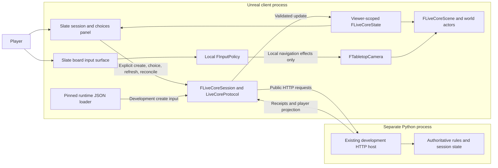

# Architecture

This repository is a C++ Unreal Engine 5.8 presentation client for the separately maintained Python rules Core. It displays authenticated projections and collects player intent; **Core alone validates rules and changes authoritative game state**.

This guide describes the source tree and current component boundaries. The [canonical migration plan](docs/plans/unreal-migration-plan.md) owns scope, priorities and implementation/verification status. The current P1a increment is adding Windows standalone packaging and non-visible checks; source described here is not, by itself, evidence that a package was built or accepted. Use the [README](README.md) for supported commands and the [evidence index](docs/plans/README.md) for observed results.

## Repository map

```text
WarhammerClient.uproject             Runtime module and enabled engine plugins
Source/
  WarhammerClient.Target.cs          Ordinary standalone Game target
  WarhammerClientEditor.Target.cs    Ordinary Editor development target
  WarhammerClientE04A*.Target.cs      Dedicated historical proof targets
  WarhammerClient/
    WarhammerClient.Build.cs         Module dependencies and build-time guards
    Public/                         Reflected public GameMode declaration
    Private/
      WarhammerClient.cpp           Primary game-module registration
      WarhammerClientGameMode.cpp   Live Slate UI, world presentation and lifecycle
      LiveCore/                     HTTP/session state, protocol, runtime data, camera
      Migration/                    Contract/geometry/input helpers and proof GameMode
      Tests/                        Geometry, camera and boundary automation tests
Config/                             Startup map/GameMode, platform and packaging settings
Content/RuntimeData/Core/<revision>/ Pinned development input and provenance
Plugins/E04ProfileProof/             Opt-in profile/parser proof modules
scripts/                            User launchers, Core ownership and development tools
  migration/                        Historical bounded migration proof tooling
tests/migration/                    Script tests and versioned reference fixtures
docs/development/                   Setup and Core runtime instructions
docs/plans/                         Canonical plan, supporting research and public evidence
.local/                             Ignored local runtimes, experiments and private evidence
```

`Binaries/`, `Intermediate/`, `Saved/`, `DerivedDataCache/` and IDE output are generated and ignored. Authored `Source/`, `Config/`, `Content/` and `Plugins/` are tracked. A runnable package is generated output, not a second source tree.

The sibling [Warhammer_40k_AI](../Warhammer_40k_AI/) checkout is reference-only. The selected Core source is `5f509724da25a2f6ded0c2739a8e7c84bdf59c91`, contract **44.3.33**. The sibling [Warhammer_40k_UI_arcade](../Warhammer_40k_UI_arcade/) is the confirmed Python UI parity reference at `5088c1c49dcaff29eb59fb64b3063d30214dde73`; its older Core contract requires explicit adaptation. Neither sibling is edited as a side effect of client work.

## Components and authority



The live client currently uses one development principal, **player-a**, and a loopback `http://127.0.0.1:<port>` endpoint. Admin credentials are used for catalog/create/start operations; displayed state and finite choices come from the player projection. Remote participants, spectators, general session selection and complete gameplay are planned product work, not capabilities implied by the diagram.

### Session, HTTP and protocol

[LiveCoreSession.h](Source/WarhammerClient/Private/LiveCore/LiveCoreSession.h) defines the presentation DTOs and `FLiveCoreSession`. [LiveCoreSession.cpp](Source/WarhammerClient/Private/LiveCore/LiveCoreSession.cpp) contains two related layers:

| Layer | Responsibility |
|---|---|
| `LiveCoreProtocol` | Validate the supported endpoint, metadata/build/contract identity, exact revisions, receipts and viewer-scoped projections; construct public command envelopes. |
| `FLiveCoreSession` | Serialize asynchronous HTTP operations, retain command identity, manage busy/unknown/error state and publish `OnChanged` on the game thread. |
| `FLiveCoreState` | Hold the current viewer's offered choices, board/terrain/objective/placed-model DTOs, known outcome and applied projection identity. It is a presentation snapshot, not a game rules model. |

The code reuses strict JSON/revision/receipt helpers from [Migration/CoreBoundaryEvidence](Source/WarhammerClient/Private/Migration/CoreBoundaryEvidence.h). The `Migration` directory therefore contains some live dependencies as well as proof code; it cannot be removed wholesale as test-only material.

Only one request is active at a time. HTTP completion is delivered on the game thread, and weak callbacks plus generation/request checks discard obsolete completions after shutdown. Credentials stay in memory/environment and are not rendered or written into command logs. Current reads have a 30-second request timeout and mutations 120 seconds; these are transport budgets, not a Core responsiveness guarantee. Response decoding/parsing rejects unsupported or incompatible content rather than inventing state.

`SessionRevision` can advance when a valid command receipt arrives. `ProjectionRevision` advances only after the corresponding projection is validated. `ProjectionVersion` is a local delivery counter for successfully applied snapshots, including a same-revision refresh. The scene uses that delivery counter to refresh its world cache; a receipt alone never pretends that new geometry has arrived.

### Create, submit and refresh

Startup creates the UI and camera but makes no automatic session. **Connect / create session** is an explicit operation; invalid endpoint input cannot fall back to a previous endpoint.

```mermaid
sequenceDiagram
    actor Player
    participant UI as Slate panel
    participant Session as FLiveCoreSession
    participant Data as Runtime data loader
    participant Core as Python Core HTTP host
    participant Scene as Live scene
    Player->>UI: Connect / create session
    UI->>Session: CreateAndStart(endpoint)
    Session->>Core: GET /rules-catalog (admin)
    Core-->>Session: Authenticated catalog response
    Session->>Data: Read pinned session-create JSON
    Data-->>Session: Validated development payload
    Session->>Core: POST /sessions (fresh game ID)
    Core-->>Session: Created session identity
    Session->>Core: POST /sessions/{id}/commands (start)
    Core-->>Session: Validated command receipt
    Session->>Core: GET /sessions/{id}/projection (player-a)
    Core-->>Session: Viewer-scoped state and offered options
    Session-->>UI: OnChanged
    Session-->>Scene: Applied projection version
    Player->>UI: Select a currently offered option
    UI->>Session: Submit original option ID
    Session->>Core: POST exact command envelope and revision
    alt Known receipt with authoritative outcome flags
        Core-->>Session: Accepted or rejected recorded outcome
        Session->>Core: GET player projection
        Core-->>Session: Authoritative refreshed state
        Session-->>UI: Outcome, revision and diagnostics
        Session-->>Scene: Applied projection version
    else Missing, incomplete or flagless outcome
        Session-->>UI: UNKNOWN; new mutations disabled
        Note over UI,Session: Explicit reconcile resends the same retained command bytes and ID
    end
```

The currently demonstrated action is `select_secondary_missions`; this is a finite setup choice, not general gameplay. A current offered option's original request/option IDs and revision are preserved. The client never creates a legal choice or a movement witness merely to satisfy its UI. Known rejection diagnostics remain distinct from transient projection-read errors. A failed refresh clears actionable options; stale choices are not re-enabled.

An uncertain command retains its exact envelope, ID and credential scope for explicit reconciliation. **Uncertain session creation is different:** the create operation has no retry identity in this client, so it blocks automatic retry/recreation. HTTP status and available Core messages remain visible; a timeout or generic error envelope is not treated as proof of rollback.

## Unreal startup, UI and world presentation

[WarhammerClient.cpp](Source/WarhammerClient/Private/WarhammerClient.cpp) registers the runtime module. [DefaultEngine.ini](Config/DefaultEngine.ini) selects `/Engine/Maps/Entry` and `AWarhammerClientGameMode`; the project currently has no authored gameplay map dependency.

[WarhammerClientGameMode.cpp](Source/WarhammerClient/Private/WarhammerClientGameMode.cpp) owns `FLiveCoreScene`. Session lifetime is world/GameMode-scoped, not a GameInstance subsystem that survives level travel. The live UI is C++ Slate rather than an implemented UMG/Blueprint application layer:


- `BeginPlay` initializes the session object, required meshes/material, transient camera and light. Tick attaches the Slate overlay when the viewport/controller is available.
- `SLiveCorePanel` contains endpoint, create, current options, outcome/errors, refresh, reconcile and Frame board controls. The board occupies a separate hit-testable camera surface beside the panel.
- `Changed` rebuilds presentation actors only for a newly applied session/projection delivery. The board is a flat display mesh; real terrain polygon boundaries are thin raised outlines; objectives and placed models use discs. These meshes have no gameplay collision and do not define legality.
- Core coordinates are inches. `DisplayPoint` recenters the board, converts to centimetres and reverses the table Y axis for Unreal display. Models without authoritative poses stay absent; no deployment position is fabricated.
- Teardown unbinds session/application callbacks, detaches widgets before freeing their scene, cancels active HTTP, releases owned input and destroys transient actors. Mesh/material references are held strongly while the scene needs them.

The renderer loads `/Engine/BasicShapes/Cube`, `Cylinder` and `BasicShapeMaterial`; the material must expose its `Color` parameter. These are explicit package resources, not imported miniature art. The current board is an advisory rendering of a narrow DTO subset, not complete terrain/line-of-sight or gameplay visualization.

### Camera and input ownership

[LiveCoreCamera.h/.cpp](Source/WarhammerClient/Private/LiveCore/LiveCoreCamera.h) implements `FTabletopCamera`, a pure local navigation model with no session/HTTP interface. It solves perspective framing from board bounds, the full viewport and the arranged board surface. The camera's lateral shift keeps the full board beside the panel without changing its orientation back toward the unshifted center. Invalid or too-small layouts produce a diagnostic instead of an invalid projection.

The live Slate surface reuses [E02InputPolicy](Source/WarhammerClient/Private/Migration/E02InputPolicy.h) as a local input reducer. Slate owns hit testing, focus and actual capture; the reducer returns orbit/pan/zoom/frame effects. RMB orbits, MMB pans, focused-board wheel zooms, and F or the panel button frames the board. Panel input stays with its controls; only explicit action controls submit Core requests. Camera gestures never submit game commands. Capture is tracked by exact Slate user and pointer, and cancellation handles Escape, focus/capture loss, application events and layout changes.

Same-bounds HTTP refresh preserves navigation; a layout resize may deliberately reframe. The current input implementation is `UIOnly` with an explicit camera surface, not a global input preprocessor or new player pawn.

## Configuration, runtime input and packaging

| Location | Role |
|---|---|
| [WarhammerClient.uproject](WarhammerClient.uproject) | Runtime module and engine plugin selection; ordinary project startup. |
| [WarhammerClient.Build.cs](Source/WarhammerClient/WarhammerClient.Build.cs) | Engine/HTTP/JSON/Slate/procedural-mesh dependencies. AutomationDriver support is enabled only for eligible Editor builds. Historical E02 toolchain guards remain opt-in. |
| [Config/DefaultEngine.ini](Config/DefaultEngine.ini) | Default map/GameMode and Windows DX12/Linux Vulkan target settings. Linux settings do not establish execution. |
| [Config/DefaultGame.ini](Config/DefaultGame.ini) | Project identity and P1a packaging declarations: Entry, engine BasicShapes and the selected runtime-data UFS directory. |
| [LiveCoreRuntimeData](Source/WarhammerClient/Private/LiveCore/LiveCoreRuntimeData.cpp) | Resolve `ProjectContentDir()/RuntimeData/Core/<revision>/session-create.json`, check exact size/checksum, UTF-8 and schema, then return the payload to the session layer. Missing/corrupt input fails visibly. |
| [Runtime provenance](Content/RuntimeData/Core/5f509724da25a2f6ded0c2739a8e7c84bdf59c91/provenance.json) | Selected Core origin, contract and byte identities. Runtime checksum is a consistency check, not authentication. Only `config.game_id` is replaced before the public create request. |

The runtime JSON is deliberately separate from [tests/migration/fixtures](tests/migration/fixtures/). Packaging must not rely on the source checkout's test tree. UFS staging lets Unreal's file APIs read the same content from a checkout or packaged container. `Content` here supplies development input; it does not embed the authoritative Python engine.

The ordinary [Game target](Source/WarhammerClient.Target.cs) is the standalone target; [Editor target](Source/WarhammerClientEditor.Target.cs) retains the normal development route. [Build-ClientPackage.ps1](scripts/Build-ClientPackage.ps1) is the authored build/cook/stage/archive entry point. It invokes the installed engine's AutomationTool through its bundled .NET runtime without a command shell, runs the cooker with NullRHI/RenderOffScreen, and never runs the game or prerequisite installer. It creates a fresh ignored output folder, captures logs and supervises its owned build tree with time/output limits. Build and runtime verification remain separate. The intended Windows Development bundle contains the Game executable, cooked Entry/BasicShapes and dependencies, UFS runtime JSON, configuration and staged engine prerequisites; its generated exact shape belongs to the build result.

[DefaultEngine.ini](Config/DefaultEngine.ini) explicitly selects `WarhammerClientEditor` and `WarhammerClient` as the ordinary build defaults. Historical proof targets remain separate and must not make AutomationTool choose an ambiguous Editor target.

Current launcher source adds explicit packaged executable selection. [Start-Client.ps1](scripts/Start-Client.ps1) accepts `-ClientExecutable`; [Start-Client.py](scripts/Start-Client.py) accepts `--client-executable`. Packaged execution omits the Editor's `.uproject -game` arguments and uses the executable's directory. Editor launch remains available. These code paths and the package build remain subject to P1a review/testing; they do not establish fresh-machine portability or rendered packaged-client acceptance.

[Test-ClientPackage.ps1](scripts/Test-ClientPackage.ps1) is separate non-visible verification tooling. It runs the actual nested Development Game executable with fixed NullRHI/RenderOffScreen flags, validates an exact automation report, and records binary/config/stream/lifecycle evidence. Resources mode has no Core credentials; Core mode uses the existing managed/attached development-host helpers, restores the parent environment and stops only an owned host. It does not automate player input or certify rendered behavior.

## Core process ownership

The C++ process attaches to a service; closing its GameMode does not stop Core or close server sessions. Ownership belongs to the launcher layer, documented in [Core startup](docs/development/core-startup.md):

| Entry point | Ownership |
|---|---|
| [Start-Client.ps1](scripts/Start-Client.ps1), Managed | Start the existing prepared Windows development Core hidden, verify readiness, run the selected client, then stop only the owned Core in cleanup. |
| [Start-Client.ps1](scripts/Start-Client.ps1), Attach | Check the existing service and run the client; closing it leaves the service running. |
| [Start-Client.py](scripts/Start-Client.py) | Manual client launch against an already running Core; verify selected runtime/reference and supply a copied environment. It neither starts nor stops Core. |
| [Start-CoreDevelopmentServer.ps1](scripts/Start-CoreDevelopmentServer.ps1) / [Stop-CoreDevelopmentServer.ps1](scripts/Stop-CoreDevelopmentServer.ps1) | Managed/Attach readiness and owned-process receipts. Shutdown checks recorded process identity; it does not kill by port or process name. |

Credentials are inherited through named environment variables, never command-line tokens or content assets. The development host has development credentials, in-memory state and limited remote guarantees; it is not a production hosting architecture. The prepared Windows environment is not portable to a new machine, and a pinned package install alone does not create its ownership/provenance receipts.

## Tests, experiments and evidence

| Area | What it establishes, within its recorded scope |
|---|---|
| [LiveCore tests](Source/WarhammerClient/Private/LiveCore/) | Protocol/identity/visibility/uncertainty regressions, creation safety, runtime-data failure handling and an explicitly opted-in real-Core create/action/refresh check. |
| [LiveCoreCameraTests](Source/WarhammerClient/Private/Tests/LiveCoreCameraTests.cpp) | Pure framing, finite bounds, navigation preservation and local input policy. |
| [LiveCoreCameraRenderedTests](Source/WarhammerClient/Private/Tests/LiveCoreCameraRenderedTests.cpp) | Dedicated ordinary live Slate/CameraActor input checks with synthetic advisory bounds; requires eligible Editor AutomationDriver support and a real RHI. |
| [Migration tests](Source/WarhammerClient/Private/Tests/) and [script tests](tests/migration/) | Versioned contract/fixture checks, geometry/input and launcher/tool regressions. A parser fixture is not a completed gameplay workflow. |
| [E04ProfileProof plugin](Plugins/E04ProfileProof/E04ProfileProof.uplugin) | Disabled-by-default profile/parser and private ABI experiments selected by dedicated targets. It is not the live HUD/profile implementation. |
| [scripts/migration](scripts/migration/) | Historical E01/E02/E04 bounded proof orchestration and reference capture. Their closed run authority and output do not transfer to routine launch or new packages. Authored roundtrip work remains deferred. |
| [docs/plans/evidence](docs/plans/evidence/) | Public, scoped result summaries. Private raw logs, captures, runtimes and review packets remain under ignored local directories. |

Development automation is conditional on `WITH_DEV_AUTOMATION_TESTS`; fixture-dependent tests need their declared data. The real-Core integration source is Game-compatible, while the rendered camera driver is intentionally Editor-only. NullRHI/RenderOffScreen checks can test package startup/resources and HTTP behavior without a window, but cannot prove pixels, fonts, shaders or physical input. A successful old cooked parser proof is not a successful current live-client package.

## Extension points and current limits

Extend the protocol/session layer for new public Core request families and typed presentation DTOs, then add user-operable controls and scene rendering. Keep rules/visibility in Core, camera/drafts local, and mutation identity/reconciliation centralized. General deployment/movement/turn flows, roster/selection synchronization, adaptive profiles/HUD, remote/spectator UI and durable recovery remain open in the [canonical plan](docs/plans/unreal-migration-plan.md).

Windows has bounded Editor/runtime evidence; standalone package work is in progress. Native Linux build/render/package and a Windows machine without Unreal installed remain unverified. Earlier manual F framing failed with cause unestablished; later synthetic native F checks do not rewrite that historical outcome.

When components, directory responsibilities, dependencies, startup/data flow or package ownership change, update this guide with the code and keep its diagrams/links accurate. Record implementation and observed verification separately in the canonical plan; do not turn an architecture description into an acceptance claim.
