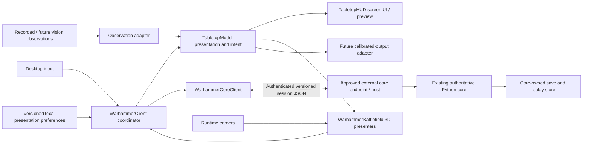
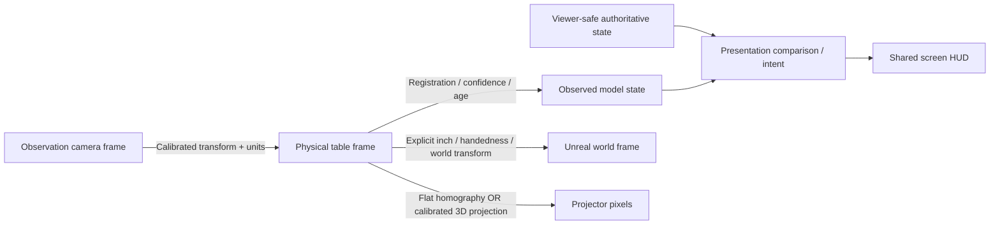

# Python/Arcade client → Unreal Engine: 3D-first migration plan

**Planning date / revision date:** 2026-10-02 / 2026-10-21 UTC
**Revision:** 90 - FOCUSED_SOURCE_PASSED_SHARED_PLUGIN_TARGET_EDITORBUILD_FAILURE_CLOSED. Focused SOURCE/root admission and first four phases PASS for `058deb1` / run `20261021T044229Z-e2488cb8`; EditorBuild FAIL on shared UnrealEditor plugin-support settings before client/plugin C++ compile/link or parser load. Discovery/Native/Audit NOT_RUN, parser attempts zero; closure/checkpoint/OWN18 backup precede any prospective target repair, fresh bindings/affected SOURCE and ordered native phases. No old approval transfer or A1E acceptance.
**Scope decision:** D01 / SCOPE01 **APPROVED**: retain the separate authoritative Python rules engine; this campaign changes the client only.
**Research status:** **RESEARCH_INCOMPLETE** — RQ01–RQ25 require evidence-backed closure or an explicit blocked disposition.
**Execution authority:** OWN11 approved BOOT01 and OWN12 the filed Core HTTP diagnostic issue, with explicit actual-error/fidelity-gap policy. **OWN13 (2026-10-16) authorizes commit/push/PR/merge of the original plan/BOOT01 PR and continuation through the migration plan; later merges require applicable approval.** BOOT01 is complete; OWN14 covers the separately labelled 120-second diagnostic, historical revision4 supplement and revision6 guarded-command/fixture repairs; OWN15 adds the fresh three-role review gate. Sibling edits, new Core host implementation, platform exclusion and unreviewed broad feature work remain outside scope.
**Canonical destination:** `Warhammer_40k_UI_unreal/docs/plans/unreal-migration-plan.md` (this file).
**Review status:** **BOUNDED_E01_SLOW120_ACCEPTANCE_RECORDED**, recorded by root at `2026-10-17T06:00:32.004673+00:00` for reviewed head `b97ed5e8c1b2b2a1472aeb7fb70a267e0eab3d37` against cumulative base `0467ee63fe6d4c775f429afae2233d7292787c31`. CODE r13 is PASS. Valid initial REQ r3 remains BLOCKED on administrative A1/A2; its separate supplement is PASS and closes those items. Root combined those dispositions for this narrow diagnostic; the raw initial REQ verdict remains BLOCKED. Contaminated original REQ r2 is invalid and supplies no approval. Normal execution remains `20261017T044903Z-b0169768` on source `d1189592a5f99bdee58cea25ae8546e5ee2e3623`, with unchanged 87/14/132/2 counts, separate 135 pure PowerShell controls/39 inputs and actual settings/wire/process evidence. Publication is a separate metadata overlay outside the reports' reviewed head. Full E01/M01/M02, research/implementation gates, the original 30-second budget, production responsiveness, UE HTTP, rendering, packaging and Linux remain open. [Final review provenance](evidence/2026-10-17-e01-slow120-final-review-provenance.json); current and historical detail in Section 0.8.

**OWN17 activated after the five closed SOURCE reports:** Special third-layer
harness/generated-response certification and broad transitive graph/witness
certification move to the [optional follow-up](#17-optional-end-of-migration-follow-up),
never PASS. Runtime assertions remain fail-closed and must not be ignored. Ordinary
UBT/dependency/ABI/build-process safety, fresh frozen focused component SOURCE
before native GO, and final CODE/different REQ after actual execution remain required.
The [focused proof packet](research/2026-10-21-e04a-functional-proof-packet.md)
supersedes only that special assurance critical path, not old raw reports or
execution gates. [Closure and scope](research/2026-10-21-e04a-source-assurance-deferral.md).

### Repository routes and provenance

| Name used in this plan | Actual project and responsibility | Start here |
|---|---|---|
| Unreal / destination | `C:\SWDev\warhammer\Warhammer_40k_UI_unreal` — new C++ client, planning and future project sources | [repository instructions](../../AGENTS.md), [plan index](README.md) |
| UI / Arcade / `Warhammer_40k_UI` | `C:\SWDev\warhammer\Warhammer_40k_UI_arcade` — legacy client and behavioral/configuration baseline. `Warhammer_40k_UI` in the owner's request is treated as this project; no third checkout with that name exists here. | [AGENTS](../../../Warhammer_40k_UI_arcade/AGENTS.md), [README](../../../Warhammer_40k_UI_arcade/README.md), [boundary ADR](../../../Warhammer_40k_UI_arcade/docs/adr/0001-ui-core-boundary.md), [plans](../../../Warhammer_40k_UI_arcade/docs/plans/README.md), [source](../../../Warhammer_40k_UI_arcade/src/warhammer40k_arcade_ui/) |
| Core / `Warhammer_40k_AI` | `C:\SWDev\warhammer\Warhammer_40k_AI` — external authoritative Python engine; reference only | [AGENTS](../../../Warhammer_40k_AI/AGENTS.md), [adapter contract](../../../Warhammer_40k_AI/docs/ADAPTER_DECISION_CONTRACT.md), [manifest](../../../Warhammer_40k_AI/contracts/manifest.json), [schemas](../../../Warhammer_40k_AI/contracts/schemas/), [examples](../../../Warhammer_40k_AI/contracts/examples/) |

These sibling links are navigation aids to mutable checkouts. Use the immutable revisions in the research evidence for claims. Do not edit either sibling or reset Core to an older pin. The original [Arcade migration plan](../../../Warhammer_40k_UI_arcade/docs/plans/migration/unreal-migration-plan.md) remains unchanged and is historical; this imported file is canonical for new development. Imported from `Warhammer_40k_UI_arcade@5088c1c49dcaff29eb59fb64b3063d30214dde73:docs/plans/migration/unreal-migration-plan.md`; original SHA256 `265972c1f38127ec147149d262412433e34a47069a0f7f6d6e3fafe50a9fa4d2`.

### Revision 90 changes

Status is **FOCUSED_SOURCE_PASSED_SHARED_PLUGIN_TARGET_EDITORBUILD_FAILURE_CLOSED**.
The [receipt](evidence/2026-10-21-e04a-shared-plugin-target-result.json) and
[closure](research/2026-10-21-e04a-shared-plugin-target-closure.md) bind source
`058deb1168f61e8457fcdf7cee8a1be76bc315bf` / run `20261021T044229Z-e2488cb8`.
Focused SOURCE/root admission and Preflight/SupervisorControls/Configure/
DependencyBuild passed. EditorBuild failed in 42.2335898 seconds: UBT exit 6
rejected `bCompileWithPluginSupport: True != False` on shared UnrealEditor products
before client/plugin C++ compile/link or parser load. The earlier 30-object vendor
build/one archive remains passed. Exit/cleanup are confirmed, no timeout, final
aggregate 2/0; Rules retention is partial with the runtime witness absent and no
EditorBuild completion. Discovery/Native/Audit are NOT_RUN, parser attempts zero;
43/33/50/eight remain planned. Visible zero/Linux UNTESTED. All execution authority
is closed. Checkpoint/push/verify OWN18 backup before reviewing the prospective
target-setting removal; no repair is applied or proved here. Any adopted change
requires fresh exact bindings/affected focused SOURCE and ordered native work.
OWN17/D-P2 remain deferred/unproven/fail-closed; final CODE/different REQ/A1E and
later gates stay open, and standing review consent is unchanged.

### Revision 89 changes (historical)

Status is **UNUSED_MODULE_RULE_CLASSIFIER_REPAIRED_SOURCE_PENDING**. The
[repair receipt](evidence/2026-10-21-e04a-unused-module-rule-repair.json)
records three wrapper hunks/one norm hunk adopted after exact `f7b8429` backup;
each full inverse recovers prior wrapper/norm bytes. The new 36-line
`Assert-UnusedCMakeScanMetadata` and changes only to
`Get-GeneratedBuildInputInventory`/`Read-ConfiguredBuildInputBaseline` add
truthful `unused-cmake-rule-metadata` classification/consumption. Exact two
stanza shapes/cache OFF, exactly one raw literal occurrence globally per exact
special name and one exact raw owner declaration are required. Other occurrences,
including comments/paths/longer identifiers, conservatively refuse.

AST errors are zero, functions 101 to 102, 99 old functions and all seven existing
controls byte-identical. Response/dyndep/script/byte/reference/preservation/
budget guards and 43/33/50/eight requirements are unchanged. The updated
[functional norm](research/2026-10-21-e04a-functional-proof-packet.md), 8293 bytes/
SHA256 `57410E0F5666D4BCFF88CFACD9EBBD1E640F8B1A8D00A00F93EE2422386A5172`,
binds the bounded repair. AST/text only: no helper/control/native runs, actual
classifier Configure/fresh SOURCE/all eight fresh phases NOT_RUN. Closed
`e293ea0` Configure FAIL and earlier failures stay unchanged/no approval transfer.

Checkpoint/push/verify OWN18 exact remote backup, then fresh exact head/run/
freeze/current bindings and affected SOURCE with corrected immutable Ninja
five excerpts/60 rows plus existing CMake 525 rows before ordered native phases.
Installed Ninja binary source provenance is UNVERIFIED. Actual suites/evidence
freeze/final CODE/different REQ remain required for A1E acceptance. OWN17/D-P2
stay deferred/unproven/fail-closed, later fidelity/HUD/input/rendering/Core/
package gates open, visible zero/Linux UNTESTED and standing consent unchanged.

### Revision 88 changes (historical)

Status is **FOCUSED_SOURCE_PASSED_UNUSED_MODULE_RULE_CONFIGURE_FAILURE_CLOSED**.
The [receipt](evidence/2026-10-21-e04a-unused-module-rule-configure-result.json)
and [closure](research/2026-10-21-e04a-unused-module-rule-closure.md) record
technical source `e293ea07cfe2a41dccfb8e2e8cf8477002c89159` and run
`20261021T034847Z-14f6de27`. Focused SOURCE/root admission passed in
869.9143447 seconds, 61 pairs/zero extraction anomalies. Preflight passed in
30.934544 seconds with zero roots; SupervisorControls passed in 51.8500308
seconds with six cases/six roots, seven generated and 18 boundary controls,
including expected RulesError exit 8. Configure failed in 40.2610337 seconds
with `E04A1_GENERATED_INPUT_UNSUPPORTED_PREEXISTING_RESPONSE`, zero secondary
errors and no completion. CMake root 36408 exited 0; scoped cleanup took
6.0348077 seconds overall (root exit observed 0.9783904 seconds), final 22/0.

Cache scanning OFF and real Release ABI compile/executable link passed. All 30
selected object edges are unscanned, no actual response files exist and the guard
rejects unused `@$out.rsp` / `@$DYNDEP_MODULE_MAP_FILE` rule templates. This is
a wrapper/tool limitation, with no observed component compile failure. Root
rehashed 353 retained descriptors, nine settings/33 canonical/33 staged sources/
56 fixtures and 11 partial original/copy pairs. Five later phases/native parser
suites are NOT_RUN, planned 43/33/50/eight unchanged, visible zero/Linux UNTESTED.
All execution authority is CLOSED_DO_NOT_REUSE; no retry or downstream.

Checkpoint/push/verify OWN18 exact remote backup before a bounded unused-template
classification repair (not applied), then fresh exact head/run/freeze/current
bindings and affected focused SOURCE before ordered native work. No old approval
transfers. Actual suites/evidence freeze/final CODE/different REQ remain required
for A1E acceptance. OWN17 stays DEFERRED_UNPROVEN/fail-closed; A1G/A2/all 727/full
fidelity/plain-DEL/HUD/input/rendering/Linux/package/Core gates remain open and
standing private source/API review consent is unchanged.

### Revision 87 changes (historical)

Status is **MODULE_SCAN_CONFIGURATION_REPAIRED_SOURCE_PENDING**. The
[repair receipt](evidence/2026-10-21-e04a-module-scan-repair.json) records only
`-DCMAKE_CXX_SCAN_FOR_MODULES=OFF` in CMake-Options and the exact OFF cache
expectation in Check-CMake for the pinned nonmodule target. The updated
[functional norm](research/2026-10-21-e04a-functional-proof-packet.md), 7443 bytes/
SHA256 `39B9852CDCAEC6842361FA3E4FF730D5958469913C713FC09711DFE548EAAF86`,
binds this configuration, installed primary-source support and future-pin limits.
Existing unsupported-dyndep refusal, real Release ABI/full static build,
compiler/required-forbidden flags/source checks, scoped cleanup and planned
43 inputs/33 generated recipes/50 attempts/eight suites remain unchanged.
AST diagnostics are zero; actual scanning-OFF Configure, fresh SOURCE and all
eight fresh phases are NOT_RUN. Closed `6e2262d` and earlier failed runs remain
unchanged; no old approval transfers and visible count is zero.

Checkpoint/push and verify OWN18 exact remote backup, then derive fresh exact
head/run/freeze/current bindings and obtain affected focused SOURCE before
ordered native work. OWN17 remains DEFERRED_UNPROVEN/fail-closed; final
CODE/different REQ/A1E acceptance, A1G/A2/all 727/full fidelity, plain-DEL,
HUD/input/rendering, Linux, packaging and real-Core play remain open. Linux is
UNTESTED and standing private source/API review consent is unchanged.

### Revision 86 changes (historical)

Status is **FOCUSED_SOURCE_PASSED_DYNDEP_CONFIGURE_FAILURE_CLOSED**. The
[receipt](evidence/2026-10-21-e04a-dyndep-configure-result.json) and
[closure](research/2026-10-21-e04a-dyndep-closure.md) record technical source
`6e2262dfe77deea171b12c742351efaa68a27cbc` and run
`20261021T025602Z-f6f74902`. Focused SOURCE/root admission passed in
1051.7899451 seconds, 80 pairs/zero extraction anomalies. Preflight passed in
31.8576293 seconds with zero roots; SupervisorControls passed in 52.1325947
seconds with six roots/six cases, seven generated and 18 boundary controls.
Configure failed in 40.9745989 seconds with
`E04A1_GENERATED_INPUT_UNSUPPORTED_DYNDEP` and zero secondary errors.

CMake root 36108 exited 0 with real Release ABI compile/executable link; root
exit was observed in 1.3412771 seconds, scoped five-second same-private-job
post-success cleanup took 6.3938272 seconds overall, final 22 total/zero active.
All 30 compiler-alias/required/forbidden flag/source checks passed. The capture
guard correctly refused 30 dyndep bindings from automatic C++20 module scanning.
Root checked 354 retained members including result, nine settings/33 canonical/
33 staged sources/56 fixtures and 11 partial live-copy pairs with matching
observations. Configure completion is absent; five later phases and native
parser suites are NOT_RUN. Planned 43/33/50/eight and visible count zero remain
unchanged; full static-library build success is not established.

Checkpoint/push this closure and verify OWN18 exact remote backup before the
minimal explicit `CMAKE_CXX_SCAN_FOR_MODULES=OFF` plus exact cache expectation
for this nonmodule target, supported by installed primary docs. No repair is
applied here. Fresh head/run/freeze/current bindings and affected focused
SOURCE precede ordered native work; old phase authority is CLOSED_DO_NOT_REUSE
and no approval transfers. OWN17 remains DEFERRED_UNPROVEN/fail-closed; final
CODE/different REQ/A1E acceptance, A1G/A2/all 727/full fidelity, plain-DEL, shared
HUD/input/rendering, Linux, packaging and real-Core play remain open. Standing
private source/API review consent is unchanged.

### Revision 85 changes (historical)

Status is **COMPILER_ALIAS_CONSUMER_REPAIRED_SOURCE_PENDING**. The
[repair receipt](evidence/2026-10-21-e04a-compiler-alias-repair.json) records
only Check-CMake's executable-token consumer change after closure `1c02b1f`
and verified OWN18 backup. The leading quoted/unquoted executable must be
followed by whitespace and an argument. It must name an absolute existing
non-reparse file; literal FullName expansion is checked again and compared with the exact frozen
compiler path. Required/forbidden flags and source checks remain verbatim;
the functional norm is unchanged. Consult the receipt for finite control
results; no fresh SOURCE PASS, native/build or cleanup result is claimed.
All eight fresh phases are NOT_RUN, 43/33/50/eight are unchanged and visible
count is zero. Checkpoint/push/verify OWN18 backup, then derive new exact
head/run/freeze/current bindings and obtain fresh affected focused SOURCE
before the ordered native sequence. No approval transfers from `ebd9ccf`.
OWN17 remains DEFERRED_UNPROVEN/fail-closed; final CODE/different REQ/A1E
acceptance and later gates remain open. Standing review consent is unchanged.

### Revision 84 history

Status is **FOCUSED_SOURCE_PASSED_COMPILER_ALIAS_CONFIGURE_FAILURE_CLOSED**.
The [factual receipt](evidence/2026-10-21-e04a-compiler-alias-configure-result.json)
and [closure](research/2026-10-21-e04a-compiler-alias-closure.md) bind
`ebd9ccf` / run `20261021T021806Z-c899d3a4`. Focused SOURCE PASS/root admission
closed in 843.014817 seconds with 74 pairs/zero extraction anomalies. Preflight
passed in 28.5084403 seconds/zero roots; SupervisorControls passed in
49.2291709 seconds/six roots, including six cases and seven/18 pure controls.
Configure failed in 37.1059373 seconds with
`E04A1_VENDOR_ACTUAL_COMPILE_FLAGS_MISMATCH`, zero secondary errors. CMake
exited 0 in 0.9629399 seconds; real Release ABI compile/link passed, and the
scoped five-second same-job cleanup completed without timeout in 6.0168323
seconds, final 22 total processes/active count 0. All 30 generated compiler
tokens use DOS 8.3 aliases of the frozen `cl.exe`; required flags are present
and forbidden flags absent. The cleanup repair worked; Configure remains FAIL.
Producer after-observations cover nine settings roles, 33 canonical sources,
33 staged sources and 56 fixtures. Five later phases/native parser suites are
NOT_RUN; 43/33/50/eight remain planned, visible count is zero and final
CODE/different REQ/A1E acceptance and later gates remain open. No alias repair
is applied. Checkpoint/push/verify OWN18 backup before narrow absolute compiler
token filesystem canonicalization/exact pinned-path comparison, then fresh
head/run/freeze/input bindings and affected focused SOURCE before new phases.
OWN17 remains DEFERRED_UNPROVEN/fail-closed; standing consent is unchanged.

### Revision 83 history

Status is **SCOPED_CMAKE_JOB_CLEANUP_REPAIRED_SOURCE_PENDING**. The
[repair receipt](evidence/2026-10-21-e04a-owned-job-cleanup-repair.json) records
the source-only cleanup repair under review after closure `7814ba7` and
verified OWN18 backup. An explicit five-second success-root cleanup mode is
scoped to fixed CMake Configure/DependencyBuild roots and existing SUP01.
Other roots retain NaturalDrain. Timeout priority and fail-closed checks remain;
the same private job and an actual final active count of zero are required.
No new SOURCE PASS, native/build result or cleanup success is established.
Counts remain 43 inputs/33 recipes/50 attempts/eight suites; all eight fresh
phases are NOT_RUN and visible count is zero. Checkpoint the repair, verify
OWN18 exact backup, derive new exact head/run/freeze/input bindings and obtain
fresh affected focused SOURCE before a fresh ordered native sequence. The
`5fb13f1` and `9972c75` failed runs remain closed, with no approval transfer.
OWN17 stays DEFERRED_UNPROVEN/fail-closed; final CODE/different REQ/A1E
acceptance and later gates remain open. Standing private source/API review
consent remains in force until explicitly revoked.

### Revision 82 history

Status is **FOCUSED_SOURCE_PASSED_RELEASE_CONFIGURE_TIMEOUT_CLOSED**. The
[factual receipt](evidence/2026-10-21-e04a-release-configure-timeout-result.json)
and [closure](research/2026-10-21-e04a-release-configure-timeout-closure.md)
bind `5fb13f1` / run `20261021T013903Z-9972c927`. Focused SOURCE PASS was
admitted; Preflight passed in 29.1928227 seconds and SupervisorControls in
45.978315 seconds. Configure failed after 599.6380226 seconds: CMake exited 0
after 0.952694 seconds, including real Release ABI compilation/linking, but the
private job stayed active until timeout cleanup. Exit/cleanup are confirmed,
with 22 total processes/final active count 0. The wrapper reported
`E04A1_ROOT_FAILED_OR_CLEANUP_UNVERIFIED` and two
`E04A1_PHASE_DEADLINE_EXCEEDED` errors; no completion marker was published.
Aggregate cleanup delay does not identify a causal descendant. The run is
closed with no future authority transfer; five later phases/native suites are
NOT_RUN, 43/33/50/eight remain planned, and final CODE/different REQ/A1E
acceptance and later gates stay open. Visible count is zero; OWN17 remains
DEFERRED_UNPROVEN/fail-closed. Checkpoint this closure and verify OWN18 backup
before the proposed explicit post-root private-job cleanup repair for CMake
and SUP01 only. No patch is applied; future phases require fresh exact bindings
and affected focused SOURCE. The earlier `9972c75` failure is unchanged.

### Revision 81 history

Status is **CMAKE_PROBE_RELEASE_REPAIRED_SOURCE_PENDING**. The
[repair receipt](evidence/2026-10-21-e04a-cmake-probe-release-repair.json) records
only the wrapper's `CMAKE_TRY_COMPILE_CONFIGURATION=Release` option and exact
Release cache expectation, after closure `3995baf` and verified OWN18 backup.
The functional norm requires actual Release ABI compilation/linking, retained
logs and bounded cleanup, without skipped/forced probes or assertion bypasses.
AST diagnostics are zero; no fresh review, build/test/native result or cleanup
success follows. Parser, fixtures, vendor source, the public ABI, process-safety assertions and 43 inputs/33
recipes/50 attempts/eight suites are unchanged. The failed `9972c75` run is
preserved. Checkpoint/verify OWN18 backup, derive fresh exact head/run/freeze/input
bindings and obtain fresh affected focused SOURCE before a new ordered native
sequence; no prior approval transfers. All eight new phases are NOT_RUN,
visible count is zero, and final CODE/different REQ/A1E acceptance and later
gates remain open. OWN17 remains DEFERRED_UNPROVEN/fail-closed; standing private
source/API review consent remains in force until explicitly revoked.

### Revision 80 history

Status is **FOCUSED_SOURCE_PASSED_CONFIGURE_TIMEOUT_CLOSED**. The
[factual receipt](evidence/2026-10-21-e04a-configure-timeout-result.json) and
[closure](research/2026-10-21-e04a-configure-timeout-closure.md) bind technical
source `9972c75` / run `20261021T005502Z-ef7254a5`. One fresh focused SOURCE
PASS was admitted. Preflight passed in 29.0109635 seconds/zero roots and
SupervisorControls in 46.9326087 seconds/six roots, with six cases, seven
generated-preparation controls, 18 boundary controls and expected ObjSrcMap
RulesError/exit 8. Configure failed in 600.1306091 seconds: CMake exited 0, but
the owned job remained active until timeout cleanup; final active count 0 and
exit/cleanup are confirmed. Producer post-phase preservation and failed-input
retention exceeded their deadline; no sourceAfter/stageAfter/fixturesAfter or
retainedArtifacts were published. The primary error was
`E04A1_ROOT_FAILED_OR_CLEANUP_UNVERIFIED`, followed by two
`E04A1_PHASE_DEADLINE_EXCEEDED` errors. The lingering member's identity/cause is not
directly established. Later five phases and native parser suites are NOT_RUN;
43/33/50/eight remain planned. Final CODE/different REQ, A1E acceptance and broader
gates remain open; visible count 0, OWN17 DEFERRED_UNPROVEN/fail-closed. Checkpoint and
verify OWN18 backup before a narrow CMake probe Release-option/cache review.
No repair or retry is recorded; fresh bindings/affected SOURCE precede a fresh
native sequence. Separate post-close checks matched nine settings roles, 33
canonical sources, 33 staged sources and 56 fixture descriptors; they cannot turn
producer preservation into PASS or establish continuous process membership.

### Revision 79 history

Status is **F13_EXPECTATION_REPAIRED_FOCUSED_SOURCE_PENDING**. The
[F13 receipt](evidence/2026-10-21-e04a-f13-expectation-repair.json) records native
and generated-manifest Observed 2-to-3 for F13 only, retaining F11=2 and all input
bytes/recipes and 43 inputs/33 recipes/50 attempts/eight suites. Closure `584a339` was remotely verified before
repair. The current functional norm supersedes only the old operational packet's
shared diagnostic count; that packet and raw revision78 report are unchanged.
No parser/wrapper behavior, test/build/native result or SOURCE admission follows.
Fresh exact head/run/freeze and focused SOURCE precede native GO; OWN17/fail-closed
policy, standing consent and final/later gates remain unchanged.

### Revision 78 history

Status is **FOCUSED_SOURCE_CLOSED_F13_REPAIR_REQUIRED**. The
[focused closure](research/2026-10-21-e04a-focused-source-f13-closure.md) and
[factual record](evidence/2026-10-21-e04a-focused-source-f13-result.json) preserve
one raw CHANGES_REQUESTED report with declared complete coverage, 65 pairs/zero
extraction anomalies and one P2: F13 expects Observed 2; pinned scanner source yields
3. Root rehashed 12 raw/262 extraction members before first full report read. No
repair, SOURCE admission, native phase GO or execution is recorded. Checkpoint and
backup before repair/rebinding/fresh affected focused SOURCE. OWN17 stays deferred,
runtime checks fail-closed; 43/33/50/eight and final/later gates are unchanged.
Separate Rules86 matched 86/86; C#4/whole18/full SupervisorControls remain NOT_RUN.

### Revision 77 history

Status is **ROUTINE_CONSUMERS_REPAIRED_FOCUSED_SOURCE_PENDING**. The
[routine repair receipt](evidence/2026-10-21-e04a-routine-consumer-repairs.json)
binds two consumer-line changes: count 40-to-43 and strict-empty ObjSrcMap
syntheticFault. Wrapper 500C8148 is 265025 bytes/AST0/101 functions; no execution or
C++/fixture/producer change. Closure `e07c436` was remotely verified first.
New exact source/run freeze and one 1,800-second focused SOURCE pass precede native
phase GO. OWN17/runtime fail-closed policy, 43/50/eight, zero admissions, all native
NOT_RUN and final/later gates remain unchanged.

### Revision 76 history

Status is **SOURCE_CLOSED_TOOL_ASSURANCE_DEFERRED_COMPONENT_PROOF_PENDING**.
The [closure](research/2026-10-21-e04a-source-assurance-deferral.md) and
[factual record](evidence/2026-10-21-e04a-source-assurance-deferral-result.json)
preserve five raw CHANGES_REQUESTED reports/480 pairs, zero anomalies/admissions,
and root's post-close 1,757-descriptor check with zero differences. OWN17 is active
only for special tool/broad transitive certification; deferred is never passed.
Routine count and strict-empty consumer fixes remain planned. Focused component/
caller/build-process safety SOURCE must pass before native phase GO. Rules86 matched
86/86 separately; all eight native phases NOT_RUN, final/later gates remain open.

### Revision 75 history

Status is **NULL_RESPONSE_ENV_REPAIRS_APPLIED_SOURCE_REFRESH_PENDING**. The
[repair checkpoint](research/2026-10-20-e04a-null-response-env-repair-checkpoint.md)
and [factual record](evidence/2026-10-20-e04a-null-response-env-repairs.json) bind
applied null-only first-document, response-file validation and UBT_EXTRA_ARGS
repairs after `b7c7ce1`. All preceding 40 inputs/30 recipes remain; F11-F13 give
43 inputs/33 recipes/50 attempts/eight suites. The strengthened 151-byte F13
addresses a test-observability weakness, not a new parser implementation defect.

One bounded PowerShell host matched all 14 selected response/child-environment
controls in 1.1780307 internal seconds/1.5770549 outer seconds, zero proof/native
roots and no timeout. The four C# checks, current Rules 86 controls and whole
18-case control remain NOT_RUN. No SOURCE or native approval follows. New exact
source/run/input bindings and affected independent SOURCE duties remain pending;
all eight native phases NOT_RUN/no native RunRoot/visible0. A1G/A2/plain-DEL/full
fidelity, final CODE/different REQ and later gates remain open; consent persists.

### Revision 74 history

Status is **VALUE_BUILD_SOURCE_CLOSED_REPAIRS_REQUIRED**. The
[closed value/build SOURCE round](research/2026-10-20-e04a-value-build-source-closure.md)
and [factual record](evidence/2026-10-20-e04a-value-build-source-closure-result.json)
bind publication/technical `beef5663687c92e8773e2596f4beaa5de3d9ae8e`, base
`03d28af` and run `20261020T220644Z-1f48b199`. All five actual jobs closed:
D CHANGES_REQUESTED/77 pairs, W_A PASS/97, W_B CHANGES_REQUESTED/120,
P PASS/80 and I CHANGES_REQUESTED/63; total 437, zero admissions. The five
remaining assignments received no GO or launch. Post-close 2,476 listed files
match with zero differences/conflicts; this is a point-in-time observation.

F01 diagnostic ordering, the generated-input count label, inherited UBT_EXTRA_ARGS
and two response-file validation cases require bounded repair. Preserve the
original 38 expectations/current 40 inputs/30 recipes/47 attempts/eight suites.
P's mandatory delivery was confirmed, but its raw PASS missed F01; raw reports
remain unchanged and no favorable completeness is inferred from ordinary audits.
All eight native phases remain NOT_RUN/no native RunRoot/visible count zero.
Plain-DEL/context-sensitive lexical/A2 production risk and final CODE/different
REQ after execution/evidence freeze, A1G/HUD/Linux/package/full acceptance remain
open. Standing perpetual source/API consent is unchanged.

### Revision 73 history

Status is **VALUE_AND_BUILD_GUARDS_REPAIRED_SOURCE_REFRESH_PENDING**. The
[repair checkpoint](research/2026-10-20-e04a-value-build-repair-checkpoint.md) and
[exact factual index](evidence/2026-10-20-e04a-value-build-repairs.json) bind applied
raw-C0/native-fixture, generated-build-input preservation and early ObjSrcMapFile
refusal repairs after `b553631`; no successor technical commit/run is claimed.
Seven actual-helper offline controls passed in 5.9663258 seconds, zero external/
native roots. The packet plans 40 inputs/30 recipes/47 attempts/eight suites,
preserving the original 38. The future 60-second ObjSrcMap control raises the
SupervisorControls phase from five to six roots, preserving its six existing cases
and 600-second budget; that UBT control is NOT_RUN. Ordinary source checks corrected
preexisting-response handling and nested typed-file membership; actual generator
compatibility remains untested. This finite A1E repair leaves plain-DEL/context-
sensitive lexical/A2 production risk open without waiving applicable A1 criteria.

Checkpoint/refreeze affected source/control/fixture/common/index/assignment inputs
and fresh independent SOURCE duties under unchanged v7.3, including both complete
witnesses. No old PASS/GO transfers, admission, native RunRoot or visible authority.
All eight phases, final CODE/different REQ and A1G/A2/HUD/Linux/package/full
acceptance remain open. Revision72 closure/raw reports and standing consent remain.

### Revision 72 history

Status is **PRACTICAL_SOURCE_CLOSED_REPAIRS_REQUIRED**. The
[repaired-source closure](research/2026-10-20-e04a-repaired-source-closure.md) and
[factual result](evidence/2026-10-20-e04a-repaired-source-result.json) bind publication
`6874c1784d7b2d2dd00019e897768894aa9b66b1`, technical `3b5447e`, base `03d28af`
and run `20261020T203627Z-e262e08c`. All six raw reports are closed: W_A PASS/116
pairs, W_B PASS/72, C PASS/107, P CHANGES_REQUESTED/97, I CHANGES_REQUESTED/70 and
D CHANGES_REQUESTED/122; total 584, zero admissions. Root sealed before first body
reads and completed all bounded ordinary/archival audits. Each witness's 18,522
mandatory source rows were machine-delivered; favorable semantics/full delivery
for C and rejected D/P/I remain UNVERIFIED by those audits. The four other
prepared jobs never received GO/launched.

Post-close rehash matched 1,749 index and 2,101 freeze entries across 2,446 unique
files, with zero differences/conflicts before canonical edits; no continuous
immutability claim or round incident is recorded. Repairs remain proposals:
raw quoted U+0001 (two independent source traces, no parser execution), current
D-ABI-01 generated Ninja/.cmake inputs before consumption, and current D-ABI-02
ObjSrcMapFile XML/CLI path side effects. Qualify these current D identifiers by
this head/run; historical D-ABI-01 radlink/cl-filter findings remain separate.
The C0 mirror proposes 40 inputs/47 attempts/eight suites, preserving all 38 original inputs byte-for-byte and using corrected 32-byte K05. No canonical code repair or tests ran.
Plain DEL/context-sensitive lexical fidelity remains open for A2/production,
without waiving any applicable universal-malformed A1 requirement.

Checkpoint this closure before applying bounded repairs, then rebind affected
source/control/fixture inputs and reviews under unchanged v7.3. No old PASS/GO
transfers. Native phases remain NOT_RUN, no native RunRoot/visible authority,
and final CODE/different REQ, A1G/A2/HUD/Linux/package/full acceptance stay open.

### Revision 71 history

Status is **TOOLCHAIN_GUARDS_REPAIRED_SOURCE_REFRESH_PENDING**. Technical commit
`3b5447e777da76b555215c135977c92a1706282b` adds 14 lines and removes none in
`YamlCpp.Build.cs`. `RejectUnsupportedNativeToolAlternatives` now rejects effective
`WindowsPlatform.bAllowRadLinker`, `bPrintToolChainTimingInfo` and
`WindowsPlatform.bCompilerTrace` at final module construction. The module is
59,007 bytes / 820 rows, SHA256
`9865BADE25264DC00F3774FA80B7C5D391B7BB36020AD44D9FDADAB6689F3557`.
Wrapper, target and test source are unchanged. Ordinary source inspection found
no actionable issue and installed read-only getters support the guards;
compilation/control/native checks remain NOT_RUN. This is not SOURCE approval.

Next derive exact current publication/run/common/index inputs and obtain fresh
affected reviews, including both complete independent witnesses. The
[revision70 closure](research/2026-10-20-e04a-practical-source-closure.md) and
[result](evidence/2026-10-20-e04a-practical-source-result.json) remain immutable
historical records of the pre-repair source. No old PASS transfers; substantive
v7.3 method, zero admissions, native/final gates and standing consent are unchanged.

### Revision 70 history

Status is **PRACTICAL_SOURCE_CLOSED_TOOLCHAIN_REPAIR_REQUIRED**. The
[practical closure](research/2026-10-20-e04a-practical-source-closure.md) and
[factual overlay](evidence/2026-10-20-e04a-practical-source-result.json) preserve
five closed jobs: VALUE BLOCKED/109 pairs, independent VALUE seam BLOCKED/57,
compiler/ABI CHANGES_REQUESTED/84 and the two finite witnesses raw PASS/117 and
PASS/109. Total 476 pairs, zero admissions. Reports were sealed before body reads;
raw reports and the historical profile-result sourceDraft are unchanged.

D-ABI-01 directly confirms unfrozen/unrefused configurable radlink/cl-filter
alternatives; it does not establish active configuration or tool execution.
Repair final module-time refusal of effective `bAllowRadLinker`,
`bPrintToolChainTimingInfo` and `bCompilerTrace`, then refreeze/review affected
source including both whole witnesses. Seven prepared future definitions are
superseded for use after repair; shared index v3 was never created and has no GO.
The conditional Dispose source-order finding remains; pinned framework research
does not demonstrate a normally reachable throwing close for the untouched
synchronous lock. No universal no-throw/unlock/process guarantee or wrapper patch
on that antecedent alone follows.

The ignored BODY013 copy was temporarily deleted through an `RD` alias collision
after all five jobs closed, then restored exactly. Root's post-restoration check
matched 2,344 unique inputs with no conflicts; continuous immutability is not
claimed. This is a documentation checkpoint before technical repair. Substantive
v7.3 criteria, standing perpetual consent and all native/final/later gates remain
unchanged; native phases are NOT_RUN, no native RunRoot and visible authority zero.

### Revision 69 history

Status is **SOURCE_V72_CLOSED_PRACTICAL_METHOD_ADOPTED_BINDINGS_PENDING**.
The [closed v7.2 summary](research/2026-10-20-e04a-v7.2-source-closure.md)
and [factual record](evidence/2026-10-20-e04a-v7.2-source-result.json) preserve
four BLOCKED reports/162 tool pairs, zero admissions, eight unused primary panels
and no integration allocation. All processes closed exit0/cleanup confirmed;
that does not establish source completion. Root sealed and fully read all reports.
The post-close rehash matched 2,576 unique frozen inputs before canonical edits.

RULES/STAGE/VALUE leave mandatory reading incomplete. D001 completed its assigned
source/literal reading but lacks JSON/localization consumer inputs and records an
unselected metadata exposure. Ordinary audits preserve additional administrative
and evidence qualifications. None establishes a new client implementation defect.
[Primary reader research](research/2026-10-20-e04a-json-load-contracts.md) locates
the missing sources, separating raw duplicate occurrences, catalog values,
conditional source expectations and unobserved native behavior.

Root prospectively adopted the [practical v7.3 method](research/2026-10-20-e04a-practical-source-method-v7.3.md)
through its [exact adoption record](evidence/2026-10-20-e04a-practical-method-adoption.json).
It explicitly supersedes blanket full-wrapper/API/record reading in every context,
repeated primary replicas and P/F/constructor machinery. Complete material source,
all substantive seven joins/16 atoms/29 duty texts, global45-unit coverage,
902/49/1561 literal/semantic obligations, independent raw seams and two full
independent finite witnesses remain. Use one shared exact index, concise own
assignments and verified additional relevant primary-source identities.

Actual successor source-unit/workload assignments, index, transport bindings,
publication/run and fresh GO remain pending. No old incomplete report transfers.
All eight current native phases are NOT_RUN; no native RunRoot or visible authority.
Final independent CODE/different REQ and A1G/A2/HUD/Linux/package/acceptance gates
remain separate. Standing private-source/API consent remains perpetual until revoked.

### Revision 68 history

Status is **COMPATIBILITY_CLOSED_ALL_FRESH_BINDINGS_PENDING**. The
[compatibility closure/v7.2 checkpoint](research/2026-10-20-e04a-compat-closed-v7.2-checkpoint.md)
and [factual record](evidence/2026-10-20-e04a-compat-closed-result.json) preserve
all three CLOSED nonblind C reports with literal INCOMPLETE: VALUE_CLIENT 154,
SELECTORS 26 and BUILD 58 captured pairs, 238 total. Root fully read the sealed
reports; bounded ordinary closure audits are complete. Six immutable negative E
records make the retained candidates ineligible in that planned set. The
post-close rehash matched all 2,687 unique frozen input files.

Root adopted v7.2 and selected 17 fresh contexts: 12 primaries plus five
independent integrations, with no retention or new C job. All seven joins,
16 atoms, 29 duties, original whole-BODY/unit/data obligations and both
independent witnesses remain. Exact repaired constructor `B12F0893...`, schema,
new launcher/selector and four unchanged generic transport sources are adopted
source choices. F01 is statically closed; dynamic valid-path/refusal checks are
NOT_RUN and the successor helpers have not been invoked. Eight new raw
definitions are prepared with adoption pending; the other nine templates remain
preserved.

Update/adopt the common assembler owner registry/transport pins before emission.
Derive/adopt exact successor current inputs, common/freeze/own/policy/count/grant
bindings and the 12-predecessor policy, then seal new P/F before fresh panels/GO.
Actual complete child/runtime/duty/finding and integration audits precede root
aggregate closure and any native phase. No F, fresh SOURCE GO or admission exists;
all eight native phases are NOT_RUN and visible authority is zero. R6 raw five
PASS/three BLOCKED/479 pairs, its failed v6 gate and both unused old integrations
remain unchanged. This metadata checkpoint is not acceptance.

### Revision 67 history

The [v7.1 checkpoint and exact-copy index](research/2026-10-20-e04a-v7.1-method-checkpoint.md)
publish the exact adopted [method criteria](research/2026-10-20-e04a-source-composition-packet-v7.1.md),
[clean norms](research/2026-10-20-e04a-fresh-source-norms-v7.1.md),
[UNBOUND template](research/2026-10-20-e04a-source-scope-contract-v7.1.template.json),
immutable duties, binding checklist, ordinary audits and four separate root
adoption/source-choice records. Exact copied PROPOSED/NOT_ADOPTED labels are
authoring provenance; later root adoption covers rules and the UNBOUND design,
not actual current source/scope/count/helper bindings or eligibility.

The conditional route is six retained technical candidates, four fresh primaries,
five fresh independent integrations and three nonblind compatibility cohorts.
All six ordinary original-evidence audits are complete; seven conjunctive pre-E
clauses, narrow BUILD and separate D001 dispositions still determine eligibility.
All seven joins, 16 atoms, 29 local duties, old whole-BODY/unit/data obligations,
original13/902/49/1,561 duties and both witness integrations remain required.
The API input definition adds BODY099/record14 separately; mandatory clean NORM
inputs are separately counted. The original assembler's two-integer/17-string
grouped F01 is statically closed in the adopted typed source choice; dynamic
refusal is untested and no helper ran. The own-panel work is interface only.

Complete/adopt and derive actual bindings before P or panels. Exact P precedes
the three nonblind C cohorts; conditional root E and immutable F precede fresh
SOURCE GO. Actual current-vector integrations, runtime/complete-duty audits and
finding dispositions discharge future obligations in the aggregate before any
native phase. Initial integrations receive neutral own permission/identities
only; E/F are HASH_ONLY and C/E conclusions remain excluded. The prospective
ten-new-PASS-only method is superseded; R6 raw verdicts, its failed old gate,
zero admissions and unused integrations are unchanged. No P/C/E/F/panel/GO,
native phase or visible authority follows this documentation checkpoint.

### Revision 66 history

The closed [R6 summary](research/2026-10-20-e04a-scoped-r6-summary.md) and
[factual record](evidence/2026-10-20-e04a-scoped-r6-result.json) preserve eight
exact raw reports for `73bc2c0` / `20261020T122137Z-3498b937`. The actual freeze
contains 98 BODY files / 50,001 physical rows, 13 selected records / 902 rows /
49 fields / 1,561 references and 33 staged members. All process groups exited0
with cleanup confirmed and no timeout. Five local raw passes are not admissions.
TARGET has incomplete mandatory reading/semantic duties. PLUGIN identifies
missing runtime JSON/FString/map helper contracts. BUILD records an unselected
manifest-property-name exposure; its raw BLOCKED is unchanged. No new client
implementation defect is established by these three different blockers.

The three descriptor-partition ordinary audits support their bounded current
data/coverage claims, with procedural qualifications preserved. Other full
admission audits remain unfinished. Both integrations are UNUSED/no GO/no launch;
the native RunRoot is absent and all eight native phases remain NOT_RUN. No
visible windows remain. Complete useful audits and missing-primary-source
research, then explicitly amend/rebind affected review duties and any proposed
unchanged-assessment eligibility before use. Current v6 requires ten fresh valid
complete passes and supplies no retention path. Preserve original technical
head/run identities; no report becomes fresh by rewriting them. Final CODE and
a different REQ auditor plus all later gates remain required.

### Revision 65 history

Root adopted the [v6 local-duty criteria](research/2026-10-20-e04a-source-composition-packet-v6.md),
[UNBOUND template](research/2026-10-20-e04a-source-scope-contract-v6.template.json)
and [metadata source bindings](evidence/2026-10-20-e04a-v6-local-duty-criteria-adoption.json).
Global duties and owner sets remain intact. Each scope receives its exact local
duty and owned atoms; the integrations independently assess the full applicable
raw union. VALUE additionally reads seven terminal flag units. CLIENT additionally
reads full BODY003 and all held-source, prelaunch and root-call interfaces.
No peer report discharges a local interface or full integration duty.

Exact wrapper/test identities are known from revision 64. Fresh common/norm/body,
complete-unit and global/scope row bindings remain unresolved. Derive them before
the binder may publish panels; retain literal source terminators and complete AST
extents. The adopted binder also retains the 49-field and atomic-owner aggregate
checks. Earlier wording/diff preparation corrections remain preserved. This is
metadata-source/criteria adoption only, with no new review invocation, SOURCE
admission, UBT/native phase or visible-window authority. All ten current complete
valid PASS reports, root audits and the labelled aggregate still precede phases.

### Revision 64 history

Root adopted the [source-preservation repair](research/2026-10-20-e04a-rules-repair-checkpoint.md)
and its [exact source/control bindings](evidence/2026-10-20-e04a-rules-source-preservation-result.json).
All 80 controls passed with zero failures; the owned PowerShell host exited0
without timeout in 31.391131 seconds. The real preparation route checks 33 pairs
through 66 held streams, then rechecks full bytes/membership/topology before the
root. Category maps require their exact path subset, suffix and name without
sorting the observed order. Explicit absent-manifest data, retained-role and
live/copy preservation cases passed, including exact restoration of owned files.

This executes selected PowerShell functions over synthetic data, including
Editor-Build through a throwing no-process seam. No full wrapper CLI, supervisor,
PEReader, actual Rules/private API/UBT, build, Core or GUI result is established.
Preserve the separate earlier 72-case source tuple and preparation corrections;
its passes were not transferred. C# sources and their prior static/reader results
are unchanged and not rerun. Derive current bindings and explicit local duties,
then complete fresh affected SOURCE and both independent integrations before
phases. No old report, admission or GO transfers; later gates remain open.

### Revision 63 history

The closed [R5 summary](research/2026-10-20-e04a-scoped-r5-summary.md) and
[factual record](evidence/2026-10-20-e04a-scoped-r5-result.json) preserve all eight
raw reports and source/destination/staged Git byte checks. No raw pass is admitted
to an aggregate. BUILD F01 requires acquiring member handles before accepting
approved bytes, then rechecking held bytes and full topology immediately before
the owned root. TARGET001 requires exact category-specific map membership,
suffix and name validation. TARGET002 requires explicit missing-manifest data,
retention and preservation controls; production missing-evidence guards already
exist. CLIENT/VALUE material relationship assessments remain incomplete, without
establishing further implementation defects.

All eight review processes exited with cleanup confirmed. Captured pairing is
activity evidence, not semantic completeness. PLUGIN has two and TARGET three
same-turn context records; selected settings match, while their cause and initial
instruction descriptor variants remain unexplained. Other runtime limits remain
explicit. Both integrations are UNUSED/no GO/no launch; all native phases remain
NOT_RUN. Checkpoint these facts, repair the confirmed gaps and prepare explicit
local relationship duties with the full independent integration obligations intact.
No previous approval transfers to amended source. Final CODE/different REQ,
A1G/A2/HUD, Linux, packaging and broader migration gates remain open.

### Revision 62 history

Root adopted the [finite-witness SOURCE amendment](research/2026-10-20-e04a-source-composition-packet-v5.md)
and its [exact source/input bindings](evidence/2026-10-20-e04a-rules-witness-amendment-adoption.json).
BODY095 now includes complete material observer/API and six missing emitted-enum
declarations: 5,751 physical / 5,551 installed literal rows, 50 ranges, 21 origins.
Root read each addition and reconstructed all literal rows against installed
source. BODY098 supplies the complete 154-row source-only validator test; the
33 staged project members remain unchanged. Both integrations require the full
module-side observer in BODY003. All earlier source, data and graph duties remain.

The constructors bind the complete 17-key witness and 32 typed selectors, all
318 distinct source/runtime descriptors, exact literal AST/control-flow units
and all 13 selected records. Ordinary inspection found and repaired array-shape
loss in a metadata comparison and unchecked Git status failures in the binder.
Their prior drafts and six earlier unit-hash preparation failures remain preserved;
the current 34 literal unit hashes match. These checks establish no independent
SOURCE approval or native result.

Use a clean new candidate/run/freeze/common manifest and ten fresh bound panels.
Actual counts must be rederived after clean norm refresh. The prospective review
budget is 5,400 seconds for BUILD, TARGET, PLUGIN and both integrations; other
scopes retain 1,800 seconds. This extends no closed attempt and permits no retry.
Every actual launch still requires exact root verification and its own GO.
All ten valid complete PASS reports, root runtime/input/completeness audits and
the labelled aggregate precede any native phase. Final CODE/different REQ,
A1G/A2/HUD, Linux, packaging and broader acceptance remain open. Standing direct
review-packet consent persists until explicitly revoked.

### Revision 61 history

The [metadata-reader checks](evidence/2026-10-20-e04a-rules-metadata-reader-result.json)
exercise the actual wrapper decoder against two trusted synthetic DLL/PDB pairs.
All six cases passed, including wrong-PDB, source-checksum and missing-PDB
rejections; the child exited 0 in 2,693 ms with confirmed cleanup and no timeout.
The first check stopped at trusted bridge compilation with CS1701 and ran zero
reader cases. Preserve that setup failure separately. The repaired setup permits
only CS1701 after checking the pinned Roslyn .NET 9 / host .NET 10 identities;
suppression itself proves no API equivalence. No emitted fixture was loaded or
executed. Actual Unreal private API accessibility, Rules/cache/runtime joins and
native execution remain untested. The 51-control and static-check sources are
unchanged. Complete the new review packets before the next source campaign.

### Revision 60 history

The [enum-tag repair](evidence/2026-10-20-e04a-rules-enum-tag-result.json)
requires actual Cpp20/V7/Unreal5_8 values before recording their canonical tags.
It preserves the 32-key vector while avoiding ambiguous Latest aliases. The
current seven-source check returns zero diagnostics; wrapper/control bytes
and their 51 results are unchanged. Rebind the target's current source identity,
88 physical rows and affected criteria/counts in the new freeze. No source
review, runtime/private API observation or phase result follows this check.

### Revision 59 history

The [wrapper repair](research/2026-10-20-e04a-rules-witness-repair.md) is canonical
with a maintained pure control script. All 51 synthetic/data/owned-file controls
passed; their [raw report](evidence/2026-10-20-e04a-rules-wrapper-controls.json)
and [bindings](evidence/2026-10-20-e04a-rules-wrapper-result.json) retain the actual
checks and limits. The source requires actual process/type/selector/cache/source/
DLL/PDB/manifest joins, exact retention and later live-output preservation.
The decoder and real UBT/private API paths remain unexecuted. Complete the new
freeze and clean review amendment, including the entire new test source and
expanded API input; derive current complete units/counts and obtain fresh
scoped SOURCE/integrations before phases. Staged membership remains 33. No
old approval or GO transfers; native/final and later gates remain open.

### Revision 58 history

The [producer repair record](research/2026-10-20-e04a-rules-witness-repair.md)
and [static binding record](evidence/2026-10-20-e04a-rules-static-check-result.json)
identify the canonical target/YamlCpp observation producer and both retained
static diagnostics. The repair requires actual target-object/type/selector,
completed cache/source-order, process/runtime and generated artifact witnesses.
It uses finite poststate observations with explicit inference limits. The pure
compiler check found and then cleared five JSON-overload reference errors.
Zero static diagnostics does not establish UBT construction, API accessibility,
DLL/PDB joins, a build or acceptance.

Finish the wrapper's owned direct-UBT process join, metadata-only validation,
retention and later live-output checks, plus meaningful pure rejection controls
and concrete freeze metadata. Preserve the native-output freshness guard and
all existing process/settings/vendor/native limits. Rebind complete source,
API/test inputs and counts, then obtain fresh complete scoped SOURCE and the
independent integrations before phases. No old GO/admission transfers. Standing
private-source/API review consent has no expiry unless explicitly revoked.

### Revision 57 history

The [R4 summary](research/2026-10-20-e04a-scoped-r4-summary.md) and
[factual record](evidence/2026-10-20-e04a-scoped-r4-result.json) close the
`f3f4895` / `20261020T083618Z-ddce956e` campaign. Preserve all seven raw reports,
the plugin timeout/absence/capture failure, current local S_VALUE admission and
complete versus partial ordinary audit boundaries. No integrations or native
phases ran, and no aggregate was constructed.

`S_TARGET_RECEIPT-01` identifies a concrete prospective harness defect: build
success is not conditioned on actual rules assembly/type, transient discovery/
cache/process/source-order witnesses or retained generated BuildRules artifacts.
Root confirmed that source path. Fix its observation and preservation mechanism
without changing installed Unreal or either sibling. Preserve unsupported/missing
states as refusals. D001 also needs a fresh exact-case semantic assessment;
recursive data equality does not repair the collapsed pattern display. Prepare
adequate bounded future review capacity without extending or retrying a closed
attempt. Recompute complete units/counts after source changes, freeze and obtain
current affected independent SOURCE plus integrations before any phase. No
previous local admission transfers automatically. Standing review consent has
no expiry unless explicitly revoked; all other execution/acceptance gates remain.

### Revision 56 history

Root prospectively adopted the [normal rules discovery SOURCE amendment](research/2026-10-20-e04a-source-composition-packet-v4.md)
and its [adoption record](evidence/2026-10-20-e04a-normal-rules-amendment-adoption.json).
The [count-text correction](evidence/2026-10-20-e04a-normal-rules-count-text-correction.json)
supersedes only the earlier unbound template: two stale prose numbers now agree
with the correct numeric counts. The first common packet and ten panels for
`354cab7` / `20261020T082729Z-26fda962` are closed unused, without any GO or review
launch. Preserve those metadata outputs; the corrected template/binder require
a fresh checkpoint/run. No source/duty/budget/runtime criterion changed.
Preserve implementation BODY001–094 and add BODY095 for the complete bounded
normal `RulesCompiler.CreateTargetRulesAssembly` discovery/cache/assembly producer
and material selection dependencies: 4,424 physical rows / 4,332 literal rows,
23 ranges from 16 whole-hash-bound installed origins. Neutral/Arcade move to
BODY096/BODY097. The current-byte reference becomes 97 BODY / 47,410 physical
rows; actual identities and counts must be rederived after normative inputs are
final and the new freeze is constructed. All 13 selected records, 902 descriptor
rows, 1,561 Plugin-reference occurrences and earlier full-body/unit/data/graph
duties remain. BUILD, TARGET and both integrations must inspect complete
BODY081/082/092/093/095. Conditional paths and .NET/Roslyn/OS/framework leaves
remain explicit; the input does not claim universal UBT transitive closure.

SOURCE assesses exact frozen source, textual invocation/selection/membership
and prospective implementation/observation/preservation contracts. Actual stage
topology and source timing, first-scan/cache/process lineage, selected loaded
assembly/type, effective configuration/compiler outputs and activation remain
later native-phase/final-acceptance observations. Their absence before an
authorized native run is not itself SOURCE failure. Concrete source/input/design
gaps still block SOURCE, and source-supported checks must cover each applicable
material path; no runtime obligation or acceptance criterion is waived.

Prospective SOURCE launch budgets are 2,700 seconds for S_BUILD_HOST,
S_TARGET_RECEIPT, I_ABI_BUILD and I_ACTIVATION, and 1,800 seconds for the other
six scopes. Each launch uses one fresh context and one review launch maximum per assessment, with
retry=false and no model change. Bind the selected budget consistently in the
actual packet/runtime/supervisor/GO before use. This is review metadata authority;
native phase budgets and single-phase execution gates are unchanged.

Fresh corrected head/run/campaign/freeze/panel/GO bindings and reviewer
assessments/native results remain pending. All ten fresh independently valid
complete PASS assessments, root admission audits and the labelled aggregate
must precede any phase. Preserve the closed R3 campaign below: ten unchanged raw
reports (eight SOURCE_PASS/two BLOCKED), ABI capacity failure without a report,
eleven closed invocations and 743 retained tool pairs. Root initially admitted
eight scopes, then withdrew TARGET/BUILD; six remain limited to old scopes and
none transfers to amended source. All eight native phases remain NOT RUN/no
native RunRoot. Final CODE/different REQ, A1G/A2, shared HUD/render/input, Linux,
packaging and broader gates remain open. Standing review consent persists.

### Revision 55 history

The [R3 summary](research/2026-10-20-e04a-scoped-r3-summary.md) and
[factual record](evidence/2026-10-20-e04a-scoped-r3-result.json) preserve eleven
closed review invocations, ten byte-exact reports and 743 tool input/output pairs.
Root initially admitted eight primary/data scopes in a partial record, then
withdrew TARGET and BUILD after the discovery gap was confirmed. Six admissions
remain limited to their old scopes; the complete ten-scope SOURCE gate is false.
The original incomplete plugin
BLOCKED report remains separate from its fresh complete SOURCE_PASS replacement.

I_ACTIVATION-B01 identifies missing `RulesCompiler.CreateTargetRulesAssembly`
producer/discovery source, while preserving complete physical exposure of its
42 mandatory BODY files / 20,291 rows and incomplete compiler/binding semantic
display qualifications. This is a packet gap; no implementation defect or actual
target-discovery failure is asserted. ABI exited 1 after “Selected model is at
capacity. Please try a different model.” It produced no report or SOURCE verdict.
Every process confirmed cleanup and no timeout. The same-boundary ABI replacement
metadata is superseded and closed without GO/launch.

The source inventory remains 96 BODY / 42,986 rows and 13 selected records /
902 descriptor rows / 1,561 references. Prepare the complete normal discovery/
assembly producer and material dependencies, prospectively adopt the amendment,
then derive/refreeze fresh exact bindings and obtain current affected SOURCE
plus independent integrations. The eight local admissions do not approve amended
source. All eight native phases remain NOT RUN/no native RunRoot; final
CODE/different REQ, A1G/A2, HUD/render/input, Linux and packaging remain open.
Standing private-source/API review consent persists until explicitly revoked.

### Revision 54 history

Root prospectively adopted the [startup and target-selection SOURCE amendment](research/2026-10-20-e04a-source-composition-packet-v3.md).
The [adoption record](evidence/2026-10-20-e04a-startup-target-amendment-adoption.json)
binds the new literal inputs, pure criteria/unbound contract and source-inspected
metadata-helper proposals. Existing BODY001–092 ordering is retained; new
BODY093 adds 2,018 physical rows for complete target creation/configuration/
finalization and alternate all-modules setup, and BODY094 adds 5,539 rows for
Default startup plus explicit load/mount implementations, default arguments and
finite material callers. Neutral/Arcade move to BODY095/BODY096. All old full-body/unit/data
duties and ten-context independent assessment/aggregate requirements remain.

The dedicated target now explicitly assigns `bBuildAllModules=false`. Its current
source is 593 bytes / 16 rows, SHA256
`1FE8F99EC560DD6C592C5DAB3434092E0A7AE313B2597BE6126C5212C25C1991`.
This is authored, unexecuted source and does not establish actual effective
configuration, discovery, compilation or startup. The reference inventory is
96 BODY files / 42,986 rows before any later norm-artifact row changes, retaining
13 selected records, 902 descriptor rows and 1,561 reference occurrences.
All relevant composition criteria must be directly delivered through the bound
contract, own scope and complete prompt; this workflow document adds no BODY.

Exact fresh subject/run/freeze/campaign/panel bindings and GO are pending.
No new metadata-helper invocation, review or native/phase result follows from
the adoption. R2 retains six raw local SOURCE_PASS/two BLOCKED with zero
aggregate-admitted passes; its integration directories remain unused without
GO/launch, all eight phases are NOT RUN and no native RunRoot exists. Standing
private-source/API consent is unchanged. Final CODE/different REQ, A1G, A2's
727 scenarios, shared HUD/render/input, Linux, packaging and broader gates remain
separate and open.

### Revision 53 history

The second [scoped SOURCE campaign summary](research/2026-10-20-e04a-scoped-r2-summary.md)
records **SCOPED_SOURCE_BLOCKED_STARTUP_AND_ALL_MODULES** for
`7ef9358d836ed75b9d8ebc40b26c1b8f74af6ac4` /
`20261020T052654Z-6fe9feeb`, against base
`03d28af606fc6c57d20915f746296b0d843211c6`. The exact inventory is
94 BODY files / 35,428 rows and 13 selected records / 902 descriptor rows,
with 414 captured tool input/output pairs. All eight distinct review sessions
closed with exit 0, confirmed cleanup and no timeout. Six raw local SOURCE_PASS
reports and two BLOCKED reports remain unchanged; zero passes are aggregate-admitted.
The [factual record](evidence/2026-10-20-e04a-scoped-r2-result.json) binds the
immutable raw reports, seals, closure and runtime limits.

TARGET-B01 identifies unresolved effective XML-configurable `bBuildAllModules`
and an ungranted alternate `PreBuildSetup` route. TARGET-B02 / PLUGIN-B1 require
the complete Default-phase startup caller. PLUGIN-B2 requires complete explicit
plugin load/mount implementations and their material callers. These packet gaps
do not assert an implementation defect. All eight phases are NOT RUN; no native
RunRoot exists. Both integration metadata directories are unused, without GO
or review launch. Future repair proposals are being prepared, not adopted,
implemented or natively proved. Fresh affected SOURCE, blind integrations, root
admission and a labelled aggregate remain prerequisites to any phase. Backend
memory internals and lower-level isolation remain unverified. Revision 52 and
all prior history, standing review consent and separate final CODE/different REQ,
A1G/A2, HUD, Linux and packaging gates remain unchanged.

### Revision 52 history

Root prospectively adopted the [target-rule SOURCE amendment](research/2026-10-20-e04a-source-composition-packet-v2.md).
Its reference inventory is 94 BODY files / 35,428 rows, including the new
2,968-row literal target-rule/default/initialization input, with all earlier
source/data/unit duties retained. Exactly three immutable common criteria
records receive explicit metadata grants; generated runtime/invocation bodies
remain ungranted, and field queries must preserve actual presence and values.
The [adoption record](evidence/2026-10-20-e04a-target-rule-amendment-adoption.json) binds the unbound v5 template, independent
literal/coverage checks and root-inspected metadata-helper proposals.
Exact candidate/run/campaign/panel bindings are not ready; helpers are
uninvoked. All ten fresh complete valid PASS assessments and root admission
audits remain required before any phase. The first campaign's seven raw local
passes/one BLOCKED and observed deviations remain unchanged. No aggregate,
native/phase GO, acceptance or merge follows. Implementation and historical
path controls are unchanged/not rerun; A1G/A2/final CODE/different REQ/Linux
and broader gates remain open. Standing review consent persists until revoked.

### Revision 51 history

Eight fresh initial scoped SOURCE reviews are closed for `f7f77eb` / run
`20261020T044205Z-14143fc0`: seven raw local SOURCE_PASS reports and one
BLOCKED target/receipt report. `TARGET-RECEIPT-B01` identifies missing complete
inherited plugin-dependency hook and target-selector defaults/initialization
primary inputs, without asserting an implementation defect. All eight raw
reports were sealed before body reads and preserved unchanged; both integrations
remain NOT LAUNCHED. No local pass is admitted to an aggregate. The
[factual record](evidence/2026-10-20-e04a-scoped-r1-result.json) binds closure and limitations. Amend/refreeze the necessary
primary inputs and exact access guidance, then obtain fresh affected SOURCE
and blind integrations. All eight phases remain NOT RUN/no native RunRoot;
implementation and historical path controls are unchanged/not rerun. Final
CODE/different REQ, A1G/A2, Linux and broader gates remain open. Standing
private-source/API review consent persists until explicit revocation.

The [root campaign summary](research/2026-10-20-e04a-scoped-r1-summary.md)
links all eight immutable raw reports. Closed trace audits preserve ungranted
common-policy and own generated-runtime accesses, synthetic null recovery and
actual source exposure. These are not retroactively granted or silently accepted.
The campaign is CLOSED_BLOCKED_DO_NOT_REUSE; no integration or phase GO exists.

### Revision 50 history

Root has prospectively adopted the [ten-context SOURCE composition packet](research/2026-10-20-e04a-source-composition-packet.md):
five fresh blind primary SOURCE scopes, three complete descriptor-data partitions
and two fresh blind integrations after the eight primary/data reports are sealed.
The [adoption record](evidence/2026-10-20-e04a-source-composition-adoption.json)
binds this prospective decision. Every one of the ten must be independently valid, complete and PASS, followed by
root runtime/input/output/scope/completeness audits and a labelled aggregate
SOURCE disposition. Preserve the full reference 93-BODY union, all 13 selected
metadata records/902 rows, all 1,561 Plugin-reference occurrences and material
relationships; derive actual new frozen identities/counts. Exact-candidate
packets, contracts/manifests/policies/prompts and runtime bindings are not ready.
The immutable transport is unchanged; root separately enforces scope/campaign/
full-prompt bindings and the aggregate gate. `sourceReviewed.report` must bind
the labelled root aggregate JSON; the wrapper does not automatically validate
all child reports. This adoption grants no review launch GO, native/phase GO,
acceptance or merge. Raw r7 and all earlier records remain unchanged; all eight
phases remain NOT RUN/no native RunRoot. Final CODE/different REQ and A1G/A2/
broader gates remain separate. Standing review consent persists until revoked.

The adopted composition criteria change neither implementation nor the staged
33-member/18-authored-path scope. They require exact local SHA-bound duties with
global positively granted source/data access, complete primary/common union,
complete literal/absence/identity ownership and independent runtime/build/
cross-system semantics. The two integration assessments remain blind to peer
reports/data/graphs despite their later launch order. All raw scoped reports
must be preserved; root composition cannot rewrite them or replace final
CODE/different REQ. Packet construction and binding are pending; design adoption
is not a review verdict or execution authorization.

### Revision 49 history

The seventh [E04-A1E SOURCE report](research/2026-10-20-e04a-source-review-r7.md)
is raw **BLOCKED** for `e505b21` / run `20261020T041347Z-5175df78`.
It completed 55 of 93 BODY files; all 33 staged members now have BODY grants.
The 13-record/902-row metadata assessment remains incomplete. No confirmed
implementation defect or binding/access denial was established. The
[factual record](evidence/2026-10-20-e04a-source-r7-result.json)
preserves this uncertainty. The review is closed; all eight phases remain NOT RUN
and no native RunRoot exists. A prospective blind scoped SOURCE design plus a
fresh independent integration assessment is being prepared, **not yet adopted**.
It must retain complete current 93-file coverage across the scopes, all 13/902
selected metadata and material relationships, with no waived criterion before
any phase. Separate final CODE/different REQ remain required. The existing path
repair and 21 passing pure PowerShell controls are unchanged/not rerun; historical
r6/r5 reports and c500f21 phase results remain unchanged. Standing review consent
persists until explicit revocation; A1G, A2 and broader gates remain open.

A preceding source launch refused the metadata category `CONFIG` before any
reviewer started. The v3 category `SOURCE` correction enabled the subsequent
closed r7 assessment; neither event executed a native phase or changed the
implementation. The full staged-source grant inventory is now represented in
that reviewed packet. Prospective decomposition must assign complete source
and selected-data responsibilities and independently assess interfaces, without
priming fresh initial reviewers with peer verdict bodies. No scoped-review
model or combined gate has yet been adopted, and no waiver or execution GO is
created by preparing it. The [packet](research/2026-10-19-e04a-profile-packet.md)
remains normative.

### Revision 48 history

The sixth [E04-A1E SOURCE report](research/2026-10-20-e04a-source-review-r6.md)
is raw **BLOCKED** for `0ed4221` / run `20261020T035315Z-1e4656b7`.
It inspected 48 of 81 BODY files; the 13-record/902-row metadata assessment is
incomplete. Existing staged client/test/settings files lack positive BODY grants.
This is unresolved review scope, with no implementation defect asserted. The
[factual record](evidence/2026-10-20-e04a-source-r6-result.json)
preserves the limitations. All eight phases for this candidate remain NOT RUN;
there is no native RunRoot. Root has authored the staged-source BODY-grant
inventory proposal, without implementation changes. The root-inspected ordinary inventory proposal adds 12 missing BODY files / 5,906 rows and covers all 33 staged members. Its current-byte estimate is 93 BODY files / 32,460 rows; the actual future frozen inventory must derive and verify those counts. The path repair and 21 passing pure
PowerShell cases are unchanged and were not rerun. A new complete source
inventory, neutral packet/freeze/RunId and fresh SOURCE precede any phase;
future BODY counts must come from that inventory. Old c500f21 Preflight/SUP PASS
and Configure FAIL remain historical. Final CODE/different REQ, A1G, A2 and
broader gates remain open. Standing review consent persists until revoked.

The closed review ran in a fresh exec with read-only sandbox and approval policy
`never`; disabled-memory metadata was recorded. The owned job ended at zero
active processes after 285 aggregate processes and 289.041 seconds. Lower
isolation remains unverified. These runtime observations establish no native
phase result and do not supply missing substantive source/metadata coverage.
The [packet](research/2026-10-19-e04a-profile-packet.md) remains normative; no
criterion or grant is waived. The ordinary sealed trace audit retained 39 paired
calls with exit 0 and no truncation: 48/81 BODY files correspond to 8,545/26,554
physical rows. Selected-metadata assessment remains incomplete; these audit facts
do not supply missing review coverage or acceptance.

### Revision 47 history

The fifth [E04-A1E SOURCE report](research/2026-10-20-e04a-source-review-r5.md)
is raw **SOURCE_PASS** for `c500f210e59e2db193a76e0339d8ca30a31aa1ec`,
base `03d28af606fc6c57d20915f746296b0d843211c6`, run
`20261020T024733Z-0781e386`. Root recorded its bounded Editor-only source gate
with the [factual record's](evidence/2026-10-20-e04a-source-r5-result.json)
compact-rendering and isolation qualifications. This source result does not
approve the subsequent repair or establish experiment acceptance.

Preflight passed with zero native roots. Six SupervisorControls cases passed in
three groups/five owned roots; expected raw timeout/fault failures remain raw
FAIL. Configure then failed. Root CMake exited 1 after about 0.859 seconds because
the generated `CMakeRCCompiler.cmake` rejected the explicit SDK `rc.exe` path's
unescaped `\P`. One unidentified private-job member remained active until the
reserved timeout shutdown; termination/cleanup were confirmed and the final job
active count was zero. Producer post-phase preservation exceeded its deadline,
so Configure has no completion marker and remains failed.

Separate root post-close observations matched 1,885 frozen files, 33 staged
sources, 51 fixtures and all nine producer settings pairs against Preflight.
These observations are distinct from the producer's missing preservation fields
and empty retained-artifact inventory; they do not turn Configure into PASS.
The run is **CLOSED_FAILED_CONFIGURE_DO_NOT_REUSE**. DependencyBuild, EditorBuild,
Discovery, Native and Audit are NOT RUN; eight parser suites/38 inputs/45 attempts
remain planned, not measured.

The CMake path serialization repair is authored, preserving explicit absolute
tool identities and actual compiler-flag checks. All 21 pure PowerShell offline
cases passed with zero failures (external pwsh exit 0, 2.727 seconds); no native
CMake/compiler/build/phase ran. Supervisor behavior and timeout budgets are unchanged; successful-root
lingering-member behavior is not newly proved. Checkpoint the coherent repair
under OWN16, bind a new candidate/freeze/RunId and obtain fresh affected SOURCE
before any new phase. Final independent CODE/different REQ, A1G, all 727 A2
scenarios, shared HUD/render/input, Linux, packages and broader gates remain open.
Standing necessary private-source/API review consent persists until explicit
revocation. No publication or merge authority is added.

### Revision 46 history

The fourth [E04-A1E SOURCE report](research/2026-10-20-e04a-source-review-r4.md)
is raw **BLOCKED** for `d39b7b84dab24495f583728213afd984766957b8`, base
`03d28af606fc6c57d20915f746296b0d843211c6`, planned run `20261020T023034Z-0b7a1fb0`.
Only IDs 001–013, 044–045, 049–050 and 077–078 were substantively inspected
(19 of 78); the other 59 remain UNASSESSED. All 902 indexed origin/value checks
were reported consistent, but the 1561 reference relationships remain incomplete.
An oversized initial dump emitted unselected sourceHeadQualification and
closureLimits fields. They contain coordinator qualification/provenance claims;
no earlier peer merits verdict was visibly exposed. This does not waive the
selected-field rule or provide approval. The [factual record](evidence/2026-10-20-e04a-source-r4-result.json)
preserves the exact report, 33 closed command/output pairs, truncations and limits.

No new implementation defect was established. The DDC repair and its 21-case /
63-check offline result are unchanged. Review delivery now starts with a compact
identity/selector bootstrap and positive metadata queries before complete body
inspection. All 78 source files, 13 selected metadata records and 902 descriptor
rows/material relationships remain required; no split assessment, sampling or
criterion waiver is adopted. All eight phases remain NOT RUN, and the attempt is
CLOSED_DO_NOT_REUSE. Checkpoint metadata, refreeze a new candidate/RunId and obtain
complete fresh affected SOURCE. Earlier reports remain unchanged. Standing consent
persists until revoked; A1G, A2/HUD, Linux, packaging and broader gates remain open.

### Revision 45 history

The third [E04-A1E SOURCE report](research/2026-10-20-e04a-source-review-r3.md)
is raw **BLOCKED** for `745517014f1efbc7625ff88592543200337424b2`, base
`03d28af606fc6c57d20915f746296b0d843211c6`, planned run `20261020T020719Z-20adc2c5`.
It substantively inspected 52 of 78 required BODY files; IDs 040, 046 and
049–072 remain UNASSESSED. The 902 descriptor origin/value comparisons do not
complete semantic assessment. The [factual record](evidence/2026-10-20-e04a-source-r3-result.json)
preserves the exact raw report, closed runtime, limited coverage and scope audit.
No A1E RunRoot or phase exists; this authority is CLOSED_DO_NOT_REUSE.

Root confirmed F01: an incidental owned DDC path mention did not establish an
active writable store, and installed graph-switch diagnostics escaped the guard.
The repaired pure validator requires the exact E04A1 owned path's Writable
registration and rejects both Failed to create graph and Attempting to create
graph messages. It preserves fatal/plugin/environment and earlier fallback
guards. Twenty-one synthetic offline cases / 63 checks passed; this proves log
validation only. The packet's owned-DDC requirement and limits are unchanged.
Checkpoint, new freeze/RunId and complete fresh affected SOURCE are required
before execution. The two earlier raw assessments remain unchanged. A1G,
A2's 727 scenarios, shared HUD/render/input, Linux, packages and broader gates
remain open. Standing source/API transmission consent persists until revoked.

### Revision 44 history

The fresh [E04-A1E SOURCE report](research/2026-10-20-e04a-source-review-r2.md)
is **CHANGES_REQUESTED** for `3791b43dd5966b49c5abc2926fb989aea587d941`, base
`03d28af606fc6c57d20915f746296b0d843211c6`, planned run `20261020T013901Z-4761d5fc`.
It found a missing `Parse-JsonLine` definition used by the required supervisor
validator. Root independently confirmed the call and absent definition. The
[factual record](evidence/2026-10-20-e04a-source-r2-result.json) preserves the raw
report and closed runtime. All eight phases remain NOT RUN; authority is
CLOSED_DO_NOT_REUSE. The earlier raw BLOCKED report remains unchanged.

The exact E02 parser function is now restored in the E04 wrapper, retaining
size/depth, duplicate/case-colliding-key and UTC-string handling. Fifteen pure
offline cases / 38 checks passed; a fresh affected SOURCE review is required.
This repair is not a supervisor, build or native execution result. The review reports
complete inspection of 78 BODY files / 26413 physical rows and 13 selected metadata
records, including 902 descriptor selectors. Closed-session coverage and scope
auditing are separate operator evidence and do not turn CHANGES_REQUESTED into PASS.
New candidate bindings and a new RunId must precede any phase decision. Standing
review transmission consent persists until explicit revocation. A1G, A2's 727
scenarios, shared HUD/render/input, Linux, packaging and broader gates remain open.

### Revision 43 history

The first independent [E04-A1E SOURCE report](research/2026-10-20-e04a-source-review-r1.md)
is raw **BLOCKED** for `c6a9410a524649147f157c3c17a2b838c7e0fc81`, base
`03d28af606fc6c57d20915f746296b0d843211c6`, planned run `20261020T010406Z-a7dec142`.
It requires primary plugin/target discovery, target-receipt and UE-CmdLineArgs
implementations, plus response normalization, VFS, shared-PCH and generated
definition placement seams. No confirmed C++ defect or runtime build failure is
reported. One metadata projection emitted excluded `selectedRanges.purpose`
strings; a later narrower projection does not undo that exposure. The
[factual record](evidence/2026-10-20-e04a-source-r1-result.json) preserves the raw
report, exact runtime/prompt bindings, 59 tool input/output pairs and the limited
mechanical observation of 47 files / 12152 physical rows. Row visibility is not
comprehension or approval. The review/run authority is CLOSED_DO_NOT_REUSE, and
no A1E native RunRoot or phase exists.

The two proof modules now request `PCHUsageMode.NoPCHs`; the bounded UBT command
passes `-NoVFS`. Installed primary source supports these proof-only choices,
which remove shared-PCH topology and bind the virtual-path choice without
relaxing stage-owned path checks. This is authored and UNEXECUTED; it does not
claim the prior candidate emitted an escaping path. Complete the clean primary
API amendments, checkpoint/freeze the changed candidate and obtain fresh
affected SOURCE with a new RunId before any phase. The original promotion record
remains historical and does not bind later changed bytes. A1G, all 727 A2
scenarios, shared HUD/render/input, Linux, packaging and broader gates remain open.

The owner directly clarified: “All reviews with private source/API are approved
in perpetuity unless revoked explicitly.  This is a low stakes project.” This
answers the E04 payload/destination question and extends standing review-packet
transmission consent indefinitely until explicit revocation. Do not ask again
for the same necessary scope and configured OpenAI Codex destination. Credentials
and unrelated sessions stay excluded; OWN15 roles, freeze and applicable
execution/acceptance gates remain.

### Revision 42 history

The exact 18-path E04-A1E source set is now canonical. Its
[promotion record](evidence/2026-10-20-e04a-source-promotion.json) binds the
unchanged source-preparation bytes copied after checkpoint
`03d28af606fc6c57d20915f746296b0d843211c6`. The actual
[packet](research/2026-10-19-e04a-profile-packet.md) and
[journal](evidence/2026-10-19-e04a-profile.md) remain dated source-preparation
records. Promotion is not a SOURCE result, build, native test or acceptance.
The next candidate checkpoint/freeze and fresh affected SOURCE review are pending.

All eight phases—Preflight, SupervisorControls, Configure, DependencyBuild,
EditorBuild, Discovery, Native and Audit—are NOT RUN. Eight suites, 38 unique IDs
and 45 attempts are planned. The installed Editor target policy enables
exceptions; A1G's genuine exception-disabled runtime caller remains required
before full A1/RQ11/production adoption. A2 retains all 727 compatibility
scenarios; E04-B shared HUD/render/input, Linux and packaging remain open.
No execution, publication or merge authority follows source promotion.

Revision 41 accidentally replaced the first `Current assignment` paragraph,
inside revision 17 history, while leaving the actual Section 0 assignment stale.
This revision restores that historical paragraph exactly from the `d7e5076` Git
blob and updates the active assignment within the Section 0 heading, along with
the current readiness routing. It preserves the recorded bounded E02 disposition,
raw reports, original failures, limits and closed, consumed window authority.

### Revision 41 history

Root records **BOUNDED_E02_WINDOWS_SYNTHETIC_ACCEPTANCE_RECORDED** for the
unchanged synthetic Windows proof. Technical reviewed subject remains `3a1d179`,
comparison base `bd801233` and execution `5e92ba3`/run `202805`; the new limited
administrative review bound clean metadata checkpoint `d7e5076`. The
[approval-recovery supplement](research/2026-10-20-e02-final-requirements-approval-recovery.md)
is SUPPLEMENTAL_PASS for the two remaining administrative findings only. Root
combines it with the distinct closed technical assessments and separate SOURCE
prerequisite verification. Original CODE r3, REQ r2 and supplement v4 remain raw
BLOCKED. The [combined disposition](evidence/2026-10-20-e02-bounded-acceptance.json)
records exact reports/runtime/audit identities and the narrow acceptance limits.

Recovered original service objects place the answer before the first launch.
The parent reports independent retrieval; root/auditor received trusted selected
complete objects, not a locally verified whole service response. Partial response
and absent explicit reply-edge qualifications remain, as do the original relay
timestamp/false retrieval flag. Historical checkpoint `1c99360` remains UNREVIEWED_FOR_ACCEPTANCE;
its original omission/noncompliance and open RQ25/E09 are preserved.

All execution authority is CLOSED_DO_NOT_REUSE, both windows consumed, zero remain.
16 native cases / 18174 assertions, six separate supervisor cases (`SUP6`), six PNG images and effective-pixel precision limits
are unchanged. Full E02/M02, RQ23/RQ24, Linux, packages, real-Core play, full HUD/
profiles and the recorded physical-input/provider/process/network gaps remain open.
No publication or merge authority follows this root disposition.

Continue E04-A1E's source freeze and affected SOURCE review: 18 source paths,
eight proposed suites/38 inputs/45 attempts and acquired pinned yaml-cpp source.
Actual Editor exceptions are ON. E04-A1G's real exception-disabled runtime caller
remains required before full A1/RQ11/adoption; A2 keeps 727 compatibility scenarios
and E04-B retains shared HUD/render/input proof. No A1 configure/build/native test
has run and no affected SOURCE verdict is established yet.

### Revision 40 history

Final reviewed candidate `3a1d17902f6fa94b6009c0cae573da8bf7dff063`, against
cumulative base `bd801233cc9989e0ae146a3be7b136d26dc73183`, now has closed
[CODE r3](research/2026-10-20-e02-final-code-r3.md),
[REQ r2](research/2026-10-20-e02-final-requirements-r2.md) and a separate
postsealed [limited supplement v4](research/2026-10-20-e02-final-requirements-supplement-v4.md).
All three raw verdicts remain **BLOCKED**. Root separately verified CODE's opaque
affected-SOURCE prerequisite. The supplement resolves reading-count, hash-gate
and administrative source-binding concerns; no fundamental contamination requiring
a fresh initial assessment was established. The [final-review provenance](evidence/2026-10-20-e02-final-review-provenance.json)
records exact reports, limits and closure; this overlay supplies no new independent approval.

Historical checkpoint `1c99360` omitted independent-review status in its message.
Root's present clarification is **UNREVIEWED_FOR_ACCEPTANCE**, because no separate
independent approval is established. Original history/noncompliance is preserved;
RQ25/E09 remain open/unexecuted. Independent retrieval/timing verification of the
original prelaunch approval remains pending owner factual clarification. Current
status is **EXECUTION_PASS_FINAL_ACCEPTANCE_BLOCKED_ADMIN**; an answer does not
itself establish acceptance. Both visible launches are consumed and all native
authority is closed with zero remaining launches. No push or merge is released.

Separately, an isolated E04-A1 source-only draft covers 18 paths, eight proposed
native cases and 38 input IDs. Pinned yaml-cpp source
`56e3bb550c91fd7005566f19c079cb7a503223cf` was acquired and byte-verified:
394 files / 5156535 bytes. Canonical promotion, library configure/build, native
execution and acceptance have not occurred. RQ23/RQ24, full E02/M02/E04, Linux,
packaging, real-Core play and full HUD/profile behavior remain open. Existing
normative gates and all historical blocks/failures remain unchanged.

### Revision 39 history

Executed source `5e92ba336da0570cb4b57def390ad3c58921e625`, run
`20261019T202805Z-5ff8cb61`, completed affected SOURCE, Preflight,
SupervisorControls, Win64 Editor Build, Discovery, Numeric, WorldInput and Audit.
The [factual result](evidence/2026-10-19-e02-5e92-result.json) binds 16 native
cases / 18174 assertions, six separate supervisor cases, six required PNGs,
4562 input events, 20 ray records, settings observations and closed evidence seals.
Both visible launches are consumed and all execution authority is closed.
Root's actual six-image observations are scoped implementer evidence. RaisedPicking
checks the same effective viewport pixel; nominal fractional-point quantization
remains. Fresh final cumulative CODE and a different REQ assessment are pending.
This factual overlay changes no normative proof criterion and establishes no
full E02/M02, Linux, packaging, real-Core or full HUD/profile acceptance.

### Revision 38 history

The [3483f79 source-review facts](evidence/2026-10-19-e02-3483-source-result.json)
record an authority/protocol BLOCKED result before body reads, with no C++ finding.
The matching root launch GO existed on disk but was not conveyed in the actual
initial prompt. Its one context and all planned-run authority are closed; no E02
execution occurred. The full-matrix guard remains UNEXECUTED and unassessed.
A new checkpoint/freeze, explicit actual prompt authority, fresh affected SOURCE
context and new RunId precede hidden checks and applicable visible approval.
Final independent CODE/different REQ remain separate gates; old findings stay intact.

### Revision 37 history

The closed c9a5ac5 SOURCE assessment requests a full captured projection-matrix
invertibility guard before the public deprojection inverse. The focused full-matrix invertibility/finite-inverse refusal
and determinant diagnostic are authored but UNEXECUTED. The [source-review facts](evidence/2026-10-19-e02-c9a5-source-result.json)
bind the unchanged report and root closure; no E02 RunRoot or native phase exists
for planned run 194405. Metadata checks do not establish operator-completed body
coverage or a final quality/acceptance verdict. The old c987 runtime failure stays
unchanged. Fresh checkpoint/freeze/affected SOURCE/new RunId/hidden checks/new
applicable visible approval remain gates, followed by final CODE/different REQ.

### Revision 36 history

The proof-only RaisedPicking helper now derives an independent support-plane
expectation at Unreal's effective viewport pixel from public projection data and
the fixed requested-Z plane/frame. It reports continuous/effective coordinates,
the projection matrix/rectangle, expected/actual points and nominal deviations.
The [E02 packet](research/2026-10-16-e02-world-input-packet.md#proposed-suite-and-acceptance-artifacts)
states this oracle explicitly. Runtime picking, fixture, three nominal points,
expected IDs, NoHit check, cases, assertions and tolerances remain unchanged.
The assertion label identifies the reference used. This is source authoring only:
fresh checkpoint/freeze, affected SOURCE review, new RunId and hidden checks
precede a new exact-candidate visible-window approval. Final CODE/different REQ
and E02 acceptance remain pending. Historical c987 results are unchanged.

### Revision 35 history

The approved c987863 pair executed on 2026-10-19 UTC. Discovery reconciled2211
engine names/exact16 E02 tests; Numeric passed4/17041. WorldInput failed
Rendered.RaisedPicking step2 after11 partial log successes/1106 assertions.
RepeatedConfirm148 exercised the diagnostic-status repair successfully, but
missing full report/raised-pick PNG/completion/Audit prevents phase acceptance.
Both windows and all execution authority are closed. [Current facts](evidence/2026-10-19-e02-c987-result.json)
and the [journal](evidence/2026-10-16-e02-world-input.md) preserve exact evidence.

Planning-only START/E09, ENTRY/M03 and standing review-packet consent checkpoints
were reconciled after the failed run closed; they do not retrospectively change
c987 criteria. Author-side ray/projection reconstruction identifies an effective
viewport-pixel versus continuous-target oracle mismatch. Only a focused independent
oracle/metric repair is being prepared; keep runtime picking, fixture, all cases,
tolerances, screenshots, zero Core counters and ownership/startup controls fixed.
No repaired candidate has executed. Fresh checkpoint/freeze/affected SOURCE/new
RunId/SUP/build/new applicable visible approval precede repaired execution.
Final CODE and a different REQ remain pending; standing packet-transmission
consent supplies no native/window or acceptance authority.

### Revision 34 history

The owner retained the current route to M03 and requested an explicit
project-owned startup level. Section 11.6 adds ENTRY01–ENTRY08 to M03/E03B:
authored map ownership, intentional editor/game defaults, reproducible Open/Play/
direct-game/package entry, cook references, Core session lifetime, startup/slice/
error evidence and the minimal scope boundary. The [startup design note](research/2026-10-19-project-owned-startup-level.md)
separates optional FrontEnd/Gameplay organization from Core-driven battlefield
data. A single small project-owned level may satisfy the initial slice.

This planning-only follow-up to 56ab55bf7f16b81b74e81b5f4c1124a621683207 stays on
codex/phase-bootstrap-plan in the isolated planning worktree. No level asset,
configuration, implementation, E02 input or runtime evidence was changed. No build,
test, game, Editor or Core host was launched. ENTRY01–ENTRY08 are NOT IMPLEMENTED /
NOT RUN. RQ25/START/E09 remain separate prospective start-profile obligations.
The current c987863 / run 20261019T130651Z-04449a62 freeze, pending visible approval,
independent CODE/different REQ gates, checkpoint policy and other manual approvals
are unchanged; this revision grants no execution, publication or merge authority.

### Revision 33 history

This revision adds prospective reproducible start-point requirements for setup,
formal battle entry, named battle rounds, player turns and phases. It defines
manifest identities, fresh-request selection, exact versus nearest observable
boundaries, smoke-versus-real-rule fidelity, operator-only state/RNG/history
evidence and separately authorized viewer fixtures. RQ25/E09 remain OPEN/NOT RUN.
[The pinned lifecycle investigation](research/2026-10-19-game-state-bootstrap.md)
distinguishes source support from unexecuted recipes and missing HTTP controls.

This is a planning-only local checkpoint on codex/phase-bootstrap-plan in the
separate Warhammer_40k_UI_unreal_phase_bootstrap_plan worktree, based on c987863.
The primary checkout, frozen E02 candidate/run 20261019T130651Z-04449a62,
requirements, raw evidence and pending visible approval remain unchanged.
The revision-32 E02 account below is the retained earlier failure history.
This amendment neither rewrites that evidence nor supplies execution, Core-edit,
publication or final acceptance authority. New start-point obligations apply
prospectively to their selected workflows; they do not add conditions to the
already frozen E02 experiment.

### Revision 32 history

Source 0ed4d7c/run 052432 executed on 2026-10-19 UTC after fresh affected SOURCE,
hidden checks and direct approval of two bounded visible launches. Preflight,
SUP6, Editor Build, Discovery (2211 engine names/exact 16 E02) and Numeric
(four cases/17041 assertions) passed. WorldInput failed before final reporting.
Six completed Input log successes/491 assertions include PanDollyFrame's 350
assertions, exercising the paint-coordinate repair. During RepeatedConfirm, a
PointerMove replaces the no-session refusal with generic Ready text. Source and
trace support this explanation; the original log does not identify the exact
failed Check. The missing report is consequential. No six PNGs or Audit exists.
Both visible launches were consumed; all execution authority is closed. Bounded
status persistence/immediate failure logging, focused regression assertions and
factual docs are released; the repair remains UNEXECUTED pending checkpoint,
fresh affected SOURCE, new RunId/build and new applicable visible approval.
Section0.9 and the journal bind original evidence and limits.

### Revision 31 history

Source 5abe18c/run 173740 actually executed on 2026-10-19 UTC after direct owner
resumption and conditional bounded visible approval. The BOM-reader repair passed
Numeric (four cases/17041 assertions). WorldInput stopped on `FramePaintStale`
during `Input.PanDollyFrame`, before Automation report finalization. Five earlier
Input successes/141 assertions are partial diagnostics, not a twelve-case PASS.
No PNG was created; Audit did not run. Both visible launches were consumed and
all run/execution authorities are closed. Only bounded paint-coordinate repair,
focused controls and factual docs are released; preserve strict stale checks,
native assertions and proof scope. Section0.9/journal bind the exact evidence.

### Revision 30 history

Source fff05fc/run160124 completed the hidden chain and graphical Discovery,
then Numeric failed while reading Unreal's BOM-prefixed JSON report. Its four
exported successes are retained as separate diagnostics. The run and all
execution authorities are closed; no second window or PNG capture was requested.
The strict reader repair passed27 offline source-unit controls; checkpoint,
fresh affected SOURCE review and a new RunId precede wrapper/native execution.
Section0.9 and the E02 journal bind the results, closure and startup limits.

### Revision 29 history

Source `e8f1837e7083f6db03ae7a3909eae76769e1692b` received affected SOURCE PASS.
Run `20261018T061145Z-1afc8afb` completed Preflight, all six supervisor subcases
and the Windows Development Editor build. Build phase duration was97.9442252s;
worker PID2576 exited0 after44.1052157s, with cleanup and final job0/42 confirmed.
The owner then directly approved the bounded two sequential visible E02 launches.
Graphical Discovery ran once: native PID27432 exited0 after221.4102112s within
its600s budget, cleanup/final job0/25 confirmed. The phase nevertheless FAILED
`E02_DISCOVERY_COMPLETE_LIST_MISSING`: Unreal emitted2211 unique eligible names,
but the client regex accepted2210 because it excluded an internal apostrophe.
All16 expected E02 names are present; that observation does not pass Discovery.
Nine recorded settings match before/after and Preflight.after. SceneJSON exists,
but scene validation was not reached; no Discovery completion/required manifest
or downstream Numeric/WorldInput/Audit exists. Root closed the run/authorities.
Only quoted-name parsing plus relevant regression checks/docs are released.
The one-character repair is authored but UNEXECUTED by a wrapper/native phase.
Checkpoint/freeze, fresh affected SOURCE review and a new RunId precede execution.
The existing OWN15 three-role gate remains mandatory: implementer, a fresh
independent CODE reviewer and a different fresh REQ auditor after evidence freeze.
Current SOURCE PASS and successful build do not supply those final assessments.
The exact e8 visible approval adds no authority for a different frozen candidate,
final review transmission or merge. See Section0.9 and the authority journal.

### Revision 28 history

Source `ba05821a8255fca334ddd1fe04a1b4e23bf6af16` received affected SOURCE PASS.
Run `20261018T005629Z-05cac877` completed Preflight and all six supervisor
subcases, then failed Build with four cascading FProcMeshTangent completeness
diagnostics in E02GeometryTests.cpp. The prior 51 diagnostics did not recur.
Native root PID28452 exited6 after51.4887138 seconds; cleanup and final job
active0/total35 are confirmed. Nine Build settings states match before/after
and Preflight.after. Root closed the run/authority and released only the defining
header include plus factual docs. The repair is UNEXECUTED until a checkpoint,
new freeze/affected SOURCE review and new RunId. Direct owner consent now covers
current/future E02 SOURCE packets within the same data scope and Codex destination;
it adds no graphical, runtime-evidence transmission or final CODE/REQ authority.

### Revision 27 history

Affected source `4ee4a3a54c3877d46f1fe2cdc82d282b1fc484b4` received SOURCE PASS.
Run `20261018T002310Z-d6305fba` completed Preflight and three supervisor groups /
six subcases / five roots, exercising the strict no-fault string repair.
The first C++ build reached UBT/UHT and native compilation, then failed with
51 compiler diagnostics across four translation units and generated code.
The root exited 6, with confirmed cleanup and final job active 0/total 35.
All nine Build settings states match before/after and Preflight.after.
The run and hidden authority are CLOSED_DO_NOT_REUSE. Only bounded UE JSON-key,
domain-ray qualification, Slate focus, generated-constructor and test-local-name
repairs plus necessary documentation are released. Checkpoint/freeze, fresh
affected SOURCE review and a new RunId must precede repaired execution.
Discovery, numeric/rendered/input Automation and GUI remain NOT RUN; final
CODE/REQ, visible-window approval, packaging and Linux remain pending.

### Revision 26 history

Affected source `8e048fc369536a76891031aa4883c888bf762aa8` received SOURCE PASS.
Run `20261017T233109Z-85e7c8a2` completed Preflight with nine matching settings
observations before/after, then SupervisorControls FAILED after one native
supervisor root. Its exit 0/PASS and confirmed cleanup do not establish SUP01
control acceptance: the validator required null for the native typed empty
no-fault string. No control case/index/completion, SUP02/SUP03, Build, Unreal
Automation or GUI result exists. Hidden authority/run are CLOSED_DO_NOT_REUSE.
Root authored only the strict string predicate repair; it remains unexecuted
and needs checkpoint/freeze, fresh affected SOURCE review and a new RunId.
Earlier raw reviews/results and all E01 history remain unchanged.

### Revision 25 history

Frozen source `58bad7984ef336dfbb486d75bcd51fd241b3b529` received SOURCE
CHANGES_REQUESTED for two pre-existing gaps: SUP03 accepted insufficient proof
that the intended injected seam was reached, and SUP02 could pass a root-only
timeout without proving its child started. No E02 phase ran on 58bad; planned
RunId `20261017T210320Z-3fa544f1` is UNUSED_DO_NOT_EXECUTE. Root sealed the raw
assessment, closed that run and released bounded supervisor remediation/docs.
The shared SUP01/SUP02 fixture now requires a real child readiness/identity match
and original-handle liveness observations. SUP03 requires exact typed diagnostics,
resume/exit states and actual final job-zero evidence. The existing cmd grouping
correction is retained. All repairs remain unexecuted pending checkpoint/freeze,
fresh affected SOURCE review and a new RunId. The three groups/six subcases/five
roots, 16 native cases and budgets remain unchanged. Historical results remain
unaltered; known control gaps prevent prospective reuse of affected approval.

### Revision 24 history

Affected source `2efd348` received SOURCE PASS; root combined it with the 338
assessment only for demonstrated unchanged scope. Run
`20261017T202655Z-2b75d9a6` completed Preflight with nine matching before/after
settings observations and SupervisorControls with three groups, six subcases,
five roots and 20 artifacts in 9.2460989 seconds. Build then FAILED: its worker
exited 0 and cleaned up, but the required native-toolchain receipt was absent.
No UBT/C++/UHT/native/GUI proof ran. Hidden authority/run are closed; do not reuse
the RunId. Root authored only a bounded cmd FOR/IF grouping repair. The repaired
wrapper remains unexecuted and needs a checkpoint, fresh freeze/affected SOURCE
review and new RunId. Earlier source/run failures and E01 history remain intact.

### Revision 23 history

Frozen source `338735e` received SOURCE PASS. Attempted RunId
`20261017T181128Z-06d66926` then failed Preflight before RunRoot creation with
`E02_REPARSE_PATH`; no supervised child, Build/native/GUI or phase completion
exists. Its hidden authority is closed and the RunId must not be reused. Only
the two exact Known Documents settings-observation routes are released for
bounded repair; leaves remain plain non-reparse files and owned/source/tool/
engine plus Local/Profile/Roaming guards remain strict. Re-freeze and obtain
fresh SOURCE review/new RunId before execution. Scoped standing E02 packet
transmission consent is recorded with its relayed-source verification limits;
it adds no graphical/merge authority. Earlier 73f/c10c and E01 history is retained.

### Revision 22 history

The latest frozen E02 candidate `73f73b5` received SOURCE CHANGES_REQUESTED for
procedural outward-face winding/the numeric oracle and unbound modified keyboard
shortcuts. Root released bounded source/test/documentation remediation only.
The unused planned RunId has no execution authority. The packet clarifies UE's
actual index/normal convention, independent face checks and exact bare-key
bindings within the same 16 cases, 14 paths and budgets. Checkpoint and obtain a
fresh affected SOURCE assessment and new RunId before execution. Earlier c10c
SOURCE PASS, its failed publication/settings coverage and all E01 history remain.

### Revision 21 history — first E02 attempt

The bounded E02 candidate `c10c021` passed its pre-execution SOURCE assessment.
The first run completed Preflight and its supervisor control assertions, then
failed required-artifact publication; no dependent build/native/GUI phase ran.
Its redirected LocalAppData observations also omitted the real desktop settings
and a persisted before baseline. Section 0.9 records these separate dispositions
and the next candidate's review/run gate. E01 acceptance and historical failures
remain unchanged; no E02 runtime or final milestone acceptance is established.

### Revision 20 history — source authored

The bounded E02 geometry, input policy, synthetic world, test declarations and
supervisor are authored. This records source preparation only. Compilation,
controls, discovery, rendering, input and all E02 acceptance results remain
unrun. The next gate is the exact candidate/source/tool/asset/plugin-closure
freeze and independent source review, followed by separately authorized
execution. Explicit visible-window approval remains pending. E01 records and
all original failures/unknowns remain unchanged.

### Revision 19 history — E02 packet adoption

The E02 packet now binds the accepted bounded predecessor and records root's
OWN13 applicability review for the exact source-authoring scope. Its14 paths,
16 tests,6 PNGs, existing budgets and later source/final-review gates are explicit.
One visible interactive game-window approval is still needed before graphical
execution. No E02 source/build/native/result acceptance is claimed by this packet
checkpoint. See Section 0.9 and the E02 authority journal.

### Revision 18 history — bounded E01 publication

Root recorded bounded E01-SLOW120 acceptance at `2026-10-17T06:00:32.004673+00:00` by combining actual
CODE r13 PASS with valid initial REQ r3 BLOCKED and its separate administrative
supplement PASS closing A1/A2. The original contaminated REQ r2 remains invalid.
The frozen reviewed candidate is `b97ed5e8c1b2b2a1472aeb7fb70a267e0eab3d37`; the executed source remains
`d1189592a5f99bdee58cea25ae8546e5ee2e3623` and every execution fact/history is unchanged. The later publication
commit records a separate metadata overlay and is outside the reports' reviewed
head. Advance only to the unchanged E02 packet gate; E02 remains planning only.
This does not close full E01, milestones, research, production or platform gates.

### Revision 17 history — 2026-10-17 UTC before final assessments

The following preserves the dated pending state before the final assessments.
Later review attempts and their validity are distinguished in Section 0.8; this
historical routing does not describe the current acceptance disposition.

**Review status:** Normal full-chain run `20261017T044903Z-b0169768` completed on executed source `d1189592a5f99bdee58cea25ae8546e5ee2e3623` and packet revision 7. Preflight, verified runtime reuse, Capture, auxiliary privacy inspection, exact-byte promotion, Native and Audit completed in order. Actual results are 87 Python units in 15.167 seconds, 14 Capture checks including source/runtime/schema checks, 132 unique native successes and two automated evidence checks. The 135 pure PowerShell controls with 39 stable inputs are separate pre-execution evidence. All six real editor-settings before/after observations matched, alongside UBT/Config and same-run wire checks. Status is **EXECUTION_EVIDENCE_RECORDED_FINAL_REVIEW_PENDING**; finalize the factual/documentation freeze before launching the separate fresh final CODE and REQ contexts under OWN15. Neither final context has launched. Execution is stopped. Historical `030835` retains its omitted six-path comparison as UNVERIFIED. Full E01/M01/M02, G-RESEARCH/G-IMPLEMENT, production responsiveness, the original 30-second budget, UE HTTP, rendering, packaging and Linux remain open. [Factual result](evidence/2026-10-16-e01-slow120-result.json); current and historical detail in Section 0.8.

**Current assignment: finalize and freeze the factual record and current documentation for completed normal run `20261017T044903Z-b0169768`, then launch separate fresh cumulative CODE and REQ assessments under OWN15.** Executed source `d1189592a5f99bdee58cea25ae8546e5ee2e3623` and packet revision 7 have a completed same-run chain and real six-path settings observations; no further phase is currently running. The current status is EXECUTION_EVIDENCE_RECORDED_FINAL_REVIEW_PENDING. Final review launch waits for the factual/documentation freeze; neither final context has launched. Keep all raw evidence, process receipts, earlier reports, historical `030835` UNVERIFIED settings criterion and the original 30-second FAIL/UNKNOWN. Final acceptance requires both current independent reports with no unresolved acceptance blockers. After acceptance of this bounded prerequisite, advance to the next E02 packet gate under the existing plan; do not infer broader E01/M01/M02 or implementation acceptance. E02 is unchanged planning only.


The fresh normal `044903` run supplies its own real six-path editor-settings
before/after comparison and completed same-run source/runtime/Capture/privacy/
promotion/Native/Audit evidence. The executed source and revision-7 packet remain
frozen; local checkpoint `234867b03150be99c797e33c67749ce656f9c08c` preserves that
coherent execution increment. Current work is factual/documentation freeze followed
by the two final OWN15 assessments. Execution and source/helper inspection do not
establish acceptance. The byte-exact `030835` archive, earlier failures and criteria
are preserved. Accepted bounded E01 proof is the prerequisite for the next E02
packet gate; E02 remains planning only.

### Revision 16 history

OWN16 requires periodic coherent local checkpoint commits, before risky changes
and after fixes, with honest test/review status and no additional publication
authority. Section 0.2 and repository instructions preserve that workflow. Round11
source review requests retaining secondary JSON-close diagnostics at every real
writer caller; the130-control result remains source evidence for its
exact earlier candidate. The repair now has135 passing pure controls; fresh
affected review and a new full normal chain remain required before final
acceptance review.

Historical source-gate detail: [round9](research/2026-10-17-e01-slow120-code-review-r9.md)
and [round10](research/2026-10-17-e01-slow120-code-review-r10.md) assessed earlier
source candidates. Diagnostic/export/finalization repairs reached 135/135 pure
PowerShell controls with 39 unchanged inputs, separate from the 87 Python units.
Earlier 93/93, 87/87 and 68/68 source results and failed 83/87 and 127/128 runs
remain preserved. [Round11](research/2026-10-17-e01-slow120-code-review-r11.md)
requested secondary close diagnostics at the `started.json` and runtime-provenance
writer callers. At revision 16, fresh affected review and the new full chain were
still pending; no new phase had begun. Those routing statements are historical.

### Revision 15 history

The current status preserves the completed normal `030835` results and same-run
wire provenance, while recording the missing six-path global editor-settings
before/after evidence. The wrapper and PowerShell guard now pass 135 pure PowerShell checks and require fresh
affected source review and a new normal full chain under unchanged criteria.
Final OWN15 code/requirements review readiness remains blocked until then and the
final documentation freeze. Prior failures, unknown outcomes and source-review
history remain historical evidence; no historical settings comparison fills the
current gap.

### Revision 14 history

At revision 14, [round-7 source review](research/2026-10-17-e01-slow120-code-review-r7.md)
passed for `5456065951fb68d1eb7331d699a38a61529de149`. Attempt
`20261017T025237Z-da446128` passed Preflight, verified runtime reuse and ran 87
unit tests successfully. Capture was **FAIL before Core launch** because the
wrapper matched `FAILED` inside a successful test name; no live scenario or wire
corpus was produced. The parser repair and [round-8 source review metadata](research/2026-10-17-e01-slow120-code-review-r8.md)
preceded the separate `030835` run. Historical Capture `002136` and supplement
`004553` retain their 40/14/132/2 successful checks for their exact earlier source.
The [execution journal](evidence/2026-10-16-e01-boundary.md) preserves earlier
failures and the original 30-second FAIL/UNKNOWN.

### Revision 5 changes

[PR1 merged](evidence/2026-10-16-bootstrap-publication.md) after the owner updated
token permissions. OWN13 continuation produced a reviewed E01 driver, frozen
contract copies and native evidence tests. Source and installed-runtime checks
passed; the execution journal preserves failed attempts and subsequent repairs.
Unreal's case-insensitive JSON object storage requires an explicit unsupported
case-colliding-key result in this bounded reader. RISK19 keeps production JSON
preservation open. Source review, actual execution and acceptance remain distinct.

### Revision 4 changes

OWN10 accepts displaying the actual HTTP status/code/message with its missing-detail fidelity gap; OWN12 authorized [Core issue #588](https://github.com/SobolGaming/Warhammer_40k_AI/issues/588), filed and read back. OWN11 authorized BOOT01, now built and generated at both probe and final paths. The minimal C++ project, generated-output ignores, reviewed creation script, existing-project README commands and hashed execution evidence are present. Linux remains UNTESTED; no broader feature or installation authority is inferred.

### Revision 3 changes

The owner selected the separate Unreal repository, superseding the old unreal/WarhammerClient nesting. Native Windows/VS Code come from Create Unreal Project CLI Guide. OWN02-OWN09 select Core44.3.33 after adaptation, both launch modes using the current development command host, local/remote/spectator modes, profile preservation/exact-core sessions, internal use, and Windows plus Linux plumbing with Linux execution deferred/UNTESTED. Arcade remains44.1; installed legacy provenance is a third identity. Historical10.2/42.0 references remain labelled history. Source support is never runtime success.

**Read section 0 first.** It is the immediate Codex assignment and takes precedence over the later prospective implementation tasks. Sections 1–16 preserve the migration design and historical research context, with scope-dependent language updated. The core remains an external dependency, not an implementation workstream. Exact engine/library versions and live-repository facts carried forward from the earlier plan must be revalidated through the research register.

### Revision 2 changes

D01 is closed by the owner; the former alternative core implementation workstream and its conditional milestones are removed. Integration remains read-only with respect to the external core. Section 0 adds RQ01–RQ24, evidence/owner closure rules and separate research, experiment and implementation gates. Affected sections/milestones link to those questions. E03 separates early delivery feasibility from final packaged-slice acceptance. Existing CAP, E, M, D and RISK identifiers are retained for traceability; RISK01 now addresses crossing the fixed ownership boundary.

## Contents

[Codex research gate](#0-codex-handoff-finish-research-before-implementation) · [Recommendation](#1-executive-recommendation) · [Baseline](#2-evidence-baseline-and-access-boundaries) · [Existing workflows](#3-existing-behavior-and-representative-execution-paths) · [Capability matrix](#4-scope-and-behavioral-contract) · [Architecture](#5-target-architecture-and-consequential-alternatives) · [3D design](#6-first-class-3d-design) · [HUD and reuse](#7-hud-architecture-percentage-sizing-and-reuse) · [Platforms](#8-platforms-enginetoolchain-and-delivery) · [Performance](#9-performance-assessment-and-proposed-budgets) · [Experiments](#10-feasibility-experimentsplanned-not-executed) · [Validation](#11-validation-strategy) · [Reproducible start points](#115-reproducible-setup-and-game-state-start-points) · [M03 startup level](#116-project-owned-startup-level-and-m03-entry-path) · [Milestones](#12-ordered-implementation-milestones) · [Cutover](#13-coexistence-cutover-rollback-and-retirement) · [Risks and decisions](#14-risk-register-and-decision-appendix) · [Readiness](#15-review-readiness-and-first-bounded-work) · [Sources](#16-sources-and-inspection-index)

## 0. Codex handoff: finish research before implementation

**Current assignment: checkpoint the closed shared plugin target EditorBuild
failure, push and verify OWN18 exact remote backup before reviewing the prospective
target-setting removal; no repair is applied here.** Status is
**FOCUSED_SOURCE_PASSED_SHARED_PLUGIN_TARGET_EDITORBUILD_FAILURE_CLOSED**. The
[receipt](evidence/2026-10-21-e04a-shared-plugin-target-result.json) records focused
SOURCE/root admission and four phases PASS through DependencyBuild for `058deb1`.
UBT refused a shared UnrealEditor `bCompileWithPluginSupport` mismatch before
client/plugin C++ compile/link or parser load; EditorBuild FAIL, exit 6, cleanup
confirmed/no timeout/final aggregate 2/0. Discovery/Native/Audit NOT_RUN, parser
attempts zero, 43/33/50/eight planned. Any adopted repair needs fresh exact head/
run/freeze/current bindings and affected focused SOURCE before ordered phases;
old authority is closed/no approval transfer. OWN17/D-P2 deferred/unproven/
fail-closed, final/later gates open, visible zero/Linux UNTESTED and consent unchanged.

**Historical assignment (revision 89): checkpoint the bounded unused-module-rule classifier repair,
push and verify OWN18 exact remote backup, then fresh exact head/run/freeze/
current bindings and affected focused SOURCE before ordered native work.**
Status is **UNUSED_MODULE_RULE_CLASSIFIER_REPAIRED_SOURCE_PENDING**. The
[repair receipt](evidence/2026-10-21-e04a-unused-module-rule-repair.json) records
exact-shape/cache-OFF/one-global-raw-occurrence classification, truthful metadata
kind/consumer and updated norm; existing guards/43-33-50-eight retained. AST/text
only, no helper/control/native runs/current SOURCE PASS; eight fresh phases
NOT_RUN. Bind corrected immutable Ninja five excerpts/60 rows and CMake 525 rows;
installed-binary source provenance UNVERIFIED. Failed runs stay closed/no approval
transfer. OWN17/D-P2 deferred/unproven/fail-closed, final/later gates open,
visible zero/Linux UNTESTED and standing consent unchanged.

**Historical assignment (revision 88): checkpoint the closed unused-module-rule Configure failure,
push and verify OWN18 exact remote backup before a bounded unused-template
classification repair (not applied).** Status is
**FOCUSED_SOURCE_PASSED_UNUSED_MODULE_RULE_CONFIGURE_FAILURE_CLOSED**. The
[receipt](evidence/2026-10-21-e04a-unused-module-rule-configure-result.json)
preserves SOURCE admission/Preflight/SupervisorControls PASS and Configure FAIL
on unused response templates despite scanning OFF/30 unscanned edges/no actual
response files/real Release ABI/scoped cleanup success. No component compile
failure was observed. Five later phases/native suites NOT_RUN; fresh exact
head/run/freeze/current bindings and affected SOURCE precede ordered native
work. Old authority closed/no approval transfer, visible zero/Linux UNTESTED,
OWN17 deferred/unproven/fail-closed, final/later gates and consent unchanged.

**Historical assignment (revision 87): checkpoint the narrow module-scan configuration repair,
push and verify OWN18 exact remote backup, then derive fresh head/run/freeze/
current bindings and obtain affected focused SOURCE before ordered native
work.** Status is **MODULE_SCAN_CONFIGURATION_REPAIRED_SOURCE_PENDING**. The
[repair receipt](evidence/2026-10-21-e04a-module-scan-repair.json) records
explicit scanning OFF/exact cache expectation for the pinned nonmodule target,
with the updated functional norm bound. Existing dyndep/ABI/build/flags/source/
cleanup/43-33-50-eight requirements are unchanged. Actual OFF Configure, fresh
SOURCE and all eight fresh phases are NOT_RUN; closed runs and failures remain
unchanged, old approvals do not transfer, visible zero/Linux UNTESTED. OWN17
stays deferred/unproven/fail-closed; final/later gates and consent are unchanged.

**Historical assignment (revision 86): checkpoint the closed dyndep Configure failure and verify
OWN18 exact remote backup before the minimal explicit
`CMAKE_CXX_SCAN_FOR_MODULES=OFF` plus cache expectation for this nonmodule
target, supported by installed primary docs.** Status is
**FOCUSED_SOURCE_PASSED_DYNDEP_CONFIGURE_FAILURE_CLOSED**. The
[receipt](evidence/2026-10-21-e04a-dyndep-configure-result.json) and
[closure](research/2026-10-21-e04a-dyndep-closure.md) preserve focused SOURCE
admission for `6e2262d`, Preflight/SupervisorControls PASS and Configure FAIL on
30 dyndep bindings after compiler/flag/source/CMake/ABI/scoped cleanup passed.
Five later phases/native suites are NOT_RUN. No repair is applied here. Fresh
bindings/affected SOURCE precede ordered native work; old authority is closed,
OWN17 stays deferred/unproven/fail-closed, final/later gates and consent are
unchanged, visible zero.

**Historical assignment (revision 85): checkpoint the narrow compiler-alias consumer repair,
push and verify OWN18 exact remote backup, then derive new exact head/run/freeze/
current bindings and obtain fresh affected focused SOURCE before ordered native
work.** Status is **COMPILER_ALIAS_CONSUMER_REPAIRED_SOURCE_PENDING**. The
[repair receipt](evidence/2026-10-21-e04a-compiler-alias-repair.json) records
only absolute executable-token/file FullName comparison changes; flag/source
checks and the functional norm remain unchanged. No fresh SOURCE PASS/native
result or approval transfer is recorded; all eight fresh phases are NOT_RUN.
OWN17 remains deferred/unproven/fail-closed and final/later gates remain open.

**Historical assignment (revision 84): checkpoint the closed compiler-alias Configure failure,
push and verify OWN18 exact remote backup before the narrow absolute compiler
token filesystem canonicalization/exact pinned-path repair.** Status is
**FOCUSED_SOURCE_PASSED_COMPILER_ALIAS_CONFIGURE_FAILURE_CLOSED**. The
[closure](research/2026-10-21-e04a-compiler-alias-closure.md) preserves focused
SOURCE admission for `ebd9ccf`, Preflight/SupervisorControls PASS and Configure
FAIL despite real Release ABI/scoped cleanup success. All 30 generated compiler
aliases resolve to the frozen executable, with required flags present and no
forbidden flags. No alias repair or A1E acceptance follows. Five later phases
are NOT_RUN; fresh bindings/affected SOURCE precede new native work. OWN17
stays deferred/unproven/fail-closed and final/later gates remain open.

**Historical assignment (revision 83): checkpoint the scoped CMake success-root cleanup repair,
verify OWN18 exact remote backup, derive new exact head/run/freeze/input bindings
and obtain fresh affected focused SOURCE before a fresh native sequence.**
Status is **SCOPED_CMAKE_JOB_CLEANUP_REPAIRED_SOURCE_PENDING**. The
[repair receipt](evidence/2026-10-21-e04a-owned-job-cleanup-repair.json) records
source-only work under review; no new review PASS, native/build or cleanup
result follows. Five-second cleanup mode is limited to fixed CMake
Configure/DependencyBuild roots and SUP01; other roots retain NaturalDrain.
Timeout priority, same-job ownership, actual final active count zero and
fail-closed assertions remain. All eight fresh phases are NOT_RUN; prior failed
runs stay closed. OWN17 remains deferred/unproven; final/later gates stay open.

**Historical assignment (revision 82): checkpoint the closed Release Configure timeout and verify
OWN18 remote backup before the proposed CMake/SUP01 post-root private-job
cleanup repair.** Status is
**FOCUSED_SOURCE_PASSED_RELEASE_CONFIGURE_TIMEOUT_CLOSED**. The
[closure](research/2026-10-21-e04a-release-configure-timeout-closure.md) preserves
focused SOURCE admission for `5fb13f1`, Preflight/SupervisorControls PASS and
Configure timeout FAIL despite CMake/real Release ABI exit 0. Cleanup/final
active count 0 are confirmed; no causal descendant identification follows.
The run is closed, five later phases/native suites are NOT_RUN, and no repair,
future authority transfer or A1E acceptance follows. Fresh bindings/affected
SOURCE precede future phases; OWN17 stays deferred/unproven/fail-closed.

**Historical assignment (revision 81): checkpoint the narrow CMake Release probe repair and verify
OWN18 remote backup, then derive fresh exact head/run/freeze/input bindings and
obtain fresh affected focused SOURCE before any new native phase.** Status is
**CMAKE_PROBE_RELEASE_REPAIRED_SOURCE_PENDING**. The
[repair receipt](evidence/2026-10-21-e04a-cmake-probe-release-repair.json) records
source-only option/cache/norm changes and zero AST diagnostics; actual Release
ABI compile/link and bounded cleanup remain unproven. The prior failed run is
closed, all eight new phases are NOT_RUN, and no approval transfers. OWN17 stays
deferred/unproven and assertions fail-closed; final/later gates remain open.

**Historical assignment (revision 80): checkpoint the closed Configure timeout and verify OWN18
remote backup before a narrow CMake probe Release-option/cache review.** Status
is **FOCUSED_SOURCE_PASSED_CONFIGURE_TIMEOUT_CLOSED**. Focused SOURCE admitted
`9972c75` for run `20261021T005502Z-ef7254a5`; Preflight/SupervisorControls passed,
Configure failed after CMake exited 0 but its owned job reached timeout cleanup.
The [closure](research/2026-10-21-e04a-configure-timeout-closure.md) preserves
confirmed cleanup/final active count 0 and incomplete producer post-phase preservation.
No repair, retry, final review or A1E acceptance follows. Five later phases and
native suites are NOT_RUN; fresh exact bindings/affected SOURCE precede a new
native sequence. OWN17 stays deferred/unproven and assertions fail-closed.

**Historical assignment (revision 79): freeze the narrow F13 expectation repair with fresh exact
head/run/input bindings, then obtain fresh affected focused SOURCE before native GO.**
Status is **F13_EXPECTATION_REPAIRED_FOCUSED_SOURCE_PENDING**. The
[receipt](evidence/2026-10-21-e04a-f13-expectation-repair.json) preserves F11=2,
F13 input bytes, 43/33/50/eight and the closed raw CHANGES_REQUESTED report. No
parser/wrapper behavior or test/native result changes. OWN17 remains deferred,
runtime assertions fail-closed, admissions zero and final/later gates open.

**Historical assignment (revision 78): checkpoint the closed focused SOURCE finding before any
F13 expectation change, then repair/rebind and obtain fresh affected SOURCE.**
Status is **FOCUSED_SOURCE_CLOSED_F13_REPAIR_REQUIRED**. The
[closure](research/2026-10-21-e04a-focused-source-f13-closure.md) records raw
CHANGES_REQUESTED with declared complete coverage and F13 expected 2/source-derived
3. There is no native observation, repair, admission or phase GO. OWN17 deferred
certification and fail-closed runtime assertions persist; 43/33/50/eight, all native
NOT_RUN and final/later gates remain open.

**Historical assignment (revision 77): checkpoint the two routine consumer repairs, then freeze
one focused SOURCE candidate under the existing functional proof packet.**
Status is **ROUTINE_CONSUMERS_REPAIRED_FOCUSED_SOURCE_PENDING**. The
[receipt](evidence/2026-10-21-e04a-routine-consumer-repairs.json) binds applied
count/strict-empty corrections; the new source head/run remain pending. Require
one fresh frozen 1,800-second focused SOURCE pass before native phase GO. OWN17
special certification remains deferred, never PASS; runtime assertions stay
fail-closed. No C++/fixture/producer change or execution; 43 inputs/50 attempts/
eight suites, all native phases NOT_RUN and final/later gates remain open.

**Historical assignment (revision 76):** the [closed round/OWN17 disposition](research/2026-10-21-e04a-source-assurance-deferral.md)
recorded planned consumer repairs and no admissions; its facts remain immutable.

**Historical assignment (revision 75): checkpoint the applied null/response/environment repairs,
then refresh exact affected source/input bindings before SOURCE/native release.**
Status is **NULL_RESPONSE_ENV_REPAIRS_APPLIED_SOURCE_REFRESH_PENDING**. The
[repair checkpoint](research/2026-10-20-e04a-null-response-env-repair-checkpoint.md)
and [factual record](evidence/2026-10-20-e04a-null-response-env-repairs.json) bind
applied null-only first-document, response-file validation and UBT_EXTRA_ARGS
repairs after `b7c7ce1`. All preceding 40 inputs/30 recipes remain; F11-F13 give
43 inputs/33 recipes/50 attempts/eight suites. The strengthened 151-byte F13
addresses a test-observability weakness, not a new parser implementation defect.

One bounded PowerShell host matched all 14 selected response/child-environment
controls in 1.1780307 internal seconds/1.5770549 outer seconds, zero proof/native
roots and no timeout. The four C# checks, current Rules 86 controls and whole
18-case control remain NOT_RUN. No SOURCE or native approval follows. New exact
source/run/input bindings and affected independent SOURCE duties remain pending;
all eight native phases NOT_RUN/no native RunRoot/visible0. A1G/A2/plain-DEL/full
fidelity, final CODE/different REQ and later gates remain open; consent persists.

**Historical revision 74 closure:** The [closed round](research/2026-10-20-e04a-value-build-source-closure.md) preserves five raw reports/437 pairs and zero admissions; five other jobs never launched.

**Historical assignment (revision 73): checkpoint the applied value/build guards, then refresh exact
source/input bindings and fresh affected SOURCE coverage before native release.**
Status is **VALUE_AND_BUILD_GUARDS_REPAIRED_SOURCE_REFRESH_PENDING**. The
[repair checkpoint](research/2026-10-20-e04a-value-build-repair-checkpoint.md) and
[factual index](evidence/2026-10-20-e04a-value-build-repairs.json) record applied
raw-C0/fixture, generated-build-input and early ObjSrcMapFile repairs after
`b553631`. Seven offline actual-helper controls passed, zero external/native roots;
no actual Configure/build/UBT/parser suite ran. The packet plans 40 inputs/30 recipes/
47 attempts/eight suites. The future ObjSrcMap UBT control is separately accounted:
one 60-second root after six supervisor cases/five roots, total six/phase600.

Derive fresh publication/run/common/index/assignment and source-unit/data bindings
under unchanged v7.3 and obtain affected independent SOURCE coverage, including
both complete finite witnesses. No prior PASS/GO transfers. Preserve revision72's
six raw reports/584 pairs/zero admissions and unchanged closure evidence. Basic
finite A1E handling does not establish full lexical/A2/production conformance;
plain-DEL/context-sensitive risk remains open without waiving A1 requirements.
All eight native phases are NOT_RUN, no native RunRoot, visible count zero; final
CODE/different REQ after execution/evidence freeze and A1G/A2/HUD/Linux/package/
full acceptance remain open. Standing perpetual source/API consent is unchanged.

**Historical R4 assignment and findings (revision 57):**

The [closed R4 campaign](research/2026-10-20-e04a-scoped-r4-summary.md) preserves
seven raw reports and the plugin timeout without a verdict. Root confirmed the
missing concrete rules assembly/type, first-scan/cache/process/source-order and
finalized-selector observation/preservation mechanism. Retain generated rules
DLL/PDB/source-manifest identities and bind them to the actual selected load/type;
refuse missing/unsupported witnesses. Do not modify installed Unreal or siblings.

D001's original PASS stays unchanged but is not admitted because exact-case
semantic display coverage is incomplete. Preserve complete/partial audit limits;
do not finish costly acceptance auditing of rejected source merely for counts.
Prepare adequate prospective review capacity and exact-case readers, checkpoint,
repair/refreeze all changed inputs and rederive counts/complete units. Current
[composition criteria](research/2026-10-20-e04a-source-composition-packet-v4.md)
retain all source/data/relationship duties; any changed review metadata needs an
explicit bound amendment before use. All ten valid complete current PASS/root
admissions and a labelled aggregate precede phases. Neither integration launched;
all eight native phases are NOT_RUN/no native RunRoot. No old GO or admission
transfers to repaired source. Final CODE/different REQ and later gates remain.

The [closed R3 campaign](research/2026-10-20-e04a-scoped-r3-summary.md) retains
eleven closed invocations, ten unchanged raw reports (eight SOURCE_PASS/two
BLOCKED, including the excluded original plugin review), 743 tool pairs and an
ABI service-capacity failure without a report or verdict. Its eight initially
recorded local admissions were followed by withdrawal of TARGET/BUILD; six
remain limited to old bounded scopes. No admission transfers to the amended
packet. The unused ABI replacement remains superseded without GO/launch. The
explicit target pin remains unexecuted.

Preserve the closed [R2 campaign](research/2026-10-20-e04a-scoped-r2-summary.md):
six raw local SOURCE_PASS/two BLOCKED, zero aggregate-admitted passes, unused
integration metadata directories without GO/launch, all eight phases NOT RUN
and no native RunRoot. Standing consent persists. Final CODE/different REQ,
A1G/A2/all 727 scenarios, full E04/M02, shared HUD/render/input, Linux and packaging
remain separate.
Bounded E02 Windows acceptance is recorded through the [combined disposition](evidence/2026-10-20-e02-bounded-acceptance.json) in Section 0.9. Original reports, failures and fidelity limits remain preserved. Its native/GUI authority is CLOSED_DO_NOT_REUSE, both windows are consumed and zero launches remain. Full E02/M02/E04, RQ23/RQ24, Linux, packages, real-Core play and broader gates remain open. No publication or merge authority is added.

### 0.1 Fixed scope and authority

**SCOPE01 / D01 — APPROVED BY OWNER, 2026-10-02:** “I approve NOT replacing the rules engine. It is a separate code base and entity.” This campaign replaces the Arcade **client**. `Warhammer_40k_AI` remains an external, separately maintained authority. Do not reopen that decision, plan its retirement, or add core implementation work to a client milestone.

Read the core's public contracts, representative implementation, canonical fixtures, and relevant tests as integration references. Do not edit its source, tests, schemas, data, lockfiles, repository history, or release artifacts. A missing operation or incompatible contract becomes a documented **external dependency**, not permission to implement game rules in Unreal or patch the core. Record the needed operation, evidence, separate owner, affected client milestone, and unblock condition. The owner must authorize any separate core work outside this campaign.

Client-side connection handling, DTO parsing, presentation, input, configuration, and—if the deployment model is approved—process supervision and staging of an externally supplied core runtime remain client integration work. Producing a new Python host or changing the external service does **not** become authorized merely by calling it packaging. Resolve the host/artifact ownership explicitly in RQ04 and RQ17.

Genuine 3D from the first playable slice, C++-first client behavior, preservation of intended existing capabilities, and the bounded tabletop-presentation reuse demonstration remain requirements. Do not ask again whether these or Python-core retention are desired. Your next owner questions concern unresolved product choices, not settled scope.

### 0.2 Research procedure and evidence rules

**Standing review amendment, OWN15 (2026-10-17 UTC):** the owner requested the
same three-role discipline as the legacy UI: implementer, independent code-quality
reviewer, and a different independent requirements/acceptance auditor. This
amendment changes review gates, not game scope, budgets or prior approvals.

**Local checkpoint amendment, OWN16 (2026-10-17 UTC):** make local checkpoint
commits of coherent increments regularly, before risky changes and after fixes,
so work has recoverable save points. Record actual tests and independent-review
status in the commit message/body. Exclude credentials, private sessions and
generated build artifacts. Checkpoints do not establish acceptance or expand push
or merge permission. Keep each review/execution candidate frozen; checkpoint
queued edits after that operation ends rather than invalidating its inputs.

Freeze exact base/head, dirty-file content hashes, dependency/fixture identities
and raw execution evidence. Each reviewer starts a new context with no resume,
fork or inherited implementation transcript, enforced read-only permissions,
approval policy never, and requested `memories.use_memories=false`. Prefer fresh
`codex exec` invocations. Record session IDs, actual model/settings/permissions and
requested versus independently established memory behavior; unavailable properties
remain BLOCKED/UNVERIFIED, never silently equivalent. The current
[official configuration reference](https://learn.chatgpt.com/docs/config-file/config-reference)
documents those controls; runtime invocation evidence is still required.

Initial review packets contain original requirements, necessary AGENTS/normative
plan criteria, frozen source/callers/tests and trustworthy raw results. They exclude
author notes/chats and other reviewers' conclusions. Use provenance-bound clean
criteria extracts where a plan mixes requirements with historical verdicts.
Contaminated approvals are invalid. Reviewers do not author fixes, merge, or approve
one another's work. Code review covers correctness, regressions, concurrency,
security and coverage; the separate auditor maps every acceptance criterion to
evidence and remaining limits. Both save PASS/CHANGES_REQUESTED/BLOCKED reports.

The implementer remediates findings, re-freezes and requests fresh affected reviews.
Material changes invalidate affected conclusions. Accept/publish/merge the affected
final candidate only with both current reports and no unresolved acceptance
blockers. Configuration files and sending instructions are not proof of invocation.
Prior BOOT01/E01 reviews, F01/F02 repairs and failed/unknown results remain recorded
as performed. Some later helper invocations inherited context or did not attest
enforced read-only/no-memory settings; the preliminary SLOW120 audit also read prior
verdicts. Those records are useful diagnostics, but do not satisfy this renewed
blind final gate. Fresh sessions must close that gap for the final candidate.

**Authority amendments, 2026-10-16:** OWN11 permitted the completed BOOT01 packet, and OWN12 its focused Core issue. OWN13 additionally authorizes publication/merge of the audited work and continuation through the plan's next bounded gate. The research-only procedure below still applies outside a recorded execution packet. Preserve siblings; do not install/upgrade tools or broaden scope silently.

Start with RQ01, then follow the dependencies in the register below. Inspect the exact local candidate, not only this plan's historical GitHub snapshot. Use concrete `repository@commit:path:symbol` references, relevant line ranges, and named test/fixture cases. For uncommitted source, record the base commit plus a patch/content hash; a branch name is not an immutable reference. Never place credentials, tokens, or private game state in the evidence packet.

Read surrounding callers, handlers, serializers and tests for end-to-end claims. A README, plan checkbox, schema entry, declared method, or passing parser alone does not establish a functioning user workflow. Record separately: **source supports**, **existing check actually passed**, **owner selected**, and **still requires execution**. A test not run, a fixture absent, or inaccessible source remains explicitly unverified.

Use current primary documentation when resolving engine/library/platform questions. Record the applicable version and retrieval date. The older source links and technical findings in sections 2–16 are inherited research inputs, not fresh verification of the machine or current branch. Version candidates are not mandates to install or upgrade anything.

Ask the owner directly for requirements or tradeoffs that source cannot decide. State the question, recommendation, alternatives, consequences, and blocked work. Ask early enough to unblock dependent research; batch related questions without repeating answers already recorded. Do not ask the owner to certify an API behavior that needs source or experimental evidence. Lack of evidence is not resolved by an optimistic preference.

You may inspect files and run existing non-destructive checks in an already prepared environment when permitted by the active instructions. Do not install tools, synchronize dependencies, create implementation scaffolding, change application code/tests/assets, create new executable experiments, modify shared sessions, move a shared checkout, or alter branches/PRs/remote state. Planning-document updates are the deliverable; publishing them requires whatever separate authorization the coordinator specifies. If a check writes caches or session data, first establish an approved isolated location and that it will not affect ongoing work.

### 0.3 Closure states and authorization gates

Use these states for **research items**, not for test results:

| State | Meaning |
|---|---|
| `OPEN` | The question or its evidence/decision is incomplete. This is the initial state of RQ01–RQ25. |
| `CLOSED_SOURCE` | Exact source, installed metadata, or applicable primary documentation answers the question; remaining execution obligations are separately identified. |
| `CLOSED_OWNER` | A product/authority choice is explicitly answered by the owner, with date and wording recorded; any technical assertions also have evidence. |
| `NOT_APPLICABLE` | Evidence and an approved scope decision establish that the item does not apply. This cannot be used to drop required parity or 3D scope. |
| `BLOCKED` | Required access, external artifact, unresolved contradiction, or empirical evidence prevents a responsible answer. Record the dependency and unblock condition. |

A mixed source/owner item closes only when both parts are resolved. Keep per-subquestion evidence when one row contains several requirements. A proposal, an assumption, an unexecuted experiment, or an owner's willingness to investigate is not evidence of technical success.

**G-RESEARCH — research complete:** all RQ items have supported closure/disposition; architectural/product choices that do not depend on experiments are settled; no required capability silently disappears; the plan and milestone prerequisites agree. Where an empirical question cannot be resolved from existing evidence, keep that subquestion BLOCKED and identify the exact bounded experiment. Do not report all research closed in that case.

**G-EXPERIMENT — BOOT01 complete; continue the next bounded E01 gate under OWN13:** prepare and review its permitted files, isolated runtime/dependencies, outputs, pass/fail, stop/cleanup and authority record before execution. Reuse OWN13 for work within that recorded continuation; do not ask the same approval again. Material new commitments or scope changes still need clarification. Other proof scopes remain separately recorded; a bounded proof does not authorize broad features or close native/runtime risk by documentation.

**G-IMPLEMENT — feature implementation authorization, not granted here:** requires G-RESEARCH, closure of the architecture-critical experimental blockers identified by RQ23, and explicit owner authorization of the refined implementation plan. Experiments already completed under separate approval are credited in M01/M02/E01–E04 rather than repeated automatically. Later behavioral, performance, packaged-build and release evidence remains mandatory at its milestone; it is not fictitiously required to exist before its implementation can be written.

The current output status must be one of `RESEARCH_INCOMPLETE`, `READY_FOR_BOUNDED_EXPERIMENT_AUTHORIZATION`, or `READY_FOR_IMPLEMENTATION_AUTHORIZATION`, with remaining blockers named. None of those statuses is permission to start implementation. Reversible details may be selected within the approved requirements; new commercial commitments, platform exclusions, feature removals, or incompatible data decisions require the owner.

### 0.4 Pre-implementation research register

**Every item below needs closure or an explicit blocked disposition before the handoff can be treated as implementation-ready.** “Blocks” identifies the affected work; it does not authorize unrelated implementation while the current assignment is research-only. `UI:` and `Core:` refer to the repositories in section 2. Paths are starting points from inherited research, not a claim that a later checkout has identical names or behavior. Follow renamed code and record its exact replacement.

#### RQ01 — Actual worktree, campaign, instructions and evidence baseline

**Status:** CLOSED_SOURCE (2026-10-16). **Resolution:** actual workspaces, clean source revisions, instruction scope, dependency/fixture/installed mismatch, output authority and check limitations are recorded in [M00 baseline](research/2026-10-16-baseline.md). The owner selected this destination; no conflicting active local worktree was found. Runtime/build availability is not implied by this source closure. **Resolve with:** source/environment inspection and coordinator confirmation. **Blocks:** all implementation; M00.

**Question:** Which checkout, revision, uncommitted changes, active campaign tasks and applicable instructions govern this migration? Is the installed core package the same revision as the sibling checkout and contract fixtures?

**Inspect:** UI root/nested `AGENTS.md`, `.codex/agents/`, `docs/plans/README.md`, `pyproject.toml`, `uv.lock`, `.github/workflows/ci.yml`, worktree/status metadata, and installed distribution provenance. Inspect core metadata read-only. Do not reset the sibling to an old pin.

**Close when:** a baseline manifest identifies actual source/installed/fixture identities, active ownership, permitted planning-output location, existing test results with their limits, and inaccessible resources. Hash any relevant dirty source rather than ignoring it.

**Ask the owner/coordinator:** which workspace and ongoing work to treat as authoritative when multiple candidates or conflicting ownership cannot be resolved from records.

#### RQ02 — Exact external contract and compatibility freeze

**2026-10-16 finding:** OWN02 selects exact Core44.3.33 commit/build, with source adaptation now recorded in [target delta](research/2026-10-16-contract-44-3-33-adaptation.md). [Change control](research/2026-10-16-session-closure-design.md) fixes one target; only owner-approved reviewed updates change it. Arcade44.1 and installed legacy provenance stay separate. Declared schema/fixture identities are source evidence, not an installed/runtime PASS; E01 remains required.

**Status:** CLOSED_OWNER (2026-10-16). **Resolve with:** source plus coordinator/core-owner selection. **Blocks:** M01 and durable integration in M03; D02.

**Question:** Which exact core release/commit and contract must the Unreal client consume? Is the historical 42.0 target still intended, already superseded, or not ready? How are ongoing Phase 35 client changes incorporated without changing the external core here?

**Inspect:** UI dependency/compatibility declarations and Phase 35 material; selected Core `contracts/manifest.json`, migrations, schemas/examples and `docs/ADAPTER_DECISION_CONTRACT.md`. Compare the actual candidate with the historical 10.2 and 42.0 references rather than mixing them.

**Close when:** one version set, schema/content identity, compatibility policy, fixture source and change-freeze process are recorded. Separate inherited old-client behavior from intentional target-contract differences. A new external version does not silently rewrite the migration baseline.

**Ask:** which supported external release to target and who approves subsequent contract changes if existing records do not settle that choice.

#### RQ03 — Complete client-facing API and command lifecycle

**2026-10-16 finding:** Selected44.3.33 operations, envelope/schema/nullability/identity/authorization and lifecycle are in [API evidence](research/2026-10-16-contract-integration.md), [target comparison](research/2026-10-16-contract-44-3-33-adaptation.md) and [session design](research/2026-10-16-session-closure-design.md). Missing normative `/sessions` support-profile, pre-create version negotiation, create idempotency and detailed uncommitted errors are explicit gaps. A deprecated public `/games/{game_id}/support-profile` exists; E01 probes it separately without adopting it as the new client's normative interface. E01 acceptance remains BLOCKED; exact-diagnostic product disposition is EXT06.

**Status:** CLOSED_SOURCE (2026-10-16). **Resolve with:** exact source/contract tracing. **Blocks:** M01, M03–M05; E01, D05.

**Question:** What are the actual operations and payloads for connection/negotiation, session creation or attachment, start/advance, viewer projection, catalog, events, finite decisions, parameterized proposals, recovery and close? Which operations are absent?

**Inspect:** selected Core `adapters/contracts.py:AdapterGameSession`, `server.py:AdapterGameServer`, `http_transport.py:create_http_server`, `command_protocol.py`, session/sync/persistence modules, schemas and canonical positive/negative cases. Cross-check UI `core_client/local_session_client.py` and submission callers.

**Close when:** an operation table gives endpoint/method or supported alternative, request/response schemas and nullability, required privilege, session/viewer identity, request/result/command IDs, revision/cursor semantics, error behavior, and named evidence. Trace how a valid action advances and refreshes, not just how it is submitted. Identify schema references versus runtime discriminators distinctly.

**Escalate:** any needed missing public operation as an external dependency; never invent an endpoint, infer authority from an opaque payload, or add a private core-access path.

#### RQ04 — Deployment topology, external host and ownership

**2026-10-16 finding:** OWN03/OWN09 select managed local plus attach using the exact checked-out run_phase18m_reference_server.py, with fixed development registry/no durable store. [README](../../README.md) and [session ownership design](research/2026-10-16-session-closure-design.md) specify launch/stop/readiness and source/package consumption. No new host/artifact is prerequisite for this internal route. Stronger remote/durable/standalone hosting is later, and E01/E03 execution is unverified.

**Status:** CLOSED_OWNER (2026-10-16). **Resolve with:** existing launcher/artifact source plus explicit owner choice. **Blocks:** architecture, M03/M07; D05 and RQ17.

**Question:** Must the client support offline local play, connection to an existing local service, remote service use, or a combination? Who supplies and maintains the Python server executable/runtime, configuration, credentials and updates?

**Inspect:** existing core release/launcher interfaces, supported CLI entrypoints, service configuration and artifacts; do not infer that an HTTP class is already a deployable host. Review sections 5.4 and 8.2 as proposals.

**Close when:** a launch-mode matrix specifies who starts/stops each process, how the endpoint and approved artifact are obtained, offline/network expectations, supported session ownership, and which repository/team owns missing delivery work. State whether this client stages an external runtime or only attaches to a service.

**Ask directly:** “Should the desktop client launch an owner-supplied local core runtime for offline play, connect to an already running service, or support both? Who owns delivery of that runtime?” Scope approval does not answer this deployment question.

#### RQ05 — Required platforms, Unreal build, toolchains and real test hosts

**2026-10-16 finding:** Source/owner portions are answered by OWN04/OWN08 and [Windows toolchain metadata](research/2026-10-16-toolchain-and-validation.md). [BOOT01 Windows Editor compilation and IDE generation passed](evidence/2026-10-16-boot01.md); UBT reported CPU/memory and selected compiler/SDK. E02 must still render. Linux host is owner-deferred with Linux UNTESTED, not a blocker to separately authorized Windows progress. Active RHI, Linux and package results remain unestablished; no complete platform PASS is claimed.

**Status:** BLOCKED (2026-10-16). **Resolve with:** installed metadata, current primary documentation, owner requirements. **Blocks:** M01/M02 and package work; D03/D04.

**Question:** Are Windows x64 and Linux x86-64 the initial required targets? Which actual machines, GPU exposure, OS/window systems, engine build and native SDK/compiler can perform builds and rendered tests?

**Inspect:** UE `Engine/Build/Build.version`, installed compiler/SDK metadata, GPU/driver/CPU/RAM, existing CI hosts, and version-matched Epic platform requirements. Recheck the inherited 5.8 candidate and conflicting Linux documentation; do not install or upgrade to make the plan appear valid. Native dependency availability depends on RQ17.

**Close when:** the owner-approved platform matrix names build and rendered-test hosts, exact available or separately required toolchains, support exclusions, and installation/access blockers. A headless VM is not accepted as a substitute for missing render evidence.

**Ask:** required launch platforms, usable hardware and any engine-version restriction not discoverable from the environment. Do not reopen the retained-core scope when a platform lacks a local runtime; resolve deployment or record an external blocker.

#### RQ06 — User modes, viewer authorization and session identity

**2026-10-16 finding:** OWN05 selects local/remote participants and spectators. [Selected five-role/mode matrix](research/2026-10-16-session-closure-design.md) specifies bound-player mutation, separate non-playing admin, coach, one-revision delayed spectator and non-live replay policy; viewer switches tear down generation-scoped data. Existing registry is accepted for internal work. Actual wrong-role/redaction/async/spectator tests remain E01 obligations.

**Status:** CLOSED_OWNER (2026-10-16). **Resolve with:** client/server source and owner product choice. **Blocks:** M03–M05; CAP29.

**Question:** Which modes are required: local single-player, hotseat, remote participant, spectator, or restricted debugging? How may the active viewer change, and which identity is allowed to issue a pending decision?

**Inspect:** UI `LocalSessionClient._projected_decision_for_status`, finite-decision refresh/viewer logic and display caches; Core access-control, shared redaction, session authorization and examples for each supported role. Trace request actor versus turn owner versus authenticated viewer.

**Close when:** an explicit role/mode matrix defines allowed reads/submissions, viewer switching, reconnect identity, hidden pending decisions, cache disposal and privileged test access. Never transplant a local “follow next actor” convenience into an authenticated remote client without authorization semantics.

**Ask:** which product modes must ship when source shows multiple possible modes but the intended migration requirement is unclear. Missing server support is an external dependency, not an invitation to bypass it.

#### RQ07 — Exhaustive implemented-behavior and interaction-variant inventory

**2026-10-16 finding:** Source/design inventory is complete at its declared boundary: [36-CAP/97-baseline-case checklist](research/2026-10-16-capability-checklist.md), [98-target-case and editor dispositions](research/2026-10-16-parity-closure-design.md). Partial/unsupported Cult Ambush, roster, nested and extra-attack controls are explicit. Remaining real-session/per-variant positive/failure/cancel captures are precisely E08-F/M/P/A/U/C, BLOCKED on authorized version-matched execution; parser counts never establish playability.

**Status:** BLOCKED (2026-10-16). **Resolve with:** end-to-end source and existing tests. **Blocks:** M01 and parity signoff M04/M05; E08.

**Question:** What does the current client actually implement, partially implement, deliberately reject, or only plan? Which apparent defects should not become requirements?

**Inspect:** `render/arcade_window.py` event handlers, `state/interaction_dispatch.py`, finite/movement/placement/assignment state and submission modules, HUD, preferences, all relevant tests, and active/finished plans. Enumerate each selected submission variant, including multi-variant and nested requests—not merely the 13 interaction-kind names or a coverage count.

**Close when:** every CAP01–CAP36 row has a specific variant/workflow checklist, source symbols, existing test/procedure, positive and failure behavior, disposition and responsible milestone. Clearly distinguish assertions inspected from checks actually run and remove no capability silently.

**Ask:** only for intended behavior where source/tests/requirements conflict or a material redesign/removal needs approval. Do not ask the owner to reconstruct behavior the source can establish.

#### RQ08 — First real-core playable scenario and meaningful action

**2026-10-16 finding:** [Source setup/+1-inch movement recipe](research/2026-10-16-contract-integration.md) and [44.3.33 adaptation](research/2026-10-16-contract-44-3-33-adaptation.md) now have actual E01-SLOW120 Capture evidence. Canonical reserves/deployment/redeploy/Scout actions reached normal movement. Three inventory negatives preserved revision/poses/history and returned actual generic HTTP422. The complete invalid-distance command returned `accepted:false, committed:true, outcome_code:proposal_invalid` at revision 20 with a fresh request; the corrected one-inch move was accepted at revision 21, and all five models reached their requested XYZ/facing endpoints. The [journal](evidence/2026-10-16-e01-boundary.md) preserves the earlier 30-second timeout with unknown receipt separately. Native 132-case execution passed; fresh independent acceptance is pending; a rendered/packaged Unreal action remains E03B work. Shooting exists in baseline source; Charge/Fight smoke reachability is not claimed.

**Status:** BLOCKED (2026-10-16). **Resolve with:** canonical fixtures, supported public setup and existing check evidence. **Blocks:** M03; E01/E03.

**Question:** Which exact scenario reaches a decision and supports a meaningful action through the approved external API? Does the fixture actually reach movement, and what path witness and resulting state change will prove acceptance?

**Inspect:** UI `core_client/live_smoke.py:build_live_core_smoke_startup`, launch/smoke documentation and existing integration tests; selected Core canonical setup fixtures and public example sequences. Do not treat named late-phase checkpoint options as reachable without evidence.

**Close when:** a version-bound recipe names initial data, viewer, ordered setup decisions, action payload source, expected accepted/invalid outcomes, relevant Z/geometry data, and planned packaged test procedure. Record whether the recipe was exercised using an existing authorized check. Keep synthetic geometry evidence separate from legal game-state evidence.

**Prospective reproducible-start obligation (RQ25/START01–START08/E09):** bind the selected real-core slice's start profile to its exact supported setup/decision recipe, actual session/current-request identities, randomness evidence and viewer-safe expected UI state. Record exact versus nearest-observable boundary precision. Existing setup-to-movement evidence does not establish arbitrary round/turn/phase reachability; a missing recipe or exact boundary remains explicit without erasing accepted earlier proof.

**Escalate:** unavailable fixtures or unsupported actions to the core owner. Obtain an external fixture or revise the proposed slice explicitly; do not author private core mutations or accept a no-op screenshot as proof.

#### RQ09 — Coordinate, elevation, footprint and geometry contracts

**2026-10-16 finding:** Units/fields/basis/inverse transform/support-measurement distinctions are source-mapped in [geometry evidence](research/2026-10-16-contract-integration.md). Arcade retains model Z but asymmetric rectangle/ellipse axes disagree with Core. E02 must numerically/render-test core-consistent length-X/width-Y, winding, origin, elevation, five visual forms and support/picking. No sibling fix, cosmetic-legality fallback or runtime success is inferred.

**Status:** BLOCKED (2026-10-16). **Resolve with:** exact schemas, serializers and geometry examples. **Blocks:** M02/M03; D08/D09, E02.

**Question:** What are the units, handedness, origin/datum, facing basis, transform semantics, shape variants, support surfaces, measurement basis and elevation fields at every boundary? Which core geometry is present versus only visually suggested?

**Inspect:** Core `adapters/battlefield_projection.py`, pose/path-witness serialization and target schemas; UI `render/core_projection.py`, `camera.py` and `view_models.py`. Resolve the capsule support/emission discrepancy and any mismatches between proposal and projection coordinate field names.

**Close when:** a field-level mapping preserves Z/facing and opaque context, defines inverse transforms/tolerances, distinguishes support/measurement/query/visual geometry, and specifies asymmetric, nonzero-origin and raised fixtures. The Y reflection in section 6 is a candidate mapping to verify against the actual source basis.

**Ask:** only for presentation choices the core does not determine. Missing authoritative geometry must remain a typed unsupported state, not a cosmetic fallback promoted to legal dimensions.

#### RQ10 — Input arbitration, camera controls and cancellation semantics

**2026-10-16 finding:** Existing handlers/tests and intentional target gesture changes are mapped in [input evidence](research/2026-10-16-parity-and-data.md) and the [complete capture/focus/cancel/retry table](research/2026-10-16-parity-closure-design.md). Full-window pixel deprojection, logical HUD hit testing, four-logical-unit drag threshold, explicit ready/review and no command from camera are the reversible design. E02/E04 actual interaction proof remains BLOCKED.

**Status:** CLOSED_SOURCE (2026-10-16). **Resolve with:** actual handlers/tests plus owner ergonomics choices where necessary. **Blocks:** M02–M05; CAP12/CAP13/CAP21.

**Question:** Which pointer/keyboard events are consumed by HUD, modal, camera, selection and each draft editor? What happens on drag threshold, focus loss, Escape, right-click, pending submission and resize?

**Inspect:** UI `ArcadeWarhammerWindow.on_mouse_press/on_mouse_drag/on_mouse_release/on_mouse_scroll/on_key_press`, preference bindings, selection/draft reducers and existing event tests. Reconcile old right-drag/right-click meanings with the new orbit gesture rather than copying either blindly.

**Close when:** a complete event-ownership/state-transition table specifies priorities, capture/release, click-versus-drag, modifiers, remappable alternatives and draft retention/cancellation; source-backed behavior and intentional changes are labelled. Camera events issue no game commands. The viewport/HUD coordinate policy is explicit.

**Ask:** about meaningful workflow changes or indispensable control preferences; otherwise choose documented reversible defaults within the current requirement. New Unreal input proof belongs to E02/E04 after authorization.

#### RQ11 — Full preference/HUD dialect and data compatibility

**2026-10-16 finding:** [Complete field/diagnostic/YAML inventory](research/2026-10-16-capability-checklist.md) and [total active/inactive/reject normalization](research/2026-10-16-parity-closure-design.md) finish source/design mapping. Immutable yaml-cpp0.9.0 evaluation candidate is56e3bb550c91fd7005566f19c079cb7a503223cf. E04 compiler/ABI/private-exception/corpus/render proof remains BLOCKED. No library adoption, compatibility PASS, silent dropped fields or new supported editor is implied.

**Current status (revision 90):** **FOCUSED_SOURCE_PASSED_SHARED_PLUGIN_TARGET_EDITORBUILD_FAILURE_CLOSED**. The [receipt](evidence/2026-10-21-e04a-shared-plugin-target-result.json) and [closure](research/2026-10-21-e04a-shared-plugin-target-closure.md) record focused SOURCE admission for `058deb1` / run `20261021T044229Z-e2488cb8`; Preflight/SupervisorControls/Configure/DependencyBuild PASS. EditorBuild failed in 42.2335898 seconds on the shared UnrealEditor `bCompileWithPluginSupport` mismatch, UBT exit 6 before client/plugin C++ compile/link or parser load. Exit/cleanup confirmed, no timeout, final aggregate 2/0; partial Rules retention/runtime witness absent/no completion. Discovery/Native/Audit NOT_RUN, parser attempts zero, 43/33/50/eight planned. Checkpoint/OWN18 backup before prospective target-setting review; no repair applied or proved. Fresh bindings/affected SOURCE and ordered native phases follow any adopted change. Authority closed/no approval transfer, OWN17/D-P2 deferred/unproven/fail-closed, final CODE/different REQ/A1E/later gates open, visible zero/Linux UNTESTED/consent unchanged.

**Historical status (revision 89):** **UNUSED_MODULE_RULE_CLASSIFIER_REPAIRED_SOURCE_PENDING**. The [repair receipt](evidence/2026-10-21-e04a-unused-module-rule-repair.json) records the bounded exact-shape/cache-OFF/one-global-raw-occurrence classifier and truthful metadata kind/consumer with updated norm; all other occurrences refuse and existing guards/43-33-50-eight remain. AST/text only, no helper/control/native runs or fresh SOURCE PASS; eight fresh phases NOT_RUN, failed runs closed/no approval transfer. Checkpoint/OWN18 backup/fresh bindings/affected SOURCE with corrected Ninja five excerpts/60 rows plus CMake 525 rows precede ordered work; installed-source provenance UNVERIFIED. OWN17/D-P2 deferred/unproven/fail-closed, final CODE/different REQ/A1E/later gates open, visible zero/Linux UNTESTED/consent unchanged.

**Historical status (revision 88):** **FOCUSED_SOURCE_PASSED_UNUSED_MODULE_RULE_CONFIGURE_FAILURE_CLOSED**. The [receipt](evidence/2026-10-21-e04a-unused-module-rule-configure-result.json) records SOURCE admission/Preflight/SupervisorControls PASS and Configure FAIL on unused response templates, with scanning OFF/30 unscanned edges/no actual response files/real Release ABI/scoped cleanup success. This is a wrapper/tool limitation; no component compile failure observed. Five later phases/native suites NOT_RUN, 43/33/50/eight planned, visible zero/Linux UNTESTED. Checkpoint/OWN18 backup before bounded classification repair (not applied), fresh bindings/affected SOURCE and ordered native work; no retry/old approval transfer. OWN17 deferred/unproven/fail-closed; final CODE/different REQ/A1E/later gates open and consent unchanged.

**Historical status (revision 87):** **MODULE_SCAN_CONFIGURATION_REPAIRED_SOURCE_PENDING**. The [repair receipt](evidence/2026-10-21-e04a-module-scan-repair.json) records explicit scanning OFF plus exact cache expectation for the pinned nonmodule target; updated functional norm bound, dyndep/ABI/build/flags/source/cleanup/43-33-50-eight requirements unchanged. Actual OFF Configure/fresh SOURCE/eight fresh phases NOT_RUN; failed runs stay closed, no approval transfer, visible zero/Linux UNTESTED. Checkpoint/OWN18 backup/new bindings/affected SOURCE precede ordered native work. OWN17 deferred/unproven/fail-closed; final CODE/different REQ/A1E/later gates open and consent unchanged.

**Historical status (revision 86):** **FOCUSED_SOURCE_PASSED_DYNDEP_CONFIGURE_FAILURE_CLOSED**. The [dyndep receipt](evidence/2026-10-21-e04a-dyndep-configure-result.json) records focused SOURCE admission for `6e2262d`, Preflight/SupervisorControls PASS and Configure FAIL on 30 automatic C++20 module-scanning dyndep bindings after compiler-alias/flag/source checks passed. CMake/real Release ABI/scoped cleanup passed, final 22/0. Five later phases/native suites NOT_RUN, 43/33/50/eight planned, visible zero; no repair/final review/A1E acceptance. Checkpoint/OWN18 backup before explicit scanning-OFF/cache expectation, fresh bindings/affected SOURCE and ordered native work. Old authority closed; OWN17 deferred/unproven/fail-closed, final/A1G/A2/plain-DEL/Linux gates open and standing consent unchanged.

**Historical status (revision 85):** **COMPILER_ALIAS_CONSUMER_REPAIRED_SOURCE_PENDING**. The [repair receipt](evidence/2026-10-21-e04a-compiler-alias-repair.json) records narrow absolute executable-token/file FullName comparison changes only; flag/source checks and functional norm unchanged. No fresh SOURCE PASS/native result or approval transfer; all eight fresh phases NOT_RUN, 43/33/50/eight unchanged. Checkpoint/backup/new bindings/affected focused SOURCE precede ordered native work. Earlier failures stay closed; OWN17 deferred/unproven/fail-closed and final/A1G/A2/plain-DEL/Linux gates remain open.

**Historical status (revision 84):** **FOCUSED_SOURCE_PASSED_COMPILER_ALIAS_CONFIGURE_FAILURE_CLOSED**. The [compiler-alias receipt](evidence/2026-10-21-e04a-compiler-alias-configure-result.json) records focused SOURCE admission for `ebd9ccf`, Preflight/SupervisorControls PASS and Configure FAIL on 30 DOS 8.3 tokens resolving to the frozen compiler, with valid required/no forbidden flags. Real Release ABI and scoped cleanup succeeded; Configure remains failed. Five later phases/native suites NOT_RUN, 43/33/50/eight planned; no alias repair or A1E acceptance. Checkpoint/backup then narrow canonicalization/fresh bindings/affected SOURCE; OWN17 deferred/unproven/fail-closed and final/A1G/A2/plain-DEL/Linux gates stay open.

**Historical status (revision 83):** **SCOPED_CMAKE_JOB_CLEANUP_REPAIRED_SOURCE_PENDING**. The [repair receipt](evidence/2026-10-21-e04a-owned-job-cleanup-repair.json) records source-only five-second success-root cleanup scoped to fixed CMake Configure/DependencyBuild roots and SUP01, under review. Other roots retain NaturalDrain; timeout priority, same private job, actual final active count zero and fail-closed checks remain. No new review PASS/native/build/cleanup result; 43/33/50/eight unchanged, all eight fresh phases NOT_RUN. Checkpoint/backup/new bindings/affected focused SOURCE precede new phases; prior failures stay closed. OWN17 remains deferred/unproven; final/A1G/A2/plain-DEL/Linux gates stay open.

**Historical status (revision 82):** **FOCUSED_SOURCE_PASSED_RELEASE_CONFIGURE_TIMEOUT_CLOSED**. The [Release Configure receipt](evidence/2026-10-21-e04a-release-configure-timeout-result.json) records focused SOURCE admission for `5fb13f1`, Preflight/SupervisorControls PASS and Configure timeout FAIL despite CMake/real Release ABI exit 0. Cleanup/final active count 0 are confirmed; producer preservation/retention hit deadline errors. Five later phases/native suites NOT_RUN; 43/33/50/eight planned. Run closed/no future authority transfer, no new repair or A1E acceptance; OWN17 deferred/unproven/fail-closed and final/A1G/A2/plain-DEL/Linux gates remain open.

**Historical status (revision 81):** **CMAKE_PROBE_RELEASE_REPAIRED_SOURCE_PENDING**. The [repair receipt](evidence/2026-10-21-e04a-cmake-probe-release-repair.json) records only the CMake Release option/cache check and corresponding functional norm, with zero AST diagnostics. No new review, build/native result or cleanup proof; 43/33/50/eight unchanged, all eight new phases NOT_RUN. Checkpoint/backup/fresh exact bindings and affected focused SOURCE precede any new phase. Prior Configure timeout remains closed; OWN17 deferred/unproven/fail-closed and final/A1G/A2/plain-DEL/Linux gates stay open.

**Historical status (revision 80):** **FOCUSED_SOURCE_PASSED_CONFIGURE_TIMEOUT_CLOSED**. The [Configure receipt](evidence/2026-10-21-e04a-configure-timeout-result.json) records focused SOURCE admission for `9972c75`, Preflight/SupervisorControls PASS and Configure timeout FAIL after CMake exited 0. Cleanup/final active count 0 are confirmed; producer post-phase preservation is incomplete. Five later phases/native suites are NOT_RUN; 43/33/50/eight remain planned. No repair or A1E acceptance follows; OWN17 deferred/unproven and final/A1G/A2/plain-DEL/Linux gates remain open.

**Historical status (revision 79):** **F13_EXPECTATION_REPAIRED_FOCUSED_SOURCE_PENDING**. The [repair receipt](evidence/2026-10-21-e04a-f13-expectation-repair.json) records F13 expected Observed 3/F11=2 only, unchanged bytes/counts and no parser/wrapper behavior or native result. Fresh exact bindings/focused SOURCE precede native GO; OWN17 deferred/fail-closed and final/A1G/A2/plain-DEL/Linux gates remain open.

**Historical status (revision 78):** **FOCUSED_SOURCE_CLOSED_F13_REPAIR_REQUIRED**. The [focused closure](research/2026-10-21-e04a-focused-source-f13-closure.md) preserves raw CHANGES_REQUESTED/F13 expected 2 versus source-derived 3; no native result, repair, admission or phase GO. Fresh affected focused SOURCE remains required; OWN17 stays deferred/fail-closed and all native/final/A1G/A2/plain-DEL/Linux gates remain open.

**Historical status (revision 77):** **ROUTINE_CONSUMERS_REPAIRED_FOCUSED_SOURCE_PENDING**. The [repair receipt](evidence/2026-10-21-e04a-routine-consumer-repairs.json) records only two routine wrapper consumers. Fresh exact bindings and focused SOURCE precede native GO; OWN17 remains active/fail-closed, zero admissions, all native/final/A1G/A2/plain-DEL/Linux gates open.

**Historical repair status (revision 75):** **NULL_RESPONSE_ENV_REPAIRS_APPLIED_SOURCE_REFRESH_PENDING**. The [repair checkpoint](research/2026-10-20-e04a-null-response-env-repair-checkpoint.md) records applied source changes and 14 matching PS-only controls, with C#4/Rules86/whole18 and all native phases NOT_RUN. Exact successor bindings, affected SOURCE, A1G/A2/full fidelity and final/later gates remain open.

**Historical repair status (revision 73):** **VALUE_AND_BUILD_GUARDS_REPAIRED_SOURCE_REFRESH_PENDING**. The [repair checkpoint](research/2026-10-20-e04a-value-build-repair-checkpoint.md) records applied bounded guards and seven passing offline helper controls; fresh affected SOURCE and actual native/final/later gates remain open. Plain-DEL/context-sensitive lexical/A2 production risk remains unclosed.

**Historical source-scope update (revision 68):** **COMPATIBILITY_CLOSED_ALL_FRESH_BINDINGS_PENDING**. The [closed compatibility/v7.2 checkpoint](research/2026-10-20-e04a-compat-closed-v7.2-checkpoint.md) preserves three literal INCOMPLETE C reports, 238 pairs and six negative E decisions; no old approval transfers. Adopted v7.2 selects 12 fresh primaries plus five independent integrations, preserving all seven joins/16 atoms/29 duties and both witnesses. Repaired helper source choices are adopted but uninvoked; dynamic checks are NOT_RUN. Exact successor bindings/P/F/panels/GO and actual reviews/audits remain pending. RQ11, A1G/A2/HUD/Linux/package and final CODE/different REQ remain open.

**Historical source-scope update (revision 67):** the [v7.1 method/input checkpoint](research/2026-10-20-e04a-v7.1-method-checkpoint.md) records prospective method/UNBOUND and API/transport/typed common-helper source choices. Actual bindings, own-panel implementation, seven-clause eligibility, P/C/E/F and GO remain pending. Six ordinary candidate evidence audits are complete, with zero admissions. Original R6 history and its failed gate remain unchanged; only the prospective ten-new-PASS-only rule is superseded. Controls and synthetic readers establish no actual Rules/private API/native result. RQ11, final CODE/different REQ and A1G/A2/HUD/Linux/package obligations remain open.

**Historical source-scope update (revision 66):** the [R6 campaign](research/2026-10-20-e04a-scoped-r6-summary.md) is closed with five raw passes and three blockers, zero admissions and no native result. The revision-64 source repair passed 80 pure controls; six separate synthetic reader cases passed. Complete useful audits, missing runtime helper inputs and an explicit prospective affected-review amendment before new bindings. Current v6 permits no reuse. RQ11, real Rules/private API/native observations, A1G/A2/HUD/Linux/package obligations remain open.

**Historical source-scope update (revision 57):** the [R4 campaign](research/2026-10-20-e04a-scoped-r4-summary.md) is closed with a concrete rules observation/preservation design finding, a plugin timeout without a verdict and a D001 case-projection gap. Raw reports and partial audits remain unchanged. Only S_VALUE had a then-current local admission; no aggregate/native result or future inheritance followed. Repair/refreeze and fresh affected reviews/integrations were next. All eight native phases remain NOT_RUN.

**Historical source-scope update (revision 56):** root prospectively
adopted the [normal rules discovery amendment](research/2026-10-20-e04a-source-composition-packet-v4.md)
and [adoption record](evidence/2026-10-20-e04a-normal-rules-amendment-adoption.json).
The reference 97 BODY / 47,410 physical rows includes complete BODY095
(4,424 physical / 4,332 literal rows / 23 ranges / 16 origins) and full reused
BODY081/082/092/093 for BUILD/TARGET/both integrations; all earlier 13/902/1,561
duties remain. Derive actual new frozen identities/counts. SOURCE assesses frozen
source/textual invocation/membership and prospective observation design; actual
staging/cache/loaded-assembly/effective-configuration/activation observations
remain native/final obligations, whose unlaunched absence alone does not fail
SOURCE. Concrete source/input/design gaps still block. Prospective SOURCE
budgets are 2,700 seconds for BUILD/TARGET/both integrations and 1,800 seconds
for the other six, one fresh context/one review launch maximum per assessment/no retry/no model change
with exact consistent packet/runtime/supervisor/GO bindings. No new exact
subject/run/campaign/freeze/panel/GO or helper/review/native result exists. All
ten fresh valid complete PASS assessments/root admission/labelled aggregate
precede any phase; all eight phases remain NOT RUN/no native RunRoot. No R3
admission transfers. RQ11 and final CODE/different REQ/A1G/A2/HUD/Linux/package
gates remain open.

**Historical source-scope update (revision 55, 2026-10-20):** the [R3 campaign](research/2026-10-20-e04a-scoped-r3-summary.md) is SCOPED_SOURCE_BLOCKED_RULES_ASSEMBLY_DISCOVERY. Eleven invocations closed with ten unchanged reports (eight SOURCE_PASS/two BLOCKED), 743 tool pairs and eight initially recorded local root scope admissions. TARGET/BUILD were later withdrawn, leaving six limited to old scopes; no admission transfers and the all-ten gate remains false. ABI produced no report after a service-capacity failure. I_ACTIVATION-B01 requires the normal discovery/assembly producer and material selection dependencies; full compiler/binding semantic assessment also remains qualified. No implementation defect is asserted. The unused ABI replacement is superseded without GO/launch. All eight native phases remain NOT RUN/no native RunRoot. Source amendment/refreeze and current affected SOURCE/fresh integrations were pending at that checkpoint. RQ11, final CODE/different REQ, A1G/A2/HUD/Linux/package gates remain open.

**Historical source-scope update (revision 54, 2026-10-20):** root prospectively adopted the [startup and target-selection amendment](research/2026-10-20-e04a-source-composition-packet-v3.md), with reference 96 BODY / 42,986 rows and all earlier 13/902/1,561 duties retained. The [adoption record](evidence/2026-10-20-e04a-startup-target-amendment-adoption.json) binds the source-only decision. The explicit dedicated-target bBuildAllModules=false assignment is applied (593 bytes / 16 rows) but unexecuted; effective configuration, startup and runtime remain unproved. Exact new subject/freeze/campaign/packets/GO and metadata-helper/review/native results were pending. R2 raw reports remain unchanged with zero aggregate-admitted passes, unused integrations, all eight phases NOT RUN and no native RunRoot. RQ11 remains BLOCKED; all ten fresh valid complete SOURCE assessments/root admission and separate final CODE/different REQ, A1G/A2/HUD/Linux/package gates remain required.

**Historical source-scope update (revision 53, 2026-10-20):** the second [scoped SOURCE campaign](research/2026-10-20-e04a-scoped-r2-summary.md) is **SCOPED_SOURCE_BLOCKED_STARTUP_AND_ALL_MODULES**. Eight initial contexts closed: six raw local SOURCE_PASS and two BLOCKED, with zero aggregate-admitted passes. TARGET/PLUGIN require effective all-modules selection plus complete startup/Default dispatch and explicit load/mount caller inputs; no implementation defect is asserted. The [factual record](evidence/2026-10-20-e04a-scoped-r2-result.json) binds the exact 94-BODY/35,428-row, 13-record/902-row campaign. Both integrations remain unused metadata without GO/launch, and all eight phases remain NOT RUN/no native RunRoot. Source-only repair proposals are being prepared, not adopted/implemented/proved. RQ11 stays BLOCKED; A1G/A2, final CODE/different REQ, Linux and broader gates remain open.

**Historical source-scope update (revision 52, 2026-10-20):** root prospectively adopted the [target-rule and exact-access amendment](research/2026-10-20-e04a-source-composition-packet-v2.md), reference94BODY/35,428rows with complete earlier duties retained. The [adoption record](evidence/2026-10-20-e04a-target-rule-amendment-adoption.json) binds the unbound v5template and source-inspected metadata helpers. Exact new freeze/campaign/panel bindings and fresh ten-context assessment remain pending. No aggregate/native/phase result; first campaign rawreports/deviations unchanged. Final CODE/different REQ, RQ11/A1G/A2, Linux and broader gates remain open.

**Historical source-scope update (revision 49, 2026-10-20):** the seventh [SOURCE report](research/2026-10-20-e04a-source-review-r7.md) is raw BLOCKED for `e505b21` / run `20261020T041347Z-5175df78`: 55/93 BODY files complete, all 33 staged members granted, metadata 13/902 assessment incomplete, with no confirmed implementation defect or binding/access denial. The [factual record](evidence/2026-10-20-e04a-source-r7-result.json) retains the closed review/all eight phases NOT RUN/no native RunRoot. A prospective blind scoped SOURCE plus fresh independent integration design is being prepared but is not yet adopted. It must cover the complete current 93-file union, all 13/902 selected-data/material relationships and unchanged criteria before any phase. Separate final CODE/different REQ remain required. Existing path repair/21 controls are unchanged/not rerun; RQ11, A1G, A2 and broader gates remain open.

**Historical source-scope update (revision 48, 2026-10-20):** the sixth [SOURCE report](research/2026-10-20-e04a-source-review-r6.md) is raw BLOCKED for `0ed4221` / run `20261020T035315Z-1e4656b7`. It inspected 48/81 BODY files; the 13-record/902-row metadata assessment is incomplete, and staged client/test/settings files lack BODY grants. No implementation defect was asserted. The [factual record](evidence/2026-10-20-e04a-source-r6-result.json) preserves the uncertainty and all eight phases NOT RUN/no native RunRoot. The full staged-source positive BODY-grant inventory proposal is authored without implementation changes; a neutral complete new SOURCE packet is next. The root-inspected ordinary inventory proposal adds 12 missing BODY files / 5,906 rows and covers all 33 staged members. Its current-byte estimate is 93 BODY files / 32,460 rows; the actual future frozen inventory must derive and verify those counts. Path repair and 21 pure PowerShell passing controls are unchanged/not rerun. Inventory must derive the future review count; fresh complete SOURCE remains required. RQ11 stays BLOCKED; A1G, A2 and broader gates remain open.

**Historical execution/repair update (revision 47, 2026-10-20):** the [E04-A1E packet](research/2026-10-19-e04a-profile-packet.md) defines 18 authored paths, eight planned suites/38 inputs/45 attempts and pinned yaml-cpp. The [historical promotion](evidence/2026-10-20-e04a-source-promotion.json) does not bind later edits. The first four raw assessments retain their findings; parser/DDC repairs passed focused offline controls. The fifth [report](research/2026-10-20-e04a-source-review-r5.md) is SOURCE_PASS only for old `c500f21`; the [factual record](evidence/2026-10-20-e04a-source-r5-result.json) distinguishes Preflight/SupervisorControls PASS, failed Configure and separate manual preservation observations. The generated SDK RC path failed escaping; one unidentified job member lingered until confirmed timeout cleanup/final zero, and producer preservation missed its deadline. The authored path repair passed 21 pure PowerShell cases with zero failures; new checkpoint/freeze/RunId/fresh affected SOURCE remain pending. The five later phases are NOT RUN and no native parser suite ran. Editor exceptions are enabled; genuine exception-disabled A1G remains required. A2 retains all 727 compatibility scenarios and known null/property/escape gaps; normalized profiles/export/shared HUD remain unproved. Final CODE/different REQ are pending. RQ11 stays BLOCKED.

**Status:** BLOCKED (2026-10-16). **Resolve with:** actual parsers, resources and tests; upstream parser documentation. **Blocks:** M02/M05; D07/D10, E04.

**Question:** Which JSON/YAML features and preference semantics are really supported, including percentages, fixed sizes, aliases, unknown keys, diagnostics, inactive fields, extensions, built-in IDs and path resolution?

**Inspect:** UI `preferences/`, `hud/composition.py`, toolkit/layout/render modules, packaged `resources/`, `docs/ui-configuration.md`, `docs/hud-customization.md`, representative profiles and parser tests. Verify the current loader, not PyYAML's entire theoretical feature set. Review the native parser candidate/version and compile/runtime requirements from its actual source.

**Close when:** a complete supported input corpus and field-by-field mapping cover preserved values, optional/new fields, warning/error severity, production versus preview data, sizing and overflow behavior, safe path handling and import/export round-trips. New tests/converters are specified, not written during research.

**Ask:** for approval of any unavoidable compatibility break. Parser differences, unsupported widgets and inactive settings cannot silently disappear.

#### RQ12 — Responsive HUD policy and C++/UMG/Slate seam

**2026-10-16 finding:** Section7 allocation/legacy/proportional/narrow policy, [typed layout/module seam](research/2026-10-16-toolchain-and-validation.md) and [normalization/input design](research/2026-10-16-parity-closure-design.md) specify the C++/UMG/Slate boundary. Source-backed facilities are not an actual allocation/layout result: E04 remains architecture-critical empirical proof.

**Status:** CLOSED_SOURCE (2026-10-16). **Resolve with:** current UI requirements, version-matched Epic APIs and owner choices for material UX changes. **Blocks:** M02/M05; D06, E04.

**Question:** How will percentage allocation, DPI/text scaling, minimum/maximum width, reflow, scroll/focus, viewport framing and file-based customization coexist? What belongs in C++ versus authoring assets?

**Inspect:** existing HUD presets and bindings, parent allocation behavior, targeted UMG/Slate APIs and layout-testing facilities. Treat the 25%/288–480/sidebar-drawer example as a proposed policy, not existing behavior or already approved pixel limits.

**Close when:** specify layout trees, normalized composition interface, exact sizing coordinate space, legacy fixed-size mapping, narrow-screen behavior, typography/focus rules, preview reuse and acceptance matrix. Identify a small UMG/Slate proof only where source/docs cannot settle a consequential layout issue.

**Ask:** whether a material loss/change to current customization is acceptable; do not replace existing editable profiles with fixed screens. C++-first applies to client behavior; editor-authored visual configuration remains a separate authoring choice.

#### RQ13 — Source assets, visual definitions and cooking inventory

**2026-10-16 finding:** [Resource inventory](research/2026-10-16-parity-and-data.md) and [visual/identifier dispositions](research/2026-10-16-parity-closure-design.md) identify17 SVGs, procedural drawing and placeholder semantics. Initial visuals need no SVG/font adoption; optional art provenance/import is reviewed before use. Textual generated inputs and explicit cook references are policy. Five-shape/mesh/query/cooking success still needs E02/later package evidence.

**Status:** CLOSED_SOURCE (2026-10-16). **Resolve with:** source/resource inspection. **Blocks:** M02/M05/M07; D09, E02.

**Question:** Which battlefield/HUD resources are procedural, raster/atlas, font or other content? How do identifiers, paths, pivots, physical footprint data and visual fallback behavior currently work?

**Inspect:** `render/primitives.py`, render hints, resource loaders, `resources/`, icon/font registries, guidance documents, package inclusion rules and tests. Follow actual use sites; do not infer absence from an incomplete directory sample.

**Close when:** an asset manifest records source/provenance, usage, visual mapping, import/UV/filter/pivot settings where applicable, cooked retention, missing-art diagnostics and unchanged identity/query/measurement contracts. All five visual footprint forms and a normal-mesh substitution have a bounded proof design. Distinguish harmless missing art from missing required geometry. **Prospective M03 addition:** include ENTRY01/ENTRY07 startup/default-map assets, semantic authoring records and actual cooked reference closure under Section 11.6. No level is authored by this amendment.

**Ask:** only about necessary visual substitutions or unlicensed/missing required resources. Detailed miniatures, paid artwork, animation and a full replacement art library are not prerequisites.

#### RQ14 — Destination project layout, authoring and binary ownership

**2026-10-16 finding:** OWN01 selects this repository/canonical path. Root WarhammerClient.uproject, runtime-only module, Game/Editor targets, configuration and reviewed wrapper now exist under OWN11; [BOOT01 builds/generation passed](evidence/2026-10-16-boot01.md). [AGENTS](../../AGENTS.md) governs runtime/editor and one-writer ownership. No LFS/remote storage commitment or binary adoption was needed for text-only bootstrap; those decisions reopen before asset adoption.

**Status:** CLOSED_OWNER (2026-10-16). **Resolve with:** repository conventions plus owner/coordinator decisions with persistent consequences. **Blocks:** creation of any implementation project/assets; D14.

**Question:** Where will the Unreal project/plugin live, how are runtime/editor dependencies enforced, and how will generated and binary content be reviewed and versioned?

**Inspect:** current repository/instruction hierarchy, CI conventions, existing `.gitattributes`/LFS arrangements, any destination Unreal scaffold and available generation/commandlet tooling. The module names and `unreal/WarhammerClient/` path in this plan are proposals unless found in source.

**Close when:** a file/module ownership and dependency map names the approved destination, C++/editor-authoring seam, textual generation inputs, semantic rebuild validation, cook dependencies, binary single-writer policy, and isolated outputs. No runtime module depends on an editor-only module or future vision SDK. **Prospective M03 addition:** name the project-owned entry asset and intentional EditorStartupMap/GameDefaultMap configuration, binary writer, application/world lifetime and ENTRY01–ENTRY08 evidence route. The current text-only bootstrap does not satisfy this later content/startup obligation.

**Ask:** before selecting a separate repository, changing remote storage/LFS or introducing other durable organizational commitments. Do not create the project, import content or change source-control settings in the research phase.

#### RQ15 — Retries, concurrency, security and process failure behavior

**2026-10-16 finding:** [Session/failure design](research/2026-10-16-session-closure-design.md) answers responsibilities,422 accepted-vs-committed union, retry/resync, generation and nonpersistent SessionLost. OWN10 accepts actual explicit HTTP errors with the detail-fidelity gap visible; a Core issue is authorized. E01/E03 scheduling/crash/unknown-outcome proof remains BLOCKED. Never infer hidden engine legality reasons locally.

**Status:** BLOCKED (2026-10-16; source/design and owner choice closed, empirical E01/E03 outstanding). **Resolve with:** selected protocol/host implementation and existing negative tests. **Blocks:** M03/M07; E01/E03.

**Question:** What happens for out-of-order responses, wrong viewers, duplicate/conflicting commands, uncertain commit, server restart, persistence failure, stale cursors and process shutdown? Which request/resource limits and credential mechanisms already exist?

**Inspect:** command journal/fingerprint/revision handling, authorization/redaction, event cursors, server lock/persistence paths and HTTP wrapper. Verify selected-version behavior, not only the historical methods summarized in section 5.4.

**Close when:** a client/host responsibility matrix and state diagram define bounded requests, pending/unknown outcomes, same-ID retry, reconciliation, draft invalidation, callback generations, viewer cache teardown, safe logging, credentials, launch/readiness/exit and owned-process termination. Identify limits enforced externally versus in the client; client validation alone is not server protection.

**Escalate:** missing host safeguards as external dependencies. Ask the owner about deployment trust/network exposure, not whether undocumented deduplication “probably works.” Empirical crash/commit-order proof remains E03.

#### RQ16 — Existing data, saves/replays and actual resume requirements

**2026-10-16 finding:** OWN06 requires supported profiles/original preservation and exact-core sessions, without midgame switching. [Data inventory](research/2026-10-16-parity-and-data.md) and [copy/normalization design](research/2026-10-16-parity-closure-design.md) specify separate stores, backups and exact-build routing. No existing player resume surface was discovered. Selected development host loses sessions on restart; durable E06 recovery is a later separately configured-host gate, not a false current promise.

**Status:** CLOSED_OWNER (2026-10-16). **Resolve with:** all current data entrypoints and explicit owner preservation requirements. **Blocks:** architecture and M05/M06/M08; D11, E06.

**Question:** What user data must survive, which save/resume/export controls actually exist, and must old/new clients continue an in-progress session interchangeably? Core persistence APIs do not establish an existing UI resume flow.

**Inspect:** UI file dialogs, CLI/settings/profile IO and tests; Core public replay/session-persistence interfaces, artifact version identity and canonical examples. Enumerate formats, locations, writers, migrations and recovery paths without opening sensitive real saves unnecessarily.

**Close when:** a data inventory defines keep/copy/convert/reject behavior, version routing, backup strategy, one-writer rules, visibility, and exact default-switch versus gameplay-resume guarantees. Preserve originals; conversion must not change external core formats or integrity semantics.

**Ask directly:** which existing profiles/sessions need continuity and whether midgame switching back to Arcade is required. Unsupported recovery or irreversible conversion is a blocking choice, not an assumed acceptable loss.

#### RQ17 — External runtime artifacts and reproducible client packaging

**2026-10-16 finding:** Initial development consumption is source/package install plus exact checkout reference script, with selected identities and [launch recipe](research/2026-10-16-contract-44-3-33-adaptation.md). E01 verified the isolated locked non-editable Windows package, all 3,116 runtime resources and eight dependency imports. The SLOW120 Capture passed Python managed/attach/owned-stop/restart-loss checks. Actual Unreal supervision/transport and portable runtime closure remain E03/EXT02 work; Linux remains deferred EXT04. The installed development environment is not a distributable runtime.

**Status:** BLOCKED (2026-10-16). **Resolve with:** owner-supplied delivery contracts/artifacts, build metadata and platform documentation. **Blocks:** M03/M07; E03; depends on RQ04/RQ05.

**Question:** For each approved launch mode, what exact core/runtime/native-library/data artifact does the client consume, where does it come from, and who proves its relocation, licensing and supported platform behavior?

**Inspect:** external release manifests or approved build recipe, Python/native dependency closure and data paths, client staging/cooking mechanisms, version negotiation and update procedures. Candidate library floors in the old plan are not an installable lock or a distributable runtime.

**Close when:** a reproducible consumption/staging design specifies platform/architecture, immutable hashes, runtime ownership, endpoint/host configuration, user-writable directories, native loading, offline prerequisites where required, and clean-machine test/repair procedures. Attach-only delivery must be explicitly selected rather than silently substituted for offline play.

**Escalate:** a missing core host/runtime package to its separate owner. A packaging proposal can be complete while feasibility is still blocked pending E03; do not declare a portable bundle from source metadata alone.

#### RQ18 — Performance baseline, workloads and acceptance budgets

**2026-10-16 finding:** [Workstation/measurement design](research/2026-10-16-toolchain-and-validation.md), Section9 W0/W1/W2 and proposed budgets are explicit. E01 verified the exact runtime; the legacy installed environment remains mismatched. The original invalid-geometry command exceeded 30 seconds and its receipt remains unknown. OWN14's separate SLOW120 Capture passed all 14 checks, with 139 completed HTTP requests and maximum 38.0938 seconds; these aggregates do not profile a specific command or prove a production SLA. [Core issue #590](https://github.com/SobolGaming/Warhammer_40k_AI/issues/590) now records both results and remains open. Production responsiveness and the 30-second target remain unresolved. No W0/W1/W2 statistical baseline or active RHI proof exists; Linux is deferred.

**Status:** BLOCKED (2026-10-16). **Resolve with:** existing measurement paths, hardware inventory and owner priorities. **Blocks:** performance claims and final test design; M02/M03 instrumentation, M07 acceptance; E05.

**Question:** Which hardware/workloads represent the product, and are the provisional latency/frame/startup/memory budgets appropriate? What baseline can be measured without changing the old application or core?

**Inspect:** draw/update/layout/input paths, existing profilers/traces/benchmarks, real-core scenario startup, available native test hosts and Phase 35 measurement notes. Run existing safe checks only when permitted; missing instrumentation is a future task, not an excuse to fabricate measurements.

**Close when:** distinguish measured data from proposed targets; name workload identities, sampling/warm-up/statistics, hardware, client/transport/core timing boundaries and repeatable procedures. Select benchmark and render hosts and define how unmet targets are escalated.

**Ask:** minimum supported hardware or responsiveness priorities if not documented. Retain the external core as measured dependency; a slow core outcome does not expand this migration into engine optimization.

#### RQ19 — Bounded tabletop reuse and observation contracts

**2026-10-16 finding:** Section7.5 and [bounded separate-host observation/intent sequence](research/2026-10-16-parity-and-data.md), with [shared module seam](research/2026-10-16-toolchain-and-validation.md), specify stable registration, units/frames/clocks/age, ambiguous/lost/manual states and zero gameplay mutation from observations. E07 proves actual reuse later; no physical hardware/CV system is prerequisite.

**Status:** CLOSED_SOURCE (2026-10-16). **Resolve with:** architecture/dependency analysis and existing requirements. **Blocks:** shared-interface freeze and M06; D13, E07.

**Question:** What exact shared presentation/command/registration contracts let a separate host reuse HUD functionality without a simulated battlefield camera or a production CV stack?

**Inspect:** proposed module dependencies, existing entity/HUD binding semantics and supported public decision path. Specify rather than implement synthetic/recorded observation envelopes, identity registration, clock/frame/unit metadata, stale/lost/ambiguous state and manual correction.

**Close when:** define shared versus host-specific types, observed versus authoritative ownership, transform/calibration separation and a minimal separate-host acceptance sequence. State precisely what the synthetic demo proves and what needs a later hardware project. Nothing observes a physical move and directly commits it as legal gameplay.

**Ask:** only for a necessary unresolved reuse requirement. Do not block this migration on camera/projector purchases, recognition accuracy, production calibration, or a hardware stack not requested here.

#### RQ20 — Test architecture, safe execution, CI and independent review

**2026-10-16 finding:** [Capability/test sources](research/2026-10-16-capability-checklist.md), [E08 capture manifest](research/2026-10-16-parity-closure-design.md) and [layer/host/output responsibilities](research/2026-10-16-toolchain-and-validation.md) map checks. BOOT01 builds passed. E01 added an independently reviewed Python harness and real native `Warhammer.Migration.E01Boundary` source; actual Python results and failed HTTP attempts are in its journal. Native 132-case execution and two automated evidence checks passed in the linked supplement. Linux is deferred. OWN15 requires fresh blind code-quality and requirements sessions; earlier helper reviews/preliminary audits do not satisfy that final gate. RISK19 records the bounded native JSON limitation.

**Status:** CLOSED_SOURCE (2026-10-16). **Resolve with:** actual tests/CI/agent facilities and version-matched test documentation. **Blocks:** M01 and each evidence gate; RQ23/RQ24.

**Question:** Which checks already exist, which must be implemented later, where will headless/rendered/packaged tests run, and can genuinely separate review and acceptance sessions be invoked?

**Inspect:** existing tests/helpers/fixtures, import-boundary script, CI jobs/check results, selected UE Automation/low-level/Driver facilities and `.codex/agents/` responsibilities. Verify available execution facilities; a configuration file is not proof that a reviewer ran independently.

**Close when:** each capability and experiment maps to a test layer, source/fixture, execution host, expected test count/result artifacts and future command where not yet implemented. Define no-install research checks, private-data isolation, fake-versus-real core boundaries and exact review packets. Never invent a working `Warhammer.Migration` suite.

**Prospective fixture/test obligation (RQ25/START01–START10):** maintain a versioned start-profile catalogue and capability-to-UI-workflow ledger. A missing or wrong-version profile fails the affected check rather than skipping it. Distinguish canonical envelope/schema fixtures, Core-only recipe execution, real HTTP/UI interaction and packaged evidence; they are separate test layers. Preserve implementer, independent requirements auditor and a different independent code reviewer, with fresh frozen inputs and coherent checkpoint commits. Earlier source-design closure does not assert E09 execution.

**Ask:** for missing CI/render-host access or review/campaign policy choices. Record an unavailable review as BLOCKED/not performed rather than role-playing independence.

#### RQ21 — Distribution intent, provenance and commitment boundaries

**2026-10-16 finding:** OWN07 selects personal/internal development. No paid assets, storage change or external release is authorized. [Source/license evidence](research/2026-10-16-toolchain-and-validation.md) records Core Apache2.0 text versus Proprietary metadata; it does not clear all data/art rights. Optional art/fonts/dependencies get provenance before adoption; destination licensing and appropriate external-release clearance remain later M07/M08 gates.

**Status:** CLOSED_OWNER (2026-10-16). **Resolve with:** owner distribution intent, artifact manifests and appropriate primary/legal review. **Blocks:** unapproved dependencies/content commitments and M07/M08 external release.

**Question:** Is the initial deliverable an internal/local development client or an externally distributed product, and who is responsible for clearing the client, external runtime, fonts/art and Warhammer-related content?

**Inspect:** existing licenses/provenance and chosen dependencies, current official license terms for the intended use, available rights records and release process. Inherited source links are not permission to redistribute. Do not make legal conclusions from public repository visibility or carry an access-denied page as verified evidence.

**Close when:** record intended distribution, permitted development resources, required notices/reviews, artifact ownership and explicit external-release blockers. Final legal clearance may remain a release gate if it does not block the approved development scope; it must not be described as obtained.

**Ask:** for distribution intent and approval of any commercial/storage commitment. Core ownership remains separate; consuming its approved artifact does not grant authority over its source or content rights.

#### RQ22 — Coexistence, ongoing client changes and cutover policy

**2026-10-16 finding:** [Coexistence/copy policy](research/2026-10-16-parity-and-data.md), [fixed-target change control](research/2026-10-16-session-closure-design.md) and [target-disposition ledger](research/2026-10-16-parity-closure-design.md) assign migration coordinator drift recording and human-owner approval of target updates/default switch/retirement. Stale Phase30/32 routes are not active ownership proof. No old client/store/default is changed; E06 remains later proof.

**Status:** CLOSED_SOURCE (2026-10-16). **Resolve with:** campaign/source/data evidence plus owner/coordinator choices. **Blocks:** M01 scope control and M06/M08; D11.

**Question:** How will ongoing Arcade work affect the migration baseline, who maintains both clients during transition, and what precisely changes when Unreal becomes default?

**Inspect:** active Phase 30/32/35 work, merge/branch coordination, installation/launch paths, preference/data stores and the RQ16 compatibility matrix. New external core releases are dependency changes, not core work owned by this plan.

**Close when:** define acceptance of ongoing bug fixes/capability additions, versioned fixture updates, separate executables/runtimes, exclusive session writers, default-selection routing, rollback limits, signoff and later retirement evidence. Distinguish candidate architecture from an authorization to modify launchers or release defaults now.

**Ask:** who triages scope changes and approves freeze/cutover/retirement. Do not let a launcher flag imply that incompatible saves or sessions can move backward.

#### RQ23 — Uncertainty-to-experiment map and non-circular gates

**2026-10-16 finding:** Section0.8 maps empirical gaps to BOOT01/E01/E02/E03A/E04/E08 without circular prerequisites. [Separate documentation review passed](research/2026-10-16-documentation-review.md); OWN10 resolves initial HTTP display fidelity, with improvement tracked in Core issue #588. OWN11 authorized [BOOT01, now passed](evidence/2026-10-16-boot01.md). Remaining architecture/contract proofs need their own exact execution packets and authority; G-IMPLEMENT is not available.

**Status:** OPEN (2026-10-16). **Resolve with:** findings from RQ01–RQ22. **Blocks:** any readiness claim or experiment/implementation request.

**Question:** Which answers are now established, which require a new experiment, and which experiment must pass before committing to the affected architecture or milestone?

**Inspect:** E01–E09, their actual setup dependencies, available existing evidence and proposed M01–M08 sequence. Split source-inspection portions from new harness/prototype work. Reuse existing proof only when exact versions, environment and acceptance match.

**Close when:** each empirical gap names the bounded experiment, prerequisite artifacts, allowed write scope, owner/access needed, pass/fail evidence, blocked decision/milestone and failure alternative within the fixed client scope. Critical transport, target-platform/runtime, 3D-picking or HUD-architecture uncertainty is resolved before broad dependent implementation. Later acceptance tests are not incorrectly treated as preexisting research evidence.

**Prospective E09 mapping:** each required setup/game/round/turn/phase profile names its supported public recipe or externally supplied operator artifact, target precision, actual identity/RNG proof, dependent CAP/E08/UI workflow and missing-fixture/API dependency. Declare which profiles are prerequisites of the selected slice and which remain later parity obligations. E09 is not a replacement for existing E01/E02/E03/E08 proof and does not become an unrecorded new condition on frozen E02 acceptance.

**Ask:** for bounded experimental authorization when necessary. Keep the empirical subquestion BLOCKED until actually tested; authorization is not a passing result. Failed external-core feasibility is not permission to add core changes.

#### RQ24 — Decision reconciliation and final research handoff

**2026-10-16 finding:** Product answers/source-design packets are reconciled, with CLOSED_SOURCE/CLOSED_OWNER separate from empirical BLOCKED items. OWN10 resolves HTTP fidelity; Core issue #588 is filed. BOOT01 compilation/generation and separate reviews passed. After the owner's credential update, private origin access succeeded and PR1 merged under OWN13. The source-only Core identity check and 127-file/98-case inventory remain distinct from live proof. E01 implementation now proceeds within its reviewed packet, with execution/review results recorded separately. Research remains RESEARCH_INCOMPLETE.

**Status:** OPEN (2026-10-16). **Resolve with:** evidence/decision audit and owner answers. **Blocks:** G-RESEARCH / G-IMPLEMENT.

**Question:** Does one self-contained plan now describe the actual baseline, selected design, remaining experimental/release gates and a safe first authorized step without contradictory “proposed” versus “approved” claims?

**Inspect:** RQ01–RQ25, START01–START10, D01–D14, CAP01–CAP36, G01–G10, E01–E09, RISK01–RISK20, source index, owner responses and milestone prerequisites. Verify that each discovered new gap has an ID and owner; do not hide new blockers in prose.

**Close when:** update the canonical plan and decision log; link every resolution to exact evidence or dated owner choice; resolve cross-references/ordering; report tests passed/failed/not run and review performed/not performed separately. Record the remaining empirical subquestions and release-only obligations, and supply the precise next bounded work packet.

Include RQ25, START01–START10, E09 and its profile-specific dependency/coverage ledger in current reconciliation. Preserve original dated register ranges and all earlier raw results; report source support, proposed recipes and actual executed start profiles separately.

**Ask:** only remaining material owner decisions, then request the appropriate next authorization. Do not ask again about retaining the Python rules engine. Scope approval and a research-ready plan do not authorize feature implementation.

#### RQ25 — Reproducible setup and game-state start points

**Status:** OPEN (2026-10-19). Resolve with pinned public Core setup/lifecycle/decision/replay and operator-persistence surfaces, existing canonical smoke recipes, the capability ledger and bounded E09 proof. Depends on RQ02/RQ03/RQ06–RQ08/RQ15/RQ16/RQ20; blocks fixture-completeness claims and the affected M01/M03–M05 workflow acceptance.

**Question:** Which supported, repeatable recipes reach setup, formal game/battle entry, a named battle round, a named player's turn and a named phase, at what observable precision, with what actual authoritative/current-request evidence and viewer-safe UI expectations?

**Inspect:** the selected Core contract/build and public lifecycle/setup completion routes; the exact Arcade source checkout and its separately pinned supported Core; existing E01 setup-to-move path and fixture/suite routing; supported replay/operator artifacts. Establish whether any requested boundary can be stopped at or restored at all. A public advance may drain across phase/event boundaries; naming a target phase does not make an exact pre-phase checkpoint available.

**Close when:** every requested start profile has START01–START10 provenance and a supported/reachable, source-only, NOT RUN, BLOCKED or explicitly nearest-observable disposition. Required exact boundaries cannot be relabelled as an equivalent later pending decision. Identify per-capability fixtures and the UI workflow they unblock. Current bounded E01 movement proof supplies only its demonstrated route.

**Escalate:** a missing exact seed/state control, operator artifact, public transition or observable boundary to the external Core owner with the exact source/contract and affected profiles. Continue separately provable start points. Do not change Core, write a new host, mutate private game state, invent a restore endpoint or silently drop required coverage.

**Source finding:** the selected Core already has formal engine-owned battle entry through its setup-completion gate. Session creation/transport start and battle entry are distinct. Public phase/round jumps and HTTP checkpoint/replay import are absent in the inspected dispatch; Python operator recovery is a separate surface. Canonical smoke data deliberately alters content. See the [pinned source investigation](research/2026-10-19-game-state-bootstrap.md) for exact symbols, identities and remaining gaps; no E09 runtime was executed.

### 0.5 Required closure record

Store the question/status/decision in this canonical plan; this import uses `docs/plans/research/` for supporting evidence. The register above remains authoritative; evidence notes do not supersede its status. Use a record like this for each item; paths and values below are placeholders, not completed evidence:

```yaml
id: RQ03
status: OPEN
question: Exact command lifecycle and client-facing operations
resolution: null
source_evidence: []  # repository, commit, path, symbol, lines; dirty-source hash if relevant
primary_docs: []     # URL, applicable version, retrieved_at, supported claim
owner_decision: null # date, question, answer, affected scope
checks: []           # exact command/environment, test count, actual outcome, artifact path
empirical_gaps: []   # unresolved subquestion, E-ID, prerequisite, blocked decision/milestone
external_dependencies: [] # separate owner, needed artifact/API, evidence, unblock condition
affected_sections: ["5.3", "5.4", "11", "M01", "M03"]
affected_decisions: [D02, D05]
reviewer: null
```

Source-only closure must say that no new runtime behavior was validated. Owner-only closure must not masquerade as technical verification. A new source/contract/toolchain revision invalidates only the conclusions it affects, but those conclusions must be reopened rather than silently carried forward.

### 0.6 Planning outputs and first owner-question bundle

The research handoff consists of the updated canonical plan, source-backed closure records, a concise unresolved-owner-question list, an external-dependency list, the version/fixture/host manifests, and the RQ23 experiment packet where needed. Preserve the full architecture, 3D/HUD requirements, behavior matrix, milestones and cutover criteria; this register is not a replacement for them.

After checking for existing answers, the likely early owner questions are the exact target core release (RQ02), local/remote/offline launch and external host ownership (RQ04), initial platforms/test hardware (RQ05), required user/viewer modes (RQ06), required saved-game continuity (RQ16), and internal versus external distribution intent (RQ21). Later questions may concern binary storage or material workflow changes. Ask only those still unresolved by source or prior explicit decisions.

### 0.7 Pasteable Codex assignment

The following is the historical research assignment. OWN11/OWN13 and Section0.8 supersede its restrictions for the specifically recorded bootstrap/publication/next-proof work; do not paste it as a new prohibition on already authorized continuation.

> Continue this document in **research/planning-only mode**. The owner has approved a client-only Unreal migration with `Warhammer_40k_AI` retained as a separate authoritative Python codebase; D01 is closed and must not be asked again. Read the actual workspace instructions and source, then resolve RQ01–RQ24 with immutable code references, applicable primary documentation, permitted existing checks, or direct owner answers for product decisions. Update the canonical plan and record remaining external dependencies. Do not modify client/core application code, tests, assets, dependencies, repository history or remote state, install tools, or create new executable experiments. Where a question needs execution not available through an existing safe check, leave it explicitly blocked and prepare the bounded experiment/authorization packet in RQ23. Finish with the updated plan, evidence, remaining questions, actual review/test status and precise next authorization needed. Do not begin implementation merely because research or scope is approved.

### 0.8 Current execution record — 2026-10-17 UTC

This is the current bounded acceptance and evidence record. Research remains
**RESEARCH_INCOMPLETE** and the RQ register remains unchanged. At `2026-10-17T06:00:32.004673+00:00`,
root recorded **BOUNDED_E01_SLOW120_ACCEPTANCE_RECORDED** for frozen reviewed head
`b97ed5e8c1b2b2a1472aeb7fb70a267e0eab3d37` against cumulative base `0467ee63fe6d4c775f429afae2233d7292787c31`.
Normal execution is still `20261017T044903Z-b0169768` on source
`d1189592a5f99bdee58cea25ae8546e5ee2e3623` and packet revision 7, SHA256
`9AE3C7B236EF7897F033163062899B4F0BA8B9A7E622D79E06D5746FA3236367`.
Counts, settings observations, runtime and source identities, wire bytes, raw
process ledgers and earlier failures/unknowns remain unchanged. Execution is stopped.

| Review or root disposition | Actual recorded outcome | Public report SHA256 |
|---|---|---|
| [CODE r13](research/2026-10-17-e01-slow120-code-review-r13.md) | PASS for the reviewed cumulative candidate | `5C8F3E8B7E80A92472B658849CB03333708BEEA892C6057D2A632860D8B3A0E7` |
| [Original REQ r2](research/2026-10-17-e01-slow120-requirements-r2.md) | BLOCKED; contaminated/invalid initial assessment; excluded from acceptance | `1FADEBA1CD1A3B17E237D4BF790F123B2CC279CC916B1A731855F536E95A4E62` |
| [Valid initial REQ r3](research/2026-10-17-e01-slow120-requirements-r3.md) | BLOCKED only on administrative A1 privacy approval / A2 checkpoint contents; original verdict unchanged | `6F232432B983EBB65F6CEE39B95F8F0A0ACD6B03539122AE0DB40E2817E8A301` |
| [REQ r3 administrative supplement](research/2026-10-17-e01-slow120-requirements-r3-administrative-supplement.md) | PASS closing A1/A2; separate new context after the initial assessment was sealed | `C382B8A36ED9D033B892220ADA9FDF265119948A7D9A2455F6C8CD22B197855E` |
| Root combination | CODE PASS + valid initial REQ BLOCKED with supplement PASS establishes narrow diagnostic acceptance | [Public provenance](evidence/2026-10-17-e01-slow120-final-review-provenance.json) |

The initial CODE and valid initial REQ contexts had runtime-enforced read-only,
approval `never` and disabled `memory_mode`; lower-level memory/feature limits
remain UNVERIFIED. The administrative supplement used a new context after the
valid initial assessment was sealed. It was not a resumed or new blind initial
assessment, and no final CODE verdict was delivered there. Keep each report's
actual verdict and scope; do not relabel the raw initial REQ report PASS or use
the invalid r2 assessment as an approval.

The publication commit is a separate metadata overlay that records root's
combination and public report identities. Those reports did not review that later
commit. The provenance file binds the overlay files without a self-hash; its
containing Git commit and separate after-commit receipt are publication evidence,
not a newly reviewed implementation candidate. The executed source, reviewed
head and later publication commit must remain distinct identities.

Only this bounded E01-SLOW120 diagnostic is accepted. Full E01/M01/M02,
G-RESEARCH/G-IMPLEMENT, the original 30-second budget, production responsiveness,
UE HTTP, rendering, packaging, Linux, Core #588/#589/#590 and RISK19 stay open or
unaccepted. The historical E01 handoff advanced only to E02 planning; this E01
record includes no E02 execution result. Current bounded E02 status is in
Section 0.9 below.

The revision-17 pending state remains dated history above. It preceded the actual
final reviews and is separate from the invalid r2 and valid administrative-only
r3 BLOCKED assessments recorded here. The historical `030835` settings criterion
remains UNVERIFIED/unwaived. C12 source-only metadata and auxiliary privacy records
retain their actual scopes and do not supply these final roles. BOOT01 and the
current run's raw execution facts below are unchanged.

Raw phase records under `.local/experiments/E01-target/20261017T044903Z-b0169768/`
retain timestamps, predecessor hashes, process ledgers, redaction and sibling state:

| Phase record | Actual status | SHA256 |
|---|---|---|
| [Preflight](../../.local/experiments/E01-target/20261017T044903Z-b0169768/preflight/result.json) | `SOURCE_INVENTORY_PASS` | `44CB8FE0FEA3B050E96289F198AA484361C1DA54CFF7702DE3A17AF6B480FA23` |
| [PrepareRuntime](../../.local/experiments/E01-target/20261017T044903Z-b0169768/prepareruntime/result.json) | `INSTALLED_RUNTIME_PASS` | `2164925EE02819E85699CB00BA11A8289D48F30B4D609179E992FF94D9CD62CA` |
| [Capture](../../.local/experiments/E01-target/20261017T044903Z-b0169768/capture/result.json) | `LOCAL_HTTP_BOUNDARY_PASS` | `A876B80EBEAD9E0711346D8D729083A6124B0A8D6A9748D4C947EA7EC0ED14E8` |
| [Native](../../.local/experiments/E01-target/20261017T044903Z-b0169768/native/result.json) | `NATIVE_FIXTURE_PASS` | `733D069BCA9F59C297A6724E2570C90F79E8C64AFADD7087F35EF3369E056989` |
| [Audit](../../.local/experiments/E01-target/20261017T044903Z-b0169768/audit/result.json) | `EVIDENCE_GATHERED_REQUIRES_INDEPENDENT_AUDIT` | `48FE9CA2CF5EA8ADFFB7425F43174921BB4F5DA5D70D6155E08DF45255BBD8C1` |

Actual counts are **87 Python unit tests in 15.167 seconds**, **14 Capture checks**,
**132 unique native Automation cases with Success**, and **two automated evidence
checks**. Capture includes SOURCE-01, RUNTIME-01 and SCHEMA-01; its 14 checks are
not 14 exclusively live scenarios. **135 pure PowerShell controls with 39 stable
inputs** are separate pre-execution evidence. Capture child report SHA256 is
`4F495B3F696E9933548C26F365C711F354B9546DF4242CCBE5C7CD5BA5534ED3`.

Capture recorded three generic HTTP 422 `proposal_invalid` inventory errors with
their exact server messages and missing-detail notice. The geometric recorded-invalid
outcome and accepted corrected movement are distinct; all five accepted model XYZ
endpoints matched within `1e-9`. Aggregate HTTP observations are 139 completed
requests with maximum 31.1409296 seconds; local observations are 129 requests with
maximum 32.0962418 seconds. These lane maxima do not attribute an individual
operation's time, pass the original 30-second budget or establish a production SLA.

The [auxiliary privacy report](../../.local/reviews/E01-SLOW120-final/privacy-20261017T044903Z-b0169768-auxiliary-20261017T050724Z.md),
SHA256 `C438B2866BAEB09E733715A310E62C914474EE1F70255AD6E28115198D30E7A1`,
inspected all 30 non-admin bodies and 34 inputs before
[exact-byte promotion](../../.local/reviews/E01-SLOW120-final/wire-promotion-20261017T044903Z-b0169768/receipt.json),
SHA256 `F7C304CC1D1761EF587FA8CC4F8EB98CDCA3D4DB823A5FC2C97D2A4797E92ECF`.
It records zero source/capture/fixture authorship (0/0/0), requested fork `none`,
and actual context/model/memory/read-only enforcement **UNVERIFIED**. It is an
auxiliary corpus inspection and supplies neither final OWN15 role. Root's
[raw/decoded scan](../../.local/reviews/E01-SLOW120-final/wire-secret-scan-20261017T044903Z-b0169768.json),
SHA256 `04C5BE602208B9602211337B6BEA500C0C6B4D407545F1893C75C0D82CC3E749`,
and the 34-input rehash also preceded promotion. The promoted index SHA256 is
`653428433660B5897498B8EC0766D9B604B6B4852F6C6598C24DCBA0E739D492`.
All 30 original-byte bodies plus index were promoted without transformation;
Native and Audit retained/revalidated their binding to this Capture. The prior
31-file corpus is preserved separately.

Native's actual six-role editor-settings arrays were recorded at
`2026-10-17T05:09:15.7907383Z` and `2026-10-17T05:09:49.6967752Z`: three present
hashes and three established absences matched. Three UBT observations and all
Native/Audit authored Config membership/bytes also matched. Five actual DDC log
records show the installed Engine pak opened for reading and only this run's owned
`ddc` writable, with no Zen/fallback. All 67 inner child records, three Python-owned
process records and five outer OS receipts are retained; all exits were 0. All 15
frozen authored inputs and both sibling pins/clean states remained unchanged.

Full E01/M01/M02, G-RESEARCH/G-IMPLEMENT, the original 30-second budget, production
responsiveness, UE HTTP, rendering, packaging, Linux, Core #588/#589/#590 and RISK19
remain open or unaccepted. E02–E08 have not executed. The
[E02 packet](research/2026-10-16-e02-world-input-packet.md) remains unchanged at
SHA256 `5E31A3E46CE3274024DD44C029318567E9A5B24DE2B0BD1A69D9C871B98169EB`
and planning only. No criteria or settled owner selections change here.

#### Historical normal chain 030835 — source c261 / packet revision 6

Normal run `20261017T030835Z-0d4af4e2` completed on source `c2614b2484a66bd8465b855e59b184d49b2b926d`, through Preflight → PrepareRuntime → Capture → auxiliary privacy inspection → exact-byte promotion → Native → Audit. Its revision-16 status was **REMEDIATION_AND_FRESH_RUN_PENDING** because the six-path editor-settings preservation criterion was **UNVERIFIED**. That omission remains unwaived for this exact run. The [byte-exact schema-2 archive](evidence/2026-10-17-e01-slow120-result-030835-schema2-history.json) preserves its factual record. The historical phase values, source identities and observation gap below remain unchanged; the later run supplies its own observations rather than a retroactive PASS.

The executed `030835` packet remains revision 6, SHA256 `B92639E9C83BF16710C6E3FA6F54AF360830C0A360BEA0F52A8477CD9348F45B`. At that checkpoint, [packet revision 7](research/2026-10-16-e01-boundary-packet.md) was prospective remediation of the existing six-path requirement. Its pending source review and required new normal chain were completed later for `044903`. The historical `030835` candidate, budgets and scope remain unchanged, with no historical Capture-link substitute or waiver.

Raw phase records under `.local/experiments/E01-target/20261017T030835Z-0d4af4e2/` retain timestamps, predecessor hashes, process ledgers, redaction and sibling state:

| Phase record | Actual status | SHA256 |
|---|---|---|
| [Preflight](../../.local/experiments/E01-target/20261017T030835Z-0d4af4e2/preflight/result.json) | `SOURCE_INVENTORY_PASS` | `1D56B698B070C3065AF3BE4F75B1FA270ED619AD0E7515B8CB59D906A4E38A6A` |
| [PrepareRuntime](../../.local/experiments/E01-target/20261017T030835Z-0d4af4e2/prepareruntime/result.json) | `INSTALLED_RUNTIME_PASS` | `A747794FAFC2A9727BB206D9E9B5319F5D06FD4ABA6F874C6370AF9FA7E81E04` |
| [Capture](../../.local/experiments/E01-target/20261017T030835Z-0d4af4e2/capture/result.json) | `LOCAL_HTTP_BOUNDARY_PASS` | `180733883A6732FFDE246F04F6F3C93D0B4B75E380E8ED16790B0B67F6CB2FE0` |
| [Native](../../.local/experiments/E01-target/20261017T030835Z-0d4af4e2/native/result.json) | `NATIVE_FIXTURE_PASS` | `43F9347F49628ED934CA012372F81917ABA5DAD4B70B3390A2FE7151ED18348A` |
| [Audit](../../.local/experiments/E01-target/20261017T030835Z-0d4af4e2/audit/result.json) | `EVIDENCE_GATHERED_REQUIRES_INDEPENDENT_AUDIT` | `FD318AF7AA0950A1EE6E93C69824ABA0CBB348FAD45F17FDC5AA20473DE2F558` |

Actual counts are **87 unit tests in 18.120 seconds**, **14 Capture checks**, **132 unique native Automation cases with Success**, and **two automated evidence-audit checks**. Capture's 14 include SOURCE-01, RUNTIME-01 and SCHEMA-01; they are not 14 exclusively live scenarios. The separate 37 pure PowerShell guard checks are pre-execution evidence. Aggregate transport observations are 139 HTTP requests with maximum 46.5698172 seconds, and 129 local requests with maximum 46.0123485 seconds. These aggregates do not attribute time to an individual operation or establish production responsiveness.

The [auxiliary privacy report](../../.local/reviews/E01-SLOW120-final/privacy-030835.md), SHA256 `68A783461535C55B5FFF49D195DC454EF84241AD21A4C76B7DF30DC055491E8E`, preceded the [promotion receipt](../../.local/reviews/E01-SLOW120-final/wire-promotion-030835/receipt.json), SHA256 `F2A656E58A2F30C09698C216B2AE99C3F63928AAC38F6BD669B1565E8971AD8E`. The receipt records 30 original-byte bodies plus index, no transformation, and index SHA256 `684B5F49EFE90DE738B79CD05D8E11809A18EBD23580C75C4C0C8FB6B4506388`. Native and Audit bind those promoted bytes to this same Capture. The privacy helper followed requested read-only conduct without tool enforcement; workspace-write tools remained available. Fresh-session isolation, model settings and memory suppression were UNVERIFIED. Its bounded corpus inspection does not satisfy either final OWN15 role.

All 67 wrapper process records have exit 0, no timeout and redaction PASS. Capture additionally records the actual owned attach worker PID 25644, primary host PID 12612 and restart host PID 11888, each exit 0. Both sibling pins and clean states were preserved through every phase. Native and Audit each retain matching before/after metadata for three authored Config files; Native additionally compares three UBT settings paths. Run `030835` has neither a six-path global editor-settings BEFORE record nor an AFTER record. The B7 observation at `2026-10-17T03:35:33.4443653Z` is after-only and supplies no preservation comparison. An earlier unchanged claim borrowed a historical comparison and was overbroad; historical `004553` evidence cannot satisfy this run's criterion. Editor preservation is UNVERIFIED, requiring the maintained guard repair and a reviewed new normal full chain.

**Historical evidence:** the separately approved earlier SLOW120 Capture and revision-4 supplement retain their 40 Python tests, 14 Capture checks, 132 native successes and two automated checks for their recorded inputs. The [preserved schema-1 result](evidence/2026-10-17-e01-slow120-result-schema1-history.json), SHA256 `7A0718455FE72F1DC18CC3665DA875144782599434AB4B7C30CC00A0144C4D0F`, and [execution journal](evidence/2026-10-16-e01-boundary.md) preserve past attempts, source-review history and the original 30-second FAIL/UNKNOWN. Prior source/helper reviews are pre-execution or historical records, not final reviews of this completed chain. E02–E08 have not run; the [E02 architecture packet](research/2026-10-16-e02-world-input-packet.md) is conditional planning only. Full E01/M01/M02, G-RESEARCH/G-IMPLEMENT, the original 30-second budget, production responsiveness, UE HTTP, rendering, packaging, Linux, Core #588/#589/#590 and RISK19 remain open or unaccepted.

**Owner decisions (initial decisions 2026-10-16; later dates shown per row):**

| Record | Decision | Affected work / remaining limits |
|---|---|---|
| OWN01 | Dedicated `Warhammer_40k_UI_unreal`; canonical plan at `docs/plans/unreal-migration-plan.md`; strong `AGENTS.md` | RQ01/RQ14/D14 destination closed; project creation and binary storage are separate |
| OWN02 | Target sibling `5f509724da25a2f6ded0c2739a8e7c84bdf59c91` / **44.3.33 after adaptation review** | RQ02/D02 target selected; adaptation/schema/fixture review and freeze completion still required. Arcade remains 44.1 baseline |
| OWN03 | **Both** managed local launch and attachment; easy use of checked-out Core and documented Python-package installation | RQ04/RQ17/D05 modes selected; README must show source and pinned-package developer recipes. No new Python host/core work or runtime installation is authorized by a documentation request; delivery/credential/persistence owner still needs assignment |
| OWN04 | **Windows x64 and Linux x86-64 from the first playable slice** | RQ05/D04 product platforms closed. Native Windows development/VS Code already selected. Linux build/render/runtime test-host access remains unresolved; no Windows-only acceptance substitute |
| OWN05 | **Local play, remote participants and spectators** | RQ06/CAP29 modes selected; explicit actor/viewer/admin/replay privileges and safe viewer-switching still required |
| OWN06 | Preserve profiles; exact-core sessions; **no midgame switching requirement** | RQ16/D11: copy supported profiles without modifying originals; do not create a reverse-save converter or block migration on interchangeability. E06 still proves recovery and mismatched-data rejection |
| OWN07 | **Personal/internal development first** | RQ21: external-release clearance is a later gate. No redistribution rights, paid resources or commercial/storage commitment is inferred |
| OWN08 | Linux host will be arranged later; **plumb the project and acknowledge it as untested** | Windows development/proofs may proceed under their authorization. Linux targets/platform-neutral seams remain required, with Linux build/render/package **NOT RUN** until host access. This defers evidence rather than excluding Linux or declaring cross-platform acceptance |
| OWN09 | **Use the currently checked-out development server** | Select `Warhammer_40k_AI@5f5097...:scripts/run_phase18m_reference_server.py` for initial managed/attach internal work. No new host/artifact is required to start this route. Fixed development registry, absent durable store and remote hardening remain explicit limits; later durable/standalone/remote release claims need new evidence |
| OWN10 | **Show the explicit HTTP error and note the fidelity gap** | EXT06 initial disposition closed: display actual server code/message, never fabricate detailed engine violations. Preserve advisory completeness hints as advisory. Owner requests a Core issue for lost error detail |
| OWN11 | **BOOT01 approved** | Minimal scaffold, Linux-capable targets, Windows Editor probe/final compile and VS Code/VS2022 generation, documented cache/empty default UBT file side effects. No GUI launch/install/broad feature work; Linux stays UNTESTED |
| OWN12 | **File a Core issue using gh for the engine errors** | One focused diagnostic-fidelity ticket in `SobolGaming/Warhammer_40k_AI`; source checkout stays read-only. That request covered no other publication/Core fix; OWN13 later adds the Unreal PR/merge scope |
| OWN13 | **Commit, push, open and merge the PR, then continue the migration plan** | Publish the audited plan/BOOT01 work with `gh`, preserve required checks and advance the next bounded gate. Missing remote/access is an external publication blocker; continue nonblocked identity/fixture/packet preparation. Earlier no-publication wording is superseded for this PR; Core source and broader acceptance boundaries remain |
| OWN14 | **“Please go ahead with the increased 120 diagnostic”**, 2026-10-16 | After the late-response explanation, authorize a separate E01-SLOW120 run with a 120-second total HTTP request budget and remaining-time-capped reads. Preserve three-second connect, 30-second managed readiness, 30-minute process bounds and prior FAIL/UNKNOWN evidence. Freeze/review before a fresh run; no production-latency acceptance, Core edits or new host authority |
| OWN15 | **Apply the legacy implementer / independent code reviewer / independent requirements auditor protocol**, owner's progress chat, 2026-10-17 UTC | New unprimed contexts, enforced read-only/approval-never, requested memory suppression with honest runtime limits, frozen candidate and raw evidence, separate findings/remediation/re-freeze/fresh reviews. Update this plan and AGENTS. Existing diagnostic evidence stays intact; affected final acceptance/publication waits for the renewed gate |
| OWN16 | **Regular local checkpoint commits of coherent increments**, owner's progress chat, 2026-10-17 UTC | Save recoverable work regularly, before risky changes and after fixes; record actual tests and independent-review status, exclude private/generated artifacts, and keep reviewing/executing candidates frozen. This adds no acceptance or push/merge authority |
| OWN17 | **Special assurance deferral**, owner policy 2026-10-20 and root activation after all five run234412 reports closed | ACTIVE prospectively for D-P2 recognizer/completeness cost and broad transitive graph/witness certification; optional Section17, never PASS. Fail-closed runtime assertions and ordinary UBT/dependency/ABI/build-process safety remain. Focused fresh SOURCE precedes native GO; actual suites/final CODE+different REQ still required; no execution authority |
| OWN18 | **Push the branch at the next checkpoint for remote backup**, owner's progress chat, 2026-10-20 23:39 UTC | Push the current migration branch to its verified existing project remote and verify the remote ref contains the checkpoint commit. No force push, history rewrite, unrelated branches, new remote or ignored/private evidence upload. Report branch, remote and actual hash verification; local commits alone are not remote backup. No new merge or execution authority |

The source baseline is Arcade `5088c1c49dcaff29eb59fb64b3063d30214dde73` with supported Core 44.1; the separately selected Unreal target is Core `5f5097...` / 44.3.33. Existing Arcade `.venv` provenance is `4ee7cc...`; none of these identities may be silently substituted. Both sibling source worktrees were clean. The Unreal repository initially had no commits or files besides `.git`. The owner-selected project destination supersedes the old shared-repository nesting.

Supporting evidence:

- [M00 identity/instruction/environment baseline](research/2026-10-16-baseline.md).
- [44.1 source API, slice recipe, geometry and external delivery](research/2026-10-16-contract-integration.md).
- [44.3.33 adaptation review](research/2026-10-16-contract-44-3-33-adaptation.md) — selected target, separate from legacy characterization.
- [Selected roles, lifecycle, retries and host ownership](research/2026-10-16-session-closure-design.md).
- [Arcade parity/configuration/input/assets/data findings](research/2026-10-16-parity-and-data.md) and [capability checklist](research/2026-10-16-capability-checklist.md).
- [Target parity and native-normalization design](research/2026-10-16-parity-closure-design.md).
- [Installed UE/toolchain, primary documentation and validation design](research/2026-10-16-toolchain-and-validation.md).
- [BOOT01 output authority and immutable parser evaluation candidate](research/2026-10-16-bootstrap-and-native-parser.md).
- [BOOT01 actual Windows probe/final builds, generators, reviews and side effects](evidence/2026-10-16-boot01.md), with [machine-readable hashes/results](evidence/2026-10-16-boot01-result.json).
- [BOOT01 independent acceptance audit](evidence/2026-10-16-boot01-acceptance-audit.md), bound to the historical candidate preserved in commit `51cbc62`; subsequent authority/source-preparation edits are outside that snapshot.
- [E01 selected-Core source manifest](../../tests/migration/fixtures/5f509724da25a2f6ded0c2739a8e7c84bdf59c91/manifest.json): existing build-identity source check passed, 127 files frozen, 98 canonical cases inventoried, **zero runtime cases executed**. This does not prove installed/native/HTTP compatibility.
- [Publication/access and E01 source-preparation record](evidence/2026-10-16-publication-and-e01-source.md) and [next bounded E01 packet](research/2026-10-16-e01-boundary-packet.md). OWN13 covers continuation; preserve the packet's runtime/output ownership and proof limits.

**External dependencies and unblock conditions:**

| ID | Needed evidence/artifact | Separate owner / unblock condition | Blocks |
|---|---|---|---|
| EXT01 | Isolated exact-version runtime and fixtures: 44.1 for old-client characterization; selected 44.3.33 for Unreal | The owned 44.3.33 environment and frozen fixtures were verified in normal run `030835` under OWN13/OWN14; no sibling reset or shared `.venv` synchronization. Separate 44.1 runtime characterization and later fixture scopes retain their own evidence requirements | Completed 44.3.33 execution is recorded; final E01 acceptance, E08 and M01/M03 remain open |
| EXT02 | Later checkout-independent managed runtime/native/data artifact | **Deferred for initial internal route by OWN09:** use exact checked-out reference command server and verified isolated package environment. Future artifact supplier remains unassigned; source/package install and actual native loading must still be checked | Later clean-machine/offline standalone E03/M07 claims; does not block Windows scaffold/development |
| EXT03 | Later non-development credentials/remote exposure/durable persistence | OWN09 accepts existing development registry and no configured store. Use actual server role policies now; session loss on restart must be explicit. No invented credential/readiness/restore route. Later operator/secure delivery is unassigned | Durable recovery and non-development remote/release claims, not all initial development |
| EXT04 | Linux x86-64 UE build and real rendered/packaged test host plus runtime | **Deferred by OWN08:** owner arranges later. Configure targets/platform-neutral plumbing now; record all Linux execution NOT RUN, with no implied PASS | Final Linux/platform acceptance when host arrives; Windows research/proof may proceed |
| EXT05 | Army identity before placement when attaching without original creation input | Full Arcade support profile has no normative HTTP equivalent. Managed create can retain the public SessionCreate.config player/army pairs exactly as Core's HTTP conformance client does; placed attach can use placed_armies. Undeployed arbitrary attach needs an authorized original creation/session mapping or external API support. No inferred names/deprecated route/profile fabrication | Initial managed slice has a source-backed path; arbitrary pre-placement attach and full-profile parity remain bounded gaps. See session design |
| EXT06 | Fine-grained uncommitted-proposal diagnostics over HTTP | Server returns generic `proposal_invalid` / `rule_path_unsupported` code/message and loses detailed in-process reasons. OWN10 accepts actual explicit HTTP errors with fidelity gap noted for initial client work. Filed and read back [Core issue #588](https://github.com/SobolGaming/Warhammer_40k_AI/issues/588) under OWN12; no fabricated legality/private route | Exact-detail improvement tracked externally; initial display policy selected; E01/E03 runtime proof still required |
| EXT07 | Reachable Unreal GitHub repository and configured credential access | **RESOLVED 2026-10-16:** after owner token update, existing private empty origin was accessible. Main/task branches pushed, [PR1](https://github.com/SobolGaming/Warhammer_40k_UI_unreal/pull/1) created/attached and normally merged as `0467ee63...`; no hosted checks reported. REST Checks permission remains unavailable; never label that CI PASS | Publication blocker closed; [publication evidence](evidence/2026-10-16-bootstrap-publication.md) records limits. E01 continuation can proceed |
| EXT08 | Exclusive Windows listening in the selected development host | E01 observed two owned instances print post-bind markers on the same occupied port; the second stayed alive beyond 30 seconds. Filed and read back [Core issue #589](https://github.com/SobolGaming/Warhammer_40k_AI/issues/589). Client-side exclusive prelaunch probing can reject an already occupied port; it cannot prevent a different process co-binding after Core starts. Core host owner must provide exclusive live listener behavior and a Windows regression test | Full robust Windows managed-host ownership/security claims remain open. Internal E01 may separately prove the bounded client prelaunch check; no production service acceptance |
| EXT09 | Canonical development-host command latency versus proof budget | Original run `231112` exceeded 30 seconds and its receipt remains unknown. Historical Capture `235710` recorded maximum completed HTTP latency 38.0938 seconds. Normal `030835` passed 14 Capture checks and recorded aggregate HTTP 139/max 46.5698172 seconds and local 129/max 46.0123485 seconds. [Core issue #590](https://github.com/SobolGaming/Warhammer_40k_AI/issues/590) remains recorded OPEN; no current remote refresh, measured bottleneck attribution or Core edits are claimed | Slow-host protocol execution and 132 native successes are recorded; fresh final acceptance remains pending. Production responsiveness/RQ18 and any 30-second target stay open; the original failure cannot become PASS. Unreal HTTP/render/package/E03 claims need their own evidence |

**Next bounded work and uncertainty map:** current source/design packets cover the target delta, selected roles/host/client matrix and CAP/profile/input/test mappings. OWN10 resolves the initial HTTP diagnostic policy; Core issue #588 tracks improved fidelity. OWN11 authorizes BOOT01 only. Broad feature implementation is not available: the following empirical evidence remains unverified unless an explicit execution result below closes it.

| Packet | Prerequisites / allowed proof scope after separate authorization | Pass evidence / stop conditions | Affected decision |
|---|---|---|---|
| **BOOT01-Windows** | Section 8.4 minimal textual scaffold, ignore rules and reviewed check wrapper; existing UE5.8.3; approved log/cache/output paths | Both IDE formats and successful Development Editor build, exact compiler/SDK/logs, no GUI. Stop on missing prerequisites, unexpected overwrite/install/global setting or out-of-scope write. Preserve failure logs; no feature porting | RQ05/RQ14, enables M02 proof |
| **BOOT01-Linux** | Same platform-neutral project/targets; actual UE/SDK/render host deferred under OWN08 | Source/configuration plumbing now; build/render/package NOT RUN until host exists. Windows IDE preference does not create an unnecessary Linux IDE requirement | D04, deferred execution; final Linux acceptance remains open |
| **E01-target** | Frozen 44.3.33 source/schema/runtime/fixture identities, principals, canonical public setup; isolated local/HTTP sessions | Same finite and meaningful movement outcomes, current geometry, same-ID retry, stale revision and wrong-viewer negatives. No private state injection. Missing endpoint/fixture is an external blocker | D02/D05, M01/M03 |
| **E02-architecture** | Authorized minimal 3D/picking fixture; asymmetric five-shape/nonzero-origin/nonzero-Z data; no Core edits | Numerical transforms/basis/winding, support/selection rays, camera ownership and same-ID mesh replacement; correct the source length/width discrepancy. Headless output cannot close rendering | D08/D09, M02/M03 |
| **E04-architecture** | Completed legacy corpus/field map and reviewed native parser candidate; shared composition/HUD path | Normalized profile semantics, actual allocated sizes, narrow mode, focus/event ownership and preview parity. Incompatible dialect behavior requires explicit disposition | D06/D07/D10, M02/M05 |
| **E03A-development / later delivery** | OWN09 current checkout command server, BOOT01/E01 minimum; smallest authorized client | First Windows internal proof may use selected developer checkout; managed launches only owned process and attach never stops service. Linux is NOT RUN under OWN08. This is not clean-machine/offline standalone delivery, durable restart or final E03 PASS; those need later EXT02–EXT04 | D04/D05, explicit bounded internal proof can enable M03 development |

The [BOOT01 packet](research/2026-10-16-bootstrap-and-native-parser.md) specifies its files, 30-minute process timeout, staging/log/output roots, cleanup and standard per-user cache/default-empty-UBT-config side effect. OWN11 is its execution authorization; results must be recorded separately. Other packets finalize exact outputs before authorization. Cleanup touches only resolved packet-owned generated paths; never shared caches/user data/engine/siblings. A failed runtime proof returns to client staging or its external supplier, never Core edits here. E03B/E05–E08 remain later acceptance except a named architecture subset. A proposed packet alone is never a passing result or execution authorization.

### 0.9 Current E02 packet gate — 2026-10-20 UTC

Current status is **BOUNDED_E02_WINDOWS_SYNTHETIC_ACCEPTANCE_RECORDED**.
The [combined disposition](evidence/2026-10-20-e02-bounded-acceptance.json)
binds the unchanged technical subject `3a1d179`/base `bd801233`, executed source `5e92ba3`/
run `202805` and new administrative review of `d7e5076`. The
[recovery supplement](research/2026-10-20-e02-final-requirements-approval-recovery.md)
is SUPPLEMENTAL_PASS for original-approval provenance and current checkpoint-status
clarification. Root separately verified the withheld original SOURCE prerequisite.
The initial CODE/REQ and v4 reports remain raw BLOCKED, with original procedural
failures preserved. The new review is a limited postsealed context, not a resumed
or new blind full technical assessment, and received no current CODE verdict.

The recovered service answer `21:42:55.923690Z` preceded local receipt `21:44:19.1422716Z`
and Discovery creation `21:44:51.9464079Z`. Parent-reported independent retrieval is
supported here by trusted selected complete objects; partial-response, contextual
reply association and lack of a locally verified service call remain explicit.
Historical checkpoint `1c99360` stays UNREVIEWED_FOR_ACCEPTANCE without rewriting its omission.

The narrow disposition credits 16 native cases / 18174 assertions, six separate supervisor cases (`SUP6`) and six PNG images.
All existing effective-pixel/settings/physical-input/provider/process/network
qualifications remain. Both windows were consumed and authority is CLOSED_DO_NOT_REUSE
with zero remaining launches. Full E02/M02, Linux, packages, real-Core/full HUD play,
RQ23/RQ24 and broader gates remain open. No new execution, publication or merge is
authorized. The following revision-40 hold and its remaining pre-execution and administrative-approval directives are historical; they do not supersede the bounded disposition above.

#### Historical revision-40 hold

Historical revision-40 status was **EXECUTION_PASS_FINAL_ACCEPTANCE_BLOCKED_ADMIN**, executed
source `5e92ba336da0570cb4b57def390ad3c58921e625`, run
`20261019T202805Z-5ff8cb61`. Fresh affected SOURCE PASS preceded successful
Preflight, SupervisorControls, Win64 Editor Build, Discovery, Numeric, WorldInput
and Audit. Discovery reconciled2211 eligible engine names/exact16 E02 names.
Numeric passed4 cases/17041 assertions; WorldInput passed12/1133
(Input8/975, Rendered4/158, including RaisedPicking27). Native total is16/18174;
the six supervisor cases in three groups/five roots are separate. All six PNGs,
4562 input events and20 ray records exist. Audit retains raw status
`EVIDENCE_GATHERED_REQUIRES_INDEPENDENT_AUDIT`; it supplies no final acceptance.

Nine settings before/after pairs match in Preflight, Build, Discovery, Numeric
and WorldInput. SupervisorControls/Audit use predecessor evidence and have no
same-phase pair. Root viewed all six originals and recorded bounded visual
observations; they remain implementer evidence separate from the sealed final assessments.
The `1e-4` inch/one-pixel RaisedPicking checks compare independent expected and
actual points at the same effective viewport pixel. Float-cast/toward-zero
quantization is unchanged; nominal deviations were about0.04663/0.08687/0.09801
inches for the three samples. No arbitrary fractional-point precision is proved.

The trusted transcript relay recorded the exact owner answer **Yes.  Go ahead.**
at `2026-10-19T21:42:57Z`; the original message was not independently retrieved.
Both approved visible launches completed. Root closed execution at
`2026-10-19T22:00:44.9846603Z`: all authority **CLOSED_DO_NOT_REUSE**, zero
windows remain and retry is unauthorized. The [factual result](evidence/2026-10-19-e02-5e92-result.json)
binds raw source/report/approval/closure/runtime and execution-source descriptors.
A later documentation freeze does not replace the executed source identity.

Final candidate `3a1d17902f6fa94b6009c0cae573da8bf7dff063` against cumulative base
`bd801233cc9989e0ae146a3be7b136d26dc73183` has closed
[CODE r3](research/2026-10-20-e02-final-code-r3.md),
[REQ r2](research/2026-10-20-e02-final-requirements-r2.md) and the postsealed
[limited supplement v4](research/2026-10-20-e02-final-requirements-supplement-v4.md).
All raw verdicts remain BLOCKED. Root separately verified CODE's opaque SOURCE
prerequisite; the supplement resolves reading-count, hash-gate and administrative
source-binding concerns without establishing fundamental contamination requiring
a fresh initial assessment. Original count-cap/recovery/EOF procedural failures
remain recorded. The [final-review provenance](evidence/2026-10-20-e02-final-review-provenance.json)
preserves this scope and the closed metadata operation.

The historical `1c99360` message omission is now explicitly classified
UNREVIEWED_FOR_ACCEPTANCE: no separate independent approval is established, original
noncompliance is unchanged, and RQ25/E09 stay open/unexecuted. Independent original
prelaunch approval retrieval/timing verification remains pending owner factual
clarification. The later direct same-pair confirmation was postclosure; it supplies
neither retroactive permission nor additional windows. No final acceptance is
established. RQ23/RQ24, full E02/M02/E04,
Linux, packaging, real-Core play, full HUD/profile, physical input/OS-focus switching,
KnownDocuments provider/target/present-file branch and lower process/network
internals remain open/unverified. All earlier failed/unknown results remain
unchanged. No further execution, push or merge is released.

#### Historical 3483f79 source-review disposition

Historical reviewed E02 checkpoint `3483f79031d8a7840a574b1f78974970cfe4e6e5` received **SOURCE BLOCKED** before source/requirements body reads: the matching root launch GO existed on disk but was omitted from the actual initial prompt. Source merits are **UNASSESSED**; this is an authority/protocol failure with no C++ finding. Planned run `20261019T201705Z-77706340` and all associated authority are **CLOSED_DO_NOT_REUSE**.

The full-matrix invertibility/finite-inverse guard remains authored and **UNEXECUTED**. No E02 RunRoot, Preflight, supervisor controls, build, native/GUI or Audit ran for this checkpoint; zero visible windows were consumed. Historical c9a5ac5 SOURCE CHANGES_REQUESTED and c987 WorldInput FAIL remain unchanged.

Checkpoint these facts and freeze a fresh neutral packet that conveys the matching root launch GO explicitly in the actual prompt. Use a new review context and RunId; affected SOURCE approval precedes approved hidden checks and new applicable exact-candidate visible approval. Final independent CODE and different REQ follow a completed execution/documentation/evidence freeze. Standing review-packet transmission consent remains unchanged and adds no execution or merge authority.

[Historical 3483 source-review facts](evidence/2026-10-19-e02-3483-source-result.json); [historical c9 assessment](evidence/2026-10-19-e02-c9a5-source-result.json).

#### Historical c987 runtime disposition

Historical E02 source `c9878630c586fc2641c08da8171ce1b969150fd1` received affected SOURCE PASS. Run `20261019T130651Z-04449a62` passed Preflight, all six supervisor cases in three groups/five roots, Win64 Editor Build, Discovery (2211 eligible engine names/exact 16 E02 names) and Numeric (four cases/17041 assertions). Discovery PID 33448 exited 0 in 250.774827s with confirmed cleanup/final job active 0/total 37; Numeric PID 20804 exited 0 in 15.5452976s with confirmed cleanup/final job active 0/total 11.

WorldInput **FAILED** before final report publication. The native log contains 11 completed Success cases / 1106 assertions: all eight Input cases / 975 assertions and three Rendered cases / 131 assertions. Input.RepeatedConfirm completed 148 assertions, exercising the status-persistence regression; these are partial log observations, not a twelve-case phase PASS. Rendered.RaisedPicking step 2 logged the exact failing combined assertion `Domain <=1e-4in and projected <=1physicalpixel` three times at 19:30:46.921/.962/.963Z. The log does not publish individual DomainError/PixelError values or identify which conjunct failed. Five other named PNGs exist; `raised-pick.png`, complete `reports/world-input/index.json` and phase completion do not. The wrapper's missing-index exception is consequential. No Audit or final CODE/REQ review ran.

WorldInput native PID 37836 exited 0 in 70.4981013s with confirmed assigned-job cleanup and final job active 0/total 13. Its nine recorded settings pairs match before/after and Preflight.after (four present/five absent). Discovery/Numeric likewise have nine matching pairs; SupervisorControls has no same-phase pair. Known Documents evidence remains limited to the logical route; resolved provider/target identity and the absent-leaf present-file branch remain UNVERIFIED. Job aggregates do not prove universal descendant identity, second-hop behavior or network isolation.

The exact-pair approval came from a trusted source-progress-chat relay: the owner's exact **Yes!** at `2026-10-19T19:18:09Z` to question `call_2a9e639c445040319e6a71082cb02a25`. The original message was not independently retrieved. Both approved visible launches have now been consumed; the run and all hidden/visible execution authority are **CLOSED_DO_NOT_REUSE**. No retry, RunId reuse or approval transfer remains.

A bounded ray/projection/quantization diagnosis and repair must preserve the existing scene/domain values, actual projection/input route, nearest-hit/NoHit semantics, geometry and pixel tolerances, cases, screenshots, zero Core counters, ownership/cleanup, timing budgets and startup controls. No repaired candidate has executed. Require a coherent checkpoint, fresh source/tool/API/fixture freeze, affected SOURCE review, new RunId, preservation/SUP/build checks and new applicable visible approval before native repaired graphical work. Fresh final independent CODE and different REQ assessments still follow a completed final execution/documentation/evidence freeze. Acceptance, publication/merge, full E02/M02, production Core-connected play, packaging and Linux remain open. Preserve every earlier failure/unknown.

[Current factual summary](evidence/2026-10-19-e02-c987-result.json).

#### Unchanged E02 gates and earlier history

**Normative gate:** Freeze the exact executable candidate, tools, assets and
plugin closure and obtain independent SOURCE PASS before each affected phase.
After a failed run, preserve its evidence and use a fresh RunId. Graphical
execution requires separate explicit visible-window approval. Final OWN15 CODE
and a different REQ assessment follow the execution/evidence freeze; neither
source review nor execution alone supplies final acceptance.

The [bounded Windows world/input packet](research/2026-10-16-e02-world-input-packet.md)
was adopted at `2026-10-17T06:14:17.416085+00:00`, source base `bd801233cc9989e0ae146a3be7b136d26dc73183`.
The [authority/execution journal](evidence/2026-10-16-e02-world-input.md) records
root's packet review, predecessor identities, OWN13 applicability,14 authored
paths,named writers,owned staging/process/cache side effects and fixed pass/fail
rules. The packet reviewed with 338 has whole-file SHA256 `48BF6A0E4EF42E930AF65FE27D76F61B224BCFA7685C19D5A00B21C9D4CB7EE8`.
Its 2026-10-17 clarification corrects the outward-face/oracle and exact bare-key
requirements within the same scope, 14 paths, 16 cases and budgets.
The historical source-only revision 23 added the Known Documents observation policy;
its whole-file SHA256 was `1CE4B98948DBA9F875983DAA6FEF9ACAB3DCEF27279C27BCB76927A074882109`
and preceding planning-prefix SHA256 is `4F09F6E58627CD258A39C6375365ACD888A8DAA7A0D6D44F8DFE70CB558BA60D`.
Those inputs were covered by the historical affected 2efd assessment below.
The historical revision25 packet added child-start/alive evidence and exact seam
validation. Revision26 clarifies typed empty-string native no-fault identity,
separate from boolean diagnostic.syntheticFault. Its whole-file SHA256 is
`7FD7CF457E6C1199831BC32CF9DABC84868EDFE71BDD8F460553871797D0E24B`;
planning-prefix SHA256 is `633CE70BDE8058F958BB5B6AC7785BC5FBFF9A44C356C9AD85CF4444D11DF1E4`.
Revision27 records the compile-only remediation without changing the normative
fixture, assertions, counts or budgets. Its whole-file SHA256 is
`69D69401DC00498E7FDB3E021CACCA92B343027BBBD0644CDD7F9C323CEB8098`;
the established raw planning-prefix before `## Freeze and remaining blockers`
remains65445 bytes/SHA256
`633CE70BDE8058F958BB5B6AC7785BC5FBFF9A44C356C9AD85CF4444D11DF1E4`,
unchanged from revision26.
Revision28 records the additional defining-header repair without changing this
planning prefix or normative proof. Its whole-file SHA256 is
`3F02CE1FC169CAD0111ADC6D8CC09EAB6D4CBE1E2F8ED9936BB4F939FDC1A9DE`. The changed source requires a fresh affected
assessment before execution.

**Historical 0ed4d7c source/run disposition (revision32):** Affected SOURCE PASS
binds `0ed4d7c5b95148724af362c02380167b33cc0660` (6466 bytes/SHA256
`85DA457D8922F45DBF30456FDFF2E040F570FED9611E3E5EDD05D7CE3FB51457`).
Run `20261019T052432Z-c29cc04d` passed Preflight/SUP6/Win64 Editor Build/
Discovery/Numeric on 2026-10-19 UTC. Discovery reconciled 2211 engine names/exact
16 E02; Numeric passed four cases/17041 assertions. The owner directly approved
two sequential bounded visible launches after the hidden prerequisites passed.

WorldInput FAILED before its complete report. Six completed Input log successes/
491 assertions include PanDollyFrame's 350 assertions, exercising the paint repair.
During RepeatedConfirm, trace row 1836 records the precise no-session refusal;
PointerMove row 1837 replaces it with generic Ready text. Source and trace support
this explanation, but the original log does not publish the exact failed Check/
call stack. The missing `reports/world-input/index.json` wrapper error is consequential.
PID 10544 exited 0 in 25.4225494s with confirmed exit/assigned-job cleanup and
final job active 0/total 9. All nine WorldInput settings pairs match before/after
and Preflight.after (four present/five absent). No complete twelve-case report,
six PNGs or Audit exists.

The [12734-byte closure](../../.local/reviews/E02-source-review/root-0ed4d7c-20261019T052432Z-c29cc04d/worldinput-failure-and-authority-closure.json)
has SHA256 `681ED353278C2E78F4501190D6287ECD7753A8C3623E7AA8F0D8A273C3F0C7E1`.
All run/hidden/visible authority is CLOSED_DO_NOT_REUSE; both visible launches
were consumed. Bounded diagnostic-status persistence, immediate failure logging,
focused regression assertions and factual docs are released. The repair remains
UNEXECUTED until checkpoint/fresh freeze/affected SOURCE/new RunId/build and new
applicable visible approval. Preserve existing assertions, cases, input ownership/
cleanup, zero Core counters, screenshots, timing budgets and startup controls.
No retry, changed-candidate approval transfer, startup flag change or final
acceptance is implied. Final OWN15 CODE/different REQ, packaging and Linux remain
pending. The journal binds actual evidence, exact closure and retained limits.

**Historical 5abe18c source/run disposition (revision31):** Affected SOURCE PASS
binds `5abe18cbd020ea97676ad87283735e17822fc462` (4270 bytes/SHA256
`347EA5D65BEF3666143769016B5E408E5DF7EB6600BD3E74C1C0DA6577EA3318`).
Run `20261018T173740Z-647fb0c4` actually executed on 2026-10-19 UTC after the
owner directly resumed work and conditionally approved two bounded visible tests.
Preflight/SUP6/Win64 Editor Build/Discovery/Numeric passed. Discovery reconciled
2211 engine names/exact 16 E02; Numeric passed four cases/17041 assertions.
WorldInput FAILED on `FramePaintStale` during `Input.PanDollyFrame`, before its
Automation index was written; the missing-index wrapper error is consequential.
Five completed Input log successes/141 assertions are partial observations only.
PID 16900 exited 0 in 25.4134518s with exit/cleanup/final job active 0/total 9 confirmed. All nine
WorldInput settings pairs match Preflight.after (four present/five absent).
No complete twelve-case result, six PNGs or Audit exists.

The [11316-byte closure](../../.local/reviews/E02-source-review/root-5abe18c-20261018T173740Z-647fb0c4/worldinput-failure-and-authority-closure.json)
has SHA256 `E993BB0AABD78A430E20765B94FA9F81511A43E96AFFB89B8AC4FF4B20971AD0`.
All run/hidden/visible authorities are CLOSED_DO_NOT_REUSE; both visible launches
were consumed. Only bounded window-to-desktop paint-coordinate remediation,
focused controls and factual docs are released. Preserve actual draw geometry,
the strict `1e-3` stale-layout guard, native assertions, fixture/cases/screenshots
and budgets. The repair remains UNEXECUTED until checkpoint/fresh freeze/affected
SOURCE review/new RunId/build and new applicable visible approval. No startup flag
change or owner-approval transfer to a materially changed candidate is implied.
Fresh final OWN15 CODE/different REQ, acceptance, packaging and Linux remain open.
The journal binds review/provenance, closed actual phase evidence and limits.

**Historical fff05fc source/run disposition (revision30):** Affected SOURCE PASS
binds `fff05fc2b7e663bd345ddae22c68058f849f7029` (5241-byte raw report/SHA256
`583663C9E698BBC40F89AB28CFDE7760E4FD195D07848A28A6CA75F13963107A`).
Its65-call trace binds1338/1338 required visible rows across10 groups; two empty
nonzero commands and recoveries remain preserved. Run
`20261018T160124Z-dcf2685f` completed Preflight/SUP6/Win64 Editor Build and
visible Discovery. Discovery reconciled2211 eligible engine names and exact16
E02 names on D3D12/RTX4090 driver610.88. PID11088 exited0 in255.7679178s,
with confirmed exit/cleanup and final job active0/total40.

Numeric FAILED at the JSON reader: the original3476-byte report begins EF-BB-BF,
and JsonDocument.Parse rejected0xEF at byte0. PID32692 exited0 in20.3899516s,
with confirmed exit/cleanup and final job active0/total11. Separate strict
BOM-aware decoding observes four exported Success cases/17041 assertions;
these are diagnostic observations, not Numeric PASS. All nine Numeric settings
pairs match Preflight.after:4present/5absent. No Numeric completion exists.
WorldInput/Audit did not run; six PNG captures were not requested.

The [6758-byte closure](../../.local/reviews/E02-source-review/root-fff05fc-20261018T160124Z-dcf2685f/numeric-failure-and-authority-closure.json)
has SHA256 `E6C5B79EED91C1D4B923D590117A4094F3DC1B18C9B61AA6A9973DA0C9E7ECFA`.
It sets the run and all hidden/visible execution authorities CLOSED_DO_NOT_REUSE.
The exact-run owner relay covered two sequential visible windows; one was used
and the remaining window is closed/nontransferable. Only strict single-leading-
UTF8-BOM reader repair, focused offline controls and factual docs are released.
The repair candidate is UNEXECUTED: checkpoint, fresh freeze/affected SOURCE
review and a new RunId precede execution. Default Trace Server/control1985 and
CrashReportClient startup were observed; no attributed activation diagnostic for
the six forbidden messaging plugins was found. Descendant second-hop behavior/network egress remain
UNVERIFIED; no actual job escape is established. Startup mitigation remains
separate pending research; no startup flag change or waiver is authorized here.
Standing SOURCE consent supplies no fresh-candidate GUI/final CODE/REQ/
acceptance/merge authority. The journal binds actual evidence, relay and limits.
Packet revision30 whole-file SHA256 is `04FA9B06177B89F8FB3A775F58B9EE16A6255B9E6E39DE699233C888AB3F8AB1`;
its65445-byte normative prefix is unchanged.

**Historical e8f1837 source/run disposition:** The affected SOURCE report is PASS
(4589 bytes/SHA256 `E720D499E2ECC4E0C95E21A5AF1133DBFDFAC77CB6215000C705DBE0E1F5CF66`).
Its73-call trace has1836/1836 required visible rows across10 groups, with no failed
or truncated command. Run061145 completed Preflight/SUP6/Editor Build, then
FAILED graphical Discovery at the complete eligible-list check. The engine
reported2211 unique list rows; the parser accepted2210, omitting log2246,
`System.AI.Gameplay Tasks.Component's basic behavior`. All16 E02 names match;
no current test/scene/visual acceptance is inferred. Native PID27432 exited0,
measured221.4102112s, cleanup confirmed, final job0/25; all nine settings match.
Closure v2 is5868 bytes/SHA256
`0A66B8AADB223CF01BFBB7C96ADD9583BC8006435275425F005CE5C99F09D4F9`.
All run execution authorities are CLOSED_DO_NOT_REUSE. Only the single capture-
class apostrophe exclusion is removed; count/set guards and proof scope stay.
Repair execution requires checkpoint/freeze/fresh affected SOURCE/new RunId.
The direct e8 approval and trusted prior relay are retained in the journal with
exact source/message IDs and limits. No future-candidate GUI or final CODE/REQ
acceptance/transmission/merge authority is inferred. OWN15 already requires the
owner-requested separate implementer/CODE/REQ roles; final reports remain pending.

**Historical ba058 source/run disposition:** Source `ba05821a8255fca334ddd1fe04a1b4e23bf6af16`
received affected SOURCE PASS (5656 bytes/SHA256
`4D50A3E104653965431EF940AB7314D828FCC08DBECFBA0504DB34EF8F5CC19A`).
All21 required groups/2427 visible rows and the145-call trace are bound in the
journal. Run `20261018T005629Z-05cac877` completed Preflight and all six controls,
then Build FAILED on four cascading completeness diagnostics for FProcMeshTangent
in the numeric test. Root PID28452 exited6, cleanup confirmed, final job active0/
total35; all nine Build settings states match before/after and Preflight.after.
Closure SHA256 `307B527A5F02B830A0AA84C7D29D6CA67E2BB03A679A364B9EE90840E9F2536B`
sets the failed run/authority CLOSED_DO_NOT_REUSE. The one defining-header include
is authored but UNEXECUTED; checkpoint/freeze/fresh affected SOURCE/new RunId
are required. No downstream, graphical or final OWN15 result exists.

**Historical 4ee4 source/run disposition:** Source `4ee4a3a54c3877d46f1fe2cdc82d282b1fc484b4`
received affected SOURCE PASS (4832 bytes/SHA256
`25E6EB15B259A3C1B3D200964EE3C169C1DE423DDC80879A52581F2A154BCAAC`).
The journal binds its actual runtime/trace, 1544 required visible rows, root
metadata seal and bounded composite gate. Run `20261018T002310Z-d6305fba`
completed Preflight and all six supervisor controls in three groups/five roots.
Build then FAILED on C++ compilation after successful UHT; native root exit6,
confirmed cleanup, final job active0/total35. Nine Build settings states match
before/after and Preflight.after; SUP has no separate snapshot pair. Root closure
SHA256 `881D57FF5EBB4986D3F55827ECF69712BF3F4A9F55BB65A8071B568C17C2FB66`
sets hidden authority/run CLOSED_DO_NOT_REUSE. Bounded compile repairs preserve
fixture semantics, case counts and budgets. Fresh checkpoint/freeze/affected
review and a new RunId are required. No discovery/native-test/GUI result or
final OWN15 acceptance exists. All historical source/run dispositions follow.

**Historical 8e048 source/run disposition:** The affected static assessment of
`8e048fc369536a76891031aa4883c888bf762aa8` is **PASS**. Root's composite gate
uses historical assessments only for demonstrated unchanged project/guard/plugin
scope; it carries no historical affected-controls approval forward. The journal
binds its unchanged 6244-byte report SHA256
`095E0AA85A1B93350A73A328BC3857FB47326E398DCF1E91418BDB089373AE4D`,
operator seal/trace/coverage and root gate. Run `20261017T233109Z-85e7c8a2`
completed Preflight with nine matching normal-desktop settings before/after.
SupervisorControls then **FAILED** in 11.7401221 seconds with
`E02_CHILD_CONTROL_FIXTURE_IDENTITY_INVALID`. One native supervisor root,
PID 33344, exited 0/PASS with cleanup confirmed and final job active 0/total 4;
matching child ACK/ALIVE records exist, but no control case was accepted. The
validator required null for the native no-fault empty System.String. No controls
index/phase completion exists; SUP02/SUP03, Build, Unreal Automation and GUI did
not run. SupervisorControls has no own settings pair; Preflight observations
retain their actual times. Root closure SHA256
`CF1E7A6A2935524089BA5B15833027A624F4DD569508A8A67EEEAFD53B90F864`
sets hidden authority/run **CLOSED_DO_NOT_REUSE**. Only strict no-fault string
validation/related inspector/docs repair is released. The authored repair remains
**UNEXECUTED**; checkpoint, fresh freeze/affected SOURCE review and a new RunId
must precede repair execution. Static SOURCE PASS is retained for its frozen
candidate and does not supply runtime or final OWN15 acceptance.

**Historical 58bad source/run disposition:** The static assessment of
`58bad7984ef336dfbb486d75bcd51fd241b3b529` is **CHANGES_REQUESTED**. Its raw
6397-byte report SHA256 is `7C4C916D9C9841CEF6AF562A7522C343A0AFE4C6573824F118CAC6DC808F34DF`.
The journal binds its sealed source/trace evidence, original approval rejection,
accepted unchanged retry and source-scoped standing-consent limits. Both P2
findings are accepted for bounded remediation: actual child-start/alive proof and
exact intended synthetic-seam validation. Planned RunId
`20261017T210320Z-3fa544f1` is **UNUSED_DO_NOT_EXECUTE**, with no phase/RunRoot.
Root disposition SHA256 is `37B6DAE8E96945D14830DF1C5DC8F3E951F01347F124ED3BBF63BBE59AEE67A2`.
Only those supervisor repairs and related documentation are released. The common
fixture also fails fast for SUP01 child startup/identity loss. The retained cmd
grouping fix and supervisor repairs remain **UNEXECUTED**. Checkpoint/freeze,
fresh affected SOURCE review and a new RunId must precede any wrapper/control/
Build execution. These findings do not rewrite the historical completed controls;
they prevent carrying affected approval forward. Visible-window approval and
final separate OWN15 CODE/REQ remain unsupplied.

**Historical 2efd source/run disposition:** The affected static assessment of
`2efd348b20bbf4adcd014dba9d50e178cad5c71c` is **PASS**. Root's composite gate
uses the historical 338 full-source assessment only for demonstrated unchanged
scope; this is no fresh whole-C++/plugin verdict from the affected reviewer.
The journal binds the unchanged 6429-byte report, SHA256
`0BE4299C8BA66C48200B322E5F6A584BCB718E45B4FA9A3F31B1A9780E4421F7`,
operator seal/audit/manifest and root disposition SHA256
`D1241E3D34965BF8DDDD87437923FEE7643FC1B93BCA2041868C9F55BA907AA3`.
Run `20261017T202655Z-2b75d9a6` completed Preflight with nine matching normal
desktop settings observations before/after. SupervisorControls completed three
groups/six subcases/five roots in 9.2460989 seconds with 20 bound artifacts,
confirmed exit/cleanup and final zero-active jobs; it records no own settings
pair. Build then **FAILED** on the absent `logs/build-toolchain-selection.json`.
Worker PID 4472 exited 0 with confirmed cleanup/job-zero, but SDK-selection
receipt, build.log, staged Binaries/Intermediate and Build completion are absent.
No UBT/C++/UHT/native/GUI proof ran. All nine Build before/after settings states
match each other and Preflight.after. The journal binds the actual primary
exception, phase artifacts and closure SHA256
`192A96C1D5B8E0C705FF454BE8C4253422F57521347508D6822C3D602EDF35AC`.
Hidden authority/run are **CLOSED_DO_NOT_REUSE**. Only bounded Build-launcher
repair/docs are released. Root's authored cmd FOR/IF grouping correction is
**UNEXECUTED**; checkpoint, fresh freeze/affected SOURCE review and new RunId
are required. Isolated cmd grammar checks supply no repaired-wrapper build proof.

**Historical 338 source/run disposition:** The sealed static assessment of
`338735e737c6892736b03c884b475c66ae0f69f8` against base `bd801233cc9989e0ae146a3be7b136d26dc73183`
is **PASS**. The journal binds its unchanged 7656-byte report
SHA256 `F92C63048C25E968999DE7A5614B7657C381BF5D43110130B74598603BA5194C`,
operator seal/audit/manifest and root gate. Run `20261017T181128Z-06d66926`
then failed Preflight with `FAIL_BEFORE_PHASE_CREATION` / `E02_REPARSE_PATH`
when the generic guard rejected the normal OneDrive/Documents reparse ancestors.
RunRoot, phase result/completion and supervised children are absent. Hidden
authority is **CLOSED**; the attempted RunId is **DO_NOT_REUSE**. Build/native/GUI
remain NOT RUN. Only bounded Known Documents repair/checks/docs are released;
the changed candidate needs a new freeze, fresh SOURCE review and new RunId.

The repair treats only the actual absolute KnownFolder paths for
`editor-known-documents-user` and `ubt-known-documents` as read-only logical
settings observations through unclassified reparse ancestors. Leaves must remain
plain non-reparse files, all nine role/path/existence/hash comparisons remain
required, and strict owned/source/tool/engine plus Local/Profile/Roaming guards
remain unchanged. Resolved target identity is UNVERIFIED. The 202655 Preflight
and Build snapshots exercised the two absent-file routes; hashing a present
Known Documents file remains unexecuted/UNVERIFIED. The journal records the
exact two suffixes and limits; no global settings fixture is authorized.

**Scoped transmission authority:** The owner's exact reply, “I have authorized
that review packet.  I further authorize all further review packets.”, is bound
in the journal's 2282-byte [standing consent record](../../.local/reviews/E02-source-review/root-338-owner-approved-20261017T200218Z-d47cd4ea/standing-e02-review-transmission-approval.json),
SHA256 `403EE89080E9BAE297E3E2A28BBDD8C9069D95DE3986318ADC73313089BCB1C5`.
It was relayed from the identified progress chat through trusted Codex-app
delegation; independent retrieval of the literal messages is not claimed.
Current and subsequent E02 source/API/requirements/metadata packets may use the
same OpenAI ChatGPT/Codex destination and existing sign-in. Credentials/private
sessions and initial-input author notes/peer verdicts remain excluded. Freeze,
review and acceptance gates remain; no GUI/merge authority is added.

**Historical source disposition:** The fresh assessment of
`73f73b5994456b008cc104e05f7a915a5976f49b` is **CHANGES_REQUESTED**: P1 procedural
winding/outward normals and the matching numeric oracle; P2 unbound modified
keyboard shortcuts. The journal binds the unchanged report, full operator audit,
seal and root disposition. These are source findings, without observed rendered
pixels. Planned RunId `20261017T174203Z-7dbe90d1` is **UNUSED_NO_AUTHORITY_DO_NOT_EXECUTE**.
Only bounded source/test/documentation repairs are released; checkpoint/freeze,
fresh affected SOURCE review and a new RunId must precede any further phase.
No final OWN15 CODE/REQ acceptance or visible-window approval is supplied.

**Dated source evidence:** Candidate `c10c02173b2d40b4f80d9bdb2dfa1d37c52079ed`
received pre-execution SOURCE PASS. The journal binds the unchanged raw report
SHA256 `0FBA3AE9618DF542B41C1947CA645214EFFFDA7FC6E4201C90A926A990ED9D4A`
and operator seal `26BFE6700AA3C1A81CF9BDFE91519880E78537F0932383238DF28D63F3D6E952`.
A raw-table transcription error remains unchanged and is corrected separately;
the actual bound input-manifest SHA256 is
`B6527957D38E96EB6CC89E496493B50EC991905A6E40D6373FF0D9F1FD861904`.
That review supplies no approval of the next changed candidate or final OWN15 verdict.

**Dated run evidence:** `20261017T171627Z-6e96cd42` completed Preflight. Its
three supervisor groups recorded six successful control subcases in 9.5589701
seconds; all five owned process roots have confirmed exit/cleanup and final
zero-active job accounting. SupervisorControls then ended
**FINALIZATION_FAILED** with `Cannot find an overload for "Contains" and the argument count: "1".`
That phase published no result, required-artifact manifest or completion record.
Build, discovery, native cases, rendered/input proof and GUI remain **NOT RUN**.

The old Preflight's nine after-settings observations used redirected LocalAppData
and had no persisted before baseline. The genuine desktop EditorSettings file
(461 bytes, SHA256 `B7E47645C8169E0C05AB6AD43F99F4529D33CD12EF019432FA56BD9F994B464E`)
was omitted; real-settings preservation for that run is **UNVERIFIED**. A separate
normal-context read-only KnownFolder probe identified the genuine LocalAppData,
Roaming, profile and OneDrive/Documents locations on the same PowerShell 7 / X64
host. It does not reconstruct a before observation. The later candidate repairs
both recursive dictionary walkers and requires normal desktop execution plus a
persisted preflight before-settings baseline. The 338 static PASS reviewed
those repairs; its failed Preflight supplies no runtime proof. The later 202655
run supplies its own normal settings comparisons and completed supervisor phase;
it does not reconstruct the old baseline or alter that run's UNVERIFIED result.
The current launcher correction requires fresh review/new run. Scope,14 paths,
16 cases and budgets are unchanged.
Visible-window approval remains pending; physical-input and Linux results are not supplied.

E01 publication `bd801233cc9989e0ae146a3be7b136d26dc73183` is on ready [PR2](https://github.com/SobolGaming/Warhammer_40k_UI_unreal/pull/2);
its merge approval has been requested separately. No remote CI is configured.
The accepted diagnostic's original reports/source/history remain unchanged;
Section0.8 is its dated publication record, not the later E02 authoring status.

## 1. Executive recommendation

Build a **C++-first Unreal client in a genuine 3D scene**, consuming the separate authoritative Python rules engine through its public, versioned session boundary. Retaining that engine is **approved scope**, not an open architectural alternative. Reusing its existing HTTP/session protocol is the recommended client integration, subject to RQ02–RQ04 and RQ15 verification. Make the battlefield, runtime camera, world picking, ordinary mesh substitution, nonzero-elevation presentation, and packaged execution part of the first functional slice—not later enhancements.

The owner explicitly approved this separation on 2026-10-02. The source boundary described in the original research is consistent with that decision: the client renders and submits intent, while the separate core owns rules and authoritative state. [R01] [R02] [R09] [R18] [R24] [R25] Core API/fixture inspection and client integration remain necessary; source changes, rule reimplementation, data-model redesign and core retirement are outside this campaign. A missing external capability is a dependency to escalate, not an Unreal workaround. All remaining decisions are tracked in section 0.

The recommended destination is:

- **Unreal C++:** client application behavior, interaction editors, viewer-scoped presentation state, camera, selection, HUD, configuration, diagnostics, observation adapters, and asset selection.
- **External Python core, unchanged by this campaign:** authoritative rules, lifecycle, legal decision generation/validation, geometry semantics, randomness, catalog identity, replay, and authoritative persistence. Its owner maintains its code and release artifacts; the client consumes an approved version through the public boundary.
- **Editor-authored or generated content:** materials, meshes, fonts, visual definitions, and a small amount of UMG composition where useful. Authoritative behavior does not move into Blueprint graphs.

Use **UE 5.8 as the candidate engine line**, with the exact patch/build and compiler pinned after local preflight. Epic documents a released 5.8 line and the required desktop/UI/runtime facilities. Nothing discovered requires a paid plugin, detailed miniature library, Lumen, Nanite, a character controller, or a new rules framework. The installed engine and graphics environment remain unknown; this is a conditional recommendation, not a tested toolchain selection. [U01] [U02] [U03] [U04]

**The important findings change the plan materially:**

1. The Arcade frontend is pinned to **44.1.0** / `fc12fa214642f1b1f2a31b56be7323b7d76dbebc`. OWN02 selects Unreal target **44.3.33** / `5f509724da25a2f6ded0c2739a8e7c84bdf59c91` after adaptation review. Installed legacy provenance is a third identity. The old **10.2/42.0** transition remains historical context only.
2. The core exposes **right-handed, Z-up inch coordinates, Z positions, model heights, and terrain volumes**. Current Arcade retains `elevation_z_inches` on models but still has 2D camera/picking and XY position helpers. Preserve the full geometry and basis in Unreal; investigate the asymmetric length/width mapping discrepancy rather than copying it. See RQ09 evidence.
3. The inspected battlefield renderer primarily produces **procedural polygons, circles, polylines, and text**. Reuse those meanings as geometry/materials; do not commission an unnecessary image-conversion pipeline. Asset hints exist, but a complete source-art inventory is still a local preflight item. [R12]
4. The HUD already has **shareable YAML composition, named bindings, layout profiles, and live/preview parity**. Fixed UMG screens alone would lose user-visible capability. [R13]
5. A default launch is a **fixture mode**; the real-core smoke path is explicit. A rendered board, a passing parser, and a playable core-connected client are different acceptance levels. [R16]

### Approved scope; remaining research

**D01 — CLOSED / APPROVED:** replace the Arcade client while retaining `Warhammer_40k_AI` as a separate authoritative Python codebase. No further scope confirmation is needed.

**Additional owner selections:** OWN02–OWN07 in Section 0.8 settle target candidate, topology, platforms, user modes, continuity and internal intent. They do not establish HTTP/runtime success, authorize installations/new host work, approve incompatible data loss, or start implementation. Resolve remaining source/empirical prerequisites through RQ01–RQ24.

## 2. Evidence, baseline, and access boundaries

**Pre-implementation closure:** RQ01/RQ02 establish the actual candidate and versions; RQ24 verifies the evidence index. Historical snapshots are not current worktree claims.

### 2.1 Evidence vocabulary

**V — Verified source in the original research:** directly inspected at an immutable repository revision as recorded in section 16. Carried forward here; not a claim of fresh inspection or runtime success in this revision.
**D — Documentation-backed in the original research:** supported by the primary-documentation references in section 16, which used the 5.8 candidate line unless stated otherwise. Revalidate live/version-sensitive details before adoption.
**P — Proposed:** architecture, budgets, bindings, interfaces, filenames, experiments, or acceptance criteria chosen by this plan.
**U — Unverified:** requires worktree access, execution, additional source tracing, owner choice, or hardware evidence.

Sections describing the destination, experiments, and future milestones are **P** unless explicitly marked V/D. Existing commands are identified separately from proposed commands. Unknown is never PASS.

### 2.2 Historical immutable baseline — original research

This table preserves the original 2026-10-02 inspection, including its then-current pin. It is not the live workspace baseline. Section 0.8 and [M00](research/2026-10-16-baseline.md) establish the current Arcade44.1 / selected Unreal44.3.33 identities and installed-package mismatch.

| Item | Inspected value | Meaning and evidence |
|---|---|---|
| UI repository | `SobolGaming/Warhammer_40k_UI_arcade` | Companion client, not the authoritative engine. [R01] [R02] |
| UI revision | `c54278b6d81de8a9d963cab25c0bdae531dd03b6` | Main snapshot inspected for this plan; commit describes Phase 35 M1 fixture gating/inventory. |
| UI package | `warhammer40k-arcade-ui`, `0.1.0` | Package metadata, not a statement of product completeness. [R03] |
| Python | UI requires `>=3.14.5,<3.15`; documented target `3.14.5` | Installed interpreter was not inspected. [R02] [R03] |
| Arcade | Lockfile `3.3.3`; declared constraint `>=3.3` | Locked version verified; installed distribution unknown. [R03] [R05] |
| Core repository | `SobolGaming/Warhammer_40k_AI` | Separately owned authoritative engine. Not the similarly named older repository. [R01] [R02] |
| Current supported core | `dbfcc3a99e9d560d1354506352a09d48ca555a94`; external contract `10.2.0` | Declared UI dependency and CI checkout. Core source in this plan was inspected at this revision. [R02] [R03] [R06] |
| Active migration target | `6e86f44b87c4559a9297596d5d18dc4247b8cbc3`; external contract `42.0.0` | Target recorded in Phase 35, **not** evidence the inspected UI already supports it. [R04] |
| Core package/dependencies | `warhammer40k-core-v2` `0.1.0`; Python `>=3.14,<3.15`; orjson, msgspec, Pydantic, Shapely, NumPy, jsonschema, referencing | These include deployment-sensitive dependencies; exact installed versions and complete native-library closure are unverified. [R17] |
| Package licenses | Both inspected pyprojects say `Proprietary` | Not a determination of rights to redistribute all included data or artwork. [R03] [R17] |

Relevant declared core floors are orjson 3.10, msgspec 0.19, Pydantic 2.11, Shapely 2.1, NumPy 2.2, jsonschema 4.23, and referencing 0.36. These are **constraints, not resolved versions**. Do not replace the project's lockfiles with those lower bounds. [R17]

### 2.3 What the historical session and this import established

**Original research record, carried forward:** read-only GitHub inspection covered root instructions, architecture/planning material, package/build configuration, representative source paths, a conformance test, the lockfile's Arcade entry, review-agent definitions, and the core adapter/server/projection boundary. Public Epic documentation was researched. The combined commit-status query returned no legacy status contexts; that does **not** establish that GitHub Actions checks passed or failed.

In the original session the remote `Warhammer-UbuntuDev` machine, source checkouts, actual installed distributions/GPU/compiler/UE and tests were unavailable. Those are historical access limitations. This 2026-10-16 session read the actual Windows workspace, imported and updated this document in the destination, added instructions/supporting evidence and ran one existing static AST audit. It did not change source, tests, dependencies, assets, branches/commits/PRs or remote state. Linux machine/build/render access remains unverified.

Inspection remains explicitly bounded: the research records identify exact paths, handlers, fixtures and tests read, remaining exhaustive characterization and all unexecuted proof. The 44.1 candidate API was traced using immutable Git objects without resetting Core; selected 44.3.33 is reviewed separately. Original 10.2 server citations are retained as history, never target-runtime acceptance.

### 2.4 Campaign coordination

The UI instructions forbid modifying the sibling core, require a public core boundary, prohibit UI-owned legality, and require viewer-safe state/diagnostics. Existing plans distinguish completed phases from active/proposed work. Phase 30 assignment, Phase 32 opportunity-tray, and Phase 35 contract work must not be declared completed merely because this migration plan covers their subject areas. [R01] [R04] [R07]

The repository has separate `sol_code_reviewer` and `astra_auditor` definitions. Their responsibilities are frozen-candidate defect review and acceptance-evidence audit; both permit BLOCKED and explicitly prohibit invented validation. The reviewer definition also says its instructions do not themselves establish session isolation. Preserve these responsibilities, but record actual fresh-session runtime evidence before calling a review independent. Neither agent was run for this plan. [R14] [R15]

This owner-authorized import is registered in this repository's `docs/plans/README.md` as **scope approved / research incomplete**. The legacy index/Phase35 are reference-only and remain unchanged; their stale Phase30/32 routes do not establish current active work. No branch or PR was created.

## 3. Existing behavior and representative execution paths

**Pre-implementation closure:** RQ03/RQ06–RQ11/RQ13/RQ16 complete the representative source traces and identify real behavior. These sections are not an exhaustive acceptance inventory.

### 3.1 Responsibility and mutation map

The source-backed path is:

```text
User input / local workspace intent
    -> Arcade client decision/submission orchestration
    -> LocalSessionClient (public core facade)
    -> AdapterGameSession / LocalGameSession
    -> authoritative lifecycle, rules validation, state, event/replay history
    -> viewer-scoped projection and diagnostics
    -> UiGameView / local presentation state
    -> battlefield_view_from_game_view
    -> procedural world primitives + HUD presentation/composition
    -> Arcade rendering
```

`LocalSessionClient` validates the supported core contract at construction, submits finite options with engine request/option IDs, submits JSON-safe parameterized payloads, and translates defined core failures into UI errors. Catalog caching uses `(catalog_id, source_hash)`. These are concrete boundary behaviors to retain, not classes to copy verbatim. [R09]

### 3.2 Launch and real-core smoke

`app.py:create_window` distinguishes `live_core_smoke` from the normal fixture path. For a live smoke it invokes `core_client/live_smoke.py:build_live_core_smoke_startup`, then supplies the resulting battlefield, game view, status, catalog, support profile, core client, viewer, and event cursor to `ArcadeWarhammerWindow`. A typed smoke startup failure produces a diagnostic window/crash-report path, rather than silently pretending a working game exists. Without live smoke, the recorded runtime mode is `fake_fixture`. `run_app` creates the window and enters Arcade's event loop. [R16]

Current Arcade documents setup through movement and now a shooting checkpoint; `test_live_core_smoke_reaches_shooting_after_declining_overwatch` is an inspected source expectation. The older terminal-before-shooting assertion is superseded. Charge/Fight checkpoint reachability is not established. See the [version-bound slice recipe](research/2026-10-16-contract-integration.md); no smoke was run.

### 3.3 Movement proposal → core → refreshed presentation

`state/movement_submission.py:prepare_movement_submission` checks that a draft and pending parameterized request exist, that the interaction route is supported, and that request ID, spatial-context hash, submission variant, and projection context still match. It requires a ready payload and allocates a result ID. `submit_movement_draft` orchestrates submission and subsequent refresh through the client/state boundary. These checks protect context and UI readiness; they do not replace core movement legality. [R08]

`LocalSessionClient.submit_parameterized_payload` forwards the request, payload, and result identity to the session. The resulting status is paired with a projected pending decision using the relevant viewer; `get_view` obtains the authoritative viewer-safe projection. `battlefield_view_from_game_view` builds render objects from canonical `battlefield_view` data, and `build_world_primitives` produces procedural board/entity/overlay primitives. [R09] [R10] [R12]

**Remaining source-trace gap:** characterize the complete gesture-to-draft handler sequence, including focus/cancellation and draft retention on each error, in the actual worktree. The orchestration/client/projection path above was inspected, but not every `ArcadeWarhammerWindow` event branch. M01 must capture semantic input traces, not infer them from this paragraph.

### 3.4 Coordinates and geometry

`render/camera.py:WorldCamera` converts tabletop **inches** to screen pixels and back; its zoom is pixels per inch, clamped to 4–96. `fit_table` uses table dimensions; `pan_screen`, `zoom_at_screen_point`, and resize preserve world-space intent. Thus, the current implementation is not simply a pixel-coordinate rules engine. [R11]

The canonical core projection explicitly declares `battlefield_inches_right_handed_z_up`. Model poses include `z_inches` and `facing_degrees`; geometry distinguishes support shape, measurement shapes, measurement basis, and height; terrain features include positioned wall/floor volumes. Measurement and path overlays also carry 3D positions. [R19]

Current UI `_canonical_position` and camera/picking remain XY/planar, but `_canonical_model` preserves `elevation_z_inches` and facing. Nonzero board X/Y minima remain unsupported in the old converter. Core uses length on local X/width on Y while the Arcade rectangle/ellipse converter swaps those axes; [RQ09 evidence](research/2026-10-16-contract-integration.md) identifies this discrepancy. Preserve core geometry rather than copying an accidental 90-degree render difference. Original [R10]/[R27] describe older code.

The UI converter handles circles, rectangles, ellipses, capsules, and polygons. The inspected core `BattlefieldShapePayload` type lists circle/ellipse/rectangle/polygon, not capsule. Preserve visualization support for all five shapes, but resolve the current emitted-shape/schema discrepancy with real fixtures before calling capsules a currently emitted core feature. Do not infer game measurements from polygon tessellation or mesh extents. [R10] [R19]

### 3.5 Existing visual and HUD behavior

`build_world_primitives` renders a table polygon, deployment areas/cutouts, objectives, terrain, units, authoritative overlays, and advisory workspace/selection/movement feedback. Its primitive types are polygon, circle, polyline, and text; the inspected path is procedural. It preserves core-provided measurement distances for display. There is no evidence here that an image atlas or tilemap is the main battlefield asset source. A full packaged-resource/icon/font inventory remains required. [R12]

The HUD documentation separates preferences, composition, named presentation bindings, and rendering. Built-in layouts include `compass_ring` and `command_bench`; zone visibility/sizes, text scale, high contrast, movement ring modes, assignment highlights, themes, icons, and overflow behavior are presentation-only. YAML is used by the live HUD and preview renderer. Built-ins are packaged resources, not runtime dependencies on the top-level `docs/` directory. Production profiles prohibit preview `sample_data`. [R13] [R02]

### 3.6 Testing and delivery baseline

CI is Ubuntu-based and separates quality, fast tests, real-core integration, and aggregated coverage. The UI's configured coverage floor is 75%; the core's is 85%. These thresholds are not measured coverage in this report. The workflow builds the Python distribution; no inspected workflow establishes equivalent native Windows/macOS packaged-game support. [R03] [R06] [R17]

The historical conformance record [R20] is not current execution evidence. Current `tests/test_contract42_conformance.py` iterates **97** baseline44.1 cases and accepts either a supported route or typed diagnostic; its filename is historical. Target44.3.33 adds another case. The slice recipe expects a **44 × 60 inch board** and **46 terrain records**. Test/source existence is not a run result, a complete editor inventory, or packaged playability.

### 3.7 Known conflicts and baseline gaps

| ID | Finding | Treatment |
|---|---|---|
| G01 | Arcade44.1 / target44.3.33 / installed legacy third provenance differ | Complete target adaptation/freeze; isolated versioned runtime/fixtures; never use sibling-tip data for old-client parity. **Research:** RQ02/RQ03/EXT01 |
| G02 | Core Z/heights/volumes versus 2D render projection | Preserve the core fields and explicitly test the new 3D presentation boundary. **Research:** RQ09. |
| G03 | Historical retained-model/membership and Firing Deck fixes are now represented in44.1 source/evidence | Characterize current behavior and44.3.33 delta; do not carry old attached-Scout/retained-model blockers as current failures. **Research:** RQ02/RQ07/RQ09 |
| G04 | Five UI footprint converters versus four named core payload kinds | Characterize actual emitted shapes; fail unknown schema kinds rather than fabricate geometry. **Research:** RQ09. |
| G05 | Current camera relies on planar pixel conversion | Replace the mechanism; preserve domain-space intent and continuous measurement. **Research:** RQ09/RQ10. |
| G06 | Planned versus implemented interaction families overlap | Every capability gets implementation/fixture/runtime evidence and status; plan checkboxes alone are insufficient. **Research:** RQ07. |
| G07 | Source/Windows metadata now known; integration mismatch, real rendering and Linux host remain unverified | M00 records one static audit only; no runtime/build PASS. **Research:** RQ01/RQ05/RQ20/EXT01/EXT04 |
| G08 | UI save/resume and arbitrary roster import/edit workflows not established by inspected source | Core persistence is verified as an API, not proof of a UI save menu. Trace before final parity signoff. **Research:** RQ07/RQ16. |
| G09 | Normative HTTP API exists; supported managed/remote host, credentials, bounds, persistence and target execution are unverified | Existing checkout/package developer recipe is documented; EXT02/EXT03 and E01/E03 still gate real delivery |
| G10 | Complete resource inventory and nested instruction scope not established | RQ01/RQ13 must enumerate them before content implementation; no asset removal based on this inspection's absence of images. **Research:** RQ01/RQ13. |

## 4. Scope and behavioral contract

**Pre-implementation closure:** RQ07 expands all CAP rows into actual supported variants. Significant redesign/removal or data incompatibility needs explicit owner disposition, not a guessed parity requirement.

### 4.1 Scope classification

**Required existing-behavior parity:** all implemented selection, command/editor, phase, roster-display, focus/modal/cancellation, diagnostics, configuration, HUD composition/preview, and supported data workflows. Preserve failures that communicate genuine unsupported capabilities, not bugs that contradict approved contracts.

**Required new 3D infrastructure:** 3D world transforms; runtime perspective camera; camera-aware picking and support queries; flat/procedural assets on real world objects; normal-mesh substitution; world annotations; and a raised fixture exposing nonzero-Z assumptions.

**Optional polish/optimization:** detailed miniatures, animation, fancy lighting, instancing after measurement, enhanced anti-aliasing choices, optional orthographic view, extra visual themes, and more elaborate label decluttering.

**Outside this client campaign:** implementation or modification of authoritative rules, core state transitions, core geometry semantics, RNG, replay/persistence formats, catalog data, and external-core release engineering. Required missing core features/artifacts remain separately owned dependencies.

**Deferred gameplay/integration:** new elevated-terrain rules, gravity/locomotion/flight, navigation meshes, new AI, production model recognition, real projector calibration, and mobile/console/browser product commitments.

### 4.2 Capability matrix

**Disposition:** Preserve = same contract; Redesign = same intent through a new mechanism; Replace = old mechanism retired; Defer = not current proven capability or outside requested scope. IDs are stable. Tests marked “characterize” are required before a capability can be closed, not permission to skip it.

| ID | Current behavior and evidence | Target / disposition | Compatibility and validation | Milestone |
|---|---|---|---|---|
| CAP01 | Fixture/live-core launch distinction; `app.create_window`. [R16] | Preserve explicit modes and typed startup failure | Launch both; fixture never reports a live session | M03 |
| CAP02 | Contract mismatch fails startup. [R02] [R09] | Preserve fail-closed negotiation | Wrong core build/schema/content tests | M01, M03 |
| CAP03 | Public facade owns rules/state. [R01] [R09] | Preserve authority; replace in-process client with session transport | Same request IDs, option IDs, legal outcomes; no local authoritative mutation | M03 |
| CAP04 | Finite engine-authored options; client forwards identities. [R09] | Preserve descriptor-driven choices in C++ | Golden finite workflows, unsupported family diagnostics | M03, M04 |
| CAP05 | Movement drafts have context/stale/readiness checks. [R08] | Redesign editor; preserve payload/witness semantics | Positive, invalid, stale, cancelled, retried submissions | M03, M04 |
| CAP06 | Placement tools are identified as completed Phase 28; individual flows need characterization. [R07] | Preserve proven deployment/redeploy/placement flows | Current descriptor variants and legal core acceptance; no guessed placements | M04 |
| CAP07 | Current shooting/melee/stratagem assignment source and tests exist; Phase30 index route is stale | Preserve implemented subset, applying selected44.3.33 physical-copy constraint rather than old multi-profile behavior | Version-labelled variant and positive/failure evidence | M05 |
| CAP08 | Finite opportunity routes exist; Phase32 index route is stale | Preserve available routes and typed unsupported state; include target `select_source_reposition` | Exact request/option identity; no inferred legality | M04/M05 |
| CAP09 | Phase/status and real smoke checkpoints are exposed. [R02] | Preserve reachable progression and truthful terminal/unsupported reporting | Setup → deployment → movement; late phases only with core-owned reachable fixture | M04, M05 |
| CAP10 | Roster/unit/model display, aliases, selection synchronization required. [R01] [R07] | Preserve and redesign view implementation | Roster/world/workbench selection stays synchronized when panels hidden | M04 |
| CAP11 | Arbitrary roster construction/import/edit not verified | Characterize, then preserve implemented behavior; defer unimplemented roadmap only | Named input formats and source paths required before disposition closes | M01, M05 |
| CAP12 | Modal/focus/cancellation behavior required by existing UI design; full trace pending | Preserve intended behavior; redesign routing | Gesture matrix, keyboard focus, loss-of-focus, Escape, no click-through | M02–M05 |
| CAP13 | Inch-space camera and continuous coordinates. [R11] | Replace planar camera with runtime 3D camera | Cross-view command equivalence; no implicit snap | M02, M03 |
| CAP14 | Canonical support and measurement geometry separate. [R10] [R19] | Preserve separate typed geometry | Mesh/texture replacement leaves geometry/hash/measurement unchanged | M02, M03 |
| CAP15 | Circle/rectangle/ellipse/capsule/polygon UI conversion. [R10] | Preserve all five visual shapes, resolve emission discrepancy | Asymmetric orientation and dimensional fixtures; concave polygon cases | M02 |
| CAP16 | Core Z/heights/volumes; current UI retains model Z/facing but camera/picking remain planar | Preserve complete geometry/elevation and redesign presentation; no new rules | Raised fixture, model/witness elevation and datum round-trip | M02, M03 |
| CAP17 | Table bounds, deployment holes, objectives, typed terrain. [R10] [R12] | Preserve geometry/categories; replace flat renderer | 44×60 fixture counts and holes; explicit origin conversion | M02, M04 |
| CAP18 | Grid behavior not established by inspected path | Add optional world grid without introducing movement snapping | Toggle affects only visuals; continuity regression cases | M02 |
| CAP19 | World selection/preview/path/range primitives. [R12] | Redesign as 3D-anchored geometry/labels | Occlusion and camera matrix; core distance text preserved | M03, M04 |
| CAP20 | Procedural colors/footprints/text plus render asset hints. [R10] [R12] | Replace drawing with mesh/material equivalents; retain found artwork | Resource manifest, import evidence, missing-art fallback | M02 |
| CAP21 | Local camera never owns core state. [R01] [R11] | Preserve; new orbit/pitch/dolly/frame/reset | Zero core commands; unchanged trusted state/revision | M02, M03 |
| CAP22 | No ordinary-3D replacement contract verified | Add stable visual definition separate from model/base | Token and cube coexist; same IDs/HUD/commands/query footprint | M02, M03 |
| CAP23 | YAML HUD composition, named bindings, live/preview same renderer. [R13] | Preserve dialect through C++ adapter; UMG/Slate renderer | Golden normalized trees and rendered parity; no raw-engine binding | M02, M05 |
| CAP24 | `compass_ring`, `command_bench`, zones, visibility/sizes. [R13] | Preserve named layouts; add proportional allocation | Profile import/export; min/max and narrow-mode tests | M02, M05 |
| CAP25 | Text scale/high contrast/themes/icons/overflow. [R13] | Preserve; improve adaptive layout | Long labels, font scale, focus visibility, no inaccessible controls | M05 |
| CAP26 | Preference paths/defaults, stale-profile error, recognized inactive settings and extension round-trips. [R02] [R13] [R26] | Preserve; version new fields additively or via explicit converter | Relative/absolute/built-in paths; malformed/old data; inactive values remain inactive and preserved | M05 |
| CAP27 | Preview CLI/component/headless artifacts. [R13] | Replace tool implementation, preserve preview functions | Same composition engine as live HUD; snapshot/metadata export | M02, M05 |
| CAP28 | UI traces/crash diagnostics exposed. [R02] [R16] | Preserve semantic categories and safe recovery information | Viewer-safe traces; redacted tokens; actionable protocol errors | M03, M05 |
| CAP29 | Viewer-scoped views/events; catalog hash cache. [R09] | Preserve, including async caches | A→B viewer switch clears data; stale callbacks cannot repopulate it | M01, M03 |
| CAP30 | Core persistence/replay APIs; player UI resume not discovered | Preserve exact-core format ownership; no cross-client midgame requirement (OWN06) | Exact-core restart/recovery, corrupted/mismatched rejection; preserve originals | M03, M06 |
| CAP31 | Arcade44.1 weapon-instance/charge/retained-model/Firing Deck behavior; target44.3.33 semantic delta | Port target order/inventory/physical-copy semantics; old test expectations may intentionally differ | Adaptation ledger, selected-target corpus and same-core comparisons | M01, M04, M05 |
| CAP32 | Python distribution/Ubuntu CI. [R06] | Replace client packaging with native UE bundles for approved targets | Clean packaged launch without a developer checkout; approved external runtime/service delivery, isolated local runtime when required | M03, M07 |
| CAP33 | No observed performance baseline | Establish budgets, not an assumed speedup | Repeatable matched workloads and trace attribution | M00, M07 |
| CAP34 | Physical-tabletop reuse is a user requirement, not verified current functionality | Add narrow shared presentation/observation boundary | Synthetic/replayed observations with ID, stale, confidence and manual-correction cases | M06 |
| CAP35 | Detailed 3D art/rigging not required | Defer | No acceptance criterion depends on paid assets or miniatures | All |
| CAP36 | New gravity/elevation rules/CV/projector production outside scope | Defer, preserving existing core semantics | No new gameplay physics; synthetic test labels are explicit | All |

M01 expands each family into an enumerated checklist of **actually implemented** interaction variants and local workflows. This matrix is the initial contract, not a claim that 36 broad rows exhaust the source. No significant removal or incompatible data change is approved here.

## 5. Target architecture and consequential alternatives

**Pre-implementation closure:** RQ02–RQ06/RQ14–RQ17/RQ19 settle boundaries, topology, ownership and data before architecture-dependent code. D01 is fixed; only client-integration alternatives remain.

### 5.1 Primary module design

Use one Unreal project and a small reusable plugin; avoid mirroring every Python package or making every game record an Actor.

| Proposed component | Responsibility / owner | Must not depend on |
|---|---|---|
| `TabletopPresentation` plugin: `TabletopModel` runtime module | Plain C++ value types, viewer-scoped presentation models, command intents, geometry/coordinate types, composition schema and policy | Actors, UMG widgets, camera, vision SDK, core internals |
| `TabletopPresentation` plugin: `TabletopHUD` runtime module | UMG/Slate widgets, styles, YAML/JSON composition adapter, preview host, named bindings | Concrete battlefield camera, observed-model recognition, Python runtime |
| `WarhammerClient` runtime module | Application coordinator, draft/state machines, selected viewer, command routing, profile/persistence UX, diagnostics | Direct Python rules imports or duplicated legality |
| `WarhammerCoreClient` runtime module | Strict target-contract parsing, async HTTP, session/version handling, managed-process connection adapter | HUD layout, scene Actors, private engine state |
| `WarhammerBattlefield` runtime module | Board, token/mesh presenters, geometry/query proxies, camera controller, world annotations | Rules evaluation, authoritative saves, CV implementation |
| `WarhammerClientEditor` editor-only module | Reproducible asset generation/import, validation, editor previews | Shipped runtime dependency from any runtime module |
| External core service/runtime artifact — separately owned, not a client module | Supplies the approved public session API, supported host/bootstrap, credentials/persistence configuration and release identity | No source changes or new host implementation are assigned to this migration; missing delivery is an external dependency |
| Recorded-observation adapter in a demo/test module | Emit external observations into the shared model boundary | Production recognition/calibration SDK |

`TabletopModel` may use Unreal Core value/container types but has no UObject/Actor ownership requirements. Test its pure transforms, reducers, and composition normalization without a rendering world. **Do not introduce a standalone multi-engine C++ domain library merely to support two Unreal applications.** Epic distinguishes engine-dependent automation from lower-level unit testing. [U14]



The core, its host and authoritative save/replay store are externally owned. OWN03/OWN09 select both managed local launch of the existing checked-out development command server and attachment to an already running service. RQ04/RQ17 track the remaining delivery and lifecycle proof, not a new choice between those modes. Arrows describe allowed use/data flow. `World → App` carries selection/intent, never a new authoritative position. `Model` receives only authorized presentation data; it is not an alternate copy of unrestricted core state.

### 5.2 Alternatives and choice

| Decision | Recommended | Rejected/deferred alternative and reason |
|---|---|---|
| External-core integration | Public HTTP/session adapter with BOTH checked-out development-server managed launch and attach, selected by OWN03/OWN09; verify remaining RQ04/RQ17 behavior | Do not embed the external core into Unreal to avoid resolving its delivery contract. The original research identifies Epic Python scripting as editor-only, not a packaged gameplay runtime. [U05] |
| Wire protocol | Existing `/sessions` protocol, after target-version verification | New bespoke JSON-RPC, WebSocket, or gRPC layer would duplicate existing identity/revision/idempotence/redaction work without evidence of need. |
| UI | C++ behavior and composition policy, UMG widgets, small Slate primitives where needed | Blueprint-owned app logic weakens textual review; a blanket all-Slate rewrite gives up useful authoring without a proven benefit. [U06] |
| Initial visuals | Procedural footprint meshes/materials, textured top faces when actual art exists | Paper 2D can mix with 3D and offers sprite/atlas tools, but it is not needed for the current procedural path and does not solve camera/rules/selection architecture. [U10] |
| Entity presentation | A modest number of presenter Actors/components; no per-entity Tick by default | One Actor per rules record or grid cell is unnecessary. ISM/HISM are later measured optimizations, not initial complexity. |
| HUD YAML support | Native validated C++ adapter; evaluate pinned `yaml-cpp` | Removing runtime YAML or making HUD reuse require a Python service would lose capability or couple the physical app unnecessarily. [R13] [U22] |

### 5.3 Target core version policy

**D02 / OWN02 selection:** target Core **44.3.33** / `5f509724da25a2f6ded0c2739a8e7c84bdf59c91` after the [adaptation review](research/2026-10-16-contract-44-3-33-adaptation.md). Keep Arcade's **44.1.0** / `fc12fa214642f1b1f2a31b56be7323b7d76dbebc` as the old-client characterization baseline and 10.2/42.0 evidence as historical context. Identical JSON schemas do not imply identical semantics. New ordered movement-witness and physical weapon-copy constraints need explicit target behavior tests. Do not build a permanent dual-version adapter or use the existing legacy environment's third installed revision.

Before durable client-adapter code is written, RQ02/RQ03 must record one immutable external-core revision, contract version, schema set, catalog/source identity, and supported interaction inventory. **Historical research-assignment scope:** If Phase 35 or its target is changing, continue nonblocked research and record the version-freeze dependency. Fixture-only 3D/HUD proof work may later be authorized separately, but this research assignment authorizes none of it. Those sentences describe the original research assignment; current bounded authority is recorded in Section 0 and OWN13/OWN15. Settling a client compatibility target does not authorize changes to the external core or completion of its roadmap.

### 5.4 Existing HTTP capabilities versus proposed process management

**Historical source finding at Core `dbfcc3a99e9d560d1354506352a09d48ca555a94` (contract 10.2 baseline; R21–R23):** At that inspected pin, `create_http_server` exposes `AdapterGameServer.handle` with an Authorization header. The server binds authenticated principals to viewers, exposes session projection/catalog/events/replay, and accepts `/sessions/{session_id}/commands`. It checks expected session revision and journals command identity/fingerprint; a repeated ID with a different payload conflicts, while a matching journaled command can return its recorded result. Server persistence has a fail-closed recovery path. **These historical source capabilities do not prove Arcade used HTTP or that selected Core 44.3.33 / `5f509724da25a2f6ded0c2739a8e7c84bdf59c91` has identical semantics.** Use the [44.3.33 adaptation](research/2026-10-16-contract-44-3-33-adaptation.md) and target-specific transport evidence for current claims. [R21] [R22] [R23]

Prefer those semantics for retries. For an uncertain response, retain the **same command envelope and ID** and reconcile using the documented target protocol. Never create a second move simply because an HTTP request timed out. A stale-revision response refreshes the projection and invalidates affected drafts; it is not a request to auto-replay an old intent against a new decision.

The inspected HTTP layer uses Python's `ThreadingHTTPServer` and does not visibly impose request-size/time limits in that file. The `AdapterGameServer` uses an application lock; multiple HTTP threads are not evidence of parallel authoritative command execution. E03 must test payload bounds, timeouts, command serialization, and the cost of persistent requests. Do not expose the development host on a public interface and call it production-ready. [R21] [R22]

For an approved local managed-host mode, proposed host requirements are: bind loopback only; use per-install/session restricted credentials, never fixture defaults in release; allocate a free port and communicate it through an authenticated/local restricted handshake; avoid secrets in process arguments or logs. Distinguish a launcher/admin capability from the player's presentation capability. A player query parameter does not grant permission to see that player. Multiplayer trust against a hostile local machine is not claimed.

In that local mode, the launcher owns only the process it started, with a process-tree/job relationship where the OS supports it. In attach-only mode, it must not terminate or reconfigure the externally owned service. Start asynchronously, show bounded readiness/error states, and keep the last confirmed view read-only on disconnect. On graceful exit, await core persistence confirmation before terminating that owned host. On crash, preserve evidence and reconcile an exact-core checkpoint; do not silently start a fresh game. No global `killall`, shared-worktree reset, or network dependency installation is part of recovery.

RQ03/RQ04/RQ15/RQ17 must distinguish existing host capabilities from requested external guarantees. If safe bootstrap, persistence confirmation, credentials, limits or a deployable host are missing, record a separately owned dependency and block the affected slice. Do not implement a new Python host or modify core server internals under the client's process-management task.

### 5.5 Lifetime, async and serialization contracts

Session/coordinator lifetime belongs to a game-instance-scoped object. World presenters are world-scoped and rebuild from a viewer-safe snapshot after map recreation. Widgets subscribe/unsubscribe to presentation updates; stable game IDs never depend on Actor names, memory addresses, or asset paths.

Parse network data and load assets asynchronously where suitable; apply UObject/component/widget changes on the game thread. Every callback carries a session generation, viewer identity, and relevant revision. Ignore old-generation replies after reconnect/viewer switch/world teardown. Cancel work on shutdown and use bounded queues. A slower response must not overwrite a newer accepted projection. Separate transport/session revision, projection hash, spatial context hash, and catalog hash: they serve different purposes. [R08] [R09] [R23]

Treat engine hashes and opaque IDs as opaque. Preserve nullability, integer widths, float precision, option ordering where contractual, and explicit schema variants. Validate before populating reflected UI wrappers; do not assume a generic JSON-to-UObject importer is the contract parser. Do not recompute an authoritative hash from C++-reserialized JSON and assume byte equality.

Representative **proposed contract sketch**, not compiled implementation:

```cpp
struct FTablePointInches { double X, Y, Z; };
struct FTablePose {
    FTablePointInches Position;
    double FacingDegrees; // Exact domain convention, not an Unreal yaw.
};
struct FPresentedModel {
    FModelId Id;
    FUnitId UnitId;
    FTablePose Pose;
    FSupportFootprint Support;
    TArray<FMeasurementShape> MeasurementShapes;
    double HeightInches;
    FVisualDefinitionId Visual; // Presentation configuration, not game identity.
};
// Names/types/error fields are specified in RQ03/RQ09, realized after authorization.
// This sketch does not assert existing C++ APIs.
class IRuleSessionPort {
public:
    virtual void Submit(FVersionedCommand Command, FCompletion Completion) = 0;
    virtual void Refresh(FViewerSessionKey Viewer, FCompletion Completion) = 0;
    virtual ~IRuleSessionPort() = default;
};
```

### 5.6 Reproducible content and agent workflow

Commit textual source definitions for visual mappings, profiles, material parameters, import settings, generation inputs, and expected asset IDs. Maintain a small approved master material and generated/static meshes. An editor-only C++ commandlet or editor script creates/imports assets from those sources. Editor Python may be used for build-time content authoring only, not installed as a hidden runtime requirement. [U05]

Version `.uasset`/`.umap` files as binary content with source inputs and metadata manifests. Decide Git LFS/locking with the repository owner before changing storage configuration; do not introduce remote storage commitments during planning. Assign one owner to a binary asset at a time. Review exported metadata, source diffs, visual evidence and cooked asset dependencies, not only an opaque binary diff. Reproducibility means the same semantic content/import configuration is reconstructible; byte-for-byte `.uasset` determinism is not assumed.

Cooking must explicitly retain assets referenced through visual-definition IDs or soft references. No runtime import of arbitrary FBX, no dependence on developer `docs/` paths, and no permissive asset-path execution from a HUD file. Generate missing-art fallback visuals with stable dimensions and clear diagnostics. Build output directories, Intermediate/Saved/DerivedDataCache and externally supplied runtime artifacts remain separate from authored sources.

## 6. First-class 3D design

**Pre-implementation closure:** RQ09/RQ10/RQ13 resolve source geometry, input and assets. E02 remains actual runtime evidence to obtain only after authorization.

### 6.1 Coordinate frames, units, handedness and persistence

The source domain is right-handed Z-up in inches; Unreal uses left-handed Z-up coordinates. [R19] [U11] Use an explicit conversion, including handedness, rather than relabelling Python tuples as `FVector`.

Choose table center `(cx, cy)` from authoritative bounds and a declared table datum `z0`. Proposed table-to-Unreal conversion before a configurable rigid world placement:

```text
q_cm = 2.54 * (x_inches - cx, -(y_inches - cy), z_inches - z0)
p_world = T_world_table(q_cm)
```

The inverse is explicit. `T_world_table` belongs to presentation/calibration configuration, never inferred from current camera view. Domain coordinates remain persisted in their original units; the world transform is derived. The conversion factor follows inches to centimetres; the scene's unit policy is fixed, not image-size- or zoom-dependent. M02 verifies the engine project's unit settings.

For a domain heading `(cos θ, sin θ, 0)`, the unrotated table's corresponding UE heading is `(cos θ, -sin θ, 0)`. Construct/test orientation from that transformed basis. For the initial horizontal table this corresponds numerically to yaw `-θ`; do not copy arbitrary Euler angles or quaternions across conventions. Reverse polygon triangle winding as necessary after the reflection and verify normals, handedness, atlas orientation, asymmetric footprints, and mirrored labels. Do not implement the frame reflection by indiscriminately applying a negative scale to every visual Actor.

The authoritative model pose currently contains translation and facing, not a claimed full 6-DOF gameplay orientation. Preserve those fields. Presentation/world attachment can use full 3D transforms; an observation pose or a visual tilt has separate ownership and does not introduce roll/pitch rules.

`z_inches`, height, terrain-volume heights, path elevations, and meaningful datum information must survive parse → presentation → display and any supported persistence mapping. A render-only offset used to prevent Z-fighting is not written back into a command or save. Existing planar calculations remain planar where the core specifies them. Existing core elevation semantics remain authoritative. No new uphill/downhill movement rule is invented by this client.

### 6.2 Board, grid and overlays

Create a real board surface in the scene, dimensioned by domain bounds. Support nonzero board origins through the converter even though the legacy adapter rejects them. Render canonical terrain areas, features, holes, objectives and deployment regions with simple geometry/materials. Volumes already supplied by the core should have a simple inspectable representation where relevant, not disappear because initial artwork is flat.

The optional visual grid starts with a **proposed one-inch spacing**, configurable in domain units. Use a world-scaled material or batched line geometry; do not create one Actor per cell. Grid visibility must not alter movement or selection coordinates. No snapping is introduced unless an actual current interaction contract requires it; the default world placement remains continuous.

Keep rules geometry exact and separately draw tessellated display meshes. Use a small, documented render-layer separation or material depth policy for selection/ranges, tested at both steep and shallow camera angles. Fade/filter fine grid lines when they would alias rather than changing their physical spacing silently. Board edges, holes and support misses must be visible. A clamped camera pivot is not permission to clamp an invalid movement proposal onto the board.

### 6.3 Tokens and minimal asset migration

Start with shallow, upward-facing footprint meshes: circle, rectangle, ellipse, capsule and polygon. The footprint's dimensions come from core geometry or an explicitly labelled fixture, never the dimensions of a PNG or a mesh's bounds. Model facing rotates the token with the world. The token **does not billboard toward the camera**.

Use procedural fill/rim colors and icons equivalent to the inspected primitives. For actual reusable image assets discovered in M01, map the art onto the token's top surface with an explicit UV rectangle, physical footprint mapping, orientation and pivot. Keep artwork aspect ratio independent from physical base size; padding/cropping is a visual configuration choice.

Default to simple unlit/controlled-light materials for predictable tabletop colors, opaque shallow bases, and masked artwork when it genuinely needs a cutout. Use translucent layers sparingly because overlaps and angled views require explicit sorting/visibility tests. Enable appropriate mipmaps/filtering for oblique viewing; nearest-neighbour filtering is an exception for actual pixel-art intent, not a default copied from a top-down renderer. Test atlas edge padding, transparent borders, backface behavior, missing assets and high-contrast modes. These are proposed defaults to validate in E02, not observed current image settings.

Procedural outlines/measurement/range paths become reusable meshes, ribbons or batched lines with labels anchored in 3D. Preserve the displayed core-provided distance rather than replacing it with mesh-to-mesh or screen-space distance. Labels may face the camera independently of the base.

### 6.4 Visual replacement contract

A model presenter has separate responsibilities:

```text
Stable model ID / unit ID
  └─ Placement root: domain pose converted to world
      ├─ Support / measurement geometry descriptors (read-only core data)
      ├─ Selection-query proxy (presentation query only)
      ├─ Base/token visual
      ├─ Optional ordinary mesh visual with its own local pivot/offset/scale
      └─ Annotation anchor(s)
```

A visual definition selects token texture/color, ordinary static mesh, material overrides, mesh pivot offset and mesh scale through normal configuration/content IDs. Replacing a token with a cube or other built-in primitive changes **only the visual branch**. It must not change the stable ID, support footprint, measurement shapes, core height, query contract, command payload, save identity or HUD binding. A flat token and an ordinary mesh must coexist.

Begin with content/config selection on load; runtime hot-swap is optional. The early proof replaces one token with a built-in primitive using the same model ID and records unchanged geometry and submitted command semantics. No rigs, animation, paid models or external miniature downloads are needed.

### 6.5 Runtime camera and input ownership

Use a simple perspective camera rig with a focus point and explicit distance, yaw and downward pitch. It is a runtime pawn/controller or equivalent C++ rig, not editor navigation. Initial proposed defaults: 45° downward view, moderate perspective FOV, pitch range 20°–89.5°, and board-relative dolly limits determined by frame-board tests. A dedicated top-down command may use a stable basis at 90°; avoid a singular pan calculation. Exact FOV/limits are tunable presentation preferences, not authoritative state.

| Gesture (proposed defaults) | Behavior / arbitration |
|---|---|
| Left click on battlefield | Select visible model/query target or advance the active placement tool, according to explicit interaction mode |
| Middle drag | Pan in the table plane using camera-oriented projected axes; preserve focus elevation |
| Right drag | Orbit/tilt around selected focus or retained pivot |
| Right click without drag | Context action only if an existing characterized workflow requires it; never also orbit |
| Wheel over battlefield | Dolly/zoom around the chosen focus; bounded, no state mutation |
| Wheel over scrollable UI | Scroll that UI; no camera zoom |
| Frame selected / frame board / reset commands | Registered, remappable commands with explicit UI affordances |
| Escape / focus lost | Cancel current gesture/capture safely; route draft cancellation according to the modal/editor state |

A gesture starts only after a proposed four-logical-pixel drag threshold. Once a camera gesture captures the pointer, its release cannot also select, move or click a widget. A modal owns input; text focus suppresses gameplay shortcuts. Multiple mouse buttons, pointer leaving/re-entering the window, capture loss, cancellation while a command is pending, and key repeat are explicit tests. Provide remappable keyboard/laptop alternatives rather than assuming a middle button is universal. Enhanced Input provides useful actions/contexts and C++ modifiers; it does not replace the application's UI/world arbitration policy. [U12]

Keep initial camera obstruction behavior simple: prevent the camera from crossing the table and chosen fixture bounds; clamp or dolly along the rig's focus line where an obstruction test requires it. Do not add character collision, gravity, unrestricted flight, or terrain-navigation logic. Frame commands fit the board/selection into the **unobscured HUD region**, not simply the window center.

The ordinary game viewport may remain full-window with HUD overlays. In that design, deprojection uses **actual game-viewport pixel coordinates**, not coordinates with a sidebar width subtracted. HUD rectangles determine event ownership and framing. If a true inset viewport is later adopted, its origin/extent must enter an explicit coordinate adapter and the same tests must pass.

### 6.6 Picking, placement and measurement

Use the runtime player camera's deprojection API to obtain a world ray, then query explicit channels. `APlayerController::DeprojectScreenPositionToWorld` is a documented runtime API; editor/VirtualCamera-only viewport helpers are not substitutes. [U13]

**Selection query:** query geometry built from stable presented geometry/height and explicit selection policy, not the interchangeable visual mesh. Use dedicated query-only components or deterministic analytic refinement for the real footprint. Resolve hits to stable IDs through a registry. A broad-phase/tessellated proxy is allowed for presentation, but it must not become legal geometry. Sort ambiguous hits deterministically by depth then stable identity; expose cycling/roster selection only for entities visible to the current viewer.

**Support query:** independently trace the board and explicit support surfaces/terrain proxies. Return position, normal, source/support ID, and frame. Missing, edge, unsupported or ambiguous hits remain explicit. Never turn a miss into `(0,0,0)` or silently snap/clamp it into a legal point. The core remains the validator of any proposed placement/movement; a support hit does not prove legality.

Transparent artwork does not make a physical base unselectable. A cosmetic replacement mesh does not introduce new selectable reach or alter occlusion rules by accident. World occlusion is a presentation policy; viewer authorization is a separate hard boundary. Optional labels/roster selection can make a partially hidden visible entity accessible without revealing hidden opponents.

Convert the picked world target back to domain inches, preserving Z. Draft a command using the current engine descriptor, request identity, spatial context and required path witness. Do not manufacture intermediate positions merely to satisfy the core, and do not replace a valid path contract with an endpoint teleport. Equivalent intentional world targets from different camera views must yield equivalent domain intent within the stated geometric tolerance, without screen coordinates in the command.

### 6.7 Minimum 3D evidence fixture

The mandatory foundation fixture contains a flat board, every supported visual footprint, overlapping tokens, one ordinary 3D primitive replacing a token, a raised horizontal support surface, and annotations at nonzero elevation. Include asymmetric art/footprints and a nonzero domain origin to expose mirroring and origin assumptions.

Its pass evidence demonstrates pan/orbit/pitch/dolly/reset/frame, elevated placement/rendering, correct support and selection rays, stable annotation anchoring, token facing, and visual-replacement invariants. It is labelled **presentation/picking evidence only** where no corresponding elevated-terrain rule is supported. The first real-game slice can remain on a flat board; this fixture does not authorize injecting illegal elevated state into the core.

## 7. HUD architecture, percentage sizing, and reuse

**Pre-implementation closure:** RQ11/RQ12/RQ19 specify the real dialect, layout/authoring seam and reuse contract. E04/E07 prove runtime behavior later; documentation alone does not.

### 7.1 What Unreal supports—and what remains application work

UMG Canvas anchors express normalized positions/extents, including stretching between anchors. DPI/application scaling changes logical display scale. `USizeBox` exposes desired-size constraints; those are not a promise that every parent allocation behaves like a CSS `clamp()`. Slate offers C++ layout and styling. These facilities support the requested sidebar, but the project must implement and test an explicit allocation policy. [U06] [U07] [U08] [U09]

**Recommended hybrid:** C++ owns application state, input routing, layout policy, typed bindings and composition normalization; UMG provides ordinary widgets/composition; a small custom Slate panel is allowed only where normal UMG allocation does not express the policy cleanly. Do not choose pure Slate merely to satisfy “C++ first,” and do not put gameplay decisions into widget Blueprints.

**Three distinct capabilities:** proportional layout divides available space; DPI/text scaling keeps content readable; end-user runtime editing changes configuration. UMG's visual designer is a development tool, not a shipped user-facing HUD editor. Preserve existing runtime file-based customization. A new drag-and-drop WYSIWYG editor is deferred unless separately requested; a settings control for documented preferences is ordinary client behavior, not a full editor.

### 7.2 Concrete sidebar policy

Let `W` be the parent composition's **allocated logical width**, after safe areas/reserved chrome. Prefer the widget's actual logical geometry; do not apply Windows DPI scaling twice. A diagnostic calculation can relate viewport pixels to effective UI scale, but allocation uses the same coordinate space as the parent widget.

For the new proportional profile:

```text
sidebar = clamp(0.25 * W, 288, 480) logical units
main    = W - sidebar - 16                 # 16-unit gap
if main < 640:
    sidebar becomes an explicitly opened overlay/drawer
```

At logical widths 1280, 1440, 1920 and 2560, the sidebar is respectively 320, 360, 480 and 480. It is **25% until bounded**, not 25% at every width regardless of min/max. Below 944 logical units, this policy needs its narrow-layout mode. Parent layout assigns the computed extent; `MinDesiredWidth`/`MaxDesiredWidth` alone are not the acceptance proof.

Text wraps to the content width and the panel scrolls vertically as needed. Long unbreakable IDs get an explicit wrapping/truncation/copy affordance. Use a small readable typography scale, proposed 16 logical units for normal body text, with a separate user text-scale control. Do not fit an overloaded panel by shrinking the whole widget tree until text is illegible. DPI scaling is not a replacement for reflow. Font-size/scale choices also affect font atlas use, so test a bounded typography set. [U08] [U09] [U23]

Legacy `size_px` preferences are imported under a documented legacy-sizing mode unless the user chooses proportional sizing. The proposed 288 minimum is **not** a silent rewrite of every saved 276-pixel inspector preference. Pixel-perfect equivalence is unnecessary; silently changing a saved profile's meaning is not acceptable.

Acceptance includes 1280×720, 1920×1080, 2560×1440 and 3440×1440 windows, an 800×600 narrow case, and 100%/150%/200% UI scaling. Verify no unreachable submit/cancel control, no text overlap, predictable collapse, keyboard focus order and correct world-event exclusion. The same tests cover both built-in layout families after importing their semantics.

### 7.3 Configuration and composition compatibility

Retain separate preferences and composition files. Use a whitelist registry of widgets, commands, data references, icons, themes and supported overflow policies. The C++ adapter normalizes existing JSON/YAML profiles into a typed composition tree that the runtime HUD and preview use identically. Production still rejects `sample_data`; preview is explicitly labelled. Nothing in a profile can reach raw engine state, execute code, create a legal option, or bypass viewer authorization. [R13]

**Historical source finding (2026-10-16):** Candidate parser: **yaml-cpp 0.9.0**, evaluation pin `56e3bb550c91fd7005566f19c079cb7a503223cf` / tag `yaml-cpp-0.9.0`, MIT license. [Primary-source/ABI refresh](research/2026-10-16-bootstrap-and-native-parser.md) retrieved 2026-10-16. E04 must still verify Unreal compiler/runtime, private exception boundary and actual PyYAML6.0.3 corpus behavior; [normalization design](research/2026-10-16-parity-closure-design.md) specifies the mapping. No library was adopted, downloaded, built or installed. No third-party Unreal wrapper is required. Resolver/alias/duplicate/merge compatibility cannot be inferred from YAML branding.

**Current status (revision 90):** **FOCUSED_SOURCE_PASSED_SHARED_PLUGIN_TARGET_EDITORBUILD_FAILURE_CLOSED**. The [receipt](evidence/2026-10-21-e04a-shared-plugin-target-result.json) and [closure](research/2026-10-21-e04a-shared-plugin-target-closure.md) record focused SOURCE admission for `058deb1` / run `20261021T044229Z-e2488cb8`; Preflight/SupervisorControls/Configure/DependencyBuild PASS. EditorBuild failed in 42.2335898 seconds on the shared UnrealEditor `bCompileWithPluginSupport` mismatch, UBT exit 6 before client/plugin C++ compile/link or parser load. Exit/cleanup confirmed, no timeout, final aggregate 2/0; partial Rules retention/runtime witness absent/no completion. Discovery/Native/Audit NOT_RUN, parser attempts zero, 43/33/50/eight planned. Checkpoint/OWN18 backup before prospective target-setting review; no repair applied or proved. Fresh bindings/affected SOURCE and ordered native phases follow any adopted change. Authority closed/no approval transfer, OWN17/D-P2 deferred/unproven/fail-closed, final CODE/different REQ/A1E/later gates open, visible zero/Linux UNTESTED/consent unchanged.

**Historical status (revision 89):** **UNUSED_MODULE_RULE_CLASSIFIER_REPAIRED_SOURCE_PENDING**. The [repair receipt](evidence/2026-10-21-e04a-unused-module-rule-repair.json) records the bounded exact-shape/cache-OFF/one-global-raw-occurrence classifier and truthful metadata kind/consumer with updated norm; all other occurrences refuse and existing guards/43-33-50-eight remain. AST/text only, no helper/control/native runs or fresh SOURCE PASS; eight fresh phases NOT_RUN, failed runs closed/no approval transfer. Checkpoint/OWN18 backup/fresh bindings/affected SOURCE with corrected Ninja five excerpts/60 rows plus CMake 525 rows precede ordered work; installed-source provenance UNVERIFIED. OWN17/D-P2 deferred/unproven/fail-closed, final CODE/different REQ/A1E/later gates open, visible zero/Linux UNTESTED/consent unchanged.

**Historical status (revision 88):** **FOCUSED_SOURCE_PASSED_UNUSED_MODULE_RULE_CONFIGURE_FAILURE_CLOSED**. The [receipt](evidence/2026-10-21-e04a-unused-module-rule-configure-result.json) records SOURCE admission/Preflight/SupervisorControls PASS and Configure FAIL on unused response templates, with scanning OFF/30 unscanned edges/no actual response files/real Release ABI/scoped cleanup success. This is a wrapper/tool limitation; no component compile failure observed. Five later phases/native suites NOT_RUN, 43/33/50/eight planned, visible zero/Linux UNTESTED. Checkpoint/OWN18 backup before bounded classification repair (not applied), fresh bindings/affected SOURCE and ordered native work; no retry/old approval transfer. OWN17 deferred/unproven/fail-closed; final CODE/different REQ/A1E/later gates open and consent unchanged.

**Historical status (revision 87):** **MODULE_SCAN_CONFIGURATION_REPAIRED_SOURCE_PENDING**. The [repair receipt](evidence/2026-10-21-e04a-module-scan-repair.json) records explicit scanning OFF plus exact cache expectation for the pinned nonmodule target; updated functional norm bound, dyndep/ABI/build/flags/source/cleanup/43-33-50-eight requirements unchanged. Actual OFF Configure/fresh SOURCE/eight fresh phases NOT_RUN; failed runs stay closed, no approval transfer, visible zero/Linux UNTESTED. Checkpoint/OWN18 backup/new bindings/affected SOURCE precede ordered native work. OWN17 deferred/unproven/fail-closed; final CODE/different REQ/A1E/later gates open and consent unchanged.

**Historical status (revision 86):** **FOCUSED_SOURCE_PASSED_DYNDEP_CONFIGURE_FAILURE_CLOSED**. The [dyndep receipt](evidence/2026-10-21-e04a-dyndep-configure-result.json) records focused SOURCE admission for `6e2262d`, Preflight/SupervisorControls PASS and Configure FAIL on 30 automatic C++20 module-scanning dyndep bindings after compiler-alias/flag/source checks passed. CMake/real Release ABI/scoped cleanup passed, final 22/0. Five later phases/native suites NOT_RUN, 43/33/50/eight planned, visible zero; no repair/final review/A1E acceptance. Checkpoint/OWN18 backup before explicit scanning-OFF/cache expectation, fresh bindings/affected SOURCE and ordered native work. Old authority closed; OWN17 deferred/unproven/fail-closed, final/A1G/A2/plain-DEL/Linux gates open and standing consent unchanged.

**Historical status (revision 85):** **COMPILER_ALIAS_CONSUMER_REPAIRED_SOURCE_PENDING**. The [repair receipt](evidence/2026-10-21-e04a-compiler-alias-repair.json) records narrow absolute executable-token/file FullName comparison changes only; flag/source checks and functional norm unchanged. No fresh SOURCE PASS/native result or approval transfer; all eight fresh phases NOT_RUN, 43/33/50/eight unchanged. Checkpoint/backup/new bindings/affected focused SOURCE precede ordered native work. Earlier failures stay closed; OWN17 deferred/unproven/fail-closed and final/A1G/A2/plain-DEL/Linux gates remain open.

**Historical status (revision 84):** **FOCUSED_SOURCE_PASSED_COMPILER_ALIAS_CONFIGURE_FAILURE_CLOSED**. The [compiler-alias receipt](evidence/2026-10-21-e04a-compiler-alias-configure-result.json) records focused SOURCE admission for `ebd9ccf`, Preflight/SupervisorControls PASS and Configure FAIL on 30 DOS 8.3 tokens resolving to the frozen compiler, with valid required/no forbidden flags. Real Release ABI and scoped cleanup succeeded; Configure remains failed. Five later phases/native suites NOT_RUN, 43/33/50/eight planned; no alias repair or A1E acceptance. Checkpoint/backup then narrow canonicalization/fresh bindings/affected SOURCE; OWN17 deferred/unproven/fail-closed and final/A1G/A2/plain-DEL/Linux gates stay open.

**Historical status (revision 83):** **SCOPED_CMAKE_JOB_CLEANUP_REPAIRED_SOURCE_PENDING**. The [repair receipt](evidence/2026-10-21-e04a-owned-job-cleanup-repair.json) records source-only five-second success-root cleanup scoped to fixed CMake Configure/DependencyBuild roots and SUP01, under review. Other roots retain NaturalDrain; timeout priority, same private job, actual final active count zero and fail-closed checks remain. No new review PASS/native/build/cleanup result; 43/33/50/eight unchanged, all eight fresh phases NOT_RUN. Checkpoint/backup/new bindings/affected focused SOURCE precede new phases; prior failures stay closed. OWN17 remains deferred/unproven; final/A1G/A2/plain-DEL/Linux gates stay open.

**Historical status (revision 82):** **FOCUSED_SOURCE_PASSED_RELEASE_CONFIGURE_TIMEOUT_CLOSED**. The [Release Configure receipt](evidence/2026-10-21-e04a-release-configure-timeout-result.json) records focused SOURCE admission for `5fb13f1`, Preflight/SupervisorControls PASS and Configure timeout FAIL despite CMake/real Release ABI exit 0. Cleanup/final active count 0 are confirmed; producer preservation/retention hit deadline errors. Five later phases/native suites NOT_RUN; 43/33/50/eight planned. Run closed/no future authority transfer, no new repair or A1E acceptance; OWN17 deferred/unproven/fail-closed and final/A1G/A2/plain-DEL/Linux gates remain open.

**Historical status (revision 81):** **CMAKE_PROBE_RELEASE_REPAIRED_SOURCE_PENDING**. The [repair receipt](evidence/2026-10-21-e04a-cmake-probe-release-repair.json) records only the CMake Release option/cache check and corresponding functional norm, with zero AST diagnostics. No new review, build/native result or cleanup proof; 43/33/50/eight unchanged, all eight new phases NOT_RUN. Checkpoint/backup/fresh exact bindings and affected focused SOURCE precede any new phase. Prior Configure timeout remains closed; OWN17 deferred/unproven/fail-closed and final/A1G/A2/plain-DEL/Linux gates stay open.

**Historical status (revision 80):** **FOCUSED_SOURCE_PASSED_CONFIGURE_TIMEOUT_CLOSED**. The [Configure receipt](evidence/2026-10-21-e04a-configure-timeout-result.json) records focused SOURCE admission for `9972c75`, Preflight/SupervisorControls PASS and Configure timeout FAIL after CMake exited 0. Cleanup/final active count 0 are confirmed; producer post-phase preservation is incomplete. Five later phases/native suites are NOT_RUN; 43/33/50/eight remain planned. No repair or A1E acceptance follows; OWN17 deferred/unproven and final/A1G/A2/plain-DEL/Linux gates remain open.

**Historical status (revision 79):** **F13_EXPECTATION_REPAIRED_FOCUSED_SOURCE_PENDING**. The [repair receipt](evidence/2026-10-21-e04a-f13-expectation-repair.json) records F13 expected Observed 3/F11=2 only, unchanged bytes/counts and no parser/wrapper behavior or native result. Fresh exact bindings/focused SOURCE precede native GO; OWN17 deferred/fail-closed and final/A1G/A2/plain-DEL/Linux gates remain open.

**Historical status (revision 78):** **FOCUSED_SOURCE_CLOSED_F13_REPAIR_REQUIRED**. The [focused closure](research/2026-10-21-e04a-focused-source-f13-closure.md) preserves raw CHANGES_REQUESTED/F13 expected 2 versus source-derived 3; no native result, repair, admission or phase GO. Fresh affected focused SOURCE remains required; OWN17 stays deferred/fail-closed and all native/final/A1G/A2/plain-DEL/Linux gates remain open.

**Historical status (revision 77):** **ROUTINE_CONSUMERS_REPAIRED_FOCUSED_SOURCE_PENDING**. The [repair receipt](evidence/2026-10-21-e04a-routine-consumer-repairs.json) records only two routine wrapper consumers. Fresh exact bindings and focused SOURCE precede native GO; OWN17 remains active/fail-closed, zero admissions, all native/final/A1G/A2/plain-DEL/Linux gates open.

**Historical repair status (revision 75):** **NULL_RESPONSE_ENV_REPAIRS_APPLIED_SOURCE_REFRESH_PENDING**. The [repair checkpoint](research/2026-10-20-e04a-null-response-env-repair-checkpoint.md) records applied source changes and 14 matching PS-only controls, with C#4/Rules86/whole18 and all native phases NOT_RUN. Exact successor bindings, affected SOURCE, A1G/A2/full fidelity and final/later gates remain open.

**Historical repair status (revision 73):** **VALUE_AND_BUILD_GUARDS_REPAIRED_SOURCE_REFRESH_PENDING**. The [repair checkpoint](research/2026-10-20-e04a-value-build-repair-checkpoint.md) records applied bounded guards and seven passing offline helper controls; fresh affected SOURCE and actual native/final/later gates remain open. Plain-DEL/context-sensitive lexical/A2 production risk remains unclosed.

**Historical source status (revision 69):** **SOURCE_V72_CLOSED_PRACTICAL_METHOD_ADOPTED_BINDINGS_PENDING**. The [closed v7.2 checkpoint](research/2026-10-20-e04a-v7.2-source-closure.md) records four BLOCKED reports/162 tool pairs and zero admissions. The [practical v7.3 method](research/2026-10-20-e04a-practical-source-method-v7.3.md) is adopted prospectively; actual small material assignments/index/transport/run/GO remain pending. Missing JSON/localization primary sources are located. Preserve complete substantive interfaces, two independent witnesses and raw seams; all native/final/later gates remain open.

**Historical source status (revision 67):** the [v7.1 checkpoint](research/2026-10-20-e04a-v7.1-method-checkpoint.md) adopts prospective method/input/source choices only. The finite runtime API input and typed assembler repair have ordinary static audits; no helper invocation, current binding/eligibility or native parser/compatibility result follows. Exact source/unit/typed-data/NORM/helper bindings and the conditional P/C/E/F/fresh-review/aggregate route precede phases. Actual loaded type/assembly, source order, cache/process, finalized selectors, artifacts, A1G/A2/HUD/Linux/package and final CODE/different REQ remain required.

**Historical source status (revision 66):** the [R6 record](research/2026-10-20-e04a-scoped-r6-summary.md) preserves current review blockers. The adopted source repair and 80 pure controls cover the prospective rules-witness design; actual loaded assembly/type, source order, cache/process, finalized selectors and retained artifacts still require the authorized native phases. Neither those controls nor the six separate synthetic reader cases establish actual UBT/private API or parser compatibility. Current v6 and all later gates remain in force.

**Historical source finding (2026-10-20, revision 57):** the [R4 factual record](evidence/2026-10-20-e04a-scoped-r4-result.json) preserves S_TARGET_RECEIPT-01: concrete selected rules assembly/type/discovery/cache/source-order/configuration and generated-artifact observations are not bound by the prospective harness. That source-design repair preceded the later freeze/review. No configure/build/native phase ran in R4; A1G/A2/HUD/Linux/package remain open.

**Historical source finding (2026-10-20, revision 56):** the pinned source was
acquired and byte-verified (394 files / 5156535 bytes); the
[E04-A1E packet](research/2026-10-19-e04a-profile-packet.md) defines the canonical
proof. The historical no-download statement above applies to its 2026-10-16
finding. The failed historical Configure phase and all earlier raw SOURCE
dispositions remain preserved; no successful library configure/build/install or
native parser test follows. Root has prospectively adopted the
[normal discovery SOURCE amendment](research/2026-10-20-e04a-source-composition-packet-v4.md),
with exact fresh bindings and all ten complete passing SOURCE assessments still
pending before any native phase. Actual Editor policy enables exceptions;
A1G's exception-disabled runtime caller, A2 compatibility and shared HUD evidence
remain open.

Unknown schema versions, unsupported binding names, unsafe tags, malformed dimensions, cyclic/oversized input, and path errors receive clear diagnostics. Preserve meaningful content on conversion; never silently discard unsupported widgets or rules-like keys. External profile references remain user-selected paths with documented relative resolution against the preferences file, not the process working directory; packaged built-in IDs resolve to packaged content. Preserve the characterized diagnostic severity rather than turning every warning into a fatal rejection. Do not copy fonts into redistributable outputs until their actual licenses are reviewed. [R26]

**Known-but-inactive is not unknown.** Existing preferences deliberately preserve `experimental.planned_settings` and report their entries as inactive. Examples include `hud.minimap_enabled`, `input.keyboard_first_mode`, `movement.auto_path_preview`, `render.cached_text_objects`, and `selection.history_limit`. Recognized planned overlays include `objective_control_context`, `engagement_range`, `coherency`, `line_of_sight`, and `cover`; accepting a saved name does not prove an implemented overlay. Preserve these entries and user/tool-specific `extensions` through import/export without activating unfinished behavior. Their eventual disposition must be recorded explicitly, not silently dropped because the Unreal internals differ. [R26]

The golden corpus must cover the `default`, `dense-debug`, `keyboard-heavy`, and `command-bench` preferences, both HUD layout families, configured action-summary label limits, color-independent warnings, and the separation of production composition from preview data. Evaluate the actual loaders and tests in M01/E04 before claiming full compatibility from documentation alone. [R26]

### 7.4 Screen HUD versus world annotations

Keep roster/workbench/status/settings in screen space. Represent a world annotation semantically as a stable entity or world/domain anchor plus display content, then let a world-to-screen adapter place it. Labels handle offscreen/behind-camera anchors, overlap, supported zoom, occlusion and viewport resizing explicitly.

A world-space Widget Component participates as a mesh and can be occluded; screen-space Widget Components are outside ordinary world occlusion. Choose intentionally: use screen-space readable labels with explicit visibility tests for most annotations, and true world-space widgets only when their depth behavior is desired. Avoid one expensive render-target widget per model when ordinary batched labels suffice. Screen-space visibility is not authorization to reveal hidden entities. [U15]

### 7.5 Physical-tabletop reuse boundary

The reusable portion is the presentation/command vocabulary, safe bindings, composition, style and widgets—not one camera or one screen layout. A simulated battlefield adapter and a physical-observation adapter both contribute to presentation models, but only the core changes authoritative game state.

Proposed observation envelope:

```text
source_id, track_id, frame_id, capture_sequence,
capture_timestamp + clock_domain, receive_timestamp,
coordinate_frame_id, units, calibration_version,
observed_pose, confidence, optional covariance,
registration_reference / unresolved identity
```

Maintain a registry linking physical observations to stable model/unit/army identities. A temporary tracker ID is not a model ID. Registration has provenance and an explicit unresolved/ambiguous state. Duplicate observations, uncertain reassociation, missing detections and stale timestamps do not silently merge or delete game models. Example demo policies may mark observations stale after 250 ms and lost after 1 s; those are tunable synthetic-test values, not calibrated hardware requirements.

Observed pose and authoritative pose are separate. Display disagreement and allow manual correction/registration. A physical move may suggest an intent, but it does not bypass pending decisions, path witnesses, turn ownership or core validation. Sparse/noisy observations cannot be treated as a proven legal movement path. A manual calibration/track correction is also not automatically a game-state command.



For a flat surface under a pinhole or distortion-corrected projection model, a homography can map table-plane `(x,y,1)` to projector pixels. It does **not** by itself handle raised terrain or miniature surfaces: those need calibrated 3D projection and appropriate surface geometry. Occlusion additionally needs visibility reasoning and real-hardware evidence. Lens distortion requires calibrated correction/remapping even for a flat table; distortion alone is not a reason to introduce 3D geometry. Keep physical calibration separate from the virtual camera's pan/orbit/FOV; changing the viewing camera must not recalibrate the table. OpenCV's primary documentation supports the planar-homography and camera-calibration distinctions; it is cited for the mathematics, not selected as a production dependency. [U26] [U27]

M06 builds a synthetic/recorded-observation demonstration with resolved and unresolved identities, stale/lost observations, reacquisition, manual correction, and a simple known plane transform. It proves data-flow and reuse boundaries, not recognition accuracy, projection alignment on real hardware, optical compensation or elevated-surface calibration. No production CV model, camera SDK, projector purchase or calibration system is part of this migration.

## 8. Platforms, engine/toolchain, and delivery

**Pre-implementation closure:** RQ04/RQ05/RQ17/RQ21 establish owner-selected deployment, platforms, external artifacts and rights/commitment responsibilities. No core delivery implementation is assigned here.

### 8.1 Candidate platform matrix

**OWN04 / D04: Windows x64 and Linux x86-64 desktop are required from the first playable slice.** Native Windows authoring/VS Code is the development preference. A platform unable to host the external runtime remains an external-delivery blocker; attach mode must not silently remove required managed-local support. This is not a commitment to every platform Unreal supports. Exact versions in the inherited table below remain historical candidates except the Windows inventory in Section 8.4; Linux host/toolchain/render availability is EXT04.

| Target | Proposed status | Build host and toolchain | Packaging/testing requirements and limitations |
|---|---|---|---|
| Windows x64 | Required initial target (OWN04) | Native Windows host; installed UE5.8.3 / actual MSVC14.44.35229 / SDK22621 or26100 is the source-inspected bootstrap candidate; record actual UBT selection. See Section8.4 | Internal route uses current checkout command host (OWN09), with explicit no-durable-store limit. Final package/offline/recovery evidence remains later; no successful build/package claimed |
| Linux x86-64 | Required planned target; actual execution explicitly deferred/UNTESTED (OWN08) | Candidate UE5.8 v26/clang20.1.8 or approved cross-compile toolchain; exact host/OS/GPU to be arranged. [U03] | Keep shared Game/Editor targets, portable paths/process adapters and platform build configuration. Build/render/native/package checks NOT RUN; no cross-platform PASS from Windows evidence |
| macOS Apple Silicon | Candidate next target, not initial acceptance | Native Mac/Xcode. Epic's 5.8 table lists Sonoma 14.5 minimum, recommends Sequoia 15 and Xcode 26.1.1, and explicitly excludes Xcode 26.4. Revalidate before adoption. [U04] | Prove all core/native dependencies for arm64; signing/notarization and chosen storefront requirements need review. Universal builds require every native dependency slice, not only the Unreal binary. [U17] |
| Mobile, console, browser, XR | Deferred unless owner declares one required | Separate SDK/device/platform assessment | Do not infer packaged Python support from UE renderer support. Consoles require platform access and source-engine workflow; no current native browser target was verified. Streaming is a different deployment architecture. [U16] |

Epic's documentation pages are live and occasionally inconsistent. The successfully retrieved Linux requirements page lists **v26 / clang 20.1.8 for UE 5.7–5.8**, while the Linux Quickstart still lists clang 18.1.0. Use the version-specific requirements table for this recommendation, then check **the installed 5.8 toolchain manifest/UBT validation** during preflight; do not silently copy the older Quickstart compiler. The macOS page likewise has an inconsistent prose OS label, so the versioned table—not the typo—is the stated research basis. This documented discrepancy is not a claim that either toolchain was tested here. [U03] [U04] [U24]

No toolchain was installed or tested here. UE 5.8 is a candidate, not a claimed validated patch. Choose 5.7 only if an evidenced driver/compiler/dependency constraint makes it necessary and repeat the affected documentation/packaging experiments; do not downgrade simply because a sample command names an older engine.

### 8.2 Consumption and deployment of the external core

**Current internal selection:** OWN03/OWN09 choose managed local **and** attach using the current checked-out reference command server. [README](../../README.md) documents isolated checkout/pinned-Git package installation and exact script flags. The script's development credentials, absent configured persistence, and checkout requirement are accepted initial limitations. Do not create a new Python host. Linux plumbing is required but execution deferred under OWN08. The standalone artifact design below is a later delivery target, not a prerequisite invented to block this developer route.

For approved offline/local delivery, stage an **owner-supplied, versioned, isolated core runtime** alongside the client or in a separately installed managed location. The external owner supplies the supported host/bootstrap and Python/native-library/data closure, or an approved reproducible artifact recipe under its own release process. The client build consumes and verifies that artifact; this campaign does not take over core source, dependency updates or host implementation. An absent artifact is a blocking external dependency.

Players should not need a developer Git checkout, editable sibling path, `uv sync`, runtime dependency installation, user site-packages or arbitrary system Python for the approved offline mode. The proposed package must prove relocation, native imports, data discovery, manifest compatibility and offline startup in E03A/E03B. Do not strip core metadata/data to shrink it or change its identity. Runtime packaging feasibility has not been demonstrated by this plan.

For an approved attach-only mode, document how the separately owned service is installed or reached, its supported version/authentication contract, endpoint configuration, availability behavior, and network requirements. Do not call that mode offline-capable unless the service is locally available by its defined installation contract. The client does not stop a service it did not start. Remote service deployment/hardening remains an external responsibility unless separately authorized.

The client release manifest records exact client/UE/platform identity, the external runtime artifact hash or supported service-contract identity, schema/content compatibility, client dependencies/SBOM, resources, supported preference/save interfaces and approved capabilities. RQ17 defines who provides underlying external-runtime provenance. Before joining/starting a session, validate the compatible pairing through supported public metadata; do not infer legal capability from installed artwork.

A failed delivery experiment is resolved by fixing client staging/connection code within scope, obtaining a corrected artifact from the external owner, or asking the owner to select another supported deployment mode. It is never a reason to absorb external-core implementation into this plan.

Restart of the selected development host loses its sessions. The client must show session loss/unknown outcome and must not pretend to restore a game or silently start a replacement. Same-process command deduplication is still required; optional persisted-server source tests do not establish persistence configured in this launcher. Remote participants/spectators use the server's real role policy, including delayed spectators; do not describe public deployment or TLS/credential provisioning as available from the reference script.

### 8.3 Licensing and release gates

Inherited pyproject metadata declared proprietary licenses, while current Core `LICENSE` contains Apache-2.0 text. Record that source/provenance conflict rather than inferring rights to all packaged data/art. OWN07 limits the current deliverable to personal/internal development. Before external distribution, inventory provenance and obtain appropriate rights review for embedded data, fonts/art, Warhammer material and selected dependencies. The historical Warhammer legal fetch was denied; no permissions are inferred from it or public repository visibility.

Review the applicable Unreal license for each product model—the virtual game and a physical-tabletop application may require different analysis. Epic distinguishes royalty-based products and seat-based use cases; this plan does not decide which terms apply or provide legal advice. Font/artwork/core-dependency license checks and release-notification obligations belong in the release checklist. No commercial commitment or storefront submission is authorized here. [U18]

### 8.4 Basic Unreal project bootstrap — BOOT01

The basic project is a required deliverable of M02, before its 3D/HUD proof. **BOOT01 passed on 2026-10-16** under OWN11: a reviewed command line workflow created the minimal project, compiled its probe/final Development Editor target and generated both IDE formats, without opening a graphical app. [Actual evidence and limits](evidence/2026-10-16-boot01.md) govern the result. The requirements below remain the bootstrap specification; [README](../../README.md#build-the-unreal-project-on-windows) gives rebuild/regenerate commands for the now-existing project. The creation wrapper deliberately refuses an existing scaffold.

**Discussion input:** [Create Unreal Project CLI Guide](https://chatgpt.com/c/6ad22954-c114-83ea-8fc0-9b57ce42e33f), latest user/assistant exchange read 2026-10-16. The owner chose native Windows and VS Code, requested all IDE-related generation by default and upfront prerequisites. The prior assistant described `New-UnrealCppProject.ps1` with temporary compile/generation preflight but explicitly reported static-only validation. Its downloadable script contents were not available through the chat-read attachment list and have not been imported or executed. Use the requirements, then inspect installed Unreal templates/build source rather than trusting an unseen helper.

**Inspected and BOOT01-tested Windows toolchain:** `C:\Program Files\Epic Games\UE_5.8`, UE **5.8.3 / CL58210709**, VS2022 **17.14.41**, compiler **14.44.35229**, available SDKs **10.0.22621.0 / 10.0.26100.0**, bundled .NET **10.0.203**, VS Code **1.140.0**. UBT actually selected SDK **10.0.22621.0** and compiler **14.44.35229**. Installed SDK JSON evaluates actual compiler version separately from its `14.44.35207` directory name. No upgrade/install occurred. [Source inventory](research/2026-10-16-toolchain-and-validation.md) and [actual build evidence](evidence/2026-10-16-boot01.md) remain distinct. Required Linux tools/host remain EXT04.

**Initial authored layout (now present):** root `WarhammerClient.uproject`; `Source/WarhammerClient.Target.cs`; `Source/WarhammerClientEditor.Target.cs`; primary module `Source/WarhammerClient/`; minimal `Config/`; empty `Content/`. A minimal reflected GameMode exercised UnrealHeaderTool. Installed `Templates/TP_Blank` supplied version-matched V7 / Unreal5_8 target conventions; the reviewed scaffold uses only Core/CoreUObject/Engine runtime dependencies. It does not recursively copy template plugins. Additional modules/plugin in Section 5 are introduced only at their authorized work item; no new rules, host, content library or playable map is implied by bootstrap.

The repository [AGENTS.md](../../AGENTS.md) governs the scaffold. Reviewed `.gitignore` entries exclude generated IDE files (including `.ignore` and `.vsconfig`), Binaries, Intermediate, Saved, DerivedDataCache and `.local` experiments/runtime staging. Authored text remains reviewable and currently uncommitted; generated output is reproducible. No LFS, global Git changes or binary import occurred. Runtime modules never depend on editor-only modules.

**Upfront checks before creating files:**

1. Confirm research/BOOT01 authorization, current destination contents, valid non-reserved project/module names, repository/output ownership and no-overwrite behavior. This repository already contains docs and `AGENTS.md`; a helper that rejects every existing destination must instead use an approved empty staging directory and a reviewed, collision-checked promotion of its generated source files. Never overwrite the repository or its `.git` directory.
2. Verify x64 Windows/shell, local engine Build.version/InstalledBuild identity, Build.bat/UBT/editor executables, the compiler's actual patch, Windows SDK headers/libs/tools, bundled .NET selection, VS Code CLI and requested C++/C# extension readiness. Do not mistake missing global .NET or `cl` on PATH for an absent bundled toolchain. C# extension readiness is currently unverified/missing by directory inventory; diagnose before installing anything.
3. Verify destination/staging writability, disk space, path lengths/quoting, engine/template identity and prospective cache/log/output paths. Record .NET first-run state, UBT logs/settings caches and generator/compiler output; `-Project=` does not isolate all writes. The [BOOT01 record](research/2026-10-16-bootstrap-and-native-parser.md) identifies an absent per-user UBT XML file that may be created. Authorization must cover that empty default file or a verified isolation solution; preserve existing settings. No silent installs/upgrades, engine edits or global IDE preference changes.
4. In separately authorized empty scratch output, run the exact initial Editor compile and both IDE generators against a probe using the same textual inputs. Only after that preflight passes promote the reviewed scaffold to this repository, then build/generate the final path so IDE references match it. This temporary compile is executable proof, not a research metadata check. Retain diagnostic logs on failure and do not promote failed output. A `CheckOnly` mode must be explicit about scratch writes and leave destination sources untouched.

**Source-inspected future commands:** this Launcher install lacks `GenerateProjectFiles.bat`; its `Build.bat` forwards UBT `-ProjectFiles`. Installed generator source accepts `-VSCode` and `-2022` together. `-Automated` suppresses guidance, not all writes. After authored files and output authority exist:

```powershell
$taskUeRoot = 'C:\Program Files\Epic Games\UE_5.8'
$taskProject = 'C:\SWDev\warhammer\Warhammer_40k_UI_unreal\WarhammerClient.uproject'
$taskBuild = Join-Path $taskUeRoot 'Engine\Build\BatchFiles\Build.bat'
& $taskBuild WarhammerClientEditor Win64 Development "-Project=$taskProject" -WaitMutex
if ($LASTEXITCODE -ne 0) { throw "Editor build failed: $LASTEXITCODE" }
& $taskBuild -ProjectFiles "-Project=$taskProject" -Game -VSCode -2022 -Automated
if ($LASTEXITCODE -ne 0) { throw "IDE generation failed: $LASTEXITCODE" }
```

The reviewed creation wrapper refuses missing tools/overwrites, checks exit codes and expected outputs, and records commands/toolchain/hashes. [README](../../README.md#build-the-unreal-project-on-windows) documents the existing-project rebuild/regenerate path; do not recreate source to refresh IDE metadata. BOOT01 verified `.code-workspace`, `.vscode` build/debug/IntelliSense data, Visual Studio outputs, generated headers and Editor binary, including absence of stale probe references. UE5.8 always uses its local UBA executor: `-NoUBA` disables detouring/remote execution; subprocess `UBA_ROOT` scopes storage to the experiment. Opening the workspace/editor remains a later explicit action.

**VS Code preference correction:** installed `SourceCodeAccessSettings.h:10–17` declares `UCLASS(config=EditorSettings)`, not `EditorPerProjectUserSettings`; its configured `PreferredAccessor` must match `VisualStudioCode`. Do not copy an uninspected preference snippet from the discussion. Verify actual project-scoped config layering/override and active accessor after authorization while preserving global settings; record the working config in the setup guide. Debugger activation and editor startup remain separate checks.

**Acceptance:** reviewed source/config manifest; no sibling/core changes; probe and final Development Editor build; both IDE formats at final path; logs/toolchain/output manifest; no GUI launch or global settings/install side effects; safe failure and rerun. This proves initial Windows project/build readiness only. It does not prove camera/picking/HUD rendering, a playable map, native Core delivery or M03. Preserve Linux targets/platform-neutral plumbing; Linux execution is acknowledged NOT RUN under OWN08 until the host is arranged.

## 9. Performance assessment and proposed budgets

**Pre-implementation closure:** RQ18 selects actual benchmark hosts/workloads and separates measured evidence from proposed budgets. Core performance is a measured dependency, not an optimization workstream.

### 9.1 Hypotheses to measure

The migration cannot be justified by assuming “C++/Unreal is faster.” Potential client costs include regenerating world/HUD primitives, layout/text measurement, labels, transparent overdraw, input-driven projection updates, and large payload parsing. Potential external-core costs include session/view construction, geometry/rules work, catalog loading and integrity verification. Measure/report those as dependency costs; remediation in the separate core is not client migration work. Phase 35 records exploratory cold-start/projection observations, but they were not reproduced here and are not Unreal measurements. [R04] [R09] [R12]

A process boundary can improve UI responsiveness without speeding the core. Conversely, UE can add startup, graphics and memory overhead. Attribute time to input handling, transport, core execution, decoding, game-thread application, UI layout, rendering, and presentation. Compare equivalent contract/scenario workloads; changing44.1 to44.3.33 and renderer simultaneously otherwise confounds the result. Historical10.2/42.0 measurements are separate.

Use Timing Insights for frame/thread timing and Slate Insights for widget invalidation/update behavior. Prefer event-driven presentation updates and no per-model Tick initially. Consider instancing, batching, caching, virtualized roster rows or controlled label density only after evidence identifies a bottleneck. Do not hide required information or weaken acceptance to hit a frame target. [U19] [U20]

### 9.2 Workloads and provisional targets

**Assumed benchmark host, not verified user hardware or a purchase recommendation:** Ryzen 5 5600-class CPU, RTX 3060 12 GB-class GPU, 32 GB RAM and NVMe storage. Run native Windows and Linux builds at 1920×1080 and 2560×1440, fixed graphics preset, driver versions recorded. Replace this reference only through a documented budget decision after M00 identifies available hardware.

Workload W0 is the pinned canonical core smoke/transition fixture. W1 is a **presentation-only synthetic stress scene** with 100 units/500 models, 50 terrain objects, overlapping tokens, all relevant HUD panels, labels and measurements, and a repeatable top-down/oblique camera path. These counts are not a claim about a legal army. W2 is a 1,000-model renderer stress tier used for scaling diagnosis, not an initial product minimum. Add a larger real legal scenario only when the core owner provides a reproducible one.

| Metric | Proposed acceptance target | Measurement definition |
|---|---|---|
| Steady interactive frame time, W1 | 60 Hz goal; p95 ≤16.7 ms, p99 ≤25 ms | At least 120 seconds after a declared warm-up; report CPU, GPU and complete frame timing separately |
| Local selection/drag/HUD feedback | p95 ≤50 ms | Input receipt to the corresponding presented/update evidence; identify software-only versus measured display latency |
| Command completion | No more than 50 ms p95 client/transport/presentation overhead beyond separately measured equivalent core work | Pending indication within 50 ms; never report acceptance before core outcome |
| Cold startup | Interactive shell ≤5 s; W0 ready ≤20 s | Packaged build, no editor, declared cache state; include core process/data initialization |
| Warm scenario startup | W0 ready ≤8 s | Same defined warm-cache state on repeated launches |
| Memory | Combined client+owned-core steady footprint ≤3 GiB, transient peak ≤4 GiB | Record OS-specific resident/private-memory metrics and avoid pretending unlike metrics are identical |
| GPU residency | ≤2 GiB for initial W1 content | Record engine/content resources; no detailed-art library assumed |
| Resize/camera stability | No repeated interaction stalls >100 ms during the scripted workload | Report shader/asset first-use separately; packaged cold cases remain tested |

These are **proposed engineering targets, not measurements**. M00/M07 establish baseline distributions and evidence-backed revisions. A failed target produces a bottleneck/decision record; it does not automatically lower required behavior or justify adding heavyweight rendering features.

## 10. Feasibility experiments—planned, not executed

Every experiment produces a packet with exact source/engine/core revisions, environment, procedure, expected/actual results, logs/traces/artifacts, and a PASS/FAIL/BLOCKED decision. A screenshot alone is insufficient.

**OWN08/OWN09 amendment:** an explicitly authorized **Windows internal-development subset** may use the current checkout command server with its fixed development registry and no durable store. Linux receives source/configuration plumbing and NOT RUN execution status until a later host. Record the subset by name; do not label full E03 or final cross-platform/clean-machine/durable acceptance PASS. Missing production hardening, portable artifacts or Linux access do not block this selected internal route. On development host restart, explicit session loss is the required outcome. Final standalone/remote/recovery acceptance below remains a later gate.

**Execute only the recorded bounded scope.** Source inspection, existing permitted checks and experiment design belong to RQ01–RQ25. OWN13 now authorizes continuation into the next E01 gate after its file/runtime/output/pass-fail packet is prepared and reviewed. Do not require a duplicate approval for that same scope. Other new harnesses, assets or prototypes need an applicable recorded authorization; RQ23 prevents source-only answers from becoming experimental PASS.

**E03 has two checkpoints to avoid a circular gate.** E03A is a bounded early packaging/dependency/connection feasibility proof using the smallest approved client/host setup; E03B is the complete packaged real-core 3D workflow and failure/recovery proof required to accept M03. E03A can justify starting the remaining M03 work after authorization; E03B cannot be a prerequisite for writing the same M03 workflow it is meant to test. This split does not remove any E03 acceptance criterion.

**E03A minimum evidence:** the approved minimal client package launches on each required target, identifies/connects to the approved external release, submits one canonical decision through a small packaged automation/control path, and reports expected connection/version failures. For managed-local delivery, prove native runtime/data relocation, offline availability, credentials and owned-process startup/exit. For attach-only delivery, prove endpoint/authentication requirements and no interference with the separately owned service. Record artifact hashes and exact test commands. This does not prove the 3D interaction workflow or complete recovery matrix.

**E03B completion evidence:** include ENTRY01–ENTRY08 and the Section 11.6 Open/Play/direct-game/package/error/lifetime matrix for the selected M03 route; a project-owned startup level and effective defaults/cook evidence are required. The actual M03 camera/selection/meaningful-action/world/HUD workflow runs packaged on the required targets, and all remaining E03 failure/uncertain-commit/persistence/recovery criteria pass. No E03 overall PASS exists until both checkpoints and all relevant deployment modes pass.

RQ23 may similarly identify narrow **architecture-proof subsets** of E02/E04 before broader implementation; full fixture, layout/profile and usability acceptance remains with M02/M05. Record subset results by name rather than claiming the entire experiment passed. Later E05/E06/E07 acceptance is not a prerequisite for writing the code those experiments validate. If a data or reuse question changes the architecture, RQ23 must pull only the necessary bounded proof forward.

| ID / question | Setup | Pass/fail criteria | Required evidence / decision |
|---|---|---|---|
| **E01: Can the existing core boundary serve the new client without duplicating rules?** | Inspect the frozen target server/schema/fixtures; drive an exact-core local and HTTP session through the same recorded choices and random outcomes | Match authorized views and outcomes under the same core build; prove finite/parameterized command handling, revision conflict, same-ID retry, wrong-viewer denial and unsupported-route behavior. Any required missing public operation blocks that slice | Source/API inventory, normalized request/response fixtures, negative tests and trace; closes empirical D02/D05 adapter questions; D01 is already approved |
| **E02: Are minimal visuals genuinely 3D and replaceable?** | Five footprint forms, asymmetric token art, cube replacement, raised surface, nonzero board origin, multiple camera angles | All required camera functions work; dimensional/heading/handedness tests pass; same-ID replacement preserves footprint/query/commands; nonzero Z survives; no hidden XY-only picking | Geometry snapshots, numerical projection/query results, screen captures, recorded interaction trace; fixes coordinate/material/query choices |
| **E03: Can the packaged client use its approved core deployment and recover safely?** | Cook minimal UE client and consume the approved external runtime/service on each required target; remove dev-path/system-Python assumptions | Clean-machine launch for each approved mode (offline where local operation is required); correct contract identification; accepted real command; no leaked default credentials; bounded failure for malformed/oversized input, service crash/restart and pending-response ambiguity; persistence result known | Package manifest, native dependency inventory, subprocess/log/recovery tests, command replay evidence; E03A proves delivery feasibility; E03B closes M03 package acceptance; no external-core source changes |
| **E04: Does the HUD meet proportional/readable/customizable requirements?** | Sidebar policy, both existing layout families, long text, supported YAML corpus, preview/live path, DPI/resolution matrix | Actual allocated sidebar within one logical unit of policy; min/max/narrow mode correct; no inaccessible controls; normalized legacy profiles preserve semantics; native YAML parser matches supported source behavior or explicit approved mapping | Layout geometry dumps, focus/input traces, profile diffs, images; chooses UMG/Slate seam and parser |
| **E05: Are performance motivations achievable?** | W0/W1/W2 on recorded reference host; camera motion, overlap, labels, active workbench; compare core work separately | W1 meets proposed budgets or produces an explicit evidence-based revision/escalation; no unexplained leak/stall; renderer improvement not misattributed to changed core workload | `.utrace`, Slate traces, timing/memory tables, matched workload metadata; chooses optimizations and budgets |
| **E06: Can data survive coexistence and rollback?** | Representative current profiles, core checkpoints/replays where supported, interrupted writes, both application bundles | Legacy originals unchanged; exact-core new restart succeeds; unsupported cross-version data rejected; old-client resume is proven or explicitly disallowed without discarding new progress | Byte hashes, mapping report, recovery logs, demonstrated launcher choices; decides cutover eligibility |
| **E07: Can shared HUD/presentation run without the simulated battlefield?** | Separate demo host with recorded observations, same presentation plugin and selected profile, no concrete battlefield-camera dependency | Registration/stale/lost/reacquisition/manual correction work; no observation directly mutates core; known synthetic plane mapping stays invariant under virtual-camera changes | Dependency/build report, event trace, synthetic transform assertions; proves reuse boundary, not hardware calibration |
| **E08: Is behavioral parity evidence strong enough to migrate incrementally?** | Enumerated implemented editor variants and semantic interaction traces, including failures and cancellation | Each preserved capability has source + fixture + test/procedure; planned/unsupported functions remain labelled; no test silently skips for a missing contract fixture | Parity ledger, fixture manifest, unimplemented/gap list; controls milestone scope and final audit |
| E09: Can required UI workflows start reproducibly at supported real game landmarks? | Exact-Core canonical config plus bounded public decision recipe, or an explicitly supported Core-owned operator artifact followed by ordinary client attachment; five named start levels with declared boundary precision | Repeated fresh instances reproduce the declared Core-supported observable semantics and randomness evidence, stop at the declared supported landmark/current decision, preserve authorization, and drive a meaningful UI workflow. Missing controls/hidden decisions/unsupported exact boundaries remain explicit gaps; no private state mutation or fabricated legal option | Versioned operator manifest and separate viewer-safe fixture manifests, ordered commands/outcomes, actual session/request identities, declared deterministic selectors, reachability/coverage ledger, positive and failure evidence. Applies to M01 and selected M03–M05 workflows; independent REQ and separate CODE gates remain |

E09 supplies versioned reproducible entry points and their precision/provenance. E08-F/M/P/A/U/C still proves the complete preserved workflow variants. Link each E08 case to its profile and actual layer/artifacts; fixture availability alone does not pass parity.

## 11. Validation strategy

**Pre-implementation closure:** RQ20/RQ23 distinguish existing check commands, future suites, empirical blockers and host access. Do not execute invented commands or claim future tests passed.

### 11.1 Layers of proof

**Headless/low-level:** strict protocol parsing, known/unknown variants, local draft reducers, stale-context handling, conversion inverses, handedness, profile normalization, command identity/retry, viewer-cache partition, and persistence mapping. These must not require a rendered world.

**Editor/rendering:** actual token materials, camera matrices, query proxies, raised support, transparent art, labels/occlusion, HUD geometry, DPI, modal routing and visual replacement. NullRHI/headless logic runs cannot certify their rendering.

**Packaged build:** each approved initial OS target; approved external runtime/service, real supported command, asset cooking, settings/resources, native dependency closure, offline operation, shutdown/crash recovery and user-writable directories. Editor PIE is not a substitute.

**Human inspection:** readability, camera ergonomics, visually confusing depth/occlusion, discoverable cancellation, and current-profile intent. Human signoff supplements numerical tests; it does not replace protocol or authority checks. Epic's Automation Framework and Automation Driver support different levels of these tests, but project-specific test suites still have to be written. [U14]

### 11.2 Determinism and differential evidence

Fixtures record external-core build/contract/catalog identity, viewer, starting state or supported setup recipe, ordered input commands, random outcomes, clock policy, IDs, revisions and expected visible results. Compare Python-client and C++-client serialization, intent and authorized outcomes against the **same external Python core build** through the supported adapter paths. There is no second rules implementation or C++ RNG to match. Use the core's existing supported deterministic fixture/replay controls; distinguish intentional external-contract differences from client regressions.

Use exact equality for identifiers, enums, contractual ordering and opaque hashes. Proposed geometric tolerances are `1e-6 inch` for algebraic transform round-trips and `1e-3 inch` for intended-world-location recovery through rendered picking, subject to measured precision/board extent. These tolerances do not expand game legality: the core validates the actual submitted values. Test boundary cases near legal thresholds rather than rounding them onto a convenient grid.

Camera-only tests assert **zero game commands** and unchanged authoritative session/relevant core state via an authorized test harness. Viewer-visible hashes are useful but are not a substitute for trusted authoritative checks where required. Do not expose privileged state/history to the normal HUD just to facilitate test comparisons.

A semantic UI trace records event owner, current mode, selected stable IDs, draft transitions, submitted commands and resulting authorized status—not only pixels. Cross-view tests aim at the same fixed world target from multiple cameras, not the same screen pixel. Selection indicators can move on screen without implying game-state changes.

### 11.3 Required negative/failure tests

Include unsupported schema, wrong core/data hash, malformed/null/oversized fields, stale decision or spatial context, missing projection, unknown model alias, hidden model selection, wrong viewer, lost/reordered responses, duplicate command ID, conflicting duplicate payload, external service crash before/after commit (owned local process only when applicable), persistence failure, missing fonts/materials, unsupported custom widget, invalid path, off-board/support miss, focus loss mid-gesture, click-through on submit/cancel, camera release over UI, and resize at a drag boundary.

For selected44.3.33, retain Phase35's per-weapon identity, nullable/empty declarations, committed charge targets, split origins, retained models, nested requests and nullable random expressions, then apply the [target adaptation](research/2026-10-16-contract-44-3-33-adaptation.md): authoritative per-model path ordering, exact placed living membership and one profile per physical weapon copy. Preserve target request/option identity for new finite opportunities. Old accepted44.1 behavior can intentionally become a target rejection.

### 11.4 Commands and procedures

**Existing commands from the inherited source record; revalidate RQ01/RQ20, not executed here:**

```bash
uv run ruff check .
uv run ruff format --check .
uv run mypy src tests
uv run pyright
uv run python scripts/check_import_boundaries.py
uv run coverage run -m pytest
uv run coverage report
uv run pre-commit run --all-files
uv build
```

CI also separates `pytest -m "not integration"` and `pytest -m integration`. These commands can use/install environment dependencies in normal development; **do not run them during a no-install planning task without first establishing a prepared environment and an approved non-installing invocation**. [R01] [R06]

**Proposed read-only local preflight; paths must refer to the coordinator-approved checkouts:**

```bash
git -C "$UI_REPO" rev-parse HEAD
git -C "$UI_REPO" status --porcelain=v1 --untracked-files=all
git -C "$UI_REPO" diff --stat
git -C "$UI_REPO" worktree list --porcelain
git -C "$CORE_REPO" rev-parse HEAD
git -C "$CORE_REPO" status --porcelain=v1 --untracked-files=all
# Also enumerate applicable AGENTS.md files in the actual scope.
# Read installed .venv distribution metadata, UE Build.version and compiler/GPU identity.
# Do not checkout/reset the shared core merely to make its examples match.
```

Prefer a dedicated immutable fixture checkout/copy matching the supported core rather than moving an active sibling worktree. Record installed package provenance separately from the sibling revision.

**Proposed Unreal test invocation pattern, not a verified project command:**

```bash
"$UE_ROOT/Engine/Binaries/Linux/UnrealEditor-Cmd" "$PROJECT" \
  -unattended -nop4 \
  '-ExecCmds=Automation RunTest Warhammer.Migration;Quit' \
  "-ReportExportPath=$EVIDENCE_DIR/automation"
```

Epic documents the `Automation RunTest` and report-export command patterns. The `Warhammer.Migration` suite, project path and host executable are proposed; RQ20 must distinguish existing commands from future suites. Create/verify future suites only after the relevant authorization in M01–M03. Check test counts and exported results; an empty suite or a process that exits zero without running tests is failure. Do not apply NullRHI to suites claiming visual validation. [U21]

Packaging uses the engine's version-pinned Automation Tool/BuildCookRun workflow or its equivalent project CI wrapper. Record the exact working command after E03; this plan does not assert an untested universal command line for every platform. Build/cook/stage/package are distinct steps; editor builds do not establish a valid packaged artifact. [U16] [U25]

### 11.5 Reproducible setup and game-state start points

A fixture catalogue must make it practical to develop and test the UI from representative real positions without turning the client into a rules simulator. Each profile names a Core-owned scenario and an exact supported landmark, not a command that assigns the game's phase or current player.

The client-owned catalogue is an index of versioned recipes, not a claimed scenario/preset registry in the server's /rules-catalog display/content dictionaries. The five levels are: setup (formal session creation initializes SETUP at revision0/started:false, then the supported start_session command drains to actual setup work and started:true); formal game/battle entry after Core-owned setup completion; a named battle round; a named player's turn within that round; and a named phase/entry decision within that turn. Turn owner and current request actor are separate: an opponent's reaction can be the current decision during another player's turn. No synthetic “start battle” option is assumed. Coincident landmarks may share a proven capture only when each declared predicate is satisfied; they are not counted as independent executions.

For every profile record requested landmark, actual reached landmark and precision: EXACT_SUPPORTED_BOUNDARY or NEAREST_OBSERVABLE_PENDING_DECISION. Specify before/after mandatory entry triggers and the actual pending decision boundary. If advance drains past a requested boundary, label the later observation explicitly and keep the requested exact-boundary gap OPEN/BLOCKED. Delivery of the development-only selector and fresh-instance workflow below is a prospective milestone exit obligation. It is not implemented or proved by this planning amendment.

| Requirement | Required behavior and evidence |
|---|---|
| START01: versioned catalogue | Stable profile ID/revision and start level; Core-owned scenario provenance; requested round/turn owner/phase/entry-trigger predicate; exact versus nearest-observable precision; supported/source-only/NOT RUN/BLOCKED status and dependent CAP/E08/UI cases. Deliver a discoverable, explicitly labelled development-only CLI or UI selector over the reviewed catalogue and document fresh-instance reset/relaunch. Do not silently skip an absent profile. |
| START02: complete provenance | Exact Core commit, runtime build/tree and contract/schema/catalog/rules/data identities; host/runtime/dependency provenance; recipe and fixture hashes; client source/build; platform, transport and applicable test procedure. Classify fidelity as synthetic advisory/UI-only, canonical Core-smoke, or real-rule supported, recording altered content/roster allowances and their limits. Record the stable fixture game_id and actual reported RNG seed/state, history, draw count and hashes from supported Core/operator/replay surfaces. GameConfig has no independent rng_seed input; do not invent one or advertise a nonexistent CLI seed. |
| START03: public reachability | Create/start/advance/submit only through supported public operations and legal current decisions, with explicit administrative versus participant roles. Each step records its actual envelope, outcome, returned authority and request/result/revision/command identities where supplied by that operation. Explicitly record absent or null identities; never invent a command ID for creation or request/result IDs for lifecycle-only operations. Use offered options, approved payload recipes and a fixed selection policy. Unrecognized, ambiguous, rejected or missing decisions stop the recipe visibly. Preserve bounded step/time/request budgets and unknown outcomes. |
| START04: actual state/request binding | At the reached point bind the actual session/game, lifecycle, revision, available Core-owned state/replay/RNG evidence, current request/frontier and relevant projection/spatial/catalog identities. Record the raw request/schema identity and actual request/option/actor/result IDs in the scope permitted by Core. A viewer with no visible decision has an explicit no-visible-decision expectation, without disclosing hidden actor IDs, counts or seeds. A viewer projection hash is not substituted for a trusted authoritative state hash. |
| START05: fresh deterministic selection | A recipe defines unambiguous selectors over each newly returned request/options and validates cardinality/context before submission. Resolve fresh session/request/option/revision/cursor identities; never replay old opaque IDs or invent an option. Keep per-instance raw hashes/identities unchanged. Across instances, compare explicitly declared stable public semantics and Core-supported correspondence; do not normalize away gameplay differences or recompute opaque Core hashes in C++. |
| START06: coverage to workflows | Map each profile and request/interaction variant to CAP01–CAP36, the selected 98-case catalogue where applicable, E08-F/M/P/A/U/C obligations and a concrete UI path. Record opening/selection/edit/review/cancel/submit/accepted refresh, and relevant invalid/stale/retry/unsupported/viewer-switch branches. A schema sample, parser success, static screenshot or Core-only decision walk cannot claim the UI workflow was exercised. |
| START07: repeated proof and layers | For each claimed reproducible profile, demonstrate at least two independent fresh instances through its supported mechanism under the same frozen inputs, stable fixture game_id and declared comparison policy. Keep unique artifact run_id/transport identity separate from game_id, which seeds standard Core behavior. Use explicitly owned, lawfully isolated sessions/hosts/work roots; never delete/reset an existing game automatically to reuse its ID. Record actual RNG seed/state, draw history/count/hashes or an explicit unavailable disposition. Separate source-supported, headless recipe, actual HTTP, rendered UI and packaged/OS evidence. Use existing proof only when identity/procedure/expectations match; do not rerun automatically. |
| START08: failure and dependencies | Wrong Core/runtime/data/schema, unavailable landmark, wrong viewer, absent/ambiguous option, request drift, nondeterministic branch, unsupported state/replay route and unknown creation/command completion fail closed with actual diagnostics. Record the profile-specific external dependency, owner and unblock condition. An unsupported exact start point cannot pass using a private state edit or an unlabelled later point. |
| START09: fixture/production separation and privacy | Production client code uses only its approved public adapter/coordinator. Test factories, private engine assignments, arbitrary turn/phase setters and in-process Core test helpers never become production dependencies or alternate rules paths. Privileged exact-state, RNG and full-request/history artifacts stay in an operator-only lane; derive separately authorized viewer fixtures through reviewed extraction. No omniscient state, hidden frontier metadata, credentials or private replay is placed in normal HUD/test screenshots or public fixture bodies. |
| START10: review and change control | Freeze requirements, profile catalogue, exact inputs, code and proposed checks before execution; keep implementer, independent requirements auditor and a different independent code reviewer. Fresh blind initial contexts receive applicable criteria and trustworthy allowed artifacts, excluding author narratives and peer conclusions. Regular coherent local checkpoints preserve recoverability; material changes require a new freeze/affected review. Final acceptance needs both current independent roles and no unresolved blockers. Existing publication, payload-transmission and visible-execution permissions retain their exact scope. |

The development harness must provide a discoverable, explicitly labelled
development-only scenario/profile and target selector through a CLI or UI.
The selected-capability M01 exit packet must include the implemented selector,
documented invocation and fresh-instance reset/relaunch workflow; selected M03–M05
workflows must demonstrate it under E09. It lists profile/version, requested and
actual supported landmarks, fidelity, required viewer/role and source-only,
NOT RUN, available or BLOCKED status. Selection resolves a reviewed manifest and
public recipe, validates exact identities/permissions, and reports unsupported
targets before claiming readiness. It must not silently substitute a later phase
or enter normal play with a test profile. No working selector command exists yet.

Reset/relaunch means leaving the local development view and provisioning a fresh,
explicitly owned isolated instance through its supported route, with new artifact
paths and recorded provenance. It does not set a phase, mutate a live session,
delete an existing game, reuse stale request IDs or create a normal-play reset
operation. If stable game_id repetition requires a fresh isolated development host
or supported operator restore, use only the separately authorized existing-host
procedure/artifact; absent isolation or restore support leaves that profile
BLOCKED. Retain earlier outputs. Reconcile unknown creation/command outcomes before
any replacement attempt, and close only explicitly owned sessions through an
authorized public operation. Document attachment versus managed-host behavior,
normal owner approval requirements, expected current decision/view and how the
owner can stop a run. The synthetic c987 manual preview is a separate inspection
convenience and supplies no E09 selector, real-Core or automated acceptance proof.

The manifest has two distinct lanes. The operator manifest records exact Core/state/RNG/history provenance and privileged validation when a supported Core-owned surface supplies it. The viewer fixture manifest contains only that role's authorized state, currently visible request(s), expected UI behavior and allowed artifact references. A spectator or inactive player may legitimately see no decision. Neither lane stores credentials; use private external credential handles. Never leak hidden request presence/counts as a substitute for redacted content.

Minimum manifest fields (proposed schema, not existing wire fields or a working command): profile_id/profile_revision; Core/runtime/contract/schema/catalog/rules/data descriptors; start_level and requested/actual landmark predicates; boundary_precision; approved create/setup/decision recipe and selection policy; supported randomness source and artifact hashes or explicit unavailable disposition; supported replay/checkpoint mechanism and provenance; per-instance actual session/game/revision/request/option/result and projection/spatial identities; clock/timeout policy; actor/turn-owner versus viewer scope; reference public semantics and allowed cross-instance comparison policy; capability/UI case mapping; source-only versus executed status/counts; failure/dependency records; output/retention/privacy policy; code/requirements review bindings. Manifest-local names must not be mistaken for new Core config/HTTP fields.

Session creation lacks the later command journal's retry identity. Unknown creation must stop automatic recreation and require operator reconciliation. Later uncertain commands retain the exact envelope/identity and follow the existing supported reconciliation policy; they do not become a new seed/session or a new command that pretends the prior attempt did not occur. Session restart on the selected nonpersistent development host remains visible SessionLost.

A seed alone does not prove equivalent execution. Standard selected Core derives randomness from game_id; local reconstruction uses game_id plus event history, and AdapterHistory.rng_seed is output rather than a config input. Keep stable fixture game_id separate from unique artifact run_id, transport IDs and output directories. Changing game_id and claiming the same seed is invalid. Bind actual supported Core RNG seed/state/history/draw_count/hashes together with configuration, decision order and version identities when available; otherwise mark the affected random-branch reproducibility criterion unavailable. Replay export does not imply replay import or HTTP restore. The selected operator-only persistence examples do not grant a client restore endpoint. The UI must not deserialize internal checkpoint objects or mutate the Core to simulate a requested start state.

| E09 subproof | Exact proposed obligation |
|---|---|
| E09-SETUP | Start an approved exact-Core scenario through the real lifecycle, bind the SETUP request(s) and viewer-safe UI entry state. |
| E09-GAME | Follow the complete supported setup/prebattle decision path to Core-owned formal battle entry or explicitly report the nearest supported observable boundary and its gap. |
| E09-ROUND | Reach the named battle-round landmark through supported decisions or a separately supplied supported operator artifact; prove the actual round and outstanding entry work. |
| E09-TURN | Reach the named player's turn, distinguishing turn owner from any pending reaction actor and verifying allowed player/spectator views. |
| E09-PHASE | Reach each required named phase/entry-decision profile at its proved precision; retain gaps for unreachable exact pre-phase boundaries and Charge/Fight paths not yet proved. |
| E09-REPLAY | Prove only an actually supported exact-Core replay/operator-artifact mechanism and its identity/privacy limits. Missing import/restore stays BLOCKED; a read-only exported replay is not a mutable live session. |
| E09-NEG | Wrong identities, absent/ambiguous selectors, hidden/no-visible requests, unauthorized actor, changed context and unknown outcomes fail without unauthorized submission, invented choices or private mutation. |

Maintain a capability/start-point ledger with one row per required UI workflow variant and scope, profile/recipe identity, current request family, selected public path, expected positive/negative/cancel behavior, actual layer/host/artifact evidence and remaining gap. A profile can support several workflows; a required variant without a profile stays visible as a missing fixture. E09 supplies reproducible entry points; E08 still proves complete behavior and E03B still proves the selected packaged real-core action.

If a late target is not publicly reachable, first try the existing bounded public canonical prefix. A Core maintainer may separately supply a supported exact-Core operator checkpoint/session fixture and its restore/provisioning procedure; the client can attach through its ordinary public API after that operation. That is an external fixture dependency, not authorization to implement a new Core host, add a private HTTP route, call a test factory in production or patch the read-only sibling. While blocked, an immutable viewer-safe DTO fixture can exercise parser/layout/input work, clearly labelled fixture-only; it cannot close real-session reachability or live gameplay acceptance.

#### Pinned support and outstanding profile gaps

The [source investigation](research/2026-10-19-game-state-bootstrap.md) binds these
findings to Core 5f509724da25a2f6ded0c2739a8e7c84bdf59c91 / contract 44.3.33,
Arcade source 5088c1c49dcaff29eb59fb64b3063d30214dde73 and Unreal c987863.
Arcade's separately supported Core remains fc12fa214642f1b1f2a31b56be7323b7d76dbebc /
44.1.0; these are separate identities, not interchangeable baselines.

The existing Unreal E01 recipe resolves offered setup/deployment/redeploy/Scout
decisions and reaches normal_move under a 256-submission bound. It uses formal
POST /sessions plus start_session; /games is only a support-profile probe.
Its game_id derives from its output root, so the existing movement evidence does
not establish cross-run fixed-game_id/RNG reproducibility. Arcade's bounded
200-decision smoke has setup, secondary/reserves/deployment/redeploy/prebattle,
Scout/movement/shooting source routes; arbitrary round/player-turn/Charge/Fight
selection is not proved. The original 98-case manifest is a source inventory with
RuntimeCasesExecuted=0, not 98 reachable real start positions. Later E01 wire
artifacts remain separate evidence.

| Gap | Source-supported finding | Remaining obligation / owner |
|---|---|---|
| START-GAP01 | Standard Core seeds from game_id and reconstructs using event history; GameConfig has no independent rng_seed. History rng_seed is output. | Fixture/integration coordinator must prove lawful isolated fixed-game_id repeats and actual supported RNG/history evidence per profile; unprovided evidence stays unavailable. |
| START-GAP02 | Python fork/persistence/replay and operator-store recovery exist; selected development CLI is in-memory and exposes no restore/scenario/seed flags. No HTTP checkpoint/replay import was found. | External Core owner supplies any supported operator artifact/provisioning procedure; client integration proves ordinary authorized attachment. No new host or route is authorized. |
| START-GAP03 | Formal battle entry is implemented behind setup completion; accepted HTTP decisions auto-drain to the next observable boundary. | Fixture/integration coordinator proves each exact or nearest-observable round/turn/phase recipe. A missing UI recipe does not itself prove a missing Core capability. |
| START-GAP04 | Projection/request access is viewer scoped; authoritative replay/persistence/RNG may require privileged operator access. | Fixture/integration coordinator and external Core owner establish separate authorized operator validation and viewer fixtures, including legitimate no-visible-decision states. |

No new game, server, test, checkpoint, native build or rendered proof was executed
for this amendment. RQ25 remains OPEN and every E09 subproof remains NOT RUN;
the inspected test bodies are source support only.

### 11.6 Project-owned startup level and M03 entry path

M03 must deliver a project-owned startup level asset and a documented path from
opening the project to playing the selected real-Core slice. The existing E02
proof deliberately uses the installed Engine Entry map and synthetic scene;
that proof and the owner manual preview remain unchanged and cannot close this
M03 obligation. All ENTRY requirements below are prospective, NOT IMPLEMENTED /
NOT RUN. The source/design basis is the [startup design note](research/2026-10-19-project-owned-startup-level.md).

**Minimal design recommendation:** use one small entry/gameplay level for M03,
with the existing C++ application boundary, a connection/status surface and the
approved canonical scenario/attachment recipe. A candidate name such as
Content/Maps/M03Entry.umap (/Game/Maps/M03Entry) is illustrative until the bounded
implementation packet fixes the exact path. A full game-configuration/army-loading
or army-building UI is not a prerequisite of this slice. Preserve those later
parity obligations where required by the capability ledger.

An optional later FrontEnd level may host configuration/army selection and a
Gameplay level may host the board. They can instead be screens within one world.
The owner need not choose that subdivision before the minimal slice. A Warhammer
battlefield is Core-owned game data, not inherently a separate Unreal map asset:
the gameplay world can build/replace its presented terrain, board and models from
authorized versioned projections and approved visual definitions. Dedicated
authored map assets or streamed sublevels can later serve distinct lighting,
scenery or authoring needs; they are not required per battlefield. World
Partition, streaming architecture and multiple travel destinations are not M03
prerequisites. A fresh match may reopen the same board level; arbitrary in-place
battlefield hot-swapping is not required or demonstrated by E02. Changing
presentation geometry never changes Core rules, phase,
legal positions, randomness or hidden-information policy.

| Requirement | M03 delivery and acceptance obligation |
|---|---|
| ENTRY01: owned level | Commit the named project-owned .umap under Content, with textual creation/import inputs or reproducible authoring procedure, semantic metadata, exact UE version, asset hash/dependencies and one binary writer. Record intended World Settings, runtime GameMode, camera/player/input and UI bootstrap. A minimal persistent scene with Core-driven runtime presenters is sufficient. A launch relying only on an engine-shipped Entry/template map or URL-only proof GameMode does not supply the owned startup asset; authoring from an approved template remains possible. Retain existing storage/provenance approval rules; no asset or LFS change is authorized by this planning text. |
| ENTRY02: intentional defaults | Set and record project-owned EditorStartupMap and GameDefaultMap choices in project configuration; they may reference the same minimal level. If they differ, explain the editor workflow and identify both assets. Bind effective World Settings/GameMode/class and configuration overrides. Under documented isolated editor startup settings, opening the project must load the declared editor level without a hidden test URL, guessed map fallback, Core mutation or automatic host/session creation. Record the editor startup mode and last-opened-map precedence; preserve existing personal preferences and document intentional user overrides. Entry into play uses the documented application flow. |
| ENTRY03: reproducible launch | Supply verified README steps/commands and working directories for project Open, Play in the declared PIE mode, direct uncooked game launch and packaged executable launch. Cover default selection without a forced map/GameMode/test URL, plus any supported explicit map override, recording the actual loaded package/class. Package launch must not rely on editor state, Saved configuration, proof flags, developer Content paths or an engine-only fallback. Freeze the exact commands in the future execution packet; none is claimed working here. |
| ENTRY04: real slice entry | From the owned entry level, expose the minimal documented route to configure/connect the approved local development host or attach endpoint and create/attach the selected authorized exact-Core session. Approved startup parameters or the canonical recipe may supply scenario inputs; a full configuration/army builder is not required. Show disconnected, connecting/pending, ready/current-decision and typed error/session-loss states, with no synthetic-ready substitution. Bind the selected START/E09 profile, viewer and fidelity; exercise the existing M03 meaningful accepted action and authoritative world/HUD refresh. |
| ENTRY05: application/world lifetime | Retain Section 5.5 game-instance scope for the C++ application/session coordinator, Core connection/session identity, pending command reconciliation and owned-host policy. A GameInstance-owned object or subsystem is an implementation choice within that existing contract, not a new module or architecture prerequisite. World Actors, UI, input capture and subscriptions have world/viewer lifetimes. A world change, PIE teardown/restart or level reload cannot silently create/restart/close a Core session, change phase or duplicate a command. Invalidate world/viewer generation callbacks and stale references, release capture/subscriptions, and rebind only authorized current data. Each PIE GameInstance/session context is isolated; no process-global session singleton. Stop only a host/session explicitly owned and authorized for that close policy. |
| ENTRY06: battlefield data and travel | Populate the selected board/terrain/model scene and refresh accepted state from the current public Core projection/catalog and whitelisted visual resources, preserving stable IDs, coordinates, support/query geometry and visibility. A different Core battlefield may reuse the same .umap; opening it for a fresh match is sufficient, and arbitrary live battlefield hot-swap is not an M03 requirement. Presentation geometry is not authoritative Core state. If travel is selected, specify application/session survival, actor/widget rebuild, input/focus restoration and rejection of late old-world/viewer callbacks. Travel itself is no Core game effect. A requested new game or session switch still follows explicit public operations/authorization and unknown-outcome policy. |
| ENTRY07: cook/reference closure | Explicitly retain the startup/default maps and their required classes, materials, widgets, meshes and dynamically/soft-referenced resources in the reviewed cook/reference manifest. Prove that the effective defaults resolve inside the produced package, including any optional direct launch/travel target actually advertised. Record exact cooked package paths/dependencies and hashes; editor-only availability or an unchecked soft path is insufficient. Preserve the selected internal host limitation and later standalone delivery gate rather than claiming the development Core host is portable. |
| ENTRY08: evidence and failure | Execute the launch and failure matrix below only under its reviewed bounded packet and applicable manual window/runtime approvals. Record source/asset/config/recipe/build/package identities, actual map/GameMode, host/OS, commands, runtime/log/input/outcome evidence and counts; inspect required rendered images. Missing map/cook/reference, connection/version/auth failure, lost session and uncertain command completion fail visibly without a replacement game, Engine Entry/synthetic-ready fallback or a false accepted state. Existing independent CODE and different REQ roles must map each ENTRY criterion to actual evidence; helper/source review or an Editor build alone cannot close it. |

The launch/acceptance matrix belongs to E03B and its selected M03 internal subset;
it does not create an additional experiment or a full FrontEnd prerequisite.
Record Windows internal execution separately, maintain Linux-compatible content/
configuration/process seams and keep Linux execution NOT RUN until its host is
arranged under OWN08. Final platform/package acceptance still requires its
existing evidence.

| Case | Required observation and evidence |
|---|---|
| Open | Open the project with the documented editor command/UI path, recorded isolated startup-mode precondition and no forced test map; observe the declared project-owned EditorStartupMap and intended editor scene. Inspect effective configuration, last-opened/user override precedence and loaded package; do not modify existing personal startup preferences. No Core host/session or mutation is caused merely by opening the editor. |
| Play | From that saved level use the declared PIE mode; standalone editor play may be documented additionally, but does not replace PIE. Prove runtime GameMode, perspective camera/HUD/input, selected authorized Core workflow and clean stop. Bind the actual session/current decision/action outcome, not just a rendered board. Editor Open and Play are different observations. |
| Direct game | Use the installed Editor runtime as a game through the declared default path without proof/map/GameMode overrides, then any separately advertised explicit project-map route. Verify the same approved application/session contract; capture actual package/class, input and startup diagnostics. This is uncooked proof, not packaging. |
| Package | Launch the produced executable through its default entry path on the applicable approved host/subset, without an Editor or developer Content dependency. Verify startup asset/cook presence, approved Core connection, real decision/action/world/HUD refresh and bounded exit/owned-host behavior. A forced-map launch alone cannot pass the default route. |
| Errors | Exercise missing/unavailable required map/dependency in an isolated permitted test artifact, and selected unreachable/incompatible/unauthorized Core/session-loss/uncertain-command cases. Preserve actual diagnostics, stopped/unknown state, absence of false Ready/accepted display and absence of unintended creation/submission. Never corrupt or delete authored assets or a live game for a negative test. Reuse existing matching evidence where valid. |
| Lifetime | Exercise the selected single-world lifecycle: start/stop/re-entry and world/viewer invalidation, no duplicated submissions/subscriptions/host starts, stale callback refusal and explicit pending-command disposition. If multiple-level travel is implemented, also prove the declared travel/rebind semantics; otherwise mark cross-level travel NOT IMPLEMENTED rather than constructing a second level solely for this test. |

The level is a presentation/application entry point. Session creation, setup,
formal battle entry, turn/phase advancement and legality remain Core-owned public
decision paths. ENTRY does not replace START/E09's development selector or fresh
isolated test-instance workflow, require production reset or prove those profiles.
This planning revision leaves the frozen c987 E02 surface and synthetic manual
preview unchanged. Preserve the reviewed-candidate freeze, coherent checkpoints,
fresh affected review, independent final roles and applicable manual approvals.

## 12. Ordered implementation milestones

### 12.1 Ordering and gates

The implementation milestones below are **prospective**, not the immediate Codex assignment. Complete section 0 first. Source discovery formerly described in M01 moves into the RQ research closures; M01 retains the later executable characterization and fixture/harness work. Preserve all acceptance criteria rather than declaring that research alone completed M01.

```text
NOW: M00 read-only baseline + RQ01–RQ25 research / owner decisions
  -> report source-backed answers, remaining empirical blockers, external dependencies
  -> explicit owner authorization for bounded experiments, where required
       -> approved proof-only portions of M01/M02 and E01/E02/E03A/E04
       -> close architecture-critical empirical blockers selected by RQ23
  -> G-RESEARCH satisfied + explicit G-IMPLEMENT authorization
       -> finish M01 characterization/fixtures and M02 3D/HUD foundation
       -> M03 early packaged REAL-CORE 3D slice + E03B acceptance
       -> M04 movement/placement/finite/selection parity
       -> M05 remaining implemented UI + profiles/diagnostics
       -> M06 persistence/cutover proof + tabletop reuse demo
       -> M07 platform/performance/hardening acceptance
       -> M08 explicitly approved cutover and later legacy-client retirement
```

If existing version-matched evidence already resolves the critical uncertainties, RQ23 may establish that no additional pre-implementation experiment is needed. Do not require a new prototype merely for ceremony. Conversely, do not waive an unresolved empirical blocker by labelling its chosen design approved. Proof code written under a separate experimental authorization counts toward the corresponding milestone but does not authorize additional feature work.

M03 does not wait for complete feature parity. After implementation authorization, M06's observation/demo lane may begin once the M01 shared contracts exist; its acceptance depends on the actual shared implementation. M07 instrumentation starts earlier, but measured full-budget/release acceptance remains later. Packaging is first-class at E03A/M03, not a final-week task. Missing external APIs, fixtures or runtime artifacts block the dependent lane without creating a core implementation workstream.

Every code milestone uses a frozen base/head pair, records its dependency/fixture manifest, and carries code-review and acceptance-audit evidence. A coordinator may split a milestone into smaller nonoverlapping PRs after authorization but must not weaken its acceptance conditions. New paths below are **proposed**, not existing repository files. Publishing changes is governed by the authorized campaign scope, not by this plan alone.

**Current milestone disposition:** OWN08/OWN09 permit authorized Windows bootstrap and an explicitly labelled internal Windows slice while Linux execution and standalone/durable hosting remain deferred. Create Linux-capable shared targets/process/path seams during that work. A Windows result cannot close final Linux/platform acceptance or full E03. Record internal-subset completion separately from the later release-grade M03/M07 criteria below.

| Milestone | Research prerequisites to cite in its work packet | Empirical/approval gate |
|---|---|---|
| M00 | RQ01; initial RQ02/RQ04/RQ05/RQ06 owner questions; D01 already closed | Planning-only metadata and documentation; no implementation authorization needed for permitted reads |
| M01 | All applicable RQ closure records, especially RQ02/RQ03/RQ07/RQ08/RQ09/RQ11/RQ20/RQ25 | New harness/fixture/code generation only under explicit bounded-experiment or implementation authorization; E01/E08 and selected prospective E09 profiles as specified |
| M02 | RQ05/RQ09–RQ14/RQ18–RQ20 | Authorized E02/E04 proof scope or G-IMPLEMENT; unexecuted visual tests remain unverified |
| M03 | RQ02–RQ06/RQ08/RQ15–RQ17/RQ20/RQ23/RQ25 | G-IMPLEMENT; E01/E02/E04 relevant proofs; E03A delivery feasibility; E03B required for completion |
| M04 | RQ03/RQ06–RQ10/RQ15/RQ20/RQ22/RQ25 | M03 and source-characterized variant checklist; review actual candidate drift |
| M05 | RQ07/RQ10–RQ14/RQ16/RQ20/RQ25 | Required prior implementation; complete approved variant/profile matrix |
| M06 | RQ16/RQ19/RQ22 | E06/E07 actual recovery/reuse evidence; owner approval for any material data change |
| M07 | RQ05/RQ13/RQ15/RQ17/RQ18/RQ20/RQ21 | E05, required packages/test hosts, release-specific provenance and reliability gates |
| M08 | RQ16/RQ21/RQ22 and completed audits | Explicit release/cutover approval; legacy retirement separately approved |

Later source changes reopen affected research items. A resolved item does not need to be re-researched solely because it appears in several milestone packets; cite the same immutable closure record and verify its assumptions still hold.

### M00 — Baseline and authority packet

**Objective:** establish the actual working baseline without disrupting the active campaign.
**Prerequisites:** access to the approved worktree and coordinator; planning-only work remains non-mutating.
**Scope/exclusions:** inspection and documentation, no tool installation, dependency update, branch reset or application change.

**Files/modules:** canonical plan and docs/plans/research/2026-10-16-baseline.md; existing instructions, legacy .codex/agents, plans, pyproject/lock/CI and environment metadata. No implementation directory is created by M00.

**Tasks:** record UI/core/installed-package SHAs, uncommitted changes, active milestones/owners and fixture sources; enumerate all applicable instructions and resource categories; record OS/GPU/driver/CPU/RAM/compiler/UE availability; inspect current CI run evidence where accessible; carry forward D01 as approved without asking again; resolve the initial deployment/platform questions and D02 target-contract policy through RQ02/RQ04/RQ05; continue the research register without starting M01 executable work.

**Inspectable result:** a baseline manifest and unresolved-gap ledger, with no application mutation.
**Acceptance/procedure:** run only authorized read-only metadata checks; reconcile dependency pin versus sibling checkout versus installed package; every unknown remains explicit; owner decisions recorded. No “clean”/“passing” claim without evidence.
**Risks/decisions:** dirty/shared worktree, evolving Phase 35, absent GPU/toolchain, missing external artifacts and unresolved deployment/platform choices. D01 is not a blocker.
**Rollback:** documentation-only changes can be removed; never reset a shared checkout.
**Temporary/removal:** provisional machine/contract assumptions are replaced by measured metadata, not left as release evidence.

### M01 — Characterization, target contract and immutable fixtures

**Objective:** turn implemented behavior into a reproducible migration contract.
**Prerequisites:** M00 and applicable RQ closure records; exact external target access; explicit authorization for the new executable characterization work (bounded experiment or G-IMPLEMENT).
**Scope/exclusions:** client characterization harness/fixtures, shared value/intent contracts and public protocol experiment; no full UI recreation or external-core changes.

**Files/modules:** proposed `Plugins/TabletopPresentation/Source/TabletopModel/`; `tests/migration/fixtures/<core-sha>/`; `tests/migration/manifest.json`; `scripts/migration/`; legacy client `state`, `core_client`, `render`, `preferences`, `hud`, resource and test paths in `../Warhammer_40k_UI_arcade/`.

**Tasks:** consume the source/gesture/resource/variant inventory resolved in RQ07–RQ13; implement the authorized client harness and immutable fixtures from the selected external canonical recipes; execute E01 and E08's executable portions; realize the resolved typed coordinate/ID/revision/intent boundaries; capture permitted viewer-safe failure traces and profile/save interface fixtures; preserve the approved target-contract difference ledger. Do not postpone missing requirements discovery until this code milestone. Build the reviewed START01–START10 catalogue for the milestone's selected capabilities, retaining each profile's exact Core/runtime/data/configuration, stable fixture game_id and actual RNG/history identities. Resolve every step against freshly returned public requests/options, record supported boundary precision and fidelity, and link CAP/E08 cases to concrete UI workflows. New harness/fixture production follows its own authorized packet; source inventory counts do not establish live profile reachability. Deliver the labelled development-only selector and documented fresh-isolated-instance reset/relaunch workflow in Section 11.5; source-only catalogue text does not satisfy this delivery obligation.

**Runnable result:** headless contract/fixture tests and a complete capability ledger; no claims of 3D playability yet.
**Acceptance:** fixtures fail closed when missing/wrong-version; sample finite and parameterized requests compare through the same exact core; negative viewer/retry/stale tests pass; every CAP row has its research disposition and executable evidence status; blockers cannot be labelled complete. D02 was frozen in RQ02 and is checked for drift, not selected after adapter implementation. Every selected start profile has an exact supported recipe/operator-artifact route and an explicit source-only/NOT RUN/proven/BLOCKED disposition. Missing, ambiguous, unauthorized or wrong-version fixtures fail visibly; unavailable exact boundaries and random-branch evidence are not passed using unlabelled approximations, invented config fields, private mutation or skipped tests. The selected-capability selector and documented fresh-instance workflow are implemented and evidenced under E09 at the claimed test layer; unavailable target recipes remain visibly BLOCKED.
**Validation:** run existing affected tests in prepared environment; run new protocol/normalization suites and record exact commands/test counts.
**Risks:** weak baseline corpus, opaque hash mismatch, target drift, unsupported editor ambiguity.
**Rollback:** keep fixtures append-only/versioned; disable new harness without changing old tests.
**Temporary/removal:** recording/export adapters are test tooling; any transient 10.2 experiment client remains outside shipping. The durable external target was frozen by RQ02, not deferred until M03.

### M02 — 3D foundation and adaptive HUD proof

**Objective:** prove the architecture is really 3D before substantial feature porting.
**Prerequisites:** RQ05/RQ09–RQ14/RQ18–RQ20 resolutions and stable coordinate/identity/composition contracts; supported local UE toolchain; explicit bounded proof authorization for E02/E04 or G-IMPLEMENT for the full foundation. Credit already accepted proof work from M01/M02 rather than repeating it.
**Scope/exclusions:** board, five footprints, cube replacement, raised support, camera, picking, minimum HUD/preview; no detailed art/new gameplay.

**Files/modules:** `WarhammerBattlefield`, `TabletopHUD`, editor-only asset utilities; proposed `Content/Migration/FirstClass3D`; visual definition manifest and geometry/interaction tests.

**Tasks:** first complete the authorized Section 8.4 bootstrap packet, including the repository instruction/ignore/dependency map and initial Editor build plus both IDE generators; then execute E02/E04; implement explicit handedness/unit transform; generate procedural token meshes/materials/query proxies; add perspective rig and input arbitration; implement support-vs-selection distinction; build sidebar policy and both profile layouts at representative resolution/DPI; prove preview shares runtime composition.

**Runnable result:** inspectable runtime 3D test scene, not yet a real-core playable migration.
**Acceptance:** all first-class 3D fixture conditions; zero authority coupling in camera; same ID/geometry after mesh replacement; correct nonzero Z and facing; UI never leaks gestures; sidebar allocation/narrow mode and profile normalization pass.
**Validation:** low-level transform tests plus actual rendered automated/manual interaction; export geometry/HUD-layout snapshots and visual evidence.
**Risks:** mirrored art/winding, flat picking, unreadable oblique tokens, YAML differences, unsupported test GPU.
**Rollback:** isolated Unreal directory/fixtures; legacy unchanged.
**Temporary/removal:** illustrative placeholder data remains labelled; no synthetic scene is used as proof of live gameplay. Debug gizmos become opt-in/test-only before M07.

### M03 — Early packaged real-core 3D slice

**Objective:** first functional end-to-end migration result.
**Prerequisites:** G-IMPLEMENT, D02 frozen, deployment/platform choices closed, relevant E01/E02/E04 proofs passed, and E03A approved external-runtime/service delivery feasibility. D01 is already approved. E03B is an acceptance gate of M03, not a prerequisite for writing M03.
**Scope/exclusions:** one representative Core-owned scenario and validated action through a minimal project-owned startup level (ENTRY01–ENTRY08). Full setup/army-builder UI, multiple worlds, streaming and one .umap per Warhammer battlefield are not prerequisites; preserve their later capability obligations.

**Files/modules:** `WarhammerClient`, `WarhammerCoreClient`, client staging/connection/process-supervision configuration for the approved external artifact/service, existing `TabletopHUD`/`WarhammerBattlefield`, proposed platform smoke scripts and release manifest; the named project-owned Content/Maps/*.umap, its authoring/semantic/dependency manifest, Config/DefaultEngine.ini default-map choices and approved cook/reference configuration. No Python-core or external-host source edits.

**Tasks:** deliver ENTRY01–ENTRY08 and the Section 11.6 launch matrix with the minimum owned entry level/defaults/cook/session-lifetime path; create/attach an authorized exact-core session; display board/models/terrain/HUD; select from top-down/oblique views; submit a meaningful action with actual witness ordering/inventory; refresh accepted world/HUD/events; implement pending/error/retry/session-loss states. Initial Windows route uses the selected checkout command server. Plumb Linux targets now and record execution NOT RUN under OWN08; repeat package/render/core proof when the host exists. Later standalone/durable packaging remains a stated gate. Name the selected E09 start profile and fidelity class in the packaged work packet; run the real public-Core recipe or attach only after a separately supported operator-provisioning procedure. Bind the actual current request and viewer-safe UI state before the meaningful action. The profile's game_id/RNG identity is independent of the artifact run_id. Preserve required later-round/turn/phase catalogue gaps for M04/M05 instead of claiming the first slice covers them.

**Runnable result:** a **packaged 3D application** opening through its own declared startup level that reaches a real decision, accepts user intent through the real core, and displays the authoritative change. The ordinary mesh and token share contracts; the raised fixture remains separately accessible as presentation evidence.

**Acceptance:** ENTRY01–ENTRY08 pass for the applicable selected route with actual Open/Play/direct-game/default-package, cook, lifetime and failure evidence; scenario loads from a documented core recipe; same intended world action produces equivalent command intent across views; camera-only actions produce no authoritative change; UI submit/cancel does not touch world input; invalid/stale action remains core-rejected; approved deployment-mode startup (including offline launch when required) and uncertain-result recovery pass; existing supported data is mapped without overwriting originals. Each owner-approved initial OS package is exercised, not merely compiled. The selected reproducible start point and its exact/nearest-observable precision, fidelity, identities and UI workflow are evidenced under START01–START10/E09. A real Core-smoke scenario with altered content may establish only its explicitly approved internal smoke workflow; it does not establish production-complete armies or rule coverage. Missing required profiles remain named blockers; this addition does not replace E03B's real accepted action, ownership, recovery or package/OS requirements.

**Validation:** Section 11.6 matrix with exact map/class/config/cook/startup and typed-error evidence; E03B complete clean-machine test; packaged semantic interaction trace, core outcome evidence, before/after IDs/poses/HUD values, input ownership trace and exact package hashes. A screenshot, fake client, empty suite, no-op-only action or editor-only run cannot close M03.
**Risks:** unavailable or incompatible externally supplied native runtime, missing target API, unreproducible real action, hidden-information leakage. External defects return to their separate owner.
**Rollback:** legacy remains default and uses its own runtime/data; delete only the isolated candidate bundle.
**Temporary/removal:** ad hoc host setup and test credentials are replaced by the validated RQ04 launch/attachment workflow before acceptance. An intentionally supported attach-only service remains externally managed; do not absorb it into the client.

### M04 — Core interaction parity: finite, movement, placement and selection

**Objective:** migrate the established primary interaction families.
**Prerequisites:** M03, variant checklist from M01.
**Scope/exclusions:** implemented finite choices, deployment/redeploy/placement, supported movement-family editors, current-action state, roster/world selection and overlays; no new core rules.

**Files/modules:** C++ application state machines/editor controllers, `TabletopModel`, world annotations, HUD widgets and parity tests; source references include `state/movement_submission.py`, interaction dispatch and the corresponding characterized legacy flows.

**Tasks:** migrate variant by variant; preserve pending-request identity and draft invalidation; handle cancellation/modal focus; preserve alias-based entity selection and visibility; show core diagnostic reasons; update geometry and labels from accepted projections; incorporate approved target-version semantics. Carry RQ25/START01–START10/E09 into each interaction packet: deliver the required phase/round/turn start profiles and development selector/reset workflow, retaining unsupported landmarks as named dependencies.

**Runnable result:** the Unreal client packages for each approved initial platform can perform the enumerated implemented finite/placement/movement workflows.
**Acceptance:** each migrated variant has positive, negative and cancellation traces; path witnesses remain contract-correct; no stale draft submits; hidden/collapsed panels do not break selection synchronization; camera rotation changes neither intent nor legality. Each selected workflow has its E09 profile, exact or declared nearest-observable precision, fidelity and actual UI evidence; missing required start profiles cannot be skipped.
**Validation:** differential/semantic corpus and packaged route tests; geometry/label tests at multiple camera angles.
**Risks:** family-specific payloads generalized incorrectly, source plans mistaken for shipped features, new-frame reply races.
**Rollback:** leave legacy default; revert an isolated editor feature only with its capability status updated.
**Temporary/removal:** generic debug JSON forms may aid inspection but cannot replace a currently implemented usable editor at parity signoff.

### M05 — Remaining implemented UI, profiles, diagnostics and presentation parity

**Objective:** close remaining observed client behavior without importing unfinished roadmap wholesale.
**Prerequisites:** M04, completed M01 behavior inventory.
**Scope/exclusions:** implemented assignment/opportunity/other editor subsets, roster/configuration workflows, profile/theme/icon behavior, preview/export, traces/crash UX; no automatic completion of active legacy plans.

**Files/modules:** `WarhammerClient`, `TabletopHUD`, preference/composition adapters, packaged resources, diagnostics and source-specific variant tests.

**Tasks:** finish every characterized remaining variant; preserve active/unsupported/recognized-inactive distinctions and extension payloads; import/export representative profiles; implement preview/component/headless artifact parity; preserve long-text/overflow/high-contrast controls; preserve safe diagnostic categories; verify actual roster import/edit/save surfaces found in M01. Complete the RQ25/START01–START10/E09 profile-to-variant ledger and discoverable development selector/reset coverage for the remaining supported UI, including later round/turn/phase profiles where required.

**Runnable result:** complete approved existing-behavior capability matrix in packaged form.
**Acceptance:** no silent widget/binding/profile removal; all default resource paths work outside the checkout; unsupported actions remain explicit; normal users cannot access raw hidden payloads; advanced trace options do not leak secrets; no CAP row disappears into a generic “done.” Every required UI variant maps to its proven E09 start profile and E08 workflow evidence, with unsupported exact boundaries and external fixture dependencies reported explicitly.
**Validation:** profile golden corpus, UI layout matrix, keyboard/mouse semantic tests, viewer-switch tests and current-source comparison.
**Risks:** YAML coercion drift, inaccessible narrow layouts, new prerequisite from uncharacterized behavior.
**Rollback:** isolated preference files and conversion copies; original legacy profiles preserved.
**Temporary/removal:** manual configuration workarounds are replaced by normal supported workflows, or remain explicitly blocked—not accepted as parity.

### M06 — Data/coexistence proof and physical-tabletop reuse demonstration

**Objective:** establish safe data boundaries and demonstrate real presentation reuse.
**Prerequisites:** M03 session/persistence foundation, M05 profile contract; observation work may start after M01.
**Scope/exclusions:** E06/E07, compatible restart/rollback and synthetic observation demo; no production hardware CV/calibration.

**Files/modules:** launcher/data manifest, persistence UX/tests, reusable plugin demo host, recorded-observation adapter and calibration-fixture configuration.

**Tasks:** test current formats and interrupted writes; retain backups and exact-build pairing; prove or explicitly disallow old-client resume for new sessions; exercise duplicate/missing/stale observation and manual registration; use the same HUD/presentation plugin in a host with no battlefield-camera dependency; test known synthetic table/projector mapping.

**Runnable result:** exact-core recoverable sessions and a separate reuse demo.
**Acceptance:** old data unchanged; mismatch fails closed; no claimed midgame rollback without demonstrated loader/adapter support; virtual-camera changes cannot alter physical calibration; observation changes do not directly mutate authoritative state; no CV SDK dependency in shared HUD.
**Validation:** E06/E07 packets with byte hashes, recovery logs, dependency inspection and synthetic numeric assertions.
**Risks:** legacy UI lacks resume, contract-42 save incompatibility, observation identity confusion, leaking raw observer data.
**Rollback:** leave old default and both runtimes available; preserve new progress with its compatible bundle.
**Temporary/removal:** synthetic observation adapter remains demo/test-only; it is not labelled a production vision integration.

### M07 — Platform, performance, reliability and release-candidate audit

**Objective:** meet the accepted desktop, behavior and operational quality bars.
**Prerequisites:** M04–M06; instrumentation begins earlier.
**Scope/exclusions:** E05 and full acceptance matrix, packaging hardening and license/provenance review; no art-driven scope expansion.

**Files/modules:** platform build/test jobs, release manifests, profiler instrumentation, dependency/resource inventory and evidence packets.

**Tasks:** run W0/W1/W2; attribute bottlenecks; optimize only demonstrated client problems; test clean installs (offline where required), approved runtime/service availability, native-library loading, long sessions, repeated start/stop, background/focus transitions, crash recovery and malformed input; verify cook contains all selectable visual assets; complete license/distribution prerequisites.

**Runnable result:** immutable release candidates for each required OS.
**Acceptance:** accepted budgets and full CAP tests pass on stated hardware/OS; no unreviewed feature removal; no unresolved severity-1/2 correctness/security/data-loss findings; exact build evidence available; each blocking limitation has an owner and cannot be called PASS.
**Validation:** full layered suite, Insights traces, memory results, packaged smoke, licensing checklist and independent code review plus acceptance audit.
**Risks:** platform-specific native dependency failures, incorrect performance comparison, release-content rights.
**Rollback:** never replace the default with a failed candidate; immutable known-good bundles retained.
**Temporary/removal:** development-only credentials, debug bypasses and editor-only runtime dependencies absent from release.

### M08 — Controlled default switch and eventual legacy retirement

**Objective:** make Unreal the default without losing recovery options.
**Prerequisites:** M07 complete; explicit owner approval of release/cutover; data compatibility/limitations documented and accepted.
**Scope/exclusions:** launcher/default selection and monitored acceptance sessions; no engine switching inside a running process.

**Files/modules:** launcher/release manifest, documentation, migration/rollback instructions and final evidence index.

**Tasks:** preserve legacy and candidate bundles side by side; back up supported data; switch only the default for eligible **new launches**; keep explicit legacy selection and session-version routing; exercise rollback; collect agreed acceptance sessions; retire legacy only under criteria in section 13.

**Runnable result:** new launches choose Unreal by default, with explicit legacy recovery available.
**Acceptance:** each session launches a compatible client/core/data combination; rollback restores the default without overwriting new progress; independent review/audit findings closed; retirement is a separate approved act.
**Validation:** repeat launcher/data test matrix before and after default change, including missing candidate bundle, failed health check and mismatched save.
**Risks:** accidental same-save concurrent writes, false assumption of reverse migration, removal of the only compatible old runtime.
**Rollback:** revert the default manifest/selector, not game data; route existing sessions to their compatible bundle or documented recovery procedure.
**Temporary/removal:** coexistence launcher entries and legacy packages are removed only after retirement criteria, never merely because the new renderer looks correct.

### 12.2 Parallel work and fresh-session packets

Safe parallel lanes after M01 are world/camera/visuals, HUD/composition, core transport/packaging, and characterization/tests. They share frozen ID/coordinate/intent/presentation contracts and own distinct files. Binary content has one owner. Do not concurrently mutate the same core session, fixture checkout, generated manifest, `.uasset`, save directory, or shared editor workspace.

A fresh implementation session receives: milestone text; approved decisions; exact base/head/core/UE revisions; applicable instructions; input fixtures and expected outputs; file ownership; non-goals; acceptance procedures; known blockers; and rollback/removal criteria. It must not depend on this chat or an implementer's private notes. A fresh reviewer first inspects the requirement and frozen source without being primed by implementer/reviewer conclusions. The acceptance auditor independently checks the evidence-to-criterion mapping. Changes after review require a new frozen candidate and re-review of affected conclusions. [R14] [R15]

## 13. Coexistence, cutover, rollback and retirement

**Pre-implementation closure:** RQ16/RQ21/RQ22 resolve data continuity, deployment intent and campaign ownership. Actual E06 recovery proof and cutover/retirement approval are later gates.

### 13.1 Side-by-side development

Keep `../Warhammer_40k_UI_arcade/` package/lock/tests usable and unchanged by this campaign. The owner selected the separate `Warhammer_40k_UI_unreal` repository on 2026-10-16. The proposed project lives at its root as `WarhammerClient.uproject`, with isolated build outputs and, when managed-local delivery is selected, an isolated externally supplied core-host environment. The former `unreal/WarhammerClient/` path is superseded. Do not use a legacy dependency change to bootstrap Unreal or rewrite the old application into a permanent abstraction layer.

Share immutable, version-labelled fixtures and approved source assets through manifests/copies, not concurrent mutable resource directories. Let the coordinator triage ongoing legacy changes into bug fix, approved capability addition, contract change, or unrelated work. Update the parity ledger and both sides' tests where relevant; do not automatically cherry-pick architecture-specific fixes. A contract change creates a new fixture namespace and a scoped migration task.

### 13.2 Application selection

Propose a small launcher or install shortcut policy with explicit `legacy` and `unreal` choices. The eventual `default_client` setting selects a **separate executable/bundle at launch**. It does not load/unload engines in a running process. Initially legacy is default; until M08, failure of the candidate does not alter that default.

A release manifest binds each application bundle to its core version and supported data formats. A session manifest records the compatible bundle/core identity. Opening an old session routes to its compatible application or a documented approved converter; the launcher must never guess that the newest core can load it.

### 13.3 Data isolation and rollback semantics

Use separate legacy/new preference stores and distinct authoritative session stores. Import from a read-only original into a new versioned copy; report each mapping and unsupported field. Use atomic replace/backups for local presentation files, and the core's own durable commit/recovery mechanism for authoritative data. One writer owns each session. Starting both applications is allowed only with isolated sessions or a deliberately supported shared server—not both mutating the same files.

**Default rollback and gameplay rollback are different.** Restoring the old launcher default is always a configuration operation. Continuing a newly created Unreal session in the old Arcade client requires proven loader/adapter compatibility. The inspected source does not establish that UI capability. If it is absent, keep the compatible Unreal/core bundle for that session, or use an explicitly tested migration/replay path. Do not discard progress, overwrite a save, or claim a universal “button flip” reverses a core-contract change.

For any core-build change, including historical10.2-to-42.0 and current44.1-to-44.3.33, assume no save/replay compatibility until proven. Preserve original runtimes/checkpoints; never rehash-edit them. OWN06 does not require midgame switching, so no reverse converter is a prerequisite. The selected development launcher has no configured store: expose restart session loss. Later durable exact-core recovery/conversion requires its own scope/evidence.

### 13.4 Cutover gate

The default can change only when: all required CAP variants are accepted; both desktop bundles pass clean-machine and real-command tests; meaningful data restart/recovery and actual rollback limits are demonstrated; no high-risk scope/data/platform decision is unapproved; performance budgets are met or explicitly revised from evidence; and independent review plus separate acceptance audit have no unresolved blockers.

**Proposed retirement gate:** after at least ten documented representative acceptance sessions across both initial OS targets, including restart/cancellation/error paths, with no unresolved high-severity regressions; all needed legacy data remains openable or has an approved migration/archive path; old build/core/resource provenance and fixtures are archived reproducibly; and the owner explicitly approves deletion. The session count is a proposed operational gate, not statistical proof of reliability.

Retire obsolete Arcade UI packages, ad hoc transition clients, dual-version client adapters and temporary launch workarounds only under the approved client retirement gate. Retain useful characterization fixtures, replay evidence and any externally supplied core-runtime versions still needed to open preserved sessions. The separately maintained Python rules engine is not part of the retirement scope.

## 14. Risk register and decision appendix

### 14.1 Risks

| ID | Risk / impact | Mitigation and trigger | Owner / gate |
|---|---|---|---|
| RISK01 | Client work crosses the separate core ownership boundary | D01 is approved; no core edits or duplicate rules; missing APIs/artifacts become external dependencies with owners | Coordinator, RQ03/RQ04/RQ17 and all milestones |
| RISK02 | Arcade44.1 / target44.3.33 / installed third provenance or old saves mixed | Immutable build/schema/fixture namespaces; no implicit save upgrade or guard relaxation | Coordinator/core adapter, M01 |
| RISK03 | Core Z/height lost or reflected incorrectly | Explicit frame conversion; nonzero origin/Z/asymmetric fixtures; inverse tests | World lead, M02 |
| RISK04 | Mesh bounds/trace accidentally become legality | Separate support/measurement/query/visual geometry; core validates every command | World + adapter, M02–M04 |
| RISK05 | Camera/UI gestures issue unintended game commands | Capture/mode/focus state machine; negative semantic traces | Client/HUD, M02–M05 |
| RISK06 | Native Python bundle works only on developer machine | Offline clean-host E03; all native/data dependencies staged and hash-verified | Packaging, M03/M07 |
| RISK07 | Retry duplicates a committed action | Existing command envelope/journal; same-ID reconcile; unknown outcome stays unknown | Adapter, M03 |
| RISK08 | Async/viewer caches reveal hidden state | Generation/viewer partition; typed redaction; restricted logs and callbacks | Adapter/presentation, M01/M03 |
| RISK09 | YAML/profile conversion silently removes customization | Golden corpus, explicit migration report, shared live/preview renderer | HUD, M02/M05 |
| RISK10 | “3D support” is only flat proxies in one camera view | Raised fixture, normal mesh replacement, real runtime controls and multi-view commands | Acceptance auditor, M02/M03 |
| RISK11 | Unfinished legacy plans treated as parity or current gaps silently discarded | Source/fixture/runtime status per variant; owner approval for removal | Coordinator, M01/M05 |
| RISK12 | Performance claim confounds new core or easier scene | Matched version/workload; separate core/transport/render timing | Performance, M07 |
| RISK13 | Binary assets unreviewable/unreproducible | Text inputs, import manifests, one-owner content, semantic rebuild/cook evidence | Content/build, M02/M07 |
| RISK14 | Rollback loses new progress | Separate data/version routing; E06 proves exact limits; keep compatible bundle | Release, M06/M08 |
| RISK15 | Shared HUD depends on battlefield or Python host | Separate demo host and dependency inspection; observation/authority split | Reuse, M06 |
| RISK16 | Licensing/platform commitment blocks distribution | Provenance and appropriate rights review; no unsupported platform promises | Owner/release, M07 |
| RISK17 | Missing GPU/UE toolchain prevents real evidence | M00 host inventory; designate native rendering hosts; BLOCKED not headless PASS | Coordinator, M00/M02 |
| RISK18 | Development HTTP defaults/bounds unsuitable for shipping | Loopback-only managed host; credential separation; limits and failure tests; no public-server claim | Adapter/security, E03 |
| RISK19 | Unreal JSON object storage silently folds keys that differ only in case | E01 reader rejects these valid JSON objects with `unsupported_key_case_collision`; preserve exact known field/value casing. Production needs a reviewed representation that round-trips distinct keys and opaque payloads before adoption | Client adapter/configuration, RQ11/RQ20, M01/M02; open |
| RISK20 | Fabricated/unreachable start positions, game_id/RNG drift, smoke-content overclaim or privileged fixture leakage creates false UI parity | START01–START10 manifests; public current-decision recipes; exact/nearest boundary labels; smoke fidelity classification; lawful fixed-game_id isolation; segregated operator and viewer fixtures; E09 plus E08 workflow evidence | Fixture/integration coordinator and external Core owner for missing supported artifacts; RQ25/E09/M01/M03–M05 |

### 14.2 Decisions

| ID / question | Recommendation and alternatives | Confidence / reversibility | Milestones / trigger / approval |
|---|---|---|---|
| **D01: fixed client/core ownership** | Replace the Arcade client; retain the separate authoritative Python core unchanged by this campaign | Settled by explicit owner instruction on 2026-10-02; not an open research question | **APPROVED / CLOSED (SCOPE01).** No further confirmation; no core implementation workstream |
| **D02: core target** | Core44.3.33 / `5f509724da25a2f6ded0c2739a8e7c84bdf59c91` selected after adaptation review; Arcade44.1 is baseline | OWN02 product selection closed; source/semantic/fixture freeze and E01 remain | RQ02/M01/M03; no core source changes |
| **D03: engine line** | UE 5.8 exact approved patch; 5.7 only for evidenced compatibility constraint | Medium until local build; reversible early | M00/E03; trigger toolchain/GPU/plugin failure. Proposed |
| **D04: initial platforms** | Windows x64 AND Linux x86-64 planned; Linux plumbing now, actual host/proof later | CLOSED_OWNER via OWN04/OWN08; Linux UNTESTED explicitly accepted for internal progress | RQ05/EXT04/E03A/M03/M07; Windows may progress, final Linux PASS still needs execution |
| **D05: client integration/deployment** | Public `/sessions`; BOTH managed-local and attach using exact current checkout reference command server (OWN03/OWN09) | Initial developer host selected with fixed registry/no durable store. Source support is not runtime PASS | RQ03/RQ04/RQ15/RQ17/E01/E03; standalone/hardened/durable hosting later; no new Python host work |
| **D06: UI architecture** | C++ application/model/policy + UMG + narrow Slate extensions | High design fit; reversible per component | E04; custom layout/preview failure may favor more Slate. Proposed |
| **D07: YAML parser** | Evaluate/pin yaml-cpp 0.9.0 with compatibility corpus; no unreviewed UE wrapper | Medium; adapter-local and reversible | E04; dialect/security/ABI failure triggers alternative. No installation/commitment made |
| **D08: coordinates** | Explicit inch→cm and Y-reflection at boundary; table-center/datum transform | High mathematical fit; implementation requires tests | M02; basis/heading/source datum mismatch requires revision before any persistence change. Proposed |
| **D09: visual model** | Procedural shallow footprints + ordinary mesh visual branch; Paper 2D only for real sprite-pipeline benefit | High for inspected assets; reversible through visual definitions | E02; complete resource inventory may add sprite importer, not change authority. Proposed |
| **D10: runtime HUD editing** | Preserve file-based customization/preview; no new WYSIWYG designer | High scope fit; additive later | M05; actual existing runtime editing found in M01 becomes parity, not automatically deferred. Proposed |
| **D11: persistence/cutover** | Versioned stores, exact-core routing, new-launch default switch; no assumed reverse migration | High risk-control fit; irreversible conversion requires separate approval | E06/M08; inability to preserve required progress blocks cutover. Proposed; no incompatible change approved |
| **D12: rendering features** | Simple materials/lighting; no mandatory Lumen/Nanite/physics framework | High initial fit; reversible | E05; add only for demonstrated need. Proposed |
| **D13: reuse demo** | Synthetic observations and shared presentation host; no production CV/projector stack | High scope fit; additive | M06; hardware requirements trigger separate campaign. Proposed |
| **D14: project and binary source control** | Dedicated `Warhammer_40k_UI_unreal` repository approved by owner 2026-10-16; proposed root `WarhammerClient.uproject`. Text generation/import sources plus versioned binaries; decide LFS/locking before large assets | Repository destination CLOSED_OWNER; binary storage and implementation remain open | RQ14/Section 8.4/M02; no storage commitment enacted |

**Research ownership:** D02->RQ02/RQ03; D03/D04->RQ05; D05->RQ03/RQ04/RQ06/RQ15/RQ17; D06->RQ12; D07->RQ11; D08->RQ09; D09->RQ09/RQ13; D10->RQ07/RQ11/RQ12; D11->RQ16/RQ22; D12->RQ13/RQ18; D13->RQ19; D14->RQ14/RQ21. RQ24 reconciles statuses. D01 is fixed; OWN01-OWN09 additionally close recorded product choices/deferrals, without closing unperformed proof or authorizing unrelated implementation.

### 14.3 Escalation policy

During the current research task, choose and log reversible **planning** details within the fixed requirements; do not implement them. Resolve source-answerable questions before asking the owner, and ask directly about product/authority choices. Stop before a significant feature removal, irreversible/incompatible data change, required-platform exclusion, or major durable commercial/storage dependency. An external-core gap is an externally owned dependency, never client rule logic. Record evidence, recommendation, alternatives within scope, consequences and exactly which work is blocked; continue nonblocked research. After separate execution authorization, reversible implementation choices may proceed within that authorization. No milestone can lower its acceptance bar merely to obtain PASS.

## 15. Review, readiness and first bounded work

### 15.1 Actual review record

**2026-10-20 E02 revision40:** Final3a1d179 against basebd80123 has sealed raw BLOCKED [CODE r3](research/2026-10-20-e02-final-code-r3.md), [REQ r2](research/2026-10-20-e02-final-requirements-r2.md) and separate postsealed [limited supplement v4](research/2026-10-20-e02-final-requirements-supplement-v4.md). Root separately verified the opaque SOURCE prerequisite; limited administrative reading/count/hash/source concerns are resolved without establishing fundamental contamination requiring a fresh initial assessment. Root conservatively clarifies the historical1c99360 omission as UNREVIEWED_FOR_ACCEPTANCE, preserving original noncompliance and open RQ25/E09. Original prelaunch approval retrieval/timing verification remains pending owner factual clarification. **EXECUTION_PASS_FINAL_ACCEPTANCE_BLOCKED_ADMIN** retains executed5e92/run202805 native16/18174, separate SUP6 and six PNGs; all authority is closed, both windows consumed and zero launches remain. [Provenance](evidence/2026-10-20-e02-final-review-provenance.json) binds scope/limits. No raw report is rewritten as PASS and no acceptance/publication/merge is released.

**2026-10-19 E02 revision39:** 5e92ba3/run202805 completed fresh affected SOURCE and all seven producer phases. Native16/18174 and separate SUP6 passed; six images/input/ray evidence and closed preservation records exist. Root's scoped visual observations are implementer evidence. All authority is closed after two consumed windows. Fresh final cumulative CODE and different REQ are NOT RUN; **EXECUTION_PASS_FINAL_ACCEPTANCE_NOT_ESTABLISHED**. The [factual result](evidence/2026-10-19-e02-5e92-result.json) preserves raw phase labels, source-gate limits, quantization and exact approval/closure descriptors. No older verdict or failed run changes.

**2026-10-19 E02 revision38:** 3483f79 SOURCE BLOCKED because the actual initial prompt omitted explicit matching root launch GO. The reviewer stopped before source/requirements bodies; 0/1458 C++ rows, 0/1231 API rows and 0/35 diff rows were read, with owner/norm/supplement unread. Source merits remain UNASSESSED, with no C++ finding. The one context and all planned-run authority are closed; no E02 execution occurred. A new explicit-authority packet/context/run is required. [Facts](evidence/2026-10-19-e02-3483-source-result.json) preserve exact descriptors and metadata limits.

**2026-10-19 E02 revision37:** c9a5ac5 SOURCE CHANGES_REQUESTED closed its one review context and all planned-run authority without creating an E02 RunRoot or executing Preflight/build/native/GUI. P2 requires a full-matrix invertibility guard; the focused full-matrix invertibility/finite-inverse refusal and existing-log field are authored, UNEXECUTED. Metadata checks preserved 31 artifacts and 166 paired call records, but body-row coverage/literal boundary audit is NOT_ROOT_COMPLETED. No execution approval or final acceptance follows. Historical c987 WorldInput remains FAILED.

**2026-10-19 E02 revision35:** c987863 affected SOURCE and all closed predecessors through Numeric passed; WorldInput failed RaisedPicking step2 with the new immediate check diagnostic. Eleven partial log successes/1106 assertions include RepeatedConfirm148. Two approved windows were consumed. All run/hidden/visible/Audit authority is closed; final CODE/different REQ have not run. The focused oracle proposal is unexecuted; raw c987 failure and its incomplete report remain unchanged.


**2026-10-19 E02 revision32:** 0ed4d7c received affected SOURCE PASS; run 052432 passed Preflight/SUP6/Editor Build/Discovery/Numeric, then FAILED WorldInput before final reporting during RepeatedConfirm. Six partial Input successes/491 assertions include the successful PanDollyFrame paint-repair exercise. Source/trace show a refusal overwritten by PointerMove; the exact failed Check is not directly logged. No complete report/six PNGs/Audit exists. Both visible launches were consumed; all authority is closed. Bounded status/logging repair is UNEXECUTED and needs fresh affected review/execution gates. Final separate OWN15 CODE/REQ remain pending. Section0.9 and the [E02 journal](evidence/2026-10-16-e02-world-input.md) bind exact evidence.

**2026-10-19 E02 revision31:** 5abe18c received affected SOURCE PASS; run 173740 passed Preflight/SUP6/Editor Build/Discovery/Numeric, then FAILED WorldInput on `FramePaintStale` during PanDollyFrame. Five preceding Input successes/141 assertions are partial diagnostics only; no complete report/six PNGs/Audit exists. All execution authority is closed after two visible launches. Bounded paint-coordinate repair remains UNEXECUTED; fresh affected SOURCE and final separate OWN15 CODE/REQ gates remain. Section0.9 and the [E02 journal](evidence/2026-10-16-e02-world-input.md) bind exact evidence.

**2026-10-18 E02 revision30:** fff05fc received affected SOURCE PASS; run160124 completed Preflight/SUP6/Editor Build/visible Discovery, then FAILED Numeric on the report BOM. Four exported numeric Success cases/17041 assertions are diagnostic observations only. All execution authority is closed; strict BOM-reader repair is UNEXECUTED pending a fresh affected gate. Section0.9 and the [E02 journal](evidence/2026-10-16-e02-world-input.md) preserve exact identities, failure, startup limits and owner-relay scope. Final OWN15 CODE/different REQ remain pending.

**Pre-BOOT01 history:** the original plan received a single-session planning self-review; revision 3 added source/toolchain/contract research, owner answers and document checks. One existing static AST boundary check passed at that stage; no application/integration/Unreal/render/package/performance test had run. This historical documentation review was not a code/experiment acceptance audit.

**2026-10-16 separate documentation review: PASS, no actionable findings (pre-BOOT01).** A fresh-context reviewer verified frozen manifest `80f5dbc970c6a041b9b5c7a210fb4ff7c190265dedc60d240bb60d1f6c2bd1e6` and all 13 member hashes before/after review, 93 relative links, source/provenance and gate/owner-answer consistency. [Full review record and limits](research/2026-10-16-documentation-review.md). Subsequent metadata and execution changes are outside that historical frozen file list; it did not review code or prove Unreal behavior.

**BOOT01 current code review:** separate fresh-context source reviewer passed the executed script `E9BCE001...` and the post-run guard-only revision `56344BD6...`; it checked unchanged hashes, installed-tool semantics and zero parser errors, without executing builds. [Actual probe/final build and generator evidence](evidence/2026-10-16-boot01.md) records the new executable proof, exact identities, review findings and limits. The separate acceptance audit binds its own frozen manifest; neither review closes full M02 or E01–E08.

The original source review and the subsequent owner-directed revision produced these incorporated decisions/corrections:

| Finding | Disposition in this plan |
|---|---|
| Owner confirmed client-only scope with a separately maintained core | D01/SCOPE01 closed; core implementation alternatives removed; remaining integration/deployment questions enumerated |
| Existing authenticated/revisioned HTTP session API makes a new rules protocol unnecessary | Reuse existing protocol, verify exact target version in E01 |
| Core already exposes elevation while UI flattens it | Preserve Z/heights/volumes; handedness and raised fixtures mandatory |
| Procedural drawing, not a proven sprite library, drives inspected visuals | Geometry/material reuse first; asset inventory gap recorded |
| YAML composition, live/preview parity and inactive-setting round-trips would be lost by fixed UMG layouts | Native composition adapter, diagnostic semantics and round-trip tests are CAP23–27 |
| 42.0 campaign is not current 10.2 runtime support | Version freeze, difference ledger and isolated fixture namespaces |
| Default fixture mode could be mistaken for real-core playability | M03 requires packaged, meaningful validated real action |
| Legacy save/resume support is not established | No universal midgame rollback promise; E06 and compatible-session routing |
| Engine documentation has version/toolchain inconsistencies | Exact local manifests and version-specific revalidation, no invented tested patch |
| Existing review-agent files do not prove fresh independent sessions occurred | Actual review status explicit; separate review/audit packets required |

An independent plan reviewer should inspect source citations and challenge: uncharacterized capabilities, target-42 protocol assumptions, geometry/heading conversion, support-vs-legality separation, native Python deployment, YAML dialect preservation, hidden-information safety, real packaged slice criteria, and data rollback limits. Return PASS/CHANGES_REQUESTED/BLOCKED with evidence and reviewed plan revision; record dispositions in this section when that review actually occurs.

### 15.2 Readiness

**Approved:** client-only scope and retention of the external authoritative Python core (D01/SCOPE01). Core source changes, its internal roadmap and its retirement are outside the migration.

**Ready now:** **FOCUSED_SOURCE_PASSED_SHARED_PLUGIN_TARGET_EDITORBUILD_FAILURE_CLOSED**.
Checkpoint the [closure](research/2026-10-21-e04a-shared-plugin-target-closure.md)
and [receipt](evidence/2026-10-21-e04a-shared-plugin-target-result.json), push and
verify OWN18 exact remote backup before reviewing a prospective removal of the
forced plugin-support target setting. No repair is applied or proved here.
SOURCE/four phases PASS; EditorBuild FAIL, three later phases NOT_RUN, parser
attempts zero, 43/33/50/eight planned. Fresh exact bindings/affected SOURCE precede
ordered work after any adopted change; old authority is closed/no approval
transfer. OWN17/D-P2 remain deferred/unproven/fail-closed; final/later gates open,
visible zero/Linux UNTESTED and standing review consent unchanged.

**Historical readiness (revision 89):** **UNUSED_MODULE_RULE_CLASSIFIER_REPAIRED_SOURCE_PENDING**.
Checkpoint the [repair receipt](evidence/2026-10-21-e04a-unused-module-rule-repair.json),
push/verify OWN18 backup, then fresh exact bindings/affected SOURCE with corrected
Ninja five excerpts/60 rows and CMake 525 rows before ordered native phases.
No helper/control/native runs or fresh SOURCE PASS; all eight fresh phases
NOT_RUN, old failures closed/no approval transfer, installed-source provenance
UNVERIFIED. OWN17/D-P2 deferred/unproven/fail-closed, final/later gates open,
visible zero/Linux UNTESTED and consent unchanged.

**Historical readiness (revision 88):** **FOCUSED_SOURCE_PASSED_UNUSED_MODULE_RULE_CONFIGURE_FAILURE_CLOSED**.
Checkpoint the [closure](research/2026-10-21-e04a-unused-module-rule-closure.md)
and [receipt](evidence/2026-10-21-e04a-unused-module-rule-configure-result.json),
push/verify OWN18 backup before bounded unused-template classification repair
(not applied), fresh exact bindings/affected SOURCE and ordered native work.
Current run closed after Configure FAIL; five later phases/native suites/final
CODE/different REQ NOT_RUN, A1E/later gates open, visible zero/Linux UNTESTED.
OWN17 deferred/unproven/fail-closed/consent unchanged; no old approval transfer.

**Historical readiness (revision 87):** **MODULE_SCAN_CONFIGURATION_REPAIRED_SOURCE_PENDING**.
Checkpoint the [module-scan repair](evidence/2026-10-21-e04a-module-scan-repair.json),
push/verify OWN18 backup, then bind fresh head/run/freeze/current inputs and
obtain affected focused SOURCE before ordered native work. Actual OFF Configure,
fresh SOURCE/eight fresh phases NOT_RUN; closed failures stay unchanged, no old
approval transfer, visible zero/Linux UNTESTED. Final CODE/different REQ/A1E and
later gates remain open; OWN17 deferred/unproven/fail-closed/consent unchanged.

**Historical readiness (revision 86):** **FOCUSED_SOURCE_PASSED_DYNDEP_CONFIGURE_FAILURE_CLOSED**.
Checkpoint the [dyndep closure](research/2026-10-21-e04a-dyndep-closure.md) and
[receipt](evidence/2026-10-21-e04a-dyndep-configure-result.json), push and verify
OWN18 backup before explicit `CMAKE_CXX_SCAN_FOR_MODULES=OFF` plus cache
expectation for this nonmodule target; no repair is applied here. Fresh bindings/
affected SOURCE precede ordered native work. Current run closed after Configure
FAIL; five later phases/native suites/final reviews NOT_RUN, A1E acceptance open.

**Historical readiness (revision 85):** **COMPILER_ALIAS_CONSUMER_REPAIRED_SOURCE_PENDING**. Checkpoint
the [consumer repair](evidence/2026-10-21-e04a-compiler-alias-repair.json), push
and verify OWN18 exact backup, then bind new head/run/freeze/current inputs and
obtain affected focused SOURCE before ordered native work. All eight fresh
phases are NOT_RUN; final CODE/different REQ and A1E acceptance stay open.

**Historical readiness (revision 84):** **FOCUSED_SOURCE_PASSED_COMPILER_ALIAS_CONFIGURE_FAILURE_CLOSED**.
Checkpoint the [compiler-alias closure](research/2026-10-21-e04a-compiler-alias-closure.md),
push and verify OWN18 exact backup before narrow absolute executable-token
filesystem canonicalization/exact pinned-path comparison. No alias repair is
applied. Fresh head/run/freeze/input bindings and affected focused SOURCE must
precede new native phases; final CODE/different REQ and A1E acceptance stay open.

**Historical readiness (revision 83):** **SCOPED_CMAKE_JOB_CLEANUP_REPAIRED_SOURCE_PENDING**. Checkpoint
the [scoped cleanup repair](evidence/2026-10-21-e04a-owned-job-cleanup-repair.json),
verify OWN18 exact backup and bind fresh head/run/freeze/inputs, then obtain
affected focused SOURCE before a new ordered native sequence. No new review
PASS, native/build or cleanup result follows; all eight fresh phases are
NOT_RUN and prior failed runs stay closed. OWN17 remains deferred/unproven;
final/later gates stay open.

**Historical readiness (revision 82):** **FOCUSED_SOURCE_PASSED_RELEASE_CONFIGURE_TIMEOUT_CLOSED**.
Checkpoint the [closed Release Configure result](research/2026-10-21-e04a-release-configure-timeout-closure.md)
and verify OWN18 backup before any repair. Proposed next work is explicit
post-root private-job cleanup for CMake/SUP01 only; no patch is applied. Fresh
exact bindings and affected focused SOURCE precede future native phases. No
authority transfers or A1E acceptance follows; final/later gates stay open.

**Historical readiness (revision 81):** **CMAKE_PROBE_RELEASE_REPAIRED_SOURCE_PENDING**. Checkpoint the
[narrow repair](evidence/2026-10-21-e04a-cmake-probe-release-repair.json), verify
OWN18 backup and derive fresh exact bindings, then obtain affected focused
SOURCE before any new native phase. The actual Release ABI probe and cleanup
remain unproven; all eight new phases are NOT_RUN. No prior approval transfers
or A1E acceptance follows; final CODE/different REQ and later gates remain open.

**Historical readiness (revision 80):** **FOCUSED_SOURCE_PASSED_CONFIGURE_TIMEOUT_CLOSED**. Checkpoint the
[closed Configure failure](research/2026-10-21-e04a-configure-timeout-closure.md)
and verify OWN18 backup, then review the narrow CMake probe Release-option/cache
route. No repair is applied. Fresh exact bindings/affected SOURCE precede a fresh
native sequence; final CODE/different REQ follows actual completed execution and
evidence freeze. No A1E acceptance is recorded; assertions remain fail-closed.

**Historical readiness (revision 79):** **F13_EXPECTATION_REPAIRED_FOCUSED_SOURCE_PENDING**. Freeze fresh
exact head/run/inputs for the [expectation repair](evidence/2026-10-21-e04a-f13-expectation-repair.json)
and obtain affected focused SOURCE before native GO. No test, native or acceptance
pass is recorded; all runtime assertions remain fail-closed.

**Historical readiness (revision 78):** **FOCUSED_SOURCE_CLOSED_F13_REPAIR_REQUIRED**. Checkpoint the
[closed focused report](research/2026-10-21-e04a-focused-source-f13-closure.md),
verify OWN18 backup, then repair F13/rebind/fresh affected SOURCE before native GO.
No SOURCE PASS or execution approval exists; runtime assertions remain fail-closed.

**Historical readiness (revision 77):** **ROUTINE_CONSUMERS_REPAIRED_FOCUSED_SOURCE_PENDING**.
Checkpoint the [two consumer repairs](evidence/2026-10-21-e04a-routine-consumer-repairs.json),
then freeze exact source/run inputs and obtain the one focused SOURCE pass before
native phase GO. Existing runtime checks stay fail-closed; no old approval transfers.

**Historical readiness (revision 75):** **NULL_RESPONSE_ENV_REPAIRS_APPLIED_SOURCE_REFRESH_PENDING**.
Checkpoint the [applied repairs](research/2026-10-20-e04a-null-response-env-repair-checkpoint.md), then derive new exact
source/run/common/index/assignment/unit/data bindings and affected SOURCE coverage.
Fourteen selected PS controls matched; no whole phase, C# or native pass follows.


**Historical readiness (revision 73):** **VALUE_AND_BUILD_GUARDS_REPAIRED_SOURCE_REFRESH_PENDING**. Checkpoint
applied parser/fixture, generated-build-input and early-target guards using the
[repair record](research/2026-10-20-e04a-value-build-repair-checkpoint.md), then derive
fresh exact bindings and affected SOURCE coverage. Seven actual-helper offline
controls passed with zero external/native roots; no UBT/native acceptance follows.
All eight native phases remain NOT_RUN; no old PASS/GO transfers.

**Historical readiness (revision 69):** **SOURCE_V72_CLOSED_PRACTICAL_METHOD_ADOPTED_BINDINGS_PENDING**.
The [v7.2 closure](research/2026-10-20-e04a-v7.2-source-closure.md) preserves four
BLOCKED reports and no admissions; 2,576 unique frozen inputs matched at closure.
Use the [adopted practical method](research/2026-10-20-e04a-practical-source-method-v7.3.md)
to bind manageable complete material assignments and independent raw interfaces,
one shared source index and the minimal transport. Newly located primary reader
contracts are available for fresh source assessment. No old report supplies an
approval, no successor GO exists and all eight native phases remain NOT_RUN.

**Research status: RESEARCH_INCOMPLETE.** RQ01 baseline is established; owner target/topology/platform/mode/continuity/internal-use questions are answered. The selected checkout command host and owned exact-version runtime were exercised in normal `044903` under OWN13/OWN14; no new host or sibling edits were introduced. BOOT01 passed under OWN11. Diagnostic status is **BOUNDED_E01_SLOW120_ACCEPTANCE_RECORDED** for the narrow accepted proof; the reviewed head is `b97ed5e8c1b2b2a1472aeb7fb70a267e0eab3d37` and execution source remains `d1189592a5f99bdee58cea25ae8546e5ee2e3623`. Full E01/M01/M02 and G-RESEARCH/G-IMPLEMENT remain open. Broad implementation and unrelated E02–E08 execution remain outside the immediate scope; Linux execution is deferred.

**Empirical limits:** BOOT01 proves Windows Editor compilation/UHT and IDE generation. E01-SLOW120 records bounded Python local/HTTP behavior and native fixture consumption. Current bounded E02 records completed Numeric4/17041 and WorldInput12/1133 with six rendered images; root's actual image observations remain implementer evidence, and final raw reports remain BLOCKED. It does not establish production Unreal HTTP transport, real-Core play, full HUD/profile feasibility, packaged Windows/Linux workflow, physical input/OS-focus switching, durable recovery or production performance. Same-effective-pixel round-trip accuracy is distinct from nominal fractional-point precision. E02 has nine real before/after settings states in Preflight/Build/Discovery/Numeric/WorldInput; SUP/Audit use predecessor evidence only. E01 had six. KnownDocuments provider/target/present-file branch and lower process/network internals remain unverified. These records do not repair historical `030835` or earlier E02 gaps. Core #588/#589/#590 and RISK19 remain open; original30-second FAIL/UNKNOWN is unchanged. SOURCE review, execution and auxiliary inspection do not supply final milestone acceptance.

**Current progress (revision 90):** FOCUSED_SOURCE_PASSED_SHARED_PLUGIN_TARGET_EDITORBUILD_FAILURE_CLOSED. Focused SOURCE/root admission and four phases passed for `058deb1`; DependencyBuild compiled 30 vendor objects/one archive. EditorBuild failed before client/plugin C++ compile/link or parser load: UBT exit 6, shared UnrealEditor plugin-support setting mismatch, cleanup confirmed/no timeout/final aggregate 2/0; partial Rules retention/no completion. Discovery/Native/Audit NOT_RUN, parser attempts zero, 43/33/50/eight planned. Closure/checkpoint/OWN18 backup before prospective target-setting review (not applied); fresh bindings/affected SOURCE precede ordered work after any adopted repair. Authority closed/no approval transfer; OWN17/D-P2 deferred/unproven/fail-closed, final/later gates open, visible zero/Linux UNTESTED/consent unchanged.

**Historical progress (revision 89):** UNUSED_MODULE_RULE_CLASSIFIER_REPAIRED_SOURCE_PENDING. Bounded exact-shape/cache-OFF/one-global-raw-occurrence classifier/truthful metadata kind/consumer and updated norm adopted; 99 old functions/seven controls byte-identical, existing guards/43-33-50-eight retained. AST/text only, no helper/control/native run/current SOURCE PASS; eight fresh phases NOT_RUN, failures closed/no approval transfer. Checkpoint/OWN18 backup/fresh bindings/affected SOURCE with corrected Ninja five excerpts/60 rows plus CMake 525 rows precede ordered native. Installed-source provenance UNVERIFIED; OWN17/D-P2 deferred/unproven/fail-closed, final/later gates open, visible zero/Linux UNTESTED/consent unchanged.

**Historical progress (revision 88):** FOCUSED_SOURCE_PASSED_UNUSED_MODULE_RULE_CONFIGURE_FAILURE_CLOSED. SOURCE admitted e293ea0 (869.9143447 seconds, 61 pairs/zero anomalies); Preflight 30.934544 and SupervisorControls 51.8500308 seconds PASS. Configure 40.2610337 seconds FAIL on unused response templates, despite scanning OFF/30 unscanned edges/no actual response files/real Release ABI/scoped cleanup success, final 22/0. Wrapper/tool limitation, no component compile failure observed. Five later phases/native suites NOT_RUN, 43/33/50/eight planned, visible zero/Linux UNTESTED. Checkpoint/OWN18 backup before bounded classification repair (not applied), fresh bindings/affected SOURCE and ordered native; old authority closed/no approval transfer. OWN17 deferred/unproven/fail-closed, final/later gates open, consent unchanged.

**Historical progress (revision 87):** MODULE_SCAN_CONFIGURATION_REPAIRED_SOURCE_PENDING. Explicit scanning OFF/exact cache expectation applied for pinned nonmodule target with updated norm bound; dyndep/ABI/build/flags/source/cleanup/43-33-50-eight requirements unchanged. Actual OFF Configure/fresh SOURCE/eight fresh phases NOT_RUN, closed failures unchanged/no approval transfer, visible zero/Linux UNTESTED. Checkpoint/OWN18 backup/new bindings/affected SOURCE precede ordered native; OWN17 deferred/unproven/fail-closed, final CODE/different REQ/A1E/later gates open, consent unchanged.

**Historical progress (revision 86):** FOCUSED_SOURCE_PASSED_DYNDEP_CONFIGURE_FAILURE_CLOSED. Focused SOURCE admitted `6e2262d`/run025602-f6f74902: 1051.7899451 seconds, 80 pairs/zero anomalies; Preflight 31.8576293 and SupervisorControls 52.1325947 seconds PASS. Configure 40.9745989 seconds FAIL on 30 dyndep bindings after compiler-alias/flag/source checks passed; CMake/real Release ABI/scoped cleanup passed, final 22/0. Root checked 354 retained including result, 9 settings/33 source/33 stage/56 fixtures and 11 partial live-copy pairs. Five later phases/native suites NOT_RUN, 43/33/50/eight planned, visible zero. No repair/final review/A1E acceptance. Checkpoint/OWN18 backup before explicit scanning-OFF/cache expectation, fresh bindings/affected SOURCE and ordered native; old authority closed, OWN17 deferred/unproven/fail-closed, broader gates/consent unchanged.

**Historical progress (revision 85):** COMPILER_ALIAS_CONSUMER_REPAIRED_SOURCE_PENDING. Narrow Check-CMake absolute executable-token/file FullName comparison repair applied; flag/source checks and functional norm unchanged. Finite controls belong in the repair receipt; no fresh SOURCE PASS/native result or approval transfer. All eight fresh phases NOT_RUN, 43/33/50/eight unchanged and visible count zero. Checkpoint/push/backup/new bindings/affected SOURCE precede ordered native work; prior failures stay closed, OWN17 deferred/unproven/fail-closed and final/later gates open.

**Historical progress (revision 84):** FOCUSED_SOURCE_PASSED_COMPILER_ALIAS_CONFIGURE_FAILURE_CLOSED. Focused SOURCE admitted `ebd9ccf` / run `20261021T021806Z-c899d3a4`; Preflight/SupervisorControls PASS. Configure failed in 37.1059373 seconds on DOS 8.3 compiler-token spelling despite real Release ABI/scoped cleanup success; all 30 tokens resolve to the frozen compiler and flags are valid. Run closed; five later phases/native suites NOT_RUN, 43/33/50/eight planned, visible count zero and no alias repair/final review/A1E acceptance. Checkpoint/backup precedes narrow canonicalization and fresh bindings/affected SOURCE. OWN17 stays deferred/unproven/fail-closed; later gates remain open.

**Historical progress (revision 83):** SCOPED_CMAKE_JOB_CLEANUP_REPAIRED_SOURCE_PENDING. Source-only five-second success-root cleanup repair for fixed CMake Configure/DependencyBuild and SUP01 is under review; other roots retain NaturalDrain. Timeout priority, same private job, actual final active count zero and fail-closed checks remain required. No new review PASS/native/build/cleanup result, all eight fresh phases NOT_RUN, 43/33/50/eight unchanged and visible count zero. Checkpoint/backup/new bindings/affected SOURCE precede a fresh sequence; both earlier failures stay closed. OWN17 remains deferred/unproven; final/later gates stay open.

**Historical progress (revision 82):** FOCUSED_SOURCE_PASSED_RELEASE_CONFIGURE_TIMEOUT_CLOSED. Focused SOURCE admitted `5fb13f1` / run `20261021T013903Z-9972c927`; Preflight/SupervisorControls PASS. Configure failed after 599.6380226 seconds despite CMake/real Release ABI exit 0; private-job timeout cleanup confirmed final active count 0, with producer preservation/retention deadline errors. Run closed/no future authority transfer; five later phases/native suites NOT_RUN, 43/33/50/eight planned and no new repair/final review/A1E acceptance. OWN17 stays deferred/unproven/fail-closed, visible count zero and later gates open.

**Historical progress (revision 81):** CMAKE_PROBE_RELEASE_REPAIRED_SOURCE_PENDING. Narrow CMake Release option/cache check and functional norm applied; AST diagnostics zero, with no new review/build/native result or cleanup proof. All eight new phases NOT_RUN; 43/33/50/eight unchanged. The `9972c75` failure stays closed. Fresh checkpoint/backup/exact bindings and affected focused SOURCE precede any new phase; OWN17 deferred/unproven/fail-closed, final/later gates open and visible count zero.

**Historical progress (revision 80):** FOCUSED_SOURCE_PASSED_CONFIGURE_TIMEOUT_CLOSED. Focused SOURCE admitted `9972c75` / run `20261021T005502Z-ef7254a5`; Preflight and SupervisorControls PASS. Configure failed after 600.1306091 seconds: CMake exited 0, job remained active until timeout cleanup, final active count 0/cleanup confirmed. Producer post-phase preservation/failed-input retention exceeded their deadline. Five later phases/native suites NOT_RUN; 43/33/50/eight planned, no repair/final review/A1E acceptance/visible launch. OWN17 remains deferred/unproven/fail-closed and later gates open.

**Historical progress (revision 79):** F13_EXPECTATION_REPAIRED_FOCUSED_SOURCE_PENDING. Native/manifest F13 expected Observed is 3; F11=2, all input bytes and 43/33/50/eight remain. No parser/wrapper behavior change or candidate execution; fresh bindings/focused SOURCE pending, zero admissions, all native phases NOT_RUN and final/later gates open.

**Historical progress (revision 78):** FOCUSED_SOURCE_CLOSED_F13_REPAIR_REQUIRED. One focused raw CHANGES_REQUESTED/65 pairs/zero extraction anomalies; F13 expected 2/source-derived 3 remains unrepaired. Zero admissions/native GO; all eight native phases NOT_RUN, OWN17 deferred, final/later gates open.

**Historical progress (revision 77):** ROUTINE_CONSUMERS_REPAIRED_FOCUSED_SOURCE_PENDING. Two wrapper consumers repaired/AST0, no execution; 43 inputs/33 recipes/50 attempts/eight suites. New head/run/focused SOURCE pending; OWN17 active, all native phases NOT_RUN, final/later gates open.

**Historical progress (revision 75):** NULL_RESPONSE_ENV_REPAIRS_APPLIED_SOURCE_REFRESH_PENDING. Null/response/environment source repairs applied; 43 inputs/33 recipes/50 attempts/eight suites. Actual PS14 matched, with C#4/Rules86/whole18 and all native phases NOT_RUN. Exact successor bindings/SOURCE, A1G/A2/final/later gates remain open; prior closed reports/admissions unchanged.

**Historical progress (revision 73):** VALUE_AND_BUILD_GUARDS_REPAIRED_SOURCE_REFRESH_PENDING. Three bounded repairs are applied after `b553631`; exact successor source/run/input refresh is pending. Seven offline helper controls passed/zero external roots. Forty inputs/47 planned attempts/eight suites; no native phase, admission or final acceptance. Plain-DEL/A2 production risk and all later gates remain open.

**Historical progress (revision 72):** PRACTICAL_SOURCE_CLOSED_REPAIRS_REQUIRED. Six closed SOURCE jobs/584 pairs, three raw PASS and three CHANGES_REQUESTED, zero admissions; all ordinary/archival audits closed. Post-close 2,446-file rehash matched. Three repairs are proposals only; all eight native phases NOT_RUN and final/later gates remain open.

**Historical progress (revision 69):** SOURCE_V72_CLOSED_PRACTICAL_METHOD_ADOPTED_BINDINGS_PENDING. Four launched v7.2 reviews closed BLOCKED/162 pairs; zero admissions. Missing reader contracts are located and v7.3 is prospectively adopted. Actual successor assignments/index/transport/run/GO remain pending; no native or visible authority follows.

**Historical progress (revision 68):** COMPATIBILITY_CLOSED_ALL_FRESH_BINDINGS_PENDING. All three C jobs for `93659c5` / `20261020T145014Z-0c80c9c7` closed INCOMPLETE with 238 pairs; six negative E decisions preserve non-eligibility in that planned set. Post-close rehash matched 2,687 unique inputs. Root adopted the v7.2 route of 17 fresh contexts and the repaired uninvoked projector/schema/transport source choices. Eight raw definitions await adoption; exact successor bindings/P/F/panels are pending. No F, fresh SOURCE GO, admission, native result or visible authority follows.

**Historical progress (revision 67):** AFFECTED_SOURCE_METHOD_ADOPTED_BINDINGS_PENDING. Exact v7.1 method/UNBOUND and API/transport/typed common-helper source choices are adopted; all six ordinary retained-candidate evidence audits are complete. The grouped assembler type repair is statically closed, dynamic refusal untested and no helper ran. Actual bindings/own-panel implementation/eligibility/P/C/E/F/GO/admissions remain absent. R6 raw history/failed gate and all native/final limits are preserved.

**Historical progress (revision 66):** R6 is closed with five unchanged raw passes and three BLOCKED reports, 479 captured pairs, zero admissions and both integrations unused. The 80 pure controls and six separate synthetic reader cases remain bounded source evidence. TARGET incompleteness, PLUGIN missing helper contracts and BUILD review-conduct deviation require distinct follow-up; no new implementation defect or native result is established.

**Historical progress (revision 57):** R4 is closed with six unchanged local SOURCE_PASS reports, one CHANGES_REQUESTED and one plugin timeout/no report, all eight initial process groups cleaned up and 416 captured pairs from seven contexts. Preserve the [summary](research/2026-10-20-e04a-scoped-r4-summary.md), case gap, partial audits and exact source-finding boundary. No integrations/native phases/aggregate. Concrete observation repair and fresh affected review are next.

**Historical progress (revision 56):** Root source-inspected and prospectively
adopted the bounded normal discovery/cache/assembly producer, full pure criteria/
unbound contract and source-inspected metadata/budget proposals. BODY095 adds
4,424 physical / 4,332 literal rows from 23 ranges / 16 origins; the reference
97 BODY / 47,410 physical rows preserves all earlier duties, with complete
BODY081/082/092/093/095 required for BUILD/TARGET/both integrations. SOURCE and
later native observations are explicitly separated without weakening concrete
source/input/design or runtime obligations. Prospective review budgets are
2,700 seconds for those four and 1,800 seconds for the other six, one fresh
context/one review launch maximum per assessment/no retry/no model change; consistent exact bindings/
GO remain required. No new exact head/run/campaign/freeze/panel/GO, helper
invocation, review or native result exists yet. All ten fresh complete valid
PASS assessments/root admission/labelled aggregate precede any phase; all eight
phases remain NOT RUN/no native RunRoot. No prior admission transfers. All
separate acceptance gates remain open.

**Historical progress (revision 55):** The [closed R3 campaign](research/2026-10-20-e04a-scoped-r3-summary.md) preserves all eleven invocations, ten raw reports and 743 exact tool pairs. Root initially recorded eight local scope admissions, then withdrew TARGET/BUILD; six remain limited to old scopes and no admission transfers. The all-ten gate remains false. I_ACTIVATION remains BLOCKED on the normal rules-discovery producer; ABI produced no report after a service-capacity failure. The unused ABI replacement is closed without GO/launch. The target pin and implementation remain unexecuted; all eight native phases are NOT RUN/no native RunRoot. A new source-input amendment/refreeze and current complete SOURCE/integrations were next at that checkpoint. All separate acceptance gates remain open.

**Historical progress (revision 54):** Root source-inspected and prospectively adopted complete all-modules and startup/explicit-loading inputs, full pure criteria/unbound scope contract and metadata-helper source proposals. The dedicated target explicitly assigns bBuildAllModules=false (593 bytes / 16 rows), without execution. Reference96 BODY / 42,986 rows preserves all earlier source/unit/data ownership; exact next bindings/packets/GO and helper/review/native results were pending. All acceptance, A1G/A2/HUD/Linux/package gates remain open. [Adoption record](evidence/2026-10-20-e04a-startup-target-amendment-adoption.json).

**Historical progress (revision 53):** R2 bound the adopted v5 access/target-rule amendment to source `7ef9358` and closed all eight initial SOURCE contexts. The 94 BODY files / 35,428 rows and 13 selected records / 902 rows yielded 414 captured tool pairs; all review processes exited 0 with cleanup and no timeout. Six raw local passes remain unadmitted because TARGET and PLUGIN identify material packet/source-context gaps. Both integration metadata directories are unused, with no GO or launch; no experiment phase or native RunRoot exists. Future repair proposals remain preparation only. [R2 summary](research/2026-10-20-e04a-scoped-r2-summary.md).

**Work completed so far (historical through revision 49):** imported plan/strong instructions, M00 metadata, legacy 44.1 source characterization and selected 44.3.33 adaptation, profile/capability/design checklists, Core launch/install recipes, recorded Core issues and BOOT01 scaffold/builds/generation. Normal E01 `044903` records 87 Python units / 14 Capture checks / 132 native successes / two evidence checks, plus separate 135 PowerShell controls / 39 inputs. E02 `202805` on `5e92ba3` completed affected SOURCE and all seven producer phases, 16 native cases / 18174 assertions, separate SUP6 and six images. Root recorded bounded Windows synthetic acceptance after separate administrative recovery; original CODE r3, REQ r2 and v4 raw BLOCKED reports and their limits are unchanged. The exact 18 E04-A1E source paths are now canonical, with eight planned suites / 38 unique IDs / 45 attempts and pinned yaml-cpp acquisition verified (394 files / 5156535 bytes). The first SOURCE assessment remains BLOCKED; the second remains CHANGES_REQUESTED for the now-restored strict Parse-JsonLine (15 offline cases / 38 checks passed). The third is BLOCKED with incomplete coverage and a DDC observation gap. Its guard repair passed 21 offline cases/63 checks. The fourth assessment remains BLOCKED with 19/78 coverage and unselected metadata exposure. The fifth raw SOURCE_PASS applies only to c500f21/run024733 with bounded Editor qualifications. That run passed Preflight (zero roots) and six supervisor controls/three groups/five roots, then Configure failed on generated SDK RC-path escaping. Root CMake exited 1 in about 0.859 seconds; one unidentified member lingered until confirmed timeout cleanup/final zero, and producer preservation missed its deadline. Separate manual checks matched 1,885 frozen files, 33 staged sources, 51 fixtures and nine settings pairs without passing the failed phase. The authored path repair passed 21 pure PowerShell cases with zero failures; at revision 47 checkpoint/new candidate/freeze/RunId/fresh affected SOURCE were pending. The subsequent sixth SOURCE review on 0ed4221/run035315 is raw BLOCKED after 48/81 BODY files, with incomplete 13-record/902-row assessment and missing staged client/test/settings BODY grants; no implementation defect was asserted. The full staged-source BODY-grant inventory proposal is authored without implementation changes or rerunning the controls; a neutral complete SOURCE packet is next. The root-inspected ordinary inventory proposal adds 12 missing BODY files / 5,906 rows and covers all 33 staged members. Its current-byte estimate is 93 BODY files / 32,460 rows; the actual future frozen inventory must derive and verify those counts. All eight phases for 0ed4221 remain NOT RUN/no native RunRoot. Subsequent r7 on e505b21/run041347 is raw BLOCKED after 55/93 BODY files, with all 33 staged members granted, incomplete 13/902 assessment and no confirmed implementation defect/binding/access denial. A prospective blind scoped SOURCE plus fresh independent integration design is being prepared, not adopted; full current 93-file union/all selected data/material relationships and unchanged criteria remain required. All eight e505b21 phases are NOT RUN/no native RunRoot; future frozen descriptors/counts remain derived. The five later phases remain NOT RUN; no native parser suite ran and final CODE/different REQ are pending. A1G, all 727 A2 compatibility scenarios, shared HUD/render/input, RQ23/RQ24, full E02/M02/E04, Linux, packages and real-Core play remain open. Historical0ed4d7c/052432 failed during RepeatedConfirm;5abe18c/173740 failed stale paint coordinates; c987/130651 failed RaisedPicking after11 partial log successes/1106 assertions and five PNGs. Their incomplete phases are not rewritten as PASS. Historical c9a5ac5 SOURCE CHANGES_REQUESTED and3483f79 administrative BLOCKED/source merits UNASSESSED remain unchanged; no E02 execution occurred for either planned run. All original failures, unknowns, settings history, raw source assessments and their then-unexecuted repair records remain preserved.

**Next concrete step:** Checkpoint the [unused-module-rule repair](evidence/2026-10-21-e04a-unused-module-rule-repair.json), push and verify OWN18 exact remote backup. Derive fresh exact head/run/freeze/current bindings with the updated [functional norm](research/2026-10-21-e04a-functional-proof-packet.md) and corrected immutable Ninja five excerpts/60 rows plus CMake 525 rows, obtain affected focused SOURCE, then ordered native phases/all actual tests/evidence freeze/final independent CODE and different REQ. Preserve all response/dyndep/script/byte/reference/preservation/budget checks and 43/33/50/eight; no closed-run retry/old approval transfer. OWN17/D-P2 remain deferred/unproven/fail-closed, installed-source provenance UNVERIFIED, final/A1E/later gates open, visible zero/Linux UNTESTED and standing consent unchanged.

**Historical next step (revision 88):** Checkpoint the [unused-module-rule closure](research/2026-10-21-e04a-unused-module-rule-closure.md) and [receipt](evidence/2026-10-21-e04a-unused-module-rule-configure-result.json), push and verify OWN18 exact remote backup. Then make a bounded unused-template classification repair (not applied here), preserving fail-closed generated-input/response/dyndep/compiler/flags/source/cleanup requirements. Derive fresh exact head/run/freeze/current bindings, obtain affected focused SOURCE under the [functional norm](research/2026-10-21-e04a-functional-proof-packet.md), then use ordered native phases. No closed-run retry or old approval transfers. Actual suites/evidence freeze/final independent CODE/different REQ remain required before A1E acceptance; OWN17 deferred/unproven/fail-closed, later gates/Linux UNTESTED/visible zero and standing consent unchanged.

**Historical next step (revision 87):** Checkpoint the [module-scan repair](evidence/2026-10-21-e04a-module-scan-repair.json), push and verify OWN18 exact remote backup. Derive fresh exact head/run/freeze/current bindings with the updated [functional norm](research/2026-10-21-e04a-functional-proof-packet.md), obtain affected focused SOURCE, then use the ordered native sequence. Preserve unsupported-dyndep/ABI/build/compiler/flags/source/cleanup assertions and 43/33/50/eight requirements. Actual OFF Configure/fresh SOURCE/eight fresh phases remain NOT_RUN; no closed-run retry or old approval transfer. Actual suites/evidence freeze and final independent CODE/different REQ remain required before A1E acceptance; OWN17 deferred/unproven/fail-closed, later gates/Linux UNTESTED/visible zero and standing consent unchanged.

**Historical next step (revision 86):** Checkpoint the [dyndep closure](research/2026-10-21-e04a-dyndep-closure.md) and [receipt](evidence/2026-10-21-e04a-dyndep-configure-result.json), push and verify OWN18 exact remote backup. Then make the minimal explicit `CMAKE_CXX_SCAN_FOR_MODULES=OFF` plus exact cache expectation for this nonmodule target, supported by installed primary docs; no repair is applied here. Preserve compiler/flag/source/fail-closed requirements and all failed runs. Fresh exact head/run/freeze/current bindings and affected focused SOURCE under the [functional packet](research/2026-10-21-e04a-functional-proof-packet.md) precede ordered native work; old authority/approvals do not transfer. Actual suites/evidence freeze and final independent CODE/different REQ remain required before A1E acceptance. OWN17 and standing consent remain unchanged.

**Historical next step (revision 85):** Checkpoint the [compiler-alias consumer repair](evidence/2026-10-21-e04a-compiler-alias-repair.json), push and verify OWN18 exact remote backup. Derive new exact head/run/freeze/current bindings and obtain fresh affected focused SOURCE under the unchanged [functional packet](research/2026-10-21-e04a-functional-proof-packet.md) before ordered native phases. Preserve all failed runs, exact compiler/flag/source requirements and fail-closed assertions; no prior approval transfers. Actual suites/evidence freeze and final independent CODE/different REQ remain required before A1E acceptance. OWN17 special assurance and standing consent remain unchanged.

**Historical next step (revision 84):** Checkpoint the [compiler-alias closure](research/2026-10-21-e04a-compiler-alias-closure.md) and [receipt](evidence/2026-10-21-e04a-compiler-alias-configure-result.json), push and verify OWN18 exact remote backup. Then make the minimal absolute executable-token filesystem canonicalization/exact pinned-path comparison repair without relaxing required/forbidden flags or other compiler checks. No alias repair is recorded yet. Fresh exact head/run/freeze/input bindings and affected focused SOURCE precede a new ordered native sequence; preserve all failed runs and fail-closed assertions. Actual suites/evidence freeze and final independent CODE/different REQ remain required before A1E acceptance; OWN17 special assurance stays deferred/unproven.

**Historical next step (revision 83):** Checkpoint the [scoped CMake cleanup repair](evidence/2026-10-21-e04a-owned-job-cleanup-repair.json) and verify OWN18 exact remote backup. Derive new exact head/run/freeze/input bindings and obtain fresh affected focused SOURCE under the [functional packet](research/2026-10-21-e04a-functional-proof-packet.md) before a fresh ordered native sequence. Require real Release ABI compile/link, scoped same-job cleanup and actual final active count zero; do not bypass timeout priority or fail-closed checks. Preserve both failed runs; no old approval transfers or new result/A1E acceptance follows. Actual suites/evidence freeze and final independent CODE/different REQ remain required.

**Historical next step (revision 82):** Checkpoint the [Release Configure timeout closure](research/2026-10-21-e04a-release-configure-timeout-closure.md) and [receipt](evidence/2026-10-21-e04a-release-configure-timeout-result.json), then verify OWN18 exact remote backup. Review the proposed explicit post-root private-job cleanup repair for CMake and SUP01 only; no patch or causal descendant identification is recorded. Any repaired candidate requires fresh exact head/run/freeze/input bindings and affected focused SOURCE before a new ordered native sequence. Preserve both failed Configure runs; actual suites/evidence freeze and final independent CODE/different REQ remain required, with no future authority transfer or A1E acceptance.

**Historical next step (revision 81):** Checkpoint the [CMake Release probe repair](evidence/2026-10-21-e04a-cmake-probe-release-repair.json) and verify OWN18 exact remote backup. Derive fresh exact head/run/freeze/input bindings and obtain fresh affected focused SOURCE under the [functional packet](research/2026-10-21-e04a-functional-proof-packet.md), then proceed only through a new ordered native sequence. Preserve the closed timeout; no prior approval transfers or new result is claimed. Actual Release ABI compile/link, cleanup, native suites/evidence freeze and final independent CODE/different REQ remain required; A1E acceptance and later gates stay open.

**Historical next step (revision 80):** Checkpoint the [Configure timeout closure](research/2026-10-21-e04a-configure-timeout-closure.md) and [actual receipt](evidence/2026-10-21-e04a-configure-timeout-result.json), then verify OWN18 exact remote backup. Review a narrow CMake probe Release-option/cache check; no repair or retry is recorded. Any repaired candidate needs fresh exact head/run/freeze/input bindings and affected focused SOURCE before a fresh ordered native sequence. Preserve this failure and pending later phases; actual native suites/evidence freeze then final independent CODE/different REQ remain required. No A1E acceptance follows.

**Historical next step (revision 79):** Checkpoint the [narrow F13 expectation repair](evidence/2026-10-21-e04a-f13-expectation-repair.json), verify OWN18 backup and derive fresh exact head/run/freeze/input bindings. Obtain fresh affected focused SOURCE under the current [functional packet](research/2026-10-21-e04a-functional-proof-packet.md) before native phase GO; no old CHANGES_REQUESTED report becomes PASS. Actual native suites/evidence freeze then final independent CODE/different REQ remain required; no execution authority is recorded here.

**Historical next step (revision 78):** Checkpoint this [focused closure](research/2026-10-21-e04a-focused-source-f13-closure.md) and verify OWN18 backup before F13 changes. Reconcile the native expectation/generated manifest or explicitly revise the construction while preserving the bounded regression, then rebind and obtain fresh affected focused SOURCE under the [functional packet](research/2026-10-21-e04a-functional-proof-packet.md) before native phase GO. No repair, PASS/admission or execution authority is recorded; actual suites/evidence freeze and final independent CODE/different REQ remain required.

**Historical next step (revision 77):** Checkpoint the routine consumer repairs and verify OWN18 remote backup, then derive exact source/run bindings under the [focused proof packet](research/2026-10-21-e04a-functional-proof-packet.md). One fresh frozen 1,800-second focused SOURCE pass is required before native phase GO. Keep runtime assertions fail-closed; actual eight suites/evidence freeze and final independent CODE/different REQ remain required. No execution approval is recorded here.

**Historical next step (revision 75):** Checkpoint these repairs and bounded PS14 evidence, derive fresh exact source/run/common/index/assignment/unit/data bindings, and obtain required affected independent SOURCE coverage, both complete finite witnesses and raw seams under unchanged v7.3 before native release. No old GO/PASS transfers; C#4/Rules86/whole18 remain NOT_RUN. Final CODE/different REQ follows actual execution/evidence freeze; A1G/A2/plain-DEL and later gates stay open.

**Historical next step (revision 73):** Checkpoint the applied repairs, derive fresh exact publication/run/common/index/assignment/source/data bindings and obtain affected independent SOURCE coverage under unchanged v7.3, including both complete finite witnesses, before native release. Preserve revision72 closure, unresolved lexical/A2 limits and final CODE/different-REQ/later gates; no old PASS/GO transfers.

**Historical next step (revision 69):** Bind the practical source-unit/workload ownership map, clean norms and shared exact source index, including newly material JSON/localization contracts and explicit primary-read roots. Inspect the minimal transport changes, checkpoint/freeze the successor candidate/run and launch only complete manageable fresh assignments. Preserve all prior raw reports and their actual limits. Root must close substantive duties, both finite witnesses and independent raw seams before native phases; final fresh CODE/different REQ and later gates remain separate.

## 16. Sources and inspection index

**Revision 4 live evidence:** Section 0.8 links the 2026-10-16 immutable baseline,44.1 API characterization, selected44.3.33 adaptation, capability/profile catalogue, session/input/normalization design, toolchain/BOOT01 packets and actual BOOT01 execution. They include applicable primary links, retrieval dates, source hashes and explicit executed/unexecuted checks. The original [Rxx]/[Uxx] index below is retained as historical provenance and is not substituted for those current records.

**Inherited source index:** references and recorded inspection depth below are retained from revision 1. They were not fetched again for this editorial revision; no new current-version verification is claimed. The 2026-10-02 owner instruction recorded as SCOPE01 supplies the new scope authority and supersedes any earlier instruction suggesting internal core responsibilities might be ported.

Repository references below are pinned. A source citation establishes the originally inspected source/documentation, not current-worktree equivalence or runtime success. For repository files read in ranges, the ranges are listed; later implementation must inspect affected surrounding code and all applicable instructions. Engine pages were researched on 2026-10-02 and labelled 5.8 unless noted. Live documentation may change; record the exact engine/toolchain/build manifest in the implementation evidence.


### 16.1 Pinned repository evidence

“UI” means the pinned Arcade client above; “Core” means the pinned 10.2.0 core source. The 42.0.0 revision is a target recorded by Phase 35, not an inspected replacement for that source baseline.

| Reference | Repository / file | Inspection and use |
|---|---|---|
| [R01] | UI: `AGENTS.md` | Root instructions; public core boundary and campaign constraints; full returned file. |
| [R02] | UI: `README.md` | Lines 1–240: current core pin, launch/fixture modes, smoke limitations, packaging and validation workflows. |
| [R03] | UI: `pyproject.toml` | Returned package/build configuration: Python/Arcade constraints, dependency pin, scripts and quality settings. |
| [R04] | UI: `docs/plans/phase-35-core-contract-42-adaptation.md` | Returned Phase 35 plan: target revision/contract and adaptation inventory; a plan is not runtime acceptance. |
| [R05] | UI: `uv.lock` | Opening range 1–80, including Arcade 3.3.3. Not a complete installed dependency inventory. |
| [R06] | UI: `.github/workflows/ci.yml` | Full returned workflow: supported core revision, Linux jobs and quality/coverage procedures; not a run result. |
| [R07] | UI: `docs/plans/README.md` | Plan index and current versus proposed campaign work; inspected as planning evidence. |
| [R08] | UI: `src/warhammer40k_arcade_ui/state/movement_submission.py` | Lines 1–335: submission types, readiness/stale-context checks, client submission, authoritative advance, projection refresh and draft retention/reset. |
| [R09] | UI: `src/warhammer40k_arcade_ui/core_client/local_session_client.py` | Full returned facade: public AdapterGameSession calls, viewer projections, event cursor and submissions. |
| [R10] | UI: `src/warhammer40k_arcade_ui/render/core_projection.py` | Lines 1–650: canonical render conversion, origin restriction, footprint transforms and XY-only positions. |
| [R11] | UI: `src/warhammer40k_arcade_ui/render/camera.py` | Full returned WorldCamera implementation: inches/pixels, pan, zoom and viewport resize. |
| [R12] | UI: `src/warhammer40k_arcade_ui/render/primitives.py` | Lines 1–300: procedural primitive types, battlefield composition, overlays and deployment rendering. |
| [R13] | UI: `docs/hud-customization.md` | Lines 1–210: composition model, profile/resource paths, zones, preview workflow and named data bindings. |
| [R14] | UI: `.codex/agents/sol-code-reviewer.toml` | Full reviewer definition; no reviewer invocation or fresh-session isolation was established here. |
| [R15] | UI: `.codex/agents/astra-auditor.toml` | Full acceptance-auditor definition; no independent audit was performed here. |
| [R16] | UI: `src/warhammer40k_arcade_ui/app.py` | Lines 1–235: create_window/run_app, fixture versus live smoke, typed startup-error handling. |
| [R17] | Core: `pyproject.toml` | Lines 1–230: dependencies, Python/license metadata, testing and import-boundary policy. |
| [R18] | Core: `src/warhammer40k_core/adapters/contracts.py` | Full returned AdapterGameSession and finite/parameterized submission contracts. |
| [R19] | Core: `src/warhammer40k_core/adapters/battlefield_projection.py` | Lines 1–210: coordinate version, right-handed Z-up inch payloads, model heights and terrain volumes. |
| [R20] | UI: `tests/test_contract10_conformance.py` | Lines 1–200: representative intended conformance assertions; no execution in this session. |
| [R21] | Core: `src/warhammer40k_core/adapters/http_transport.py` | Full returned HTTP wrapper, authorization forwarding and JSON-body handling. |
| [R22] | Core: `src/warhammer40k_core/adapters/server.py` | Ranges 1–270 and 310–590: server ownership/lock, authentication, persistence transaction and routing. |
| [R23] | Core: `src/warhammer40k_core/adapters/server.py` | Range 615–875: session endpoints, expected-revision checks, command fingerprint/journal and staged application. |
| [R24] | Core: `AGENTS.md` | Lines 1–210: core invariants, build order, test policy, decisions, redaction and replay requirements. |
| [R25] | UI: `docs/adr/0001-ui-core-boundary.md` | Full accepted ADR: frontend authority, permitted imports and local advisory state. |
| [R26] | UI: `docs/ui-configuration.md` | Lines 1–235: portable profiles, active/planned settings and overlays, extension preservation, paths and diagnostics. |
| [R27] | UI: `src/warhammer40k_arcade_ui/render/view_models.py` | Lines 1–270: 2D render value types and distinct support/measurement footprints. |
| [R28] | UI: `architecture.md` | Returned architecture/roadmap material was consulted; not treated as completion or acceptance evidence. |
| [R29] | Core: `src/warhammer40k_core/interfaces/cli.py` | Returned CLI prompt/submission helpers; does not establish a ready-to-ship core-host launcher. |

### 16.2 Primary external documentation

| Reference | Source and scope |
|---|---|
| [U01] | Epic: UE 5.8 release announcement, June 23, 2026; released engine line, not an exact installed patch. |
| [U02] | Epic: Visual Studio/toolchain version guidance for UE 5.8. |
| [U03] | Epic: Linux requirements and 5.7–5.8 v26 / clang 20.1.8 version table; Windows cross-compilation and native sysroot. |
| [U04] | Epic: macOS/Xcode 5.8 requirements table and Xcode 26.4 incompatibility note; recheck before adoption. |
| [U05] | Epic: Python scripting belongs to the editor, not the packaged gameplay runtime. |
| [U06] | Epic: Slate C++ UI framework; the hybrid architecture is this plan’s recommendation. |
| [U07] | Epic: normalized anchors and stretch behavior in UMG. |
| [U08] | Epic API: USizeBox desired-size constraints. Parent allocation still needs explicit policy and testing. |
| [U09] | Epic: project UI scale/DPI settings; not a substitute for adaptive layout. |
| [U10] | Epic: Paper 2D sprites/tile maps and 2D/3D use; no requirement to adopt it here. |
| [U11] | Epic: Unreal’s left-handed, Z-up coordinate conventions; the explicit migration mapping is proposed. |
| [U12] | Epic: Enhanced Input actions and mapping contexts; gesture ownership remains application policy. |
| [U13] | Epic API: runtime screen-to-world ray deprojection; not a rules-validity test. |
| [U14] | Epic: Automation Test Framework and its engine dependencies; not evidence of project test execution. |
| [U15] | Epic: world-space versus screen-space Widget Component behavior, including occlusion. |
| [U16] | Epic: build/cook/stage/package concepts and platform distribution constraints. |
| [U17] | Epic: macOS universal binaries and architecture-specific packaging. |
| [U18] | Epic: current Unreal licensing framework. Product-specific rights/legal conclusions are not established. |
| [U19] | Epic: frame, CPU/GPU and timing analysis in Unreal Insights. |
| [U20] | Epic: UI update/invalidation/repaint investigation with Slate Insights. |
| [U21] | Epic: automation invocation/reporting. Proposed project suite names still need implementation. |
| [U22] | yaml-cpp upstream: C++ YAML parser, 0.9.0 release and MIT license. Exact adoption/ABI/dialect compatibility remains an experiment. |
| [U23] | Epic: font DPI scaling and font atlas implications. |
| [U24] | Epic: native Linux installed/source build workflows; its compiler example differs from the newer requirements table. |
| [U25] | Epic: Unreal Automation Tool build/automation role; platform command lines must be checked against the selected build. |
| [U26] | OpenCV primary tutorial: planar homography mathematics. Historical documentation used only for the mathematical boundary, not a selected library version. |
| [U27] | OpenCV primary tutorial: camera intrinsics and distortion/calibration concepts. No production CV dependency is authorized. |

### 16.3 Source limitations and refresh rules

The supplied task, `Pasted text.txt` (482 lines), together with the later SCOPE01 owner approval, defines scope and acceptance expectations; its instructions are not evidence that a feature exists. Public documentation supports engine capabilities, not this application's feasibility or performance. The physical-tabletop projection boundary is an architectural proposal, not a calibrated hardware result.

An attempted official Warhammer legal-page fetch was access-denied (HTTP 403), so this plan makes no content-specific permission claim from it. Obtain current appropriate rights review for engine licensing, proprietary core data, Warhammer content, fonts, third-party libraries and artwork before external distribution. No downloadable font files or source assets are included with this planning artifact.

Before implementing a milestone, re-read its affected source at the exact approved candidate revision. Reconcile any changes to the campaign index, AGENTS instructions, contract manifest, fixtures or dependency lock in the baseline packet. A changed source or toolchain does not retroactively validate this plan's experiments; update the decision/evidence record and repeat affected tests.

### 16.4 Link definitions

[R01]: https://github.com/SobolGaming/Warhammer_40k_UI_arcade/blob/c54278b6d81de8a9d963cab25c0bdae531dd03b6/AGENTS.md
[R02]: https://github.com/SobolGaming/Warhammer_40k_UI_arcade/blob/c54278b6d81de8a9d963cab25c0bdae531dd03b6/README.md
[R03]: https://github.com/SobolGaming/Warhammer_40k_UI_arcade/blob/c54278b6d81de8a9d963cab25c0bdae531dd03b6/pyproject.toml
[R04]: https://github.com/SobolGaming/Warhammer_40k_UI_arcade/blob/c54278b6d81de8a9d963cab25c0bdae531dd03b6/docs/plans/phase-35-core-contract-42-adaptation.md
[R05]: https://github.com/SobolGaming/Warhammer_40k_UI_arcade/blob/c54278b6d81de8a9d963cab25c0bdae531dd03b6/uv.lock
[R06]: https://github.com/SobolGaming/Warhammer_40k_UI_arcade/blob/c54278b6d81de8a9d963cab25c0bdae531dd03b6/.github/workflows/ci.yml
[R07]: https://github.com/SobolGaming/Warhammer_40k_UI_arcade/blob/c54278b6d81de8a9d963cab25c0bdae531dd03b6/docs/plans/README.md
[R08]: https://github.com/SobolGaming/Warhammer_40k_UI_arcade/blob/c54278b6d81de8a9d963cab25c0bdae531dd03b6/src/warhammer40k_arcade_ui/state/movement_submission.py#L1-L335
[R09]: https://github.com/SobolGaming/Warhammer_40k_UI_arcade/blob/c54278b6d81de8a9d963cab25c0bdae531dd03b6/src/warhammer40k_arcade_ui/core_client/local_session_client.py
[R10]: https://github.com/SobolGaming/Warhammer_40k_UI_arcade/blob/c54278b6d81de8a9d963cab25c0bdae531dd03b6/src/warhammer40k_arcade_ui/render/core_projection.py
[R11]: https://github.com/SobolGaming/Warhammer_40k_UI_arcade/blob/c54278b6d81de8a9d963cab25c0bdae531dd03b6/src/warhammer40k_arcade_ui/render/camera.py
[R12]: https://github.com/SobolGaming/Warhammer_40k_UI_arcade/blob/c54278b6d81de8a9d963cab25c0bdae531dd03b6/src/warhammer40k_arcade_ui/render/primitives.py
[R13]: https://github.com/SobolGaming/Warhammer_40k_UI_arcade/blob/c54278b6d81de8a9d963cab25c0bdae531dd03b6/docs/hud-customization.md
[R14]: https://github.com/SobolGaming/Warhammer_40k_UI_arcade/blob/c54278b6d81de8a9d963cab25c0bdae531dd03b6/.codex/agents/sol-code-reviewer.toml
[R15]: https://github.com/SobolGaming/Warhammer_40k_UI_arcade/blob/c54278b6d81de8a9d963cab25c0bdae531dd03b6/.codex/agents/astra-auditor.toml
[R16]: https://github.com/SobolGaming/Warhammer_40k_UI_arcade/blob/c54278b6d81de8a9d963cab25c0bdae531dd03b6/src/warhammer40k_arcade_ui/app.py
[R17]: https://github.com/SobolGaming/Warhammer_40k_AI/blob/dbfcc3a99e9d560d1354506352a09d48ca555a94/pyproject.toml
[R18]: https://github.com/SobolGaming/Warhammer_40k_AI/blob/dbfcc3a99e9d560d1354506352a09d48ca555a94/src/warhammer40k_core/adapters/contracts.py
[R19]: https://github.com/SobolGaming/Warhammer_40k_AI/blob/dbfcc3a99e9d560d1354506352a09d48ca555a94/src/warhammer40k_core/adapters/battlefield_projection.py
[R20]: https://github.com/SobolGaming/Warhammer_40k_UI_arcade/blob/c54278b6d81de8a9d963cab25c0bdae531dd03b6/tests/test_contract10_conformance.py
[R21]: https://github.com/SobolGaming/Warhammer_40k_AI/blob/dbfcc3a99e9d560d1354506352a09d48ca555a94/src/warhammer40k_core/adapters/http_transport.py
[R22]: https://github.com/SobolGaming/Warhammer_40k_AI/blob/dbfcc3a99e9d560d1354506352a09d48ca555a94/src/warhammer40k_core/adapters/server.py#L310-L590
[R23]: https://github.com/SobolGaming/Warhammer_40k_AI/blob/dbfcc3a99e9d560d1354506352a09d48ca555a94/src/warhammer40k_core/adapters/server.py#L615-L875
[R24]: https://github.com/SobolGaming/Warhammer_40k_AI/blob/dbfcc3a99e9d560d1354506352a09d48ca555a94/AGENTS.md
[R25]: https://github.com/SobolGaming/Warhammer_40k_UI_arcade/blob/c54278b6d81de8a9d963cab25c0bdae531dd03b6/docs/adr/0001-ui-core-boundary.md
[R26]: https://github.com/SobolGaming/Warhammer_40k_UI_arcade/blob/c54278b6d81de8a9d963cab25c0bdae531dd03b6/docs/ui-configuration.md
[R27]: https://github.com/SobolGaming/Warhammer_40k_UI_arcade/blob/c54278b6d81de8a9d963cab25c0bdae531dd03b6/src/warhammer40k_arcade_ui/render/view_models.py
[R28]: https://github.com/SobolGaming/Warhammer_40k_UI_arcade/blob/c54278b6d81de8a9d963cab25c0bdae531dd03b6/architecture.md
[R29]: https://github.com/SobolGaming/Warhammer_40k_AI/blob/dbfcc3a99e9d560d1354506352a09d48ca555a94/src/warhammer40k_core/interfaces/cli.py

[U01]: https://www.unrealengine.com/news/unreal-engine-5-8-is-now-available
[U02]: https://dev.epicgames.com/documentation/en-us/unreal-engine/setting-up-visual-studio-development-environment-for-cplusplus-projects-in-unreal-engine
[U03]: https://dev.epicgames.com/documentation/unreal-engine/linux-development-requirements-for-unreal-engine
[U04]: https://dev.epicgames.com/documentation/en-us/unreal-engine/macos-development-requirements-for-unreal-engine
[U05]: https://dev.epicgames.com/documentation/en-us/unreal-engine/scripting-the-unreal-editor-using-python
[U06]: https://dev.epicgames.com/documentation/en-us/unreal-engine/slate-overview-for-unreal-engine
[U07]: https://dev.epicgames.com/documentation/en-us/unreal-engine/umg-anchors-in-unreal-engine-ui
[U08]: https://dev.epicgames.com/documentation/unreal-engine/API/Runtime/UMG/USizeBox
[U09]: https://dev.epicgames.com/documentation/en-us/unreal-engine/user-interface-settings-in-the-unreal-engine-project-settings
[U10]: https://dev.epicgames.com/documentation/en-us/unreal-engine/2d-in-unreal-engine
[U11]: https://dev.epicgames.com/documentation/unreal-engine/coordinate-system-and-spaces-in-unreal-engine
[U12]: https://dev.epicgames.com/documentation/en-us/unreal-engine/enhanced-input-in-unreal-engine
[U13]: https://dev.epicgames.com/documentation/en-us/unreal-engine/API/Runtime/Engine/APlayerController/DeprojectScreenPositionToWorld
[U14]: https://dev.epicgames.com/documentation/en-us/unreal-engine/automation-test-framework-in-unreal-engine
[U15]: https://dev.epicgames.com/documentation/en-us/unreal-engine/widget-components-in-unreal-engine
[U16]: https://dev.epicgames.com/documentation/unreal-engine/packaging-your-project
[U17]: https://dev.epicgames.com/documentation/en-us/unreal-engine/supporting-universal-binaries-for-macos-in-unreal-engine
[U18]: https://www.unrealengine.com/license
[U19]: https://dev.epicgames.com/documentation/unreal-engine/timing-insights-in-unreal-engine
[U20]: https://dev.epicgames.com/documentation/en-us/unreal-engine/slate-insights-in-unreal-engine
[U21]: https://dev.epicgames.com/documentation/en-us/unreal-engine/run-automation-tests-in-unreal-engine
[U22]: https://github.com/jbeder/yaml-cpp
[U23]: https://dev.epicgames.com/documentation/en-us/unreal-engine/font-dpi-scaling-in-unreal-engine
[U24]: https://dev.epicgames.com/documentation/en-us/unreal-engine/linux-development-quickstart-for-unreal-engine
[U25]: https://dev.epicgames.com/documentation/en-us/unreal-engine/unreal-automation-tool-overview-for-unreal-engine
[U26]: https://docs.opencv.org/3.4.5/d9/dab/tutorial_homography.html
[U27]: https://docs.opencv.org/4.13.0/d4/d94/tutorial_camera_calibration.html

## 17. Optional end-of-migration follow-up

**OWN17 active after run `20261020T234412Z-8299df00` closed:** Root defers the
special third-layer E04-A1E harness/generated-response recognizer, completeness
and repeated-certification workload, plus broad transitive graph/witness
certification. D-P2's unrecognized out-of-rule `command=@` capture context exposes
the nontrivial assurance cost. These claims remain unresolved/uncertified and may
become obsolete; this is not PASS or a toolchain/ABI/safety guarantee.

Existing runtime assertions stay fail-closed as uncertified checks; any failure
must stop and cannot be ignored. Add no bypass, ModuleRules branch or new framework.
Ordinary UBT/dependency requirements and actual component/build/process safety
errors remain must-fix. Fresh frozen focused SOURCE for actual component/material
callers/build-process safety/changed units must pass before native GO. Completing
the former ten contexts/full transitive certification is not required first.
Relevant actual builds and functional tests provide component proof; all eight
suites/evidence freeze and final independent CODE plus different REQ remain required.
A1G/A2/plain-DEL/Linux and broader migration gates remain open.

**Historical pre-activation policy wording:**

**OWN17 — conditional, not yet triggered:** If the upcoming review requires
nontrivial fixes to the special custom E04-A1E assurance harness/response-closure
tooling, revisit that deferred assurance work only as an optional task after the
migration. It may be obsolete by then; avoid another expensive hardening loop.
Record the deferred scope and preserved failures without claiming that the tool
passed. Relevant actual builds and functional tests remain the small component's
proof; actual component defects still require fixes. This does not defer normal
UBT prerequisites or unrelated review, safety, manual-execution and final
CODE/different REQ gates, and grants no execution approval.
